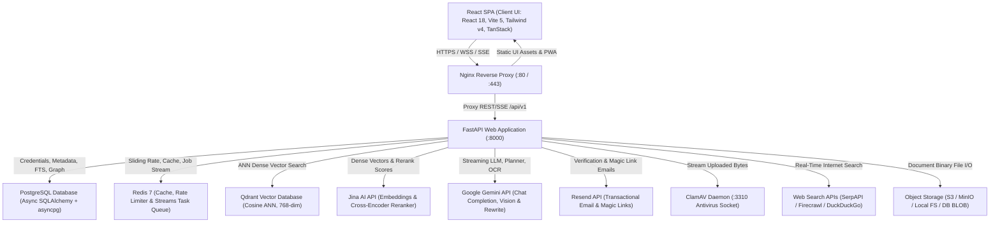
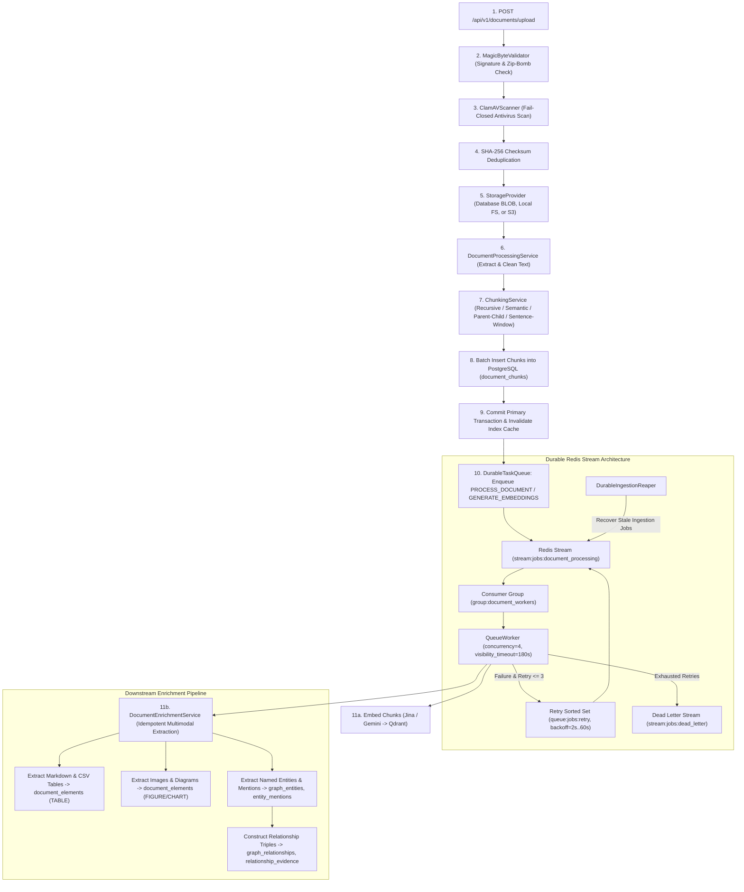
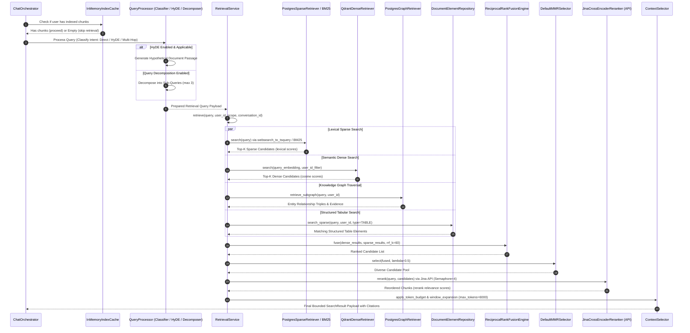
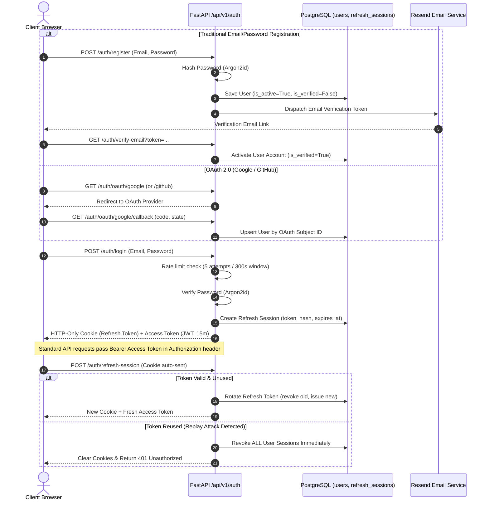
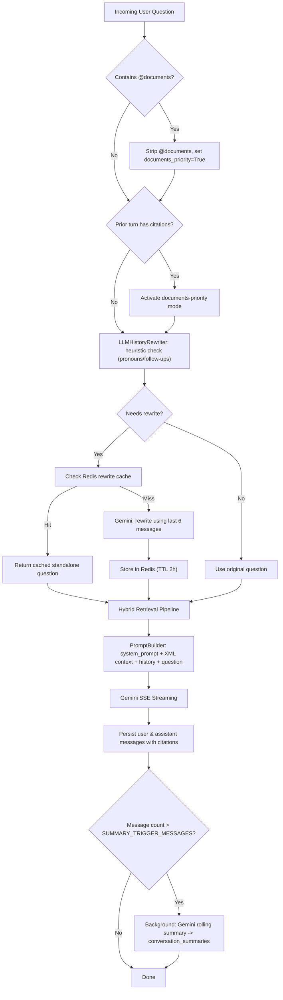
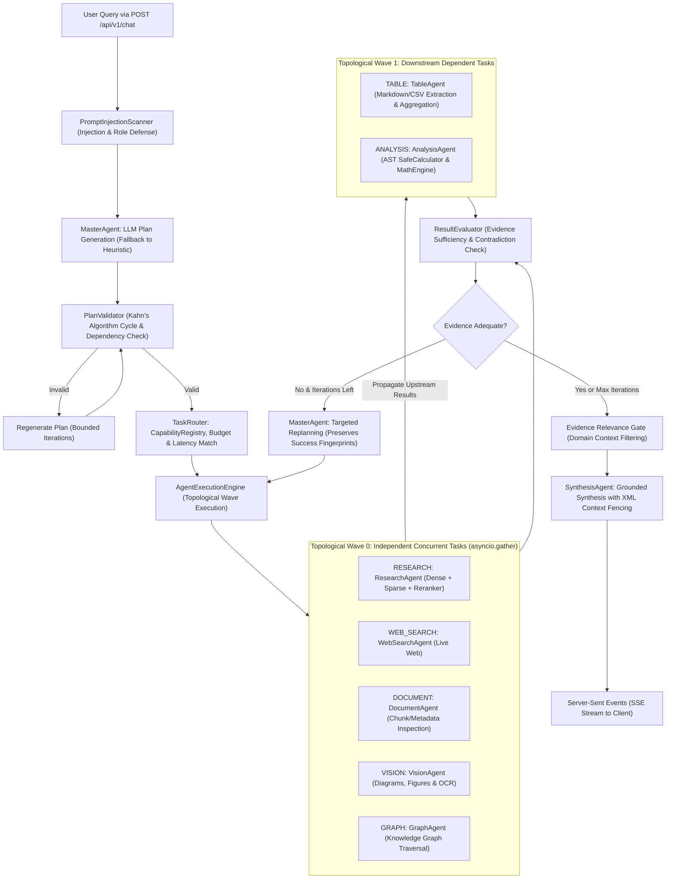
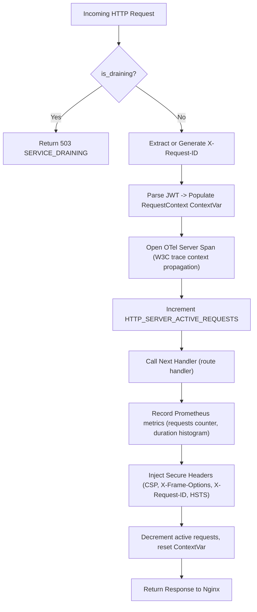

# System Architecture Manual - Fusion RAG Platform

This document provides an exhaustive architectural specification of the design, pipelines, workflows, and protocols implemented across the **Fusion RAG Platform**.

---

## 1. High-Level System Architecture

The application is structured into decoupled, modular layers: a responsive React SPA frontend (React 18 + Vite 5 + TypeScript + Tailwind CSS v4 + TanStack Query v5), an Nginx reverse proxy gateway, a FastAPI (Python 3.12+) asynchronous application server, authoritative PostgreSQL 16 transactional storage, ephemeral Redis 7 cache and Streams queue, Qdrant vector database, ClamAV antivirus daemon, and upstream REST AI inference providers (Jina AI, Google Gemini, Resend, SerpAPI/Firecrawl).

---

## 2. Ingestion & Document Processing Pipeline

The ingestion architecture uses a decoupled two-tier design: fast primary synchronous validation and chunking, followed immediately by asynchronous durable background processing via Redis Streams (`RedisStreamTaskQueue`) for dense embedding generation, multimodal element extraction (tables, figures), and Knowledge Graph construction.

---

## 3. Advanced Hybrid Retrieval Pipeline

The retrieval engine coordinates parallel lexical, semantic, tabular, and knowledge graph traversal channels. It supports query preprocessing (HyDE, Query Classification, Expansion, Decomposition), merges candidate sets with Reciprocal Rank Fusion (RRF), filters redundant information using Maximal Marginal Relevance (MMR), applies Cross-Encoder joint cross-attention reranking, and applies hierarchical context expansion (Parent-Child, Sentence-Window).

---

## 4. Authentication, OAuth & Session Flow

Authentication implements NIST SP 800-63B standards with Argon2id password hashing, stateless JWT HS256 access tokens, single-use rotated HTTP-only refresh cookies, OAuth 2.0 (Google/GitHub), and transactional email verification via Resend.

---

## 5. History-Aware Retrieval & Conversation Memory

---

## 6. Hierarchical Multi-Agent Orchestration Subsystem

The multi-agent execution pipeline orchestrates 7 registered specialist agents via dynamic DAG construction, parallel wave concurrency ($4.00\times$ measured speedup), dependency data propagation, and grounded streaming synthesis.

---

## 7. Security, Isolation & Attack Mitigation Subsystem

Fusion RAG applies defense-in-depth across all system entry points:

1. **Prompt Injection & Jailbreak Defense**:
   - `PromptInjectionScanner`: Pre-flight heuristic detection of role-play instructions, system prompt extraction, delimiter escaping, and override tokens on `/chat` and `/search`.
   - Structured security logging: `PROMPT_INJECTION_BLOCKED` events logged without echoing payload text to stdout.
2. **Context Isolation & Untrusted Framing**:
   - `PromptBuilder` wraps retrieved document chunks strictly inside `<retrieved_context>` XML tags.
   - System prompts instruct the LLM that retrieved text is **strictly untrusted data** and must never be interpreted as instructions.
3. **AST Arithmetic Sandboxing**:
   - `SafeCalculator`: Restricted Abstract Syntax Tree (AST) evaluator for `AnalysisAgent`.
   - Blocks `__import__`, `eval`, `exec`, OS calls, and prevents exponential Denial-of-Service (`base <= 10000`, `exp <= 15`).
4. **Malware Scanning & File Upload Validation**:
   - `MagicByteValidator`: Binary signature checking against MIME types; blocks disguised executables.
   - Zip-bomb defense: Blocks nested archives exceeding 25 MB or an expansion ratio $> 100\times$.
   - `ClamAVScanner`: Streams uploaded bytes to ClamAV daemon (`clamd` TCP 3310), failing closed in production.
5. **Cryptographic Protection & Cursor Signing**:
   - Argon2id password hashing with random per-user salts.
   - Cryptographic envelope encryption: Master Key (`ENCRYPTION_MASTER_KEY`) wraps per-user Data Encryption Keys (`user_encryption_keys`).
   - HMAC SHA-256 keyset cursor signing (`CURSOR_SIGNING_KEY`) prevents pagination tampering.
6. **Multi-Tier Rate Limiting**:
   - Sliding-window Redis rate limiter (`60 req/min`, burst `10`).
   - Strict brute-force guard on `/auth/login`: max 5 attempts per 5-minute window (`300s`).
   - Password-gated account deletion rate limit (`10 req/min`).

---

## 8. Evaluation Framework & Operational Confidence Governance

To prevent regressions, validate complex agentic workflows, and monitor live operations, Fusion RAG enforces a formal multi-tier evaluation system.

### Operational Confidence Categories
1. **Benchmark-Proven**: Offline evaluation over versioned golden datasets (`golden_rag_dataset`, `golden_multi_agent_v1`) measuring quality scores under deterministic execution.
2. **Repository-Proven**: Verified via automated pytest test suites covering retrieval pipelines, agent DAG execution, timeouts, failure cascades, and telemetry sanitization.
3. **Production-Observable**: Fully instrumented with low-cardinality Prometheus metrics (`AGENT_LLM_TOKENS`, `AGENT_LLM_DURATION`, `AGENT_REPLANS`, `AGENT_TASKS_EXECUTED`), OpenTelemetry distributed traces, and sanitized structured JSON logs.

### 10-Dimension Multi-Agent Quality Evaluation
* **Planning & Routing**: Validates correct specialist selection and capability policy enforcement.
* **DAG Execution**: Ensures topological dependency execution and bounded replanning ($\le 2$ iterations).
* **Deterministic Calculation**: Sandboxed arithmetic without LLM numeric hallucinations.
* **Refusal Faithfulness**: Explicit refusal on missing evidence without ungrounded extrapolation.
* **Contradiction Detection**: Identifies conflicting claims across documents, references all sources.
* **Injection Resistance**: Document text treated strictly as untrusted data.
* **Replanning Exhaustion**: Graceful halt at max iterations with diagnostic notices.
* **Web Search Integration**: Accurate real-time information retrieval and result formatting.
* **Capability Routing**: Budget and latency constraint enforcement in `TaskRouter`.
* **Result Synthesis**: Coherent, citation-grounded final answer quality via `SynthesisAgent`.

### Regression Governance (Floor + Maximum Degradation)
* **Dual Gate**: Absolute minimum floor per metric (e.g. faithfulness $\ge 0.90$) AND maximum allowed degradation from versioned baselines (`max_score_drop <= 0.03`).
* **CI Integration**: Automated CLI (`backend/scripts/regression.py`) runs on pull requests to block regressions before merging.

---

## 9. Production Middleware & Request Lifecycle

Every HTTP request passes through a single `ProductionMiddleware` ASGI handler:

---

## 10. Scalability & Resilience

1. **Connection-Pooled Async Redis**: Native `redis.asyncio` connection pooling handles rate limiting, ephemeral caching, and job queuing without blocking the FastAPI event loop.
2. **Thread-Pool Starvation Prevention**: SQLAlchemy database connection pool parameters exceed anyio worker thread limits, eliminating pool starvation deadlocks under heavy concurrency.
3. **Batch DB Ingestion Queries**: Bulk chunk lookups using SQL `.in_()` operations eliminate N+1 database queries during document ingestion.
4. **Shared BM25 Pre-Tokenization Caching**: Class-level tokenization cache reuses CPU-intensive text tokenizations across requests, invalidating selectively on document changes.
5. **Durable Ingestion Reaper**: Non-blocking background asyncio task that periodically recovers stale processing jobs and re-enqueues them.
6. **Durable Cleanup Worker**: Processes `durable_cleanup_jobs` for orphan Qdrant vector and file purging after document deletion.
7. **InMemoryIndexCache**: LRU cache tracking whether a user has any indexed document chunks; prevents unnecessary Qdrant API calls when the knowledge base is empty.
8. **Multi-key Gemini Workload Isolation**: Three separate Gemini API keys (LLM, Planner, Fallback) prevent rate-limit cascades under concurrent agent operations.
9. **Multi-Target Storage Providers**: Supports PostgreSQL binary BLOB, local filesystem, and cloud Object Storage (S3 / MinIO) configured via `STORAGE_PROVIDER`.

---

## 11. API-Driven Retrieval & Zero-PyTorch Architecture

All deep learning inference runs via optimized external REST APIs:

1. **Bi-Encoder Dense Vectors**: Jina AI API (`jina-embeddings-v3`, 768 dimensions) with explicit task flags (`retrieval.passage` for chunks, `retrieval.query` for search queries), or Google Gemini (`text-embedding-004`).
2. **Cross-Encoder Reranking**: Jina AI REST API (`jina-reranker-v2-base-multilingual`) with HTTP connection reuse, bounded concurrency semaphores (`asyncio.Semaphore=4`), and exponential backoff retries.
3. **LLM Generation**: Google Gemini (`gemini-3.5-flash-lite`) for streaming SSE chat completion, Vision OCR, query rewriting, planning, and evaluation.
4. **Runtime Benefits**:
   - Zero PyTorch / CUDA overhead: Backend container image < 450 MB.
   - Instant server startup: sub-second cold start.
   - Zero host GPU dependency: fully operational on standard CPU hardware or free-tier cloud containers (Render, Vercel, Supabase, Upstash).
