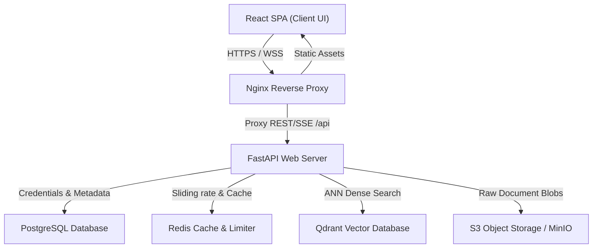
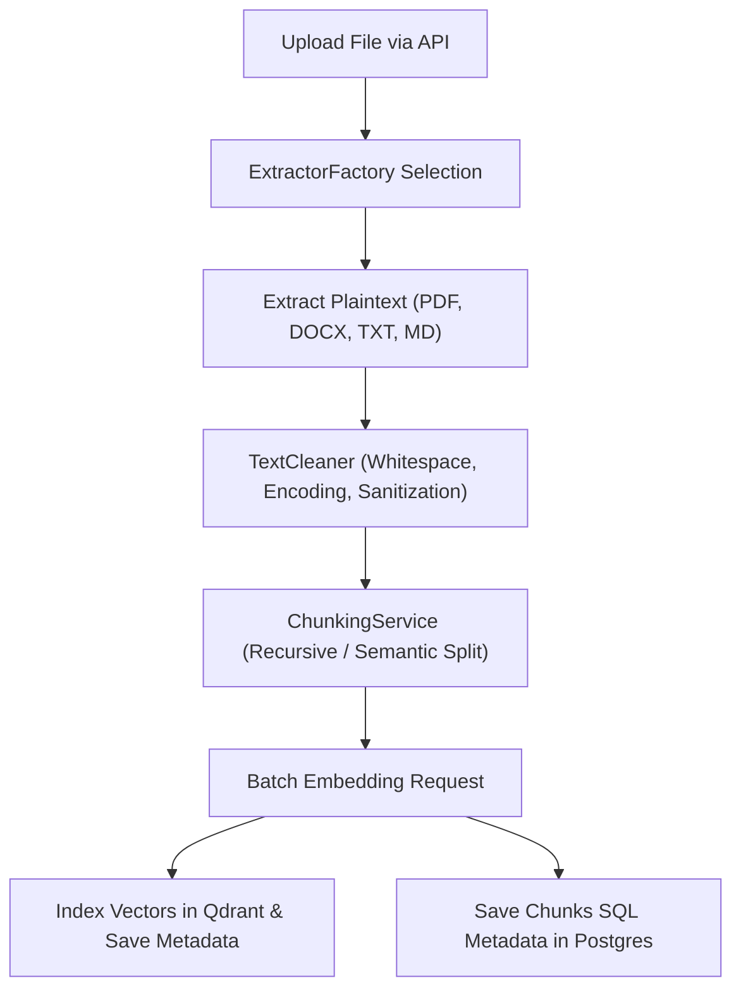
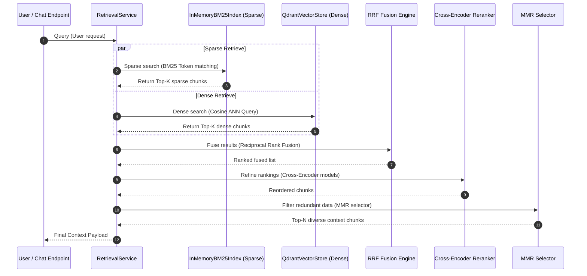
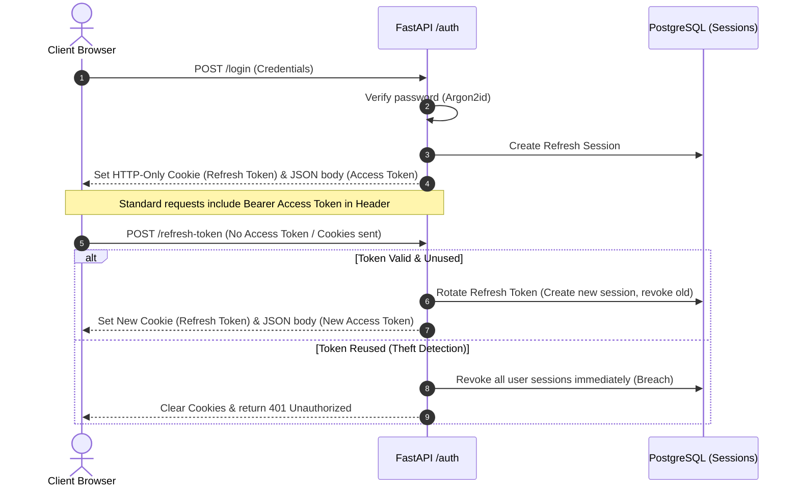
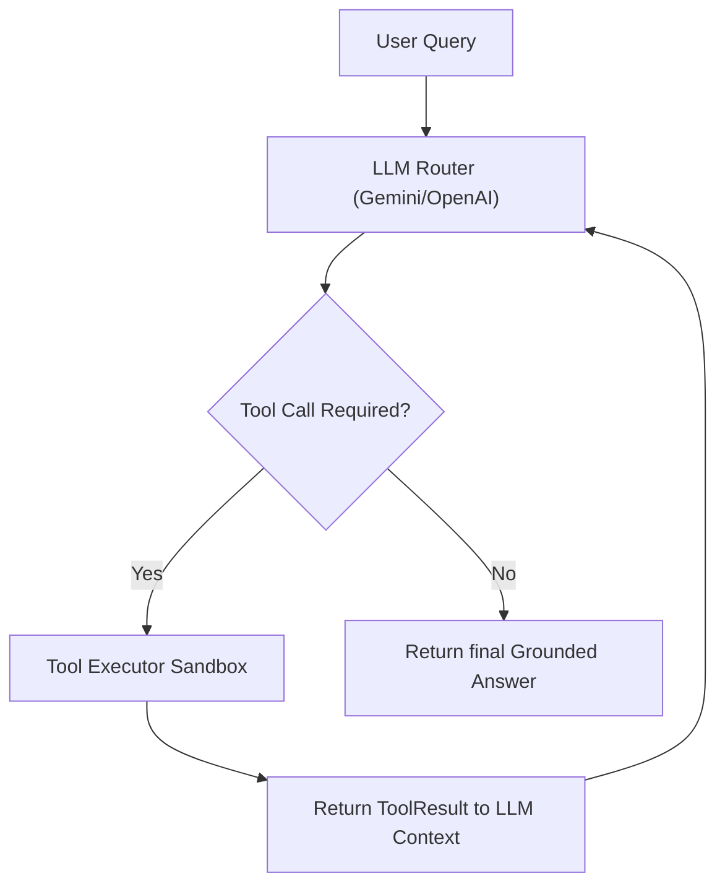

# System Architecture Manual - Hybrid RAG Chatbot

This document provides a comprehensive overview of the design, pipelines, and workflows implemented in the **Hybrid RAG Chatbot**.

---

## 1. High-Level System Architecture

The following diagram illustrates the relational layout of the backing systems, client interfaces, and operational components.

---

## 2. Ingestion & Document Processing Pipeline

The ingestion pipeline handles raw uploads, text extraction, structural cleaning, chunking, vector embedding generation, and indexing.

---

## 3. Hybrid Retrieval Pipeline

The retrieval engine combines dense semantic search and sparse term-frequency keyword matching to achieve high precision and recall.

---

## 4. Authentication & JWT Session Flow

Access is controlled via short-lived JWT tokens and secure, rotated, HTTP-only refresh cookies.

---

## 5. Agentic Tool Calling Loop

When a request requires calculation or database lookups, the orchestrator invokes a feedback loop to evaluate tools.

---

## 6. Evaluation Framework & Observability Console

To prevent regression, offline dataset runners evaluate retrieval and generation metrics.

*   **Faithfulness**: Asserts the generation is fully grounded in the retrieved chunks.
*   **Answer Relevancy**: Asserts the response directly answers the user's prompt.
*   **Context Recall & Precision**: Asserts the retrieval contains and isolates the exact answers.
*   **Circuit-Breaker Failover**: Automatically redirects LLM queries between Gemini and OpenAI in case of API degradation.

### Visual Admin Dashboard (`/admin/dashboard`)
We have introduced a visual frontend console allowing admin users to:
1.  **Observability Traces**: View real-time token counts, response latency (retrieval vs. generation), cost estimates, and full conversation traces.
2.  **Evaluations Suite**: View runs history, trigger offline benchmarks, perform regression comparison checking, and render styled HTML performance reports directly in-app.

The backend exposes these operations via `/api/v1/observability` and `/api/v1/evaluation` endpoints, restricted via the `check_admin_user` dependency guard.
