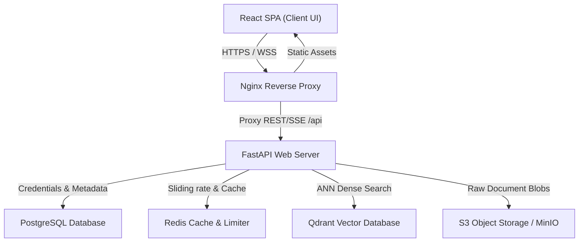
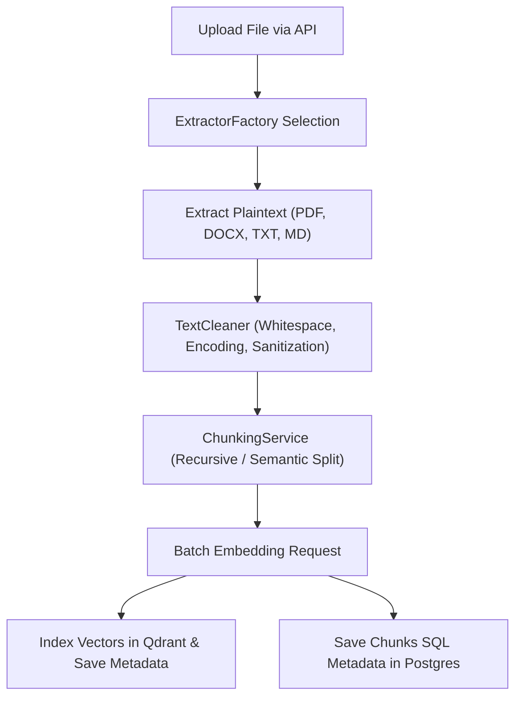
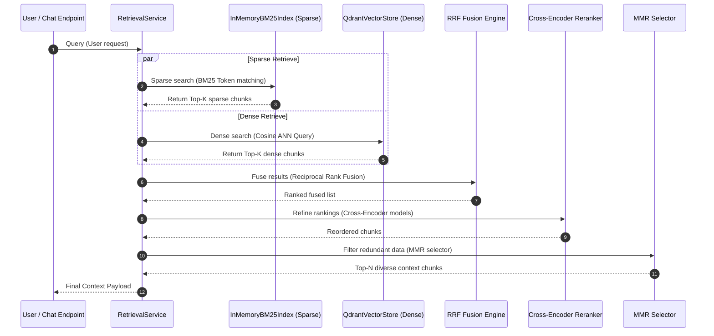
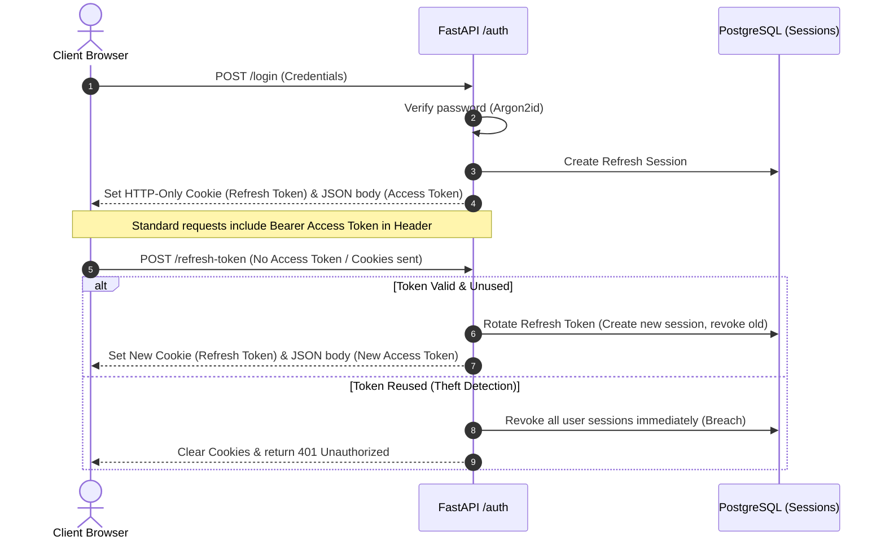
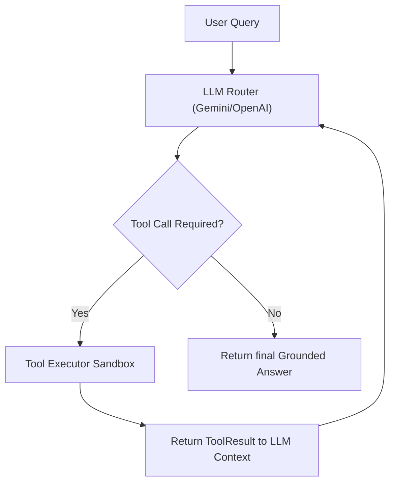

# System Architecture Manual - Hybrid RAG Chatbot

This document provides a comprehensive overview of the design, pipelines, and workflows implemented in the **Hybrid RAG Chatbot**.

---

## 1. High-Level System Architecture

The following diagram illustrates the relational layout of the backing systems, client interfaces, and operational components.

---

## 2. Ingestion & Document Processing Pipeline

The ingestion pipeline handles raw uploads, text extraction, structural cleaning, chunking, vector embedding generation, and indexing.

---

## 3. Hybrid Retrieval Pipeline

The retrieval engine combines dense semantic search and sparse term-frequency keyword matching to achieve high precision and recall.

---

## 4. Authentication & JWT Session Flow

Access is controlled via short-lived JWT tokens and secure, rotated, HTTP-only refresh cookies.

---

## 5. Agentic Tool Calling Loop

When a request requires calculation or database lookups, the orchestrator invokes a feedback loop to evaluate tools.

---

## 6. Evaluation Framework & Observability Console

To prevent regression, offline dataset runners evaluate retrieval and generation metrics.

*   **Faithfulness**: Asserts the generation is fully grounded in the retrieved chunks.
*   **Answer Relevancy**: Asserts the response directly answers the user's prompt.
*   **Context Recall & Precision**: Asserts the retrieval contains and isolates the exact answers.
*   **Circuit-Breaker Failover**: Automatically redirects LLM queries between Gemini and OpenAI in case of API degradation.

### Visual Admin Dashboard (`/admin/dashboard`)
We have introduced a visual frontend console allowing admin users to:
1.  **Observability Traces**: View real-time token counts, response latency (retrieval vs. generation), cost estimates, and full conversation traces.
2.  **Evaluations Suite**: View runs history, trigger offline benchmarks, perform regression comparison checking, and render styled HTML performance reports directly in-app.

The backend exposes these operations via `/api/v1/observability` and `/api/v1/evaluation` endpoints, restricted via the `check_admin_user` dependency guard.

---

## 7. Scalability & High-Concurrency Enhancements

To prepare the RAG pipeline for high-throughput production deployment, we implemented several key architectural optimizations:

### 1. Connection-Pooled Async Redis Lifecycle
All Redis connections (used for distributed locking, rate limiting, and cache management) operate natively through `redis.asyncio` with an async connection pool. The pool is initialized during application lifespan startup and closed gracefully during shutdown. This avoids blocking the FastAPI single-threaded event loop and provides optimal connection reuse.

### 2. Preventing Thread-Pool Starvation Deadlocks
FastAPI runs synchronous dependency generators (like `get_db` yielding a SQLAlchemy Session) inside a background thread pool (default size: 40). If the database connection pool is smaller than this thread pool, concurrent incoming requests will fill all worker threads waiting for connections, resulting in a thread-pool starvation deadlock where active requests cannot run their cleanup/release callbacks.
We scaled SQLAlchemy's database connection pool parameters (`pool_size=50`, `max_overflow=50`) to always exceed the worker thread limits, mathematically preventing deadlock under peak concurrent loads.

### 3. Bulk Ingestion Queries
We eliminated database N+1 queries during document processing. Instead of checking chunk generation statuses in a loop of individual SQL queries, the system uses a single batch query (`get_by_chunk_ids`) using an SQL `.in_()` clause and maps the results in-memory.

### 4. Shared Class-Level BM25 Tokenization Caching
While `InMemoryBM25Index` is instantiated per-request (to bind it to the request's transient database transaction session), it shares a class-level tokenization cache (`_tokenized_chunks_cache`) across instances. This guarantees that expensive, CPU-bound tokenization is performed exactly once per chunk and reused on subsequent requests. The cache automatically prunes obsolete entries when users or documents are modified or evicted from the LRU cache.

### 5. Non-Blocking Durable Startup Recovery
Pending and failed cleanup jobs are recovered durably on lifespan startup without blocking the web service boot. A startup lifespan task uses `asyncio.to_thread` to query a bounded batch of jobs (`CLEANUP_RECOVERY_BATCH_SIZE`) from PostgreSQL using a dedicated, transient database session. These jobs are then dispatched to FastAPI's background task queue for asynchronous, retry-resilient processing.

