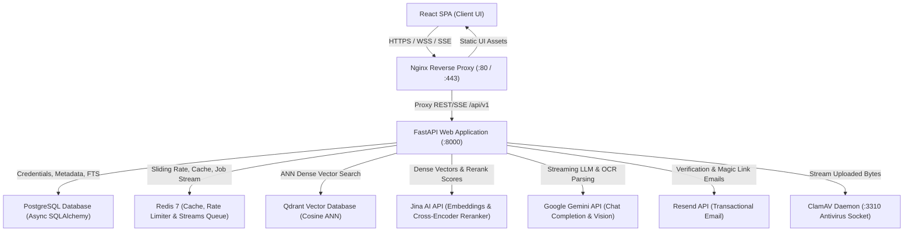
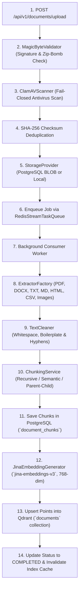
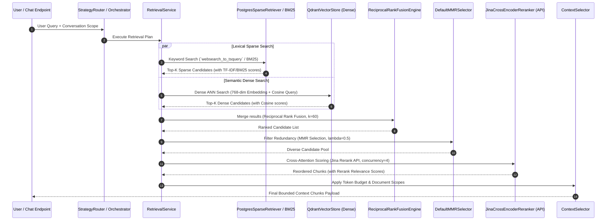
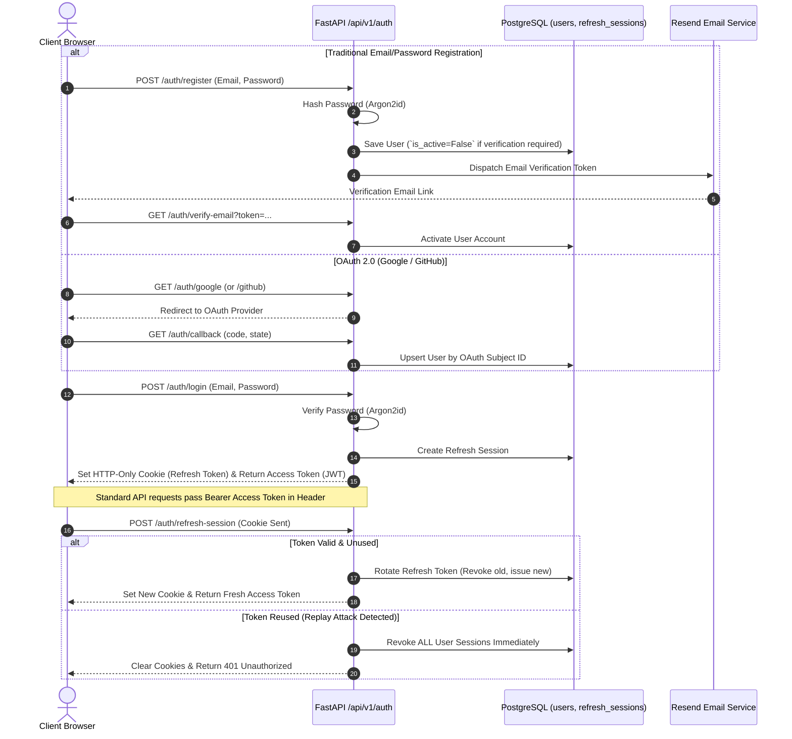
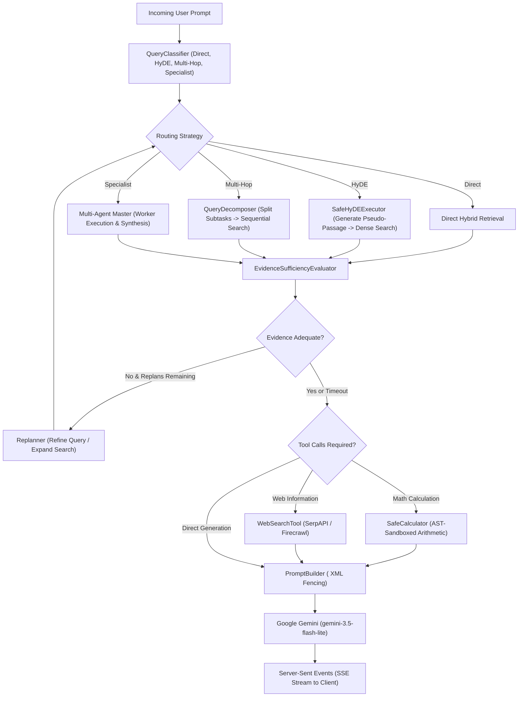

# System Architecture Manual - Hybrid RAG Chatbot

This document provides a comprehensive architectural specification of the design, pipelines, workflows, and protocols implemented across the **Hybrid RAG Chatbot** platform.

---

## 1. High-Level System Architecture

The application is structured into decoupled, modular layers: a responsive React SPA frontend, an Nginx reverse proxy gateway, a FastAPI (Python 3.12+) asynchronous application server, authoritative PostgreSQL transactional storage, an ephemeral Redis 7 cache & streams queue, a Qdrant vector database, and upstream REST AI inference providers (Jina AI, Google Gemini, Resend).

---

## 2. Ingestion & Document Processing Pipeline

The ingestion pipeline securely ingests multi-format documents, validates signatures, scans for malware, normalizes text, generates hierarchical chunks, computes dense embeddings, and writes to both SQL and vector stores.

---

## 3. Hybrid Retrieval Pipeline

The retrieval engine coordinates parallel lexical and semantic search, combines candidate sets with Reciprocal Rank Fusion (RRF), filters redundant information using Maximal Marginal Relevance (MMR), applies Cross-Encoder joint cross-attention reranking, and budgets context.

---

## 4. Authentication, OAuth & Session Flow

Authentication implements NIST SP 800-63B standards, Argon2id password hashing, stateless JWT HS256 access tokens, single-use rotated HTTP-only refresh cookies, OAuth 2.0 (Google/GitHub), and transactional email verification via Resend.

---

## 5. Adaptive RAG & Multi-Agent Orchestration

When queries require multi-step reasoning, hypothetical formulation, or external tools, the `AdaptiveRAGOrchestrator` executes a dynamic agentic control loop.

---

## 6. Evaluation Framework & Operational Confidence Governance

To prevent regressions, validate complex agentic workflows, and monitor live operations, Hybrid RAG enforces a formal multi-tier evaluation system:

### Operational Confidence Categories
1. **Benchmark-Proven**: Offline evaluation over versioned golden datasets (`golden_rag_dataset`, `golden_multi_agent_v1`) measuring exact mathematical properties and quality scores under deterministic execution.
2. **Repository-Proven**: Verified via automated pytest test suites covering execution DAGs, timeouts, failure cascades, and telemetry sanitization (with 1 known environment-specific Upstash Redis Windows SSL socket shutdown failure).
3. **Production-Observable**: Fully instrumented with low-cardinality Prometheus metrics (`AGENT_LLM_TOKENS`, `AGENT_LLM_DURATION`, `AGENT_REPLANS`, `AGENT_TASKS_EXECUTED`), OpenTelemetry distributed traces, and sanitized structured JSON logs.
4. **Live-Production Observed**: Requires observation under real-world multi-tenant traffic (live Gemini requests, real SSE streaming backpressure, actual token distributions).
5. **Load / Adversarially Verified**: High-concurrency saturation (p95/p99 latency under load), thread-pool contention, and extensive live adversarial prompt injection suites remain to be proven in staging/production.

### Multi-Agent 10-Dimension Quality & Safety Evaluation
* **Planning & Routing**: Validates correct specialist selection (Research, Analysis, Document, Web Search) and capability policy enforcement.
* **DAG Execution & Bounded Replanning**: Ensures topological dependency execution and bounds replanning to $\le 2$ iterations.
* **Deterministic Calculation**: Sandboxed arithmetic execution without LLM numeric hallucinations.
* **Refusal Faithfulness**: Explicit refusal on missing evidence without ungrounded extrapolation.
* **Contradiction Detection & Synthesis**: Identifies conflicting claims across documents, references all conflicting sources, and prevents arbitrary one-sided bias.
* **Indirect Prompt Injection Resistance**: Ensures document text is treated strictly as untrusted data rather than executable instructions.
* **Replanning Exhaustion Handling**: Halts gracefully at max iterations with actionable diagnostic limitation notices.

### Regression Governance (Floor + Maximum Degradation)
* **Dual Gate**: Enforces both an absolute minimum quality floor per metric (e.g. calculation $\ge 0.99$, injection resistance $\ge 0.99$) AND a maximum allowed degradation from versioned baselines (`max_score_drop \le 0.03`).
* **CI Integration**: Automated CLI (`backend/scripts/regression.py`) runs on pull requests and commits to block regressions before merging. Proven against negative test cases (floor breaches, delta drops, and latency increases).

### Telemetry & Observability
* **In-App Admin Dashboard (`/admin/dashboard`)**: Displays real-time KPI metrics, token consumption, latency breakdowns, and interactive execution trace waterfalls.
* **OpenTelemetry Distributed Tracing**: Exports spans with automated PII/credential sanitization (`TelemetrySanitizer`).
* **Low-Cardinality Prometheus Metrics**: Scrapes `/api/v1/observability/metrics` with strict cardinality bounds (no user IDs or document IDs in metric labels).

---

## 7. Scalability & Resilience Enhancements

1. **Connection-Pooled Async Redis**: Native `redis.asyncio` connection pooling handles rate limiting, ephemeral caching, and job queuing without blocking the FastAPI event loop.
2. **Thread-Pool Starvation Prevention**: Scaled SQLAlchemy database connection pool parameters (`pool_size=50`, `max_overflow=50`) to exceed anyio worker thread limits, eliminating pool starvation deadlocks under heavy concurrency.
3. **Batch DB Ingestion Queries**: Bulk chunk lookups using SQL `.in_()` operations eliminate N+1 database queries during document ingestion.
4. **Shared BM25 Pre-Tokenization Caching**: Class-level tokenization cache reuses CPU-intensive text tokenizations across requests, invalidating selectively upon document modifications.
5. **Durable Ingestion Reaper & Cleanup Worker**: Non-blocking background workers automatically reclaim stale processing jobs and durably purge orphan vector and file records on document deletion.

---

## 8. API-Driven Retrieval & Zero-PyTorch Architecture

All deep learning inference runs via optimized external REST APIs:

1. **Bi-Encoder Dense Vectors**: Jina AI API (`jina-embeddings-v3`, 768 dimensions) with explicit task flags (`retrieval.passage` for chunks, `retrieval.query` for search queries), or Google Gemini (`text-embedding-004`).
2. **Cross-Encoder Reranking**: Jina AI REST API (`jina-reranker-v2-base-multilingual` via `https://api.jina.ai/v1/rerank`) with HTTP/2 connection reuse, bounded concurrency semaphores, and exponential backoff retries.
3. **Runtime Benefits**:
   - **Zero PyTorch / CUDA Overhead**: Backend container image size is < 450 MB.
   - **Instant Server Startup**: Startup latency is sub-second (< 1 ms initialization for model clients).
   - **Zero Host GPU Dependency**: Fully operational on standard CPU hardware or free-tier cloud containers (Render, Vercel, Supabase).

