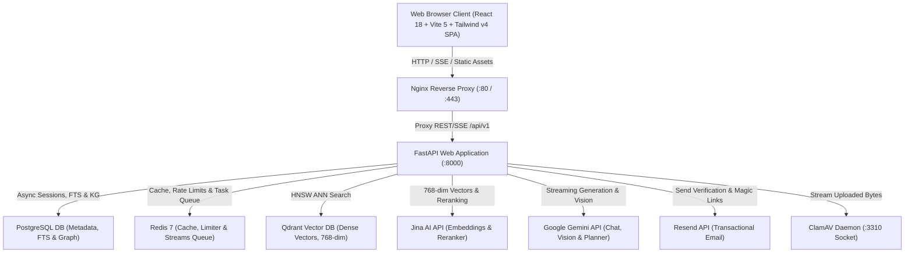

# Production-Grade Fusion RAG Platform

A high-performance, observable, and modular reference implementation of an enterprise-grade **Fusion RAG (Retrieval-Augmented Generation) Platform** built with **FastAPI (Python 3.12+)**, **React 18 + Vite 5 + TypeScript + Tailwind CSS v4**, **PostgreSQL 16**, **Qdrant**, **Redis 7**, **Jina AI**, and **Google Gemini**.

---

## Key Features

* **Hierarchical Multi-Agent Orchestration Subsystem**:
  * **Master Planner & Dynamic DAG Construction**: `MasterAgent` decomposes user intent into dependency-aware ExecutionPlans with Kahn's algorithm cycle prevention.
  * **7 Production-Wired Specialist Agents**:
    * `ResearchAgent`: 4-stage hybrid Fusion RAG (Dense Qdrant + Sparse BM25 + RRF + MMR + Cross-Encoder).
    * `DocumentAgent`: Targeted chunk/document direct inspection with tenant ownership validation.
    * `AnalysisAgent`: AST-sandboxed symbolic mathematics (`SafeCalculator` + `MathEngine`) and CAGR/growth calculations.
    * `WebSearchAgent`: Real-time internet search with domain relevance gating.
    * `TableAgent`: Structured table extraction, aggregation (`SUM`, `AVG`, `GROWTH`, `MIN`, `MAX`), and upstream DAG consumption.
    * `VisionAgent`: Diagram inspection, OCR transcription, and chart trend reasoning.
    * `GraphAgent`: Multi-hop Knowledge Graph traversal via `PostgresGraphRetriever` and `GraphTraversalService`.
  * **Topological Wave Execution & Parallelism**: Concurrently executes independent specialist tasks ($4.00\times$ measured speedup) with upstream data propagation.
  * **Adaptive Replanning & Evidence Gate**: Evaluates evidence sufficiency, executes bounded replanning without re-running successful tasks, and gates off-domain noise.
  * **Synthesis & Streaming**: Grounded synthesis with strict XML context isolation, citation provenance, and Server-Sent Events (SSE).

* **Asynchronous Multimodal & Knowledge Graph Ingestion**:
  * **Decoupled Enrichment**: Synchronous upload commits fast; background `DocumentEnrichmentService` executes non-blocking extraction.
  * **Durable Task Queue**: Redis Streams with consumer groups (`group:document_workers`), retry sorted sets (`queue:jobs:retry`), dead-letter streams (`stream:jobs:dead_letter`), and background `DurableIngestionReaper`.
  * **Multimodal Element Storage**: Persists Markdown/CSV tables and figure/chart elements in `document_elements`.
  * **Knowledge Graph Triples**: Extracts named entities, normalized types, mentions, relationship edges, and confidence evidence with versioned idempotency (`delete_by_version`).

* **Advanced Hybrid Retrieval Pipeline**:
  * **Multi-Branch Search**: Combines Dense Vector ANN search (Qdrant with cosine similarity), Sparse Lexical search (native PostgreSQL Full-Text Search with GIN indexes), Structured Table filtering, and Subgraph Traversal.
  * **Adaptive Preprocessing**: HyDE (Hypothetical Document Embeddings), `QueryClassifier`, `QueryExpansion`, and `QueryDecomposer`.
  * **Reciprocal Rank Fusion (RRF)**: Merges rank positions from candidate sets ($k=60$).
  * **Maximal Marginal Relevance (MMR)**: Eliminates redundant information to select a diverse candidate pool ($\lambda=0.5$).
  * **Cross-Encoder Reranking**: REST API-driven joint cross-attention reranking via Jina AI (`jina-reranker-v2-base-multilingual`), bounded by asynchronous semaphores (`asyncio.Semaphore=4`).
  * **Context Selector & Token Budgeting**: Enforces strict token ceilings (default 6,000 tokens) with parent-child and sentence-window context expansion.

* **Two-Tier Document Management**:
  * **Global Library Documents**: Uploaded via the Documents manager, shared across sessions, and addressable via `@documents` mentions.
  * **Conversation-Scoped Attachments**: Attached directly in the chat composer, automatically scoped to the active conversation, and cascade-deleted when the conversation is deleted.
  * **Multi-Format Ingestion**: Supports PDF, DOCX, TXT, Markdown (`.md`), HTML, CSV, and Images (PNG, JPG, JPEG, WEBP via Gemini Vision OCR).
  * **Multi-Target Storage**: Supports PostgreSQL binary BLOB (Supabase) or Local filesystem.
  * **Security & Sanitization**: Magic-byte signature verification, zip-bomb expansion ratio checks (< 100x), SHA-256 deduplication, and streaming ClamAV antivirus socket integration.

* **Production Security & Authentication**:
  * **NIST-Compliant Auth**: Password hashing with Argon2id, stateless JWT HS256 access tokens (15m expiration), and single-use rotated HTTP-only refresh cookies (7d expiration) with replay attack revocation.
  * **OAuth 2.0 Integration**: Native Google and GitHub social login with state verification.
  * **Transactional Email & Magic Links**: Email verification and passwordless magic link login powered by Resend.
  * **Multi-Tier Rate Limiting**: Sliding-window rate limiters backed by Redis (with in-memory circuit-breaker fallback) and brute-force lockout defense on authentication routes.
  * **Prompt Injection Defense**: Pre-flight heuristic injection scanner, `<retrieved_context>` XML prompt isolation, and untrusted data system instructions.

* **Enterprise-Grade Multi-Tier & Cross-User Caching**:
  * **L1/L2/L3 Multi-Tier Architecture**: In-memory LRU process cache (L1), distributed Redis (L2), and RAG Response Cache (L3).
  * **Active-Version Document Fingerprinting**: Cache keys hash `(doc_id, active_version)` across all authorized documents in scope. Document edits, uploads, or deletions instantly invalidate affected entries, guaranteeing zero stale answers.
  * **Global Cross-User Caching**: Standalone general knowledge queries (with zero document dependencies) fall back to a shared global cache, saving cross-user LLM tokens and returning answers in <10ms.
  * **Envelope Encryption & Crypto-Shredding**: All private cached answer payloads in Redis are encrypted with user-specific Data Encryption Keys (AES-256-GCM); account deletion mathematically shreds all cached data.
  * **Document OCR & Vision Extraction Cache**: Caches extracted page text and table layouts per page image hash to avoid redundant Gemini Vision API calls during document re-indexing.
  * **Synthetic Paced SSE Stream Replay**: Replays cached answers at 5ms intervals with structured SSE events (`metadata`, `text`, `synthesis_done`, `done`) to maintain frontend typewriter animations and message persistence in PostgreSQL.

* **Zero Local Deep Learning Dependencies**:
  * Completely free of PyTorch, CUDA, and heavy local neural network weights.
  * Embeddings via **Jina AI API** (`jina-embeddings-v3`, 768-dim Matryoshka) or **Google Gemini** (`text-embedding-004`).
  * Cross-encoder reranking via **Jina AI REST API** (`jina-reranker-v2-base-multilingual`).
  * LLM generation via **Google Gemini** (`gemini-3.5-flash-lite`).
  * Instant sub-second server startup and lightweight container footprints (< 450 MB).

* **Observability & Evaluation Suite**:
  * **Visual Admin Dashboard (`/admin/dashboard`)**: In-app UI for real-time KPI metrics, token volume tracking, latency breakdowns (retrieval vs. generation), execution traces, and evaluation report rendering.
  * **Automated Quality Evaluations**: Ragas and DeepEval evaluation runners testing faithfulness, answer relevancy, context precision, and context recall against golden datasets with regression tracking.
  * **OpenTelemetry & Prometheus**: Distributed tracing exported to Jaeger (`:4317` / `:16686 UI`) and Prometheus operational metrics (`:9090`) visualized in curated Grafana dashboards (`:3000`).

---

## Technical Stack

| Tier / Component | Technology | Description |
|---|---|---|
| **Backend Framework** | Python 3.12+, FastAPI, Pydantic v2 | High-performance ASGI REST API with asynchronous I/O and strict type validation |
| **Relational Database** | PostgreSQL 16+ (SQLAlchemy Async + asyncpg) | Authoritative transactional system of record for users, sessions, documents, chunks, and chat history |
| **Lexical Search** | PostgreSQL FTS / InMemoryBM25 | Lexical keyword search using `to_tsvector`/`ts_rank_cd` on GIN indexes or BM25 with tokenization caching |
| **Vector Database** | Qdrant | Fast HNSW approximate nearest neighbors vector search with strict tenant payload filtering |
| **Cache & Queue** | Redis 7 (`redis.asyncio`) | Ephemeral response caching, sliding-window rate limiting, and durable Redis Streams task queue |
| **Dense Embeddings** | Jina AI / Google Gemini | `jina-embeddings-v3` (768 dimensions) or `text-embedding-004` (768 dimensions) |
| **Cross-Encoder Reranker** | Jina AI REST API | `jina-reranker-v2-base-multilingual` with asynchronous semaphore concurrency bounding |
| **LLM Generation** | Google Gemini | `gemini-3.5-flash-lite` for streaming SSE chat completion, vision parsing, and query rewriting |
| **Transactional Email** | Resend API | User email verification and magic link authentication flows |
| **Frontend SPA** | React 18, Vite 5, TypeScript, Tailwind CSS v4 | Responsive UI with TanStack Query v5, Radix UI primitives, Shiki syntax highlighting, KaTeX math, and PWA |
| **Telemetry & Metrics** | OpenTelemetry, Prometheus, Jaeger, Grafana | Distributed tracing and time-series metrics with privacy sanitization |
| **Malware Defense** | ClamAV Daemon | Antivirus stream scanning over clamd TCP port 3310 (fail-closed in production) |

---

## System Architecture



---

## Getting Started

### Prerequisites

* [Docker Desktop](https://www.docker.com/products/docker-desktop/) or Docker Engine (v20.10+) with Docker Compose (v2.x+).
* *Optional (for offline local development)*: [Python 3.12+](https://www.python.org/), [uv](https://docs.astral.sh/uv/), and [Node.js v18+](https://nodejs.org/).

### 1. Clone & Configure Environment

```bash
git clone <repository-url>
cd FusionRAG

# Copy environment template
cp backend/.env.example backend/.env
cp frontend/.env.example frontend/.env
```

Ensure the following primary API keys are set in `backend/.env`:
* `GEMINI_API_KEY` (from [Google AI Studio](https://aistudio.google.com/))
* `JINA_API_KEY` (from [Jina AI](https://jina.ai/))
* `JWT_SECRET` (generate via `openssl rand -hex 32`)
* `ENCRYPTION_MASTER_KEY` (generate via `openssl rand -hex 32`)

### 2. Launch Local Stack via Docker Compose

```bash
# Start all core application containers (Postgres, Redis, Qdrant, Backend, Frontend, Nginx)
docker compose up -d --build
```

### 3. Verify Health Status

```bash
curl http://localhost:8000/api/v1/health
```

Expected JSON response:
```json
{
  "status": "healthy",
  "version": "1.0.0",
  "services": {
    "postgres": "connected",
    "redis": "connected",
    "qdrant": "connected"
  }
}
```

---

## Testing & Quality Assurance

```bash
# Run backend test suite
docker compose exec backend pytest

# Run frontend tests
cd frontend && npm test

# Run multi-agent quality benchmark
docker compose exec backend uv run python scripts/benchmark.py --profile multi_agent --mock
```

---

## Documentation Index

* [ARCHITECTURE.md](ARCHITECTURE.md) — Comprehensive System Architecture Manual
* [prd.md](prd.md) — Product Requirements Document & Master Project Plan
* [frontend/README.md](frontend/README.md) — Frontend Architecture & Component Guide
* [docs/EVALUATION.md](docs/EVALUATION.md) — Quality Evaluation Framework & Regression Governance
* [docs/SECURITY.md](docs/SECURITY.md) — Security Policy, Secrets Management & Threat Blueprint
* [docs/architecture/deployment-architecture.md](docs/architecture/deployment-architecture.md) — Production Deployment Blueprint
* [observability/README.md](observability/README.md) — Observability, Metrics & Distributed Tracing
