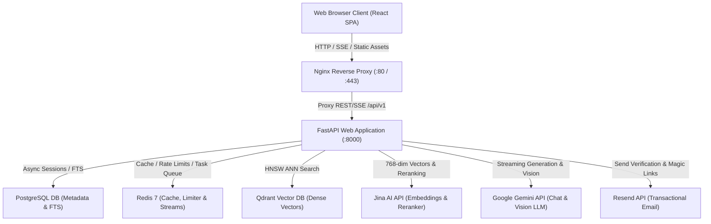

# Production-Grade Hybrid RAG Chatbot

A high-performance, observable, and modular reference implementation of an enterprise-grade **Hybrid RAG (Retrieval-Augmented Generation) Platform** built with **FastAPI (Python 3.12+)**, **React + Vite + TypeScript**, **PostgreSQL**, **Qdrant**, **Redis 7**, **Jina AI**, and **Google Gemini**.

---

## Key Features

* **Advanced Hybrid Retrieval Pipeline**:
  * **Dual-Branch Search**: Combines Dense Vector ANN search (Qdrant with cosine similarity) and Sparse Lexical search (native PostgreSQL Full-Text Search with GIN indexes or in-memory BM25 with tokenization caching).
  * **Reciprocal Rank Fusion (RRF)**: Merges rank positions from dense and sparse candidate sets ($k=60$, with optional weighted dense/sparse balancing).
  * **Maximal Marginal Relevance (MMR)**: Eliminates redundant information to select a diverse candidate pool ($\lambda=0.5$).
  * **Cross-Encoder Reranking**: REST API-driven joint cross-attention reranking via Jina AI (`jina-reranker-v2-base-multilingual`), bounded by asynchronous semaphores with graceful fallback.
  * **Context Selector & Token Budgeting**: Enforces strict token ceilings (default 6,000 tokens) and candidate count limits (default 12 chunks) with parent-child and sentence-window context expansion.

* **Adaptive RAG & Multi-Agent Orchestration**:
  * **Dynamic Query Classification & Routing**: Classifies user queries into Direct Retrieval, HyDE (Hypothetical Document Embeddings), Multi-Hop Decomposition, or Multi-Agent Specialist execution.
  * **Evidence Sufficiency Evaluation**: Evaluates retrieved context adequacy before answer generation, triggering autonomous replanning if evidence is lacking.
  * **Agentic Tool Calling & Sandboxing**: LLM function calling with AST-sandboxed math evaluation (`SafeCalculator`), web search integration (SerpAPI / Firecrawl), recursion protection, and execution timeouts.

* **Two-Tier Document Management**:
  * **Global Library Documents**: Uploaded via the Documents manager, shared across sessions, and addressable via `@documents` mentions.
  * **Conversation-Scoped Attachments**: Attached directly in the chat composer, automatically scoped to the active conversation, and cascade-deleted when the conversation is deleted.
  * **Multi-Format Ingestion**: Supports PDF, DOCX, TXT, Markdown (`.md`), HTML, CSV, and Images (PNG, JPG, JPEG, WEBP via Gemini Vision OCR).
  * **Security & Sanitization**: Magic-byte signature verification, zip-bomb expansion ratio checks (< 100x), SHA-256 deduplication, and streaming ClamAV antivirus socket integration.

* **Production Security & Authentication**:
  * **NIST-Compliant Auth**: Password hashing with Argon2id, stateless JWT HS256 access tokens (15m expiration), and single-use rotated HTTP-only refresh cookies (7d expiration) with replay attack revocation.
  * **OAuth 2.0 Integration**: Native Google and GitHub social login with state verification.
  * **Transactional Email & Magic Links**: Email verification and passwordless magic link login powered by Resend.
  * **Multi-Tier Rate Limiting**: Sliding-window rate limiters backed by Redis (with in-memory circuit-breaker fallback) and brute-force lockout defense on authentication routes.
  * **Prompt Injection Defense**: Pre-flight heuristic injection scanner, `<retrieved_context>` XML prompt isolation, and untrusted data system instructions.

* **Zero Local Deep Learning Dependencies**:
  * Completely free of PyTorch, CUDA, and heavy local neural network weights.
  * Embeddings via **Jina AI API** (`jina-embeddings-v3`, 768-dim Matryoshka) or **Google Gemini** (`text-embedding-004`).
  * Cross-encoder reranking via **Jina AI REST API** (`jina-reranker-v2-base-multilingual`).
  * LLM generation via **Google Gemini** (`gemini-3.5-flash-lite`).
  * Instant sub-second server startup and lightweight container footprints (< 450 MB).

* **Observability & Evaluation Suite**:
  * **Visual Admin Dashboard (`/admin/dashboard`)**: In-app UI for real-time KPI metrics, token volume tracking, latency breakdowns (retrieval vs. generation), execution traces, and evaluation report rendering.
  * **Automated Quality Evaluations**: Ragas and DeepEval evaluation runners testing faithfulness, answer relevancy, context precision, and context recall against golden datasets with regression tracking.
  * **OpenTelemetry & Prometheus**: Distributed tracing exported to Jaeger (`:4317` / `:16686 UI`) and Prometheus operational metrics (`:9090`) visualized in curated Grafana dashboards (`:3000`).

---

## Technical Stack

| Tier / Component | Technology | Description |
|---|---|---|
| **Backend Framework** | Python 3.12+, FastAPI, Pydantic v2 | High-performance ASGI REST API with asynchronous I/O and strict type validation |
| **Relational Database** | PostgreSQL 16+ (SQLAlchemy Async + asyncpg) | Authoritative transactional system of record for users, sessions, documents, chunks, and chat history |
| **Lexical Search** | PostgreSQL FTS / InMemoryBM25 | Lexical keyword search using `to_tsvector`/`ts_rank_cd` on GIN indexes or BM25 with tokenization caching |
| **Vector Database** | Qdrant | Fast HNSW approximate nearest neighbors vector search with strict tenant payload filtering |
| **Cache & Queue** | Redis 7 (`redis.asyncio`) | Ephemeral response caching, sliding-window rate limiting, and durable Redis Streams task queue |
| **Dense Embeddings** | Jina AI / Google Gemini | `jina-embeddings-v3` (768 dimensions) or `text-embedding-004` (768 dimensions) |
| **Cross-Encoder Reranker** | Jina AI REST API | `jina-reranker-v2-base-multilingual` with asynchronous semaphore concurrency bounding |
| **LLM Generation** | Google Gemini | `gemini-3.5-flash-lite` for streaming SSE chat completion, vision parsing, and query rewriting |
| **Transactional Email** | Resend API | User email verification and magic link authentication flows |
| **Frontend Framework** | React 18, Vite 5, TypeScript | Responsive SPA with Vanilla CSS tokens, dark/light themes, Shiki syntax highlighting, and SSE streaming |
| **Telemetry & Metrics** | OpenTelemetry, Prometheus, Jaeger, Grafana | Distributed tracing and time-series metrics with privacy sanitization |
| **Malware Defense** | ClamAV Daemon | Antivirus stream scanning over clamd TCP port 3310 (fail-closed in production) |

---

## System Architecture



---

## Getting Started

### Prerequisites

* [Docker Desktop](https://www.docker.com/products/docker-desktop/) or Docker Engine (v20.10+) with Docker Compose (v2.x+).
* *Optional (for offline local development)*: [Python 3.12+](https://www.python.org/), [uv](https://docs.astral.sh/uv/), and [Node.js v18+](https://nodejs.org/).

### 1. Clone & Configure Environment

```bash
git clone <repository-url>
cd hybrid_rag

# Copy environment template
cp backend/.env.example backend/.env
cp frontend/.env.example frontend/.env
```

Ensure the following primary API keys are set in `backend/.env`:
* `GEMINI_API_KEY` (from [Google AI Studio](https://aistudio.google.com/))
* `JINA_API_KEY` (from [Jina AI](https://jina.ai/))
* `JWT_SECRET` (generate via `openssl rand -hex 32`)
* `ENCRYPTION_MASTER_KEY` (generate via `openssl rand -hex 32`)

### 2. Launch Local Stack via Docker Compose

```bash
# Start all core application containers (Postgres, Redis, Qdrant, Backend, Frontend, Nginx)
docker compose up -d --build
```

### 3. Verify Health Status

```bash
curl http://localhost:8000/api/v1/health
```

Expected JSON response:
```json
{
  "status": "healthy",
  "version": "0.1.0",
  "services": {
    "postgres": "connected",
    "vector_db": "connected",
    "redis": "connected"
  }
}
```

### 4. Access the Application

* **Frontend UI**: [http://localhost:5173](http://localhost:5173) (or [http://localhost](http://localhost) via Nginx)
* **API Documentation (Swagger)**: [http://localhost:8000/docs](http://localhost:8000/docs)
* **Prometheus Metrics**: [http://localhost:8000/api/v1/observability/metrics](http://localhost:8000/api/v1/observability/metrics)

---

## Observability Stack (Optional)

To start Prometheus, Jaeger distributed tracing, and Grafana dashboards:

```bash
docker compose -f docker-compose.yml -f docker-compose.observability.yml up -d
```

| Service | URL | Credentials |
|---|---|---|
| **Grafana Dashboards** | [http://localhost:3000](http://localhost:3000) | `admin` / `admin` |
| **Jaeger Trace Explorer** | [http://localhost:16686](http://localhost:16686) | None (Public) |
| **Prometheus Scraper** | [http://localhost:9090](http://localhost:9090) | None (Public) |

---

## Admin Console & LLM Observability

The application includes an **Admin Console** at `/admin/dashboard` in the React frontend:

* **LLM Observability**: Live KPI cards, daily token consumption, latency breakdowns, and detailed execution trace waterfalls.
* **RAG Evaluations**: Run automated evaluation benchmarks, prevent quality regressions against baseline metrics, and review rendered HTML test reports.

### Single Admin Account Invariant

The application enforces a **single-admin invariant** configured declaratively via `backend/.env`:

```env
ADMIN_EMAIL=admin@example.com
ADMIN_PASSWORD=admin_secure_password_123
```

On startup, the system automatically promotes the user matching `ADMIN_EMAIL` to the `"admin"` role and demotes all other database accounts to `"user"`.

---

## Local Development & Testing

### Running Backend Tests

```bash
cd backend
uv venv
source .venv/bin/activate  # On Windows: .venv\Scripts\activate
uv sync --extra dev
pytest
```

### Formatting and Linting

```bash
# Backend linting & formatting checks
cd backend
ruff check .
ruff format --check .

# Frontend linting & type checks
cd ../frontend
npm run lint
npm run build
```

### Performance & Load Testing

To benchmark concurrent retrieval throughput and latency percentiles:

```bash
cd backend
uv run python scripts/load_test.py --concurrency 10,25,50 --duration 5 --runs 3
```


