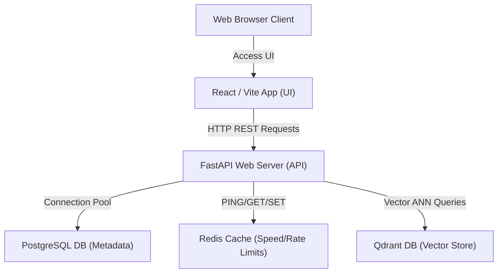
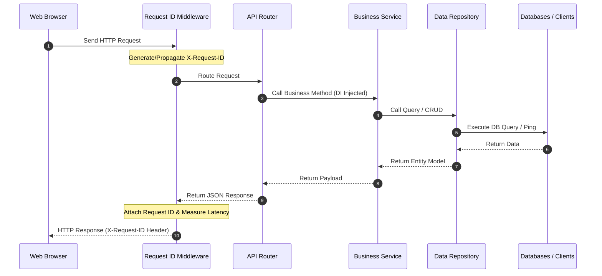

# Production-Grade Hybrid RAG Chatbot

This repository contains a reference implementation of a production-ready **Hybrid RAG Chatbot** engineered with FastAPI, React + Vite + TypeScript, PostgreSQL, Redis, and Qdrant.

## Features (Milestone 1: Project Foundation)
*   **Fully Containerized Development**: One-command local startup via Docker Compose.
*   **Health Check API**: A comprehensive health-monitoring API `/api/v1/health` verifying backing databases and caching availability.
*   **Type-Safe Configurations**: Environment settings parsed and validated using Pydantic at server startup.
*   **Continuous Integration Checks**: Standardized Python formatting (`ruff`) and TypeScript verification.

---

## Technical Stack
*   **Backend**: Python 3.12+, FastAPI, Pydantic v2
*   **Frontend**: React, Vite, TypeScript, Vanilla CSS
*   **Databases**: PostgreSQL (Relational metadata), Qdrant (Vector indexing), Redis (Caching and rate limiting)
*   **Orchestration**: Docker, Docker Compose

---

## System Architecture

### 1. System Data Topology


### 2. Request Pipeline Flow


---

## Getting Started

### Prerequisites
Make sure you have the following installed on your system:
*   [Docker Desktop](https://www.docker.com/products/docker-desktop/) or Docker Engine (v20.10+) with Docker Compose (v2.x+).
*   *Optional (for local development checks)*: [Python 3.12+](https://www.python.org/) and [Node.js v18+](https://nodejs.org/).

### Quick Start (Local Docker Setup)
1.  **Clone the Repository**:
    ```bash
    git clone <repository-url>
    cd hybrid_rag
    ```

2.  **Configure Environment Variables**:
    Copy the example template file to create your active configurations:
    ```bash
    cp .env.example .env
    ```

3.  **Spin Up the Services**:
    Run Docker Compose to pull database images, compile application containers, and launch:
    ```bash
    docker-compose up --build
    ```

4.  **Verify Services Health**:
    Verify the backend server is successfully listening and connected to all systems:
    ```bash
    curl http://localhost:8000/api/v1/health
    ```
    Expected JSON response:
    ```json
    {
      "status": "healthy",
      "version": "0.1.0",
      "services": {
        "postgres": "connected",
        "vector_db": "connected",
        "redis": "connected"
      }
    }
    ```

5.  **Access the User Interface**:
    Open your browser and navigate to:
    ```
    http://localhost:5173
    ```

---

## Admin Console & LLM Observability

We have implemented a visual **Admin Console** at `/admin/dashboard` in the React frontend, allowing admin users to:
*   **Monitor LLM Observability**: Real-time KPI metrics, daily token volume & response speed charts, and collapsible LLM execution traces (tokens, cost, citations, and granular latencies).
*   **Run RAG Evaluations**: Trigger benchmark runs, compare pipeline results to prevent regressions, and render detailed HTML performance reports in-app.

### Configuring the Single Admin User
By design, the application enforces a **single-admin invariant** configured declaratively via the environment variables in `backend/.env`:

```env
ADMIN_EMAIL=admin@example.com
ADMIN_PASSWORD=admin_secure_password_123
```

On backend startup, the system automatically:
1. Promotes the user matching `ADMIN_EMAIL` to the `"admin"` role (registering them first if they do not exist).
2. Demotes any other database user possessing the `"admin"` role to `"user"`, guaranteeing that exactly one admin account exists at any time.

To change the admin account or update the password, simply edit these values in `.env` and restart the backend service.

---

## Local Development Checks

### Running Backend Unit Tests (Offline)
To run backend validations locally, ensure your virtual environment is initialized:
```bash
cd backend
uv venv
source .venv/bin/activate  # On Windows: .venv\Scripts\activate
uv pip install -r pyproject.toml --extra dev
pytest
```

### Formatting and Linting
Enforce code quality before pushing commits:
```bash
# Backend lint check
ruff check .

# Backend format check
ruff format --check .

# Frontend lint check
cd ../frontend
npm run lint
```
