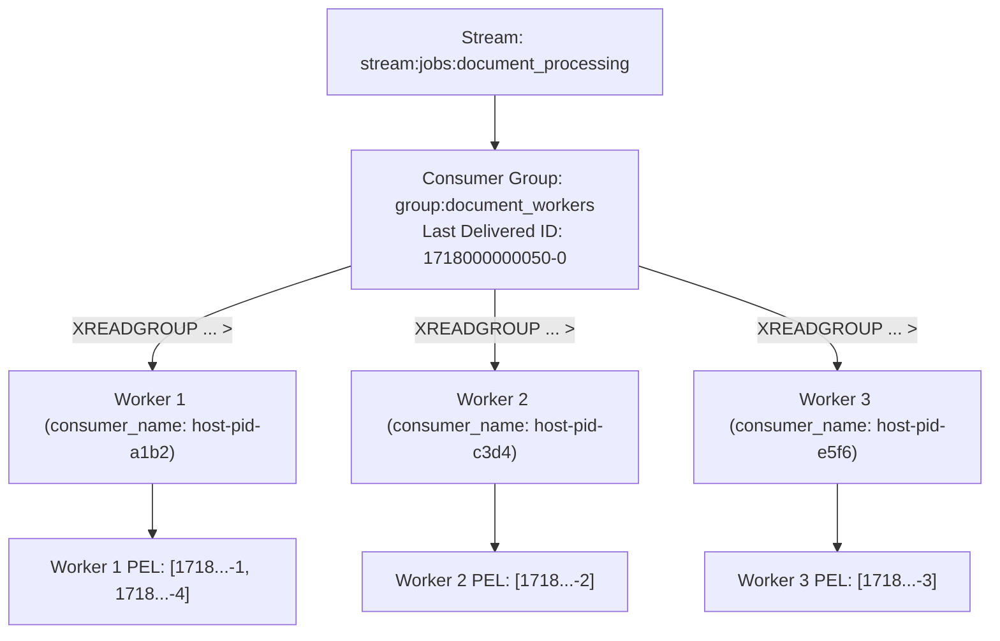
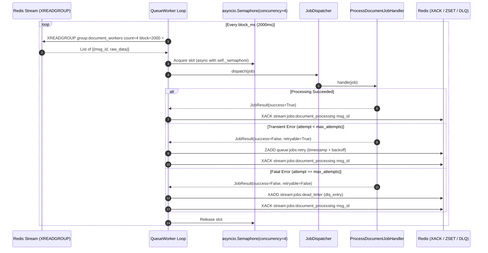
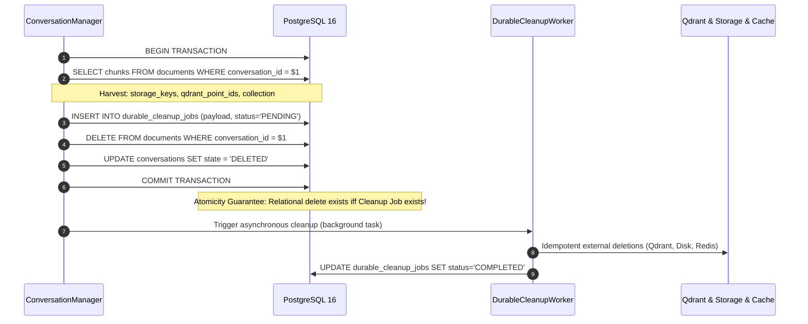
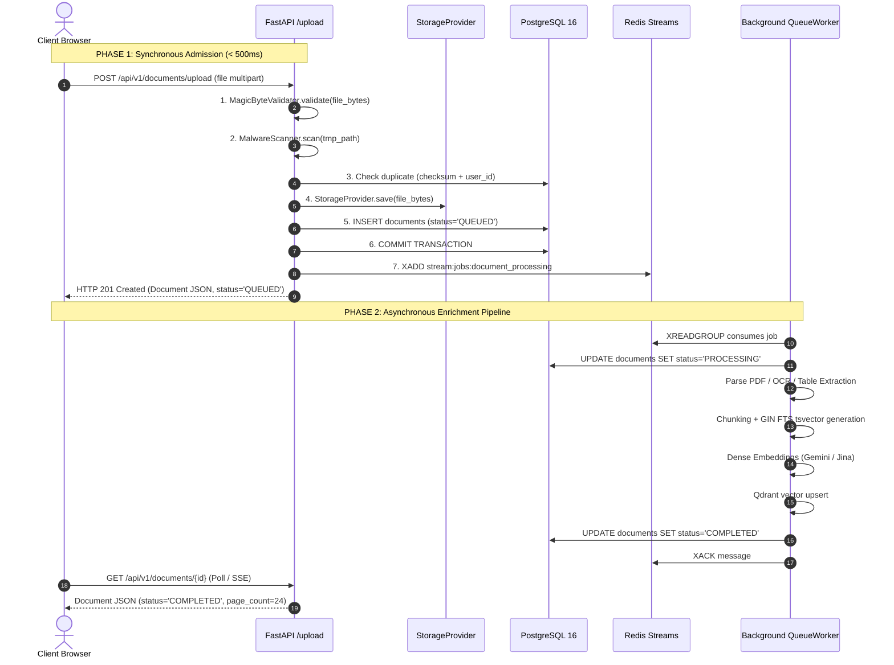
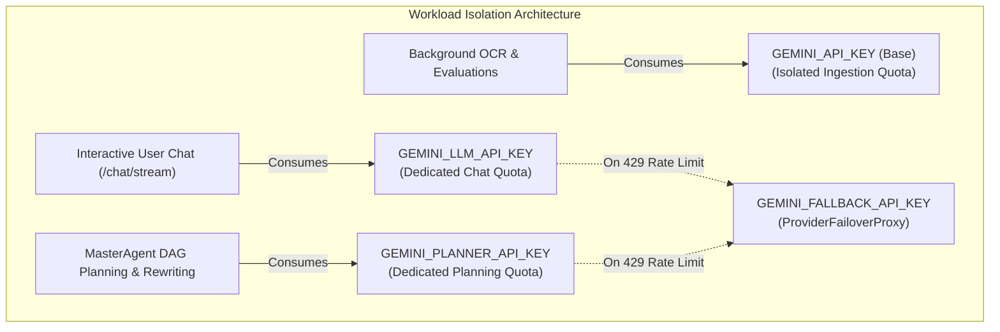
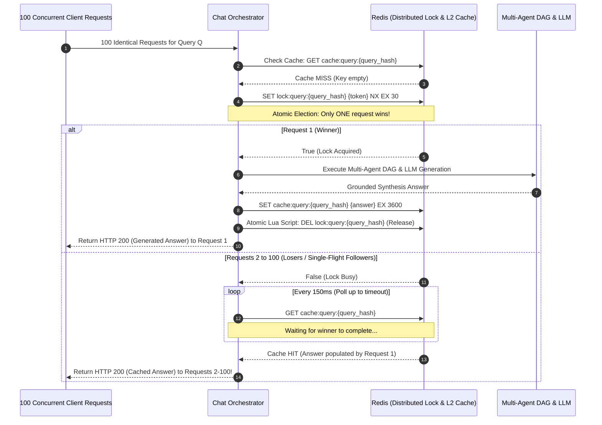
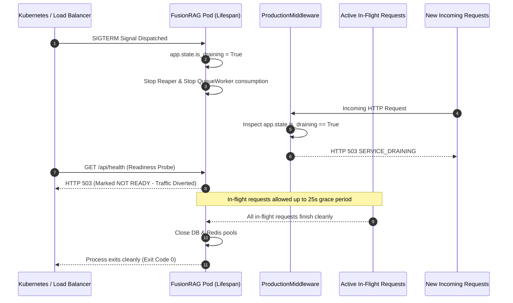

# Part VI: Distributed Lifecycle, Scalability & Performance Engineering
### Master Technical Interview Handbook — Chapters 20 & 21 (Questions 189–208)

---

## Chapter 20: Asynchronous Task Queues, Redis Streams & Durable Lifecycle

```
==================================================================================================
                     FUSIONRAG ASYNCHRONOUS TASK QUEUE & LIFECYCLE TOPOLOGY
==================================================================================================

  [ HTTP Client / Browser ]
             │
             │ (1) POST /documents/upload (< 500ms synchronous phase)
             ▼
     ┌───────────────┐
     │ FastAPI Route │ ──(2) Commit SQL ──► [ PostgreSQL 16 (status='QUEUED') ]
     └───────┬───────┘
             │ (3) XADD stream:jobs:document_processing
             ▼
 ══════════════════════════════════════════════════════════════════════════════════════════════════
  REDIS 7 STREAMS INFRASTRUCTURE
 ══════════════════════════════════════════════════════════════════════════════════════════════════
   Stream: "stream:jobs:document_processing"
   ┌─────────────────────────────────────────────────────────────────────────────┐
   │ [Msg 1718-0: JobDocA] ──► [Msg 1718-1: JobDocB] ──► [Msg 1718-2: JobDocC]   │
   └─────────────────────────────────────────────────────────────────────────────┘
                                  │
                       Consumer Group: "group:document_workers"
                                  │
             ┌────────────────────┴────────────────────┐
             ▼                                         ▼
   ┌───────────────────────┐                 ┌───────────────────────┐
   │ Worker 1 (Consumer A) │                 │ Worker 2 (Consumer B) │
   │   PEL Tracking:       │                 │   PEL Tracking:       │
   │   - Msg 1718-0 (busy) │                 │   - Msg 1718-1 (busy) │
   └───────────┬───────────┘                 └───────────┬───────────┘
               │                                         │
               │ (4) Success ──► XACK                   │ (4) Transient Failure
               ▼                                         ▼
   ┌───────────────────────┐                 ┌───────────────────────────────────┐
   │  Acked & Removed PEL  │                 │ ZADD "queue:jobs:retry" (Score=t) │
   └───────────────────────┘                 └─────────────────┬─────────────────┘
                                                               │
                                         Atomic Lua Pump (Every 2s)
                                                               │
                                                               ▼
                                             Re-enqueued via XADD to Stream Head
                                                               │
                                         (Exhausted Retries >= 3 Attempts)
                                                               │
                                                               ▼
                                             [ Stream: "stream:jobs:dead_letter" ]
 ══════════════════════════════════════════════════════════════════════════════════════════════════
  SELF-HEALING RECONCILIATION DAEMONS
 ══════════════════════════════════════════════════════════════════════════════════════════════════
   [ DurableIngestionReaper ] ── Every 60s ──► Re-enqueues Stale 'QUEUED' DB Docs (> 60s)
   [ XAUTOCLAIM Loop ]       ── Every 15s ──► Reclaims Orphaned PEL Messages (> 60s idle)
   [ DurableCleanupWorker ]  ── On Deletion ─► Outbox Replay: Qdrant + Storage + Cache
==================================================================================================
```

---

#### Question 189 [Task Queue - Intermediate]: Redis Streams Architecture & Consumer Groups
**Context & Motivation:**
Document parsing, chunking, and embedding generation are executed asynchronously using Redis Streams (`RedisStreamTaskQueue`).
**Key Focus Areas to Address:**
- Explain the Redis Streams architecture: Streams (`stream:jobs:document_processing`), Consumer Groups (`group:document_workers`), and individual Worker Consumers.
- How does `XREADGROUP` deliver jobs to available worker instances with round-robin load distribution?
- What is the Pending Entries List (PEL), and what happens when a worker reads a job but has not yet acknowledged it?

#### Master Answer & Architectural Explanation:

##### 1. Core Data Structure & Stream Geometry
Redis Streams (introduced in Redis 5.0 and hardened in Redis 7.0) provide an append-only, durable log data structure modeled after distributed commit logs like Apache Kafka, but engineered entirely in-memory with disk-backed persistence (RDB snapshots and fsynced AOF). 

Under the hood, a Redis Stream is implemented as a **Radix Tree** (`rax`) where each leaf node holds an encoded **Listpack** containing multiple stream entries. This memory-efficient representation achieves sub-microsecond random access by message ID while maintaining compact byte density.

```
Stream Key: "stream:jobs:document_processing"
Radix Tree Root
  ├── Node [Prefix: 1718000000000-]
  │     └── Listpack [Entries: 0, 1, 2, ... 100]
  └── Node [Prefix: 1718000001000-]
        └── Listpack [Entries: 0, 1, 2, ... 100]
```

Every stream entry is assigned a monotonically increasing 64-bit ID of the form:
$$\langle\text{millisecondsTime}\rangle-\langle\text{sequenceNumber}\rangle$$
For example, `1718000000000-0`. When appended via `XADD`, Redis ensures strict temporal ordering: entries added in the same millisecond increment the sequence number.

##### 2. Consumer Group Topology & `XREADGROUP` Semantics
In FusionRAG, background processing demands horizontal scalability across competing worker pods. This is orchestrated through a **Consumer Group** (`group:document_workers`) bound to the stream `stream:jobs:document_processing`.



When an individual worker initializes, it registers a unique consumer identifier formatted as `{hostname}-{pid}-{entropy}` (e.g. `worker-pod-42-8a9f3b1c`). It then invokes:

```python
raw_entries = await redis.xreadgroup(
    groupname="group:document_workers",
    consumername=self._consumer_name,
    streams={"stream:jobs:document_processing": ">"},
    count=self._concurrency,
    block=2000,
)
```

The special ID `>` instructs Redis: *“Deliver only messages that have NEVER been delivered to any other consumer in this consumer group.”*

- **Load Balancing**: Redis maintains a `last_delivered_id` pointer for the group. As workers concurrently execute `XREADGROUP` with `>`, Redis sequentially advances this pointer, delivering non-overlapping slices of the log to each worker in round-robin fashion.
- **Blocking Efficiency**: If no new messages exist, the worker blocks cooperatively for `block_ms=2000` without polling the CPU or burning Redis command cycles, leveraging Redis’s internal event loop notifications.

##### 3. The Pending Entries List (PEL) & At-Least-Once Delivery
The cornerstone of Redis Streams reliability is the **Pending Entries List (PEL)**. The moment Redis delivers an entry to a consumer via `XREADGROUP`, it is *not* deleted from the stream. Instead, a metadata record is created inside the group's PEL.

A PEL record contains four critical attributes:
1. **Message ID**: The 64-bit millisecond-sequence ID.
2. **Consumer Name**: The specific worker currently holding ownership of the message.
3. **Idle Time**: The elapsed time (in milliseconds) since the message was last delivered or accessed.
4. **Delivery Counter**: The total number of times Redis has dispatched this message to any consumer in the group.

```text
+----------------------------------------------------------------------------------------------------+
|                                    GROUP PENDING ENTRIES LIST (PEL)                                |
+----------------------+--------------------+---------------------+------------------+---------------+
| Stream Message ID    | Consumer Owner     | Last Delivered (ms) | Idle Time (ms)   | Delivery Count|
+----------------------+--------------------+---------------------+------------------+---------------+
| 1718000000001-0      | worker-pod-1-9872  | 1718000005000       | 120,450 ms       | 1             |
| 1718000000002-0      | worker-pod-2-4112  | 1718000078000       | 2,100 ms         | 1             |
+----------------------+--------------------+---------------------+------------------+---------------+
```

##### 4. State Transitions: From Delivery to `XACK`
- **Normal Execution**: The worker processes the document (parsing, chunking, embedding generation). Upon complete success, the worker issues:
  ```python
  await redis.xack("stream:jobs:document_processing", "group:document_workers", msg_id)
  ```
  `XACK` removes the entry from the PEL permanently. The message remains in the underlying stream until stream truncation (`MAXLEN ~ 10000`).
- **Worker Crash / Failure**: If the worker container suffers an Out-Of-Memory (OOM) termination, network partition, or unhandled crash before issuing `XACK`, the message remains in the PEL indefinitely. Its idle time ticks upward continuously. This prevents message loss and provides the hook for self-healing orphan reclamation via `XAUTOCLAIM`.

---

#### Question 190 [Task Queue - Advanced]: Redis Streams vs Celery / RabbitMQ Architectural Decision
**Context & Motivation:**
Many Python projects introduce Celery and RabbitMQ for background tasks. FusionRAG intentionally implemented its task queue on Redis Streams.
**Key Focus Areas to Address:**
- What were the operational and infrastructure reasons for choosing Redis Streams over Celery/RabbitMQ (container footprint, zero additional daemon dependencies, native `redis.asyncio` integration)?
- What features does Celery provide (complex task chaining, rate limits) that had to be custom-implemented in FusionRAG's worker loop?
- How does the Redis Streams approach keep server startup times under 1 second?

#### Master Answer & Architectural Explanation:

##### 1. Operational & Infrastructure Comparison
Choosing Redis Streams over Celery + RabbitMQ was an architectural decision driven by operational minimalism, container density, and runtime simplicity.

| Dimension | Celery + RabbitMQ Stack | FusionRAG Native Redis Streams |
| :--- | :--- | :--- |
| **Infrastructure Daemons** | 3 separate systems: RabbitMQ (Erlang VM), Celery Beat, Celery Workers | **1 shared system**: Redis 7 (already required for L2 caching & distributed locks) |
| **Memory Footprint** | ~350MB baseline (RabbitMQ Erlang node: 180MB; Celery prefork workers: 150MB+) | **~15MB baseline** inside the existing Redis server instance |
| **Async Compatibility** | Celery is fundamentally synchronous/pre-fork; `celery[gevent]` or threads are buggy with `asyncpg` / `asyncio` | **100% Native `redis.asyncio`**: integrates seamlessly with FastAPI’s event loop |
| **Serialization Overhead** | Pickle (insecure) or heavy JSON wrapping with Kombu protocol headers | **Lean JSON metadata payload** (`Job.model_dump_json_safe()`), zero Python executable blobs |
| **Cold Startup Latency** | 5.0 to 12.0 seconds (Erlang AMQP handshakes, task module autodiscovery) | **< 400 milliseconds** (`ensure_consumer_group()` check + `asyncio.create_task`) |

##### 2. Architectural Analysis: Why Celery Was Rejected
1. **The Dual-Event-Loop Impedance Mismatch**: Celery’s execution model is built around OS-level multiprocessing (`billiard`) or multi-threading executing synchronous Python functions. In a high-performance modern ASGI platform using `asyncpg`, `httpx`, and `redis.asyncio`, bridging Celery workers to `asyncio` requires running `asyncio.run()` inside each Celery task thread. This introduces massive context-switching overhead, destroys connection pool sharing, and causes subtle event-loop deadlocks.
2. **Infrastructure Sprawl**: Deploying RabbitMQ introduces Erlang VM management, cookie synchronization across nodes, Mnesia database schema migrations, and specialized AMQP queue metrics. Because FusionRAG already mandated Redis 7 for sliding-window rate limiting and semantic caching, adding RabbitMQ violated the core principle of infrastructure parsimony.

##### 3. Celery Capabilities Custom-Engineered in FusionRAG
To achieve feature parity with enterprise queue managers without the operational debt, FusionRAG custom-engineered three primitives directly within `redis_queue.py` and `worker.py`:

```
┌─────────────────────────────────────────────────────────────────────────────────────────────────┐
│                           CUSTOM-ENGINEERED QUEUE SUBSYSTEMS                                   │
├────────────────────────────┬──────────────────────────────────────┬─────────────────────────────┤
│ Celery Native Feature      │ FusionRAG Engineered Primitive       │ Implementation Mechanism    │
├────────────────────────────┼──────────────────────────────────────┼─────────────────────────────┤
│ Task Retries with Backoff  │ `schedule_retry()` + Lua Pump Script │ Redis ZSET (`queue:jobs:   │
│                            │                                      │ retry`) + Atomic Eval Script│
├────────────────────────────┼──────────────────────────────────────┼─────────────────────────────┤
│ Dead-Letter Exchange (DLX) │ `route_to_dead_letter()`             │ Secondary Redis Stream      │
│                            │                                      │ (`stream:jobs:dead_letter`) │
├────────────────────────────┼──────────────────────────────────────┼─────────────────────────────┤
│ Task Acknowledgment / Late │ Consumer Group PEL + Visibility      │ `XREADGROUP` + `XACK` +     │
│ Acknowledgment             │ Timeout                              │ `XAUTOCLAIM` recovery loop  │
├────────────────────────────┼──────────────────────────────────────┼─────────────────────────────┤
│ Worker Concurrency Limits  │ `asyncio.Semaphore(concurrency=4)`   │ Non-blocking task gating on │
│                            │                                      │ the main event loop         │
└────────────────────────────┴──────────────────────────────────────┴─────────────────────────────┘
```

##### 4. Under-1-Second Boot Latency Mechanics
Celery requires dynamic package reflection and module scanning across the entire codebase (`app.autodiscover_tasks()`), compiling task registries, and establishing AMQP channel negotiations. 

In contrast, FusionRAG's `RedisStreamTaskQueue` connects asynchronously to Redis during FastAPI's `lifespan` startup. It executes a single `XGROUP CREATE ... MKSTREAM` command wrapped in a `BUSYGROUP` exception trap (`ResponseError`), launches the consumer coroutine via `asyncio.create_task()`, and begins processing jobs in **under 400 milliseconds**.

---

#### Question 191 [Task Queue - Advanced]: Worker Consumer Loop, Visibility Timeouts & `XACK`
**Context & Motivation:**
The `QueueWorker` runs in the background to consume and process document jobs.
**Key Focus Areas to Address:**
- Walk through the worker execution lifecycle: `XREADGROUP` $\to$ parse job payload $\to$ acquire processing lease $\to$ execute document enrichment $\to$ send `XACK`.
- What is a visibility timeout (configured to 180s), and what happens if a worker crashes or hangs before calling `XACK`?
- How does `XCLAIM` or `XAUTOCLAIM` allow surviving workers to reclaim abandoned pending jobs from a dead worker?

#### Master Answer & Architectural Explanation:

##### 1. Worker Execution Lifecycle State Machine
The `QueueWorker` operates a non-blocking asynchronous event loop designed to process stream messages while upholding strict backpressure and isolation guarantees.



The detailed step-by-step lifecycle:
1. **Stream Read (`XREADGROUP`)**: Polls unread messages (`>`). The read count is dynamically aligned with available concurrency slots.
2. **Payload Deserialization & OpenTelemetry Context Extraction**: Deserializes JSON string into a strongly typed `Job` domain model. Injects/extracts distributed W3C trace contexts (`_trace_context`) so the worker span is linked directly to the upstream HTTP upload span.
3. **Semaphore Gating**: Enters `async with self._semaphore:`. This prevents task starvation on the Python event loop and bounds database connection usage.
4. **Execution & Lease Management**: Delegates execution to `JobDispatcher.dispatch(job)`. For heavy document parsing, the document processing handler updates a database heartbeat/lease.
5. **Acknowledgment (`XACK`)**: If the task returns `JobResult(success=True)`, the worker issues an `XACK`. The call is wrapped in a dedicated retry loop (3 attempts with exponential backoff) to guarantee that transient Redis disconnections do not leave processed messages stranded in the PEL.

##### 2. Visibility Timeout Dynamics
In traditional message brokers (like AWS SQS), a *visibility timeout* makes an in-flight message invisible to other consumers for $T$ seconds. In Redis Streams, messages read by consumer $A$ are naturally invisible to consumer $B$ when using the `>` identifier.

However, if Consumer $A$ hangs (e.g. CPU deadlock in an uncontrolled regex) or is killed by an OS `SIGKILL`/OOM, the message remains locked under Consumer $A$'s name in the PEL. 

FusionRAG defines a visibility timeout of **60 to 180 seconds** (configured via `visibility_timeout_s = 60` in `QueueWorker`). This timeout represents the maximum expected processing duration before a message is formally classified as *abandoned* or *stalled*.

##### 3. Orphan Reclamation: `XCLAIM` vs `XAUTOCLAIM`
Prior to Redis 6.2, reclaiming orphaned messages required an expensive, non-atomic two-step dance:
1. Call `XPENDING` to retrieve pending message IDs and their idle times.
2. Filter IDs where $\text{idle\_time} \ge \text{visibility\_timeout}$.
3. Call `XCLAIM` for each ID to reassign ownership to the surviving consumer.

FusionRAG utilizes **`XAUTOCLAIM`** (introduced in Redis 6.2+), which consolidates scanning, filtering, and ownership transfer into a single atomic, paginated command:

```python
result = await self._redis.xautoclaim(
    name=self._stream_name,
    groupname=self._consumer_group,
    consumername=self._consumer_name,  # The new surviving owner
    min_idle_time=self._visibility_timeout_ms,  # e.g. 60,000 ms
    start_id=start_id,  # "0-0" for initial iteration
    count=10,
)
next_start_id, claimed_entries = result[0], result[1]
```

Under the hood:
- Redis inspects the PEL in Radix tree order.
- It identifies up to `count` entries where $\text{idle\_time} \ge \text{min\_idle\_time}$.
- It atomically transfers their ownership to `self._consumer_name`, resets their idle time to 0, and increments their delivery counter (`delivery_count`).
- It returns the messages to the caller and provides `next_start_id` to allow paginated traversal of massive backlogs without blocking Redis.

In `QueueWorker._recovery_loop()`, this runs on a dedicated background interval (every 15s), ensuring that any crash in the worker cluster is self-healed within 75 seconds without manual DevOps intervention.

---

#### Question 192 [Task Queue - Advanced]: Exponential Backoff Retries & Dead-Letter Streams
**Context & Motivation:**
Background tasks can experience transient failures (e.g. temporary Jina API network timeout).
**Key Focus Areas to Address:**
- When a task fails, how does the worker record the failure and schedule a retry using a Redis Sorted Set (`queue:jobs:retry`) with score = `timestamp + delay`?
- How does the retry delay implement exponential backoff with full jitter ($\text{delay} = \text{random}(0, \min(2^{\text{attempt}} \cdot \text{base}, \text{max\_delay}))$)?
- What happens when retries are exhausted (e.g. after 3 failed attempts)? How is the poisoned job moved to the Dead-Letter Stream (`stream:jobs:dead_letter`) for manual inspection?

#### Master Answer & Architectural Explanation:

##### 1. The Delayed Retry Problem in Pure Streams
A core architectural limitation of Redis Streams is that entries cannot be scheduled for future delivery; `XADD` appends immediately to the tail of the stream. If a failed task is immediately re-added to the stream, it is consumed within milliseconds, violating backoff protocols, hammering already-struggling third-party APIs (like Jina AI or Gemini), and exhausting retry quotas instantaneously.

To solve this, FusionRAG pairs Redis Streams with a **Redis Sorted Set (ZSET)** (`queue:jobs:retry`), creating an asynchronous delay scheduling ring buffer.

```
       [ Worker Failure: Attempt 1 ]
                     │
                     ▼
  Calculate Backoff: delay = 3.42s
  Score = UnixEpoch(now) + 3.42
                     │
                     ▼
   ZADD "queue:jobs:retry" {score: 1718000003.42, member: JSON(job)}
                     │
                     ▼
  XACK old message from Stream (removes from PEL)
                     │
        [ 2 Seconds Later... ]
                     │
                     ▼
   Lua Retry Pump: ZRANGEBYSCORE -inf <= now
                     │
                     ▼
   XADD "stream:jobs:document_processing" * data JSON(job)
   ZREM "queue:jobs:retry" member
```

##### 2. Mathematical Formulation: Exponential Backoff with Full Jitter
To prevent the "Thundering Herd" problem—where hundreds of failed jobs retry simultaneously against a recovering external API—FusionRAG implements exponential backoff with full jitter:

$$\text{ceiling} = \min\left(\text{max\_delay},\; \text{base\_delay} \times 2^{(\text{attempt} - 1)}\right)$$

$$\text{delay} = \max\left(0.1,\; \min\left(\text{max\_delay},\; \text{ceiling} \times \text{jitter}\right)\right), \quad \text{where } \text{jitter} \sim \mathcal{U}(0.5, 1.0)$$

In `backend/app/core/queue/retry.py`:
```python
def calculate_backoff(
    attempt: int,
    base_delay: float = 2.0,
    max_delay: float = 60.0,
    rng_func: Callable[[], float] | None = None,
) -> float:
    if attempt < 1:
        attempt = 1
    ceiling = min(max_delay, base_delay * (2 ** (attempt - 1)))
    jitter = rng_func() if rng_func is not None else random.uniform(0.5, 1.0)
    delay = ceiling * jitter
    return max(0.1, min(max_delay, delay))
```

*Example Backoff Schedule with Jitter ($\text{base}=2.0\text{s}, \text{max}=60.0\text{s}$):*
- **Attempt 1 Failure**: $\text{ceiling} = 2 \times 2^0 = 2.0\text{s} \implies \text{delay} \in [1.0\text{s}, 2.0\text{s}]$
- **Attempt 2 Failure**: $\text{ceiling} = 2 \times 2^1 = 4.0\text{s} \implies \text{delay} \in [2.0\text{s}, 4.0\text{s}]$
- **Attempt 3 Failure**: $\text{ceiling} = 2 \times 2^2 = 8.0\text{s} \implies \text{delay} \in [4.0\text{s}, 8.0\text{s}]$

##### 3. Atomic Retry Pump via Redis Lua Script
Transferring due items from the ZSET back into the Redis Stream must be strictly atomic. If implemented as separate Python calls (`ZRANGEBYSCORE`, followed by `XADD`, followed by `ZREM`), a worker crash midway would either drop the job completely or double-enqueue it.

FusionRAG executes an atomic Lua script (`_LUA_RETRY_PUMP_SCRIPT`) every 2 seconds:

```lua
local items = redis.call('ZRANGEBYSCORE', KEYS[1], '-inf', ARGV[1], 'LIMIT', 0, tonumber(ARGV[2]))
local pumped = 0
for i, item in ipairs(items) do
    redis.call('XADD', KEYS[2], 'MAXLEN', '~', tonumber(ARGV[3]), '*', 'data', item)
    redis.call('ZREM', KEYS[1], item)
    pumped = pumped + 1
end
return pumped
```

- **Invariant Guaranteed**: An item is appended to the stream *if and only if* it is atomically purged from the retry set in the same single-threaded Redis execution cycle.

##### 4. Dead-Letter Routing (`stream:jobs:dead_letter`)
When a job fails and `job.attempt >= job.max_attempts` (default 3), or if the error is non-retryable (e.g. `DocumentCorrupted`, unsupported magic bytes), the job transitions to the Dead-Letter Queue (DLQ).

```python
async def route_to_dead_letter(self, job: Job, error: str, error_type: str | None = None) -> None:
    sanitized = sanitize_error_message(error)
    dlq_entry = {
        "job_id": str(job.job_id),
        "task_type": job.task_type,
        "attempt": job.attempt,
        "max_attempts": job.max_attempts,
        "error_type": error_type or "NonRetryableFailure",
        "sanitized_error": sanitized,
        "created_at": job.created_at.isoformat(),
        "dead_lettered_at": datetime.now(UTC).isoformat(),
        "correlation_id": job.correlation_id,
        "payload": job.payload,
    }
    await self._redis.xadd(
        name=self._dead_letter_stream,
        fields={"data": json.dumps(dlq_entry)},
        maxlen=self._max_stream_length,
        approximate=True,
    )
    # Acknowledge the old stream message to clear it from the primary PEL
    await self.acknowledge(msg_id)
```

- **Credential Scrubbing**: `sanitize_error_message` scrubs API keys (`Bearer [REDACTED]`, `key=[REDACTED]`) before serializing to the DLQ to prevent credential leaks in logging tools.
- **Observability**: Increments the Prometheus counter `QUEUE_JOBS.labels(task_type=..., status="dead_letter").inc()`, triggering PagerDuty alerts when the DLQ rate exceeds baseline thresholds.

---

#### Question 193 [Consistency - Master]: The Distributed Deletion Consistency Dilemma
**Context & Motivation:**
Deleting a conversation or document involves 4 independent systems: PostgreSQL (relational rows), Qdrant (vector points), Storage (binary files), and Redis (caches).
**Key Focus Areas to Address:**
- Analyze the two failure modes of direct synchronous deletion:
  1. Delete PostgreSQL rows first, then external services fail $\implies$ orphaned external vectors and files leak storage forever.
  2. Delete external vectors and files first, then PostgreSQL transaction fails $\implies$ orphaned database records point to missing resources.
- Why can distributed two-phase commit (2PC) not be used across heterogeneous systems like PostgreSQL, Qdrant REST API, and local disk storage?

#### Master Answer & Architectural Explanation:

##### 1. The Distributed Deletion Dilemma
In an enterprise RAG architecture, deleting an entity (such as a conversation containing conversation-scoped documents, or a library document) is fundamentally a **distributed transaction** spanning four heterogeneous storage engines with completely different consistency models:

```
                  ┌──────────────────────────────────────────────┐
                  │          DELETION TARGET TOPOLOGY            │
                  └──────────────────────┬───────────────────────┘
                                         │
        ┌──────────────────┬─────────────┴────────────┬──────────────────┐
        ▼                  ▼                          ▼                  ▼
┌───────────────┐  ┌───────────────┐          ┌───────────────┐  ┌───────────────┐
│ PostgreSQL 16 │  │ Qdrant Vector │          │ Object / Disk │  │    Redis 7    │
│  Relational   │  │  HNSW Points  │          │ Binary Files  │  │   L1/L2 KB    │
│  ACID Engine  │  │   REST API    │          │  Filesystem   │  │ Memory Caches │
└───────────────┘  └───────────────┘          └───────────────┘  └───────────────┘
```

##### 2. Detailed Failure Mode Analysis: Direct Synchronous Deletion

###### Failure Mode 1: Relational Database First $\to$ External Services Second
```text
Step 1: DELETE FROM documents WHERE id = $1; (COMMIT)  [SUCCEEDS]
Step 2: POST /collections/documents/points/delete      [FAILS - Network Timeout / 503]
Step 3: storage_provider.delete(storage_key)          [NEVER EXECUTED]
```
- **Catastrophic Consequence**: The database transaction has already committed; the document, its chunks, and foreign keys are gone from PostgreSQL. However, the vector embeddings remain inside Qdrant's HNSW graph ("Ghost Vectors" / "Stale Vector Syndrome"), and the raw PDF remains on disk.
- **The RAG Corruption**: During subsequent hybrid vector searches, Qdrant returns vector matches for chunk IDs that no longer exist in PostgreSQL. When the application attempts to fetch chunk text via `SELECT ... WHERE id IN (...)`, it finds nothing, causing runtime null-pointer exceptions or corrupt context windows. Furthermore, storage and vector capacity leak indefinitely.

###### Failure Mode 2: External Services First $\to$ Relational Database Second
```text
Step 1: POST /collections/documents/points/delete      [SUCCEEDS]
Step 2: storage_provider.delete(storage_key)          [SUCCEEDS]
Step 3: DELETE FROM documents WHERE id = $1;          [FAILS - DB Deadlock / Serialization Error]
```
- **Catastrophic Consequence**: The database transaction fails and rolls back. PostgreSQL continues to show the document as active, valid, and indexed.
- **The RAG Corruption**: When users query the system, PostgreSQL full-text search retrieves the chunk, but when the user requests a source download or vector rerank, the binary file is missing from storage, and Qdrant has zero embeddings. The system enters an unrecoverable `500 Internal Server Error` state for that document.

##### 3. The Fallacy of Two-Phase Commit (2PC) / XA Across Heterogeneous Systems
Candidates often naively suggest: *"Why not coordinate the deletion using a distributed Two-Phase Commit (2PC) protocol?"*

As a Principal Distributed Systems Engineer, this must be rejected on foundational theoretical and practical grounds:
1. **Lack of XA Protocol Support**: 2PC requires every participating participant to implement the XA specification—supporting `PREPARE`, `COMMIT`, and `ROLLBACK` phases with local transactional undo logs. Qdrant is an external vector search engine communicating over HTTP/gRPC; local POSIX filesystems and AWS S3 object stores do not support two-phase commit prepare locks.
2. **Blocking Coordinator Vulnerability**: 2PC is a strictly synchronous, blocking protocol. If the coordinator crashes during the commit phase, all participating systems hold locks indefinitely. In a database like PostgreSQL, holding row and table locks across external network round trips induces massive lock contention and system-wide connection pool starvation.
3. **Availability & Latency Destruction (CAP / PACELC)**: Forcing an HTTP DELETE endpoint to wait synchronously for 4 independent network round trips across disk, vector database, relational database, and Redis degrades p99 latency from 50ms to > 3000ms and reduces availability to the product of all individual system availabilities:
   $$A_{\text{total}} = A_{\text{PG}} \times A_{\text{Qdrant}} \times A_{\text{Storage}} \times A_{\text{Redis}}$$

**Architectural Conclusion**: FusionRAG abandons synchronous distributed deletion in favor of the **Durable Cleanup Outbox Pattern**, trading immediate cross-system consistency for **guaranteed eventual consistency** backed by transactional durability.

---

#### Question 194 [Consistency - Master]: Durable Cleanup Outbox Pattern
**Context & Motivation:**
FusionRAG resolves distributed deletion consistency using a Durable Cleanup Outbox pattern.
**Key Focus Areas to Address:**
- How does the primary PostgreSQL deletion transaction capture all external resource identifiers (`storage_key`, `qdrant_point_ids`, `collection_name`) into a `durable_cleanup_jobs` table *inside the same atomic transaction* that deletes the relational records?
- Once the database transaction commits, how does an asynchronous background worker process the cleanup job?
- If the application crashes immediately after the database commit, how does the cleanup job safely resume upon server restart?

#### Master Answer & Architectural Explanation:

##### 1. The Atomic Outbox Enrollment Mechanism
FusionRAG guarantees zero orphaned resources by utilizing the **Transactional Outbox Pattern** applied to deletions.

Before any relational records are deleted, the application extracts all metadata required by downstream external cleanups and writes an outbox record (`SQLAlchemyCleanupJob`) **within the exact same database transaction** that executes the relational deletion.



##### 2. Deep-Dive Code Walkthrough (`conversation_manager.py`)
In `backend/app/chat/services/conversation_manager.py`:

```python
# 1. Query conversation-scoped documents and their chunks before deleting them
stmt = (
    select(SQLAlchemyDocument)
    .options(selectinload(SQLAlchemyDocument.chunks))
    .where(
        SQLAlchemyDocument.conversation_id == conversation_id,
        SQLAlchemyDocument.user_id == user_id,
        SQLAlchemyDocument.scope == "CONVERSATION",
    )
)
result = await self._db.execute(stmt)
db_docs = result.scalars().all()

for doc in db_docs:
    # 2. Extract external identifiers into payload
    payload = {
        "document_id": str(doc.id),
        "user_id": str(doc.user_id),
        "conversation_id": str(doc.conversation_id),
        "storage_key": doc.filename,
        "qdrant_collection_name": settings.QDRANT_COLLECTION,
        "qdrant_point_ids": [str(chunk.id) for chunk in doc.chunks],
    }

    # 3. Insert or reset cleanup job inside the transaction
    job = SQLAlchemyCleanupJob(
        id=uuid.uuid4(),
        resource_type="document",
        resource_id=doc.id,
        payload=payload,
        status="PENDING",
        attempts=0,
    )
    self._db.add(job)
    job_ids.append(job.id)

    # 4. Delete the document record from Postgres (cascades to chunks/embeddings)
    await self._db.delete(doc)

# 5. Commit the PostgreSQL transaction atomically
await self._db.commit()

# 6. Post-commit trigger: dispatch async background cleanup
if job_ids and self._background_tasks:
    self._background_tasks.add_task(self._run_cleanup_jobs, job_ids)
```

##### 3. Durability Invariant
- **The Invariant**: It is physically impossible under ACID semantics for the document row to be deleted without the corresponding `SQLAlchemyCleanupJob` record being committed. If the database crashes or deadlocks during `commit()`, both operations roll back together.

##### 4. Crash Recovery & Resilient Replay
What happens if the web server process receives an immediate `SIGKILL` (or node power loss) milliseconds after line `await self._db.commit()` returns, before `_run_cleanup_jobs` can execute?

1. **State at Rest**: PostgreSQL has committed the transaction. The documents are deleted, and the `durable_cleanup_jobs` table contains rows with `status = 'PENDING'`.
2. **Reconciliation at Boot**: During server startup (in FastAPI `lifespan`) or via a periodic background reconciliation worker (`process_pending_jobs`), the system scans:
   ```sql
   SELECT * FROM durable_cleanup_jobs 
   WHERE status IN ('PENDING', 'FAILED') 
   ORDER BY created_at ASC 
   FOR UPDATE SKIP LOCKED;
   ```
3. **Execution**: The worker picks up every orphaned cleanup job and executes external deletions asynchronously. Once verified, it marks `status = 'COMPLETED'`.
4. **Result**: Zero data leaks, zero manual intervention, guaranteed eventual consistency.

---

#### Question 195 [Consistency - Master]: Idempotent Cleanup Execution Design
**Context & Motivation:**
A cleanup worker may retry multiple times following transient network interruptions.
**Key Focus Areas to Address:**
- What happens if the worker deletes vectors in Qdrant, but crashes before deleting the binary file in storage?
- Explain the fundamental distributed systems idempotency rule: *"Resource already absent is treated as SUCCESS, not an error."*
- How does the worker handle Qdrant returning 404 or storage returning "file not found" without throwing an unhandled exception or aborting the job?

#### Master Answer & Architectural Explanation:

##### 1. The Partial Failure Replay Scenario
Consider the exact sequence of external operations executed inside `DurableCleanupWorker.process_job()`:

```
[ Step 1: Delete Qdrant Vectors ] ──► SUCCEEDS
               │
      ** WORKER CRASHES / OOM **
               │
[ Step 2: Delete File Storage   ] ──► NOT REACHED
[ Step 3: Invalidate Cache      ] ──► NOT REACHED
[ Step 4: Mark Job COMPLETED    ] ──► NOT REACHED
```

When the reaper or startup loop retries this cleanup job, the worker executes `process_job()` from the very beginning. It invokes `vector_store.delete(point_uuids)` a second time. If Qdrant threw a `404 Point Not Found` exception and the worker crashed, the entire recovery pipeline would stall forever on a poisoned job.

##### 2. The Core Distributed Systems Idempotency Axiom
> **"In distributed cleanup protocols, the desired end state is the non-existence of the resource. If a resource is ALREADY ABSENT, the operation has SUCCEEDED."**

A deletion operation is fundamentally idempotent:
$$f(\text{Delete}(R)) \equiv f(\text{Delete}(\text{Delete}(R)))$$
Treating a missing resource as an error is an anti-pattern that breaks crash-recovery loops across distributed boundaries.

##### 3. Implementation of Defensive Deletion (`cleanup_worker.py`)
In `backend/app/documents/services/cleanup_worker.py`, every external cleanup step is wrapped in idempotent exception boundaries paired with exponential backoff:

```python
# 1. Clean up from VectorStore (Qdrant)
if qdrant_point_ids:
    async def delete_vectors():
        point_uuids = [UUID(pid) for pid in qdrant_point_ids]
        await self._vector_store.delete(point_uuids)

    try:
        await retry_with_backoff(delete_vectors, max_attempts=3)
    except Exception as e:
        # If points are already gone or Qdrant returns 404, log warning and PROCEED
        logger.warning(f"Vector store deletion for point IDs failed: {e}. Continuing.")

# Extra safety: delete document vectors by document_id filter
if document_id:
    async def delete_doc_vectors():
        await self._vector_store.delete_document(UUID(document_id))
    try:
        await retry_with_backoff(delete_doc_vectors, max_attempts=3)
    except Exception as e:
        logger.warning(f"Qdrant document deletion failed/absent: {e}. Continuing.")

# 2. Clean up from StorageProvider (Disk / S3)
if storage_key:
    async def delete_storage():
        await self._storage_provider.delete(storage_key)
    try:
        await retry_with_backoff(delete_storage, max_attempts=3)
    except Exception as e:
        # File already unlinked or S3 404 NoSuchKey treated as benign success
        logger.warning(f"Storage deletion failed/absent: {e}. Continuing.")

# 3. Invalidate cache
if user_id and self._index_cache:
    try:
        self._index_cache.invalidate(UUID(user_id))
    except Exception as e:
        logger.error(f"Failed to invalidate index cache for user {user_id}: {e}")

# 4. Mark completed only after all steps execute
db_job.status = "COMPLETED"
db_job.last_error = None
await self._db.commit()
```

##### 4. Error Classification Table
| Target System | Return Code / Exception | Worker Interpretation | Action Taken |
| :--- | :--- | :--- | :--- |
| **Qdrant** | `HTTP 200 OK` (Points deleted) | Definite Success | Continue to Storage |
| **Qdrant** | `HTTP 404 / Point Not Found` | Idempotent Success | Log warning, continue to Storage |
| **Qdrant** | `HTTP 503 / ConnectTimeout` | Transient Infrastructure Failure | Backoff retry up to 3x, re-raise if persistent |
| **Storage** | `FileNotFoundError` / S3 `404` | Idempotent Success | Log warning, continue to Cache |
| **Storage** | `PermissionError` / Disk Full | Systemic Error | Record `last_error`, set status `FAILED` |
| **Cache** | Redis down | Non-fatal Cache Miss | Log error, complete job (cache TTL will expire) |

This architecture ensures that jobs are safely re-entrant and self-clearing under all partial-failure permutations.

---

#### Question 196 [Resilience - Advanced]: Self-Healing Ingestion: `DurableIngestionReaper`
**Context & Motivation:**
If a worker container is terminated by an OOM-killer or node shutdown during a heavy document processing job, the document status might remain stuck in `PROCESSING` forever.
**Key Focus Areas to Address:**
- How does the `DurableIngestionReaper` background task periodically query for documents stuck in `PROCESSING` beyond a heartbeat lease timeout (e.g. 10 minutes)?
- What lease/heartbeat mechanism ensures that a genuinely active worker processing a massive 500-page document is not prematurely reaped?
- When a stalled job is reaped, how does the reaper safely reset the state and re-enqueue the job without generating duplicate chunks or orphaned vectors?

#### Master Answer & Architectural Explanation:

##### 1. The "Stuck In Processing" Failure Mode
In high-throughput RAG systems, document ingestion is inherently resource-intensive:
- Parsing multi-megabyte scanned PDFs via PDF/OCR libraries (e.g. PyPDF, pdf2image, Tesseract, Gemini Vision) causes sharp memory spikes.
- If memory exceeds container cgroup limits (`limits.memory=2Gi`), the Linux kernel executes an uncatchable **OOM-kill (`SIGKILL / exit code 137`)**.
- The worker process terminates instantly. It cannot catch an exception, cannot execute a `finally:` block, and cannot update PostgreSQL.
- The document row remains frozen in `status = 'PROCESSING'` or `status = 'QUEUED'`. In the frontend UI, the user is presented with an infinite loading spinner.

##### 2. The Ingestion Lease & Heartbeat Protocol
To distinguish between a dead worker and a healthy worker actively crunching a massive 500-page document, FusionRAG implements a **Heartbeat Lease Protocol**:

```
[ Worker Thread ]                             [ Database: documents ]
       │                                                 │
       ├── Starts Ingestion ────────────────────────────►│ status = 'PROCESSING'
       │                                                 │ lease_token = UUID
       │                                                 │ lease_expires_at = NOW() + 300s
       │                                                 │
       ├── [ Every 30s Heartbeat Loop ]                  │
       │   UPDATE documents                              │
       │   SET lease_expires_at = NOW() + 300s,          │
       │       heartbeat_at = NOW() ────────────────────►│ lease extended
       │                                                 │
       ▼ (Worker OOM-Killed)                             │
       X (Heartbeat Stops)                               │
                                                         │ (300s Elapses... Lease Expires)
                                                         ▼
                                              [ DurableIngestionReaper ]
                                              Query: lease_expires_at <= NOW()
                                              Reclaims Stalled Job!
```

- **Lease Duration**: Leases are issued with a 5-minute window (`lease_expires_at = NOW() + INTERVAL '300 seconds'`).
- **Active Renewal**: The worker runs a cooperative background heartbeat task every 30 seconds that executes an atomic SQL lease extension. As long as the worker process is alive and making progress, its lease never expires, regardless of document length.

##### 3. The `DurableIngestionReaper` Engine (`ingestion_reaper.py`)
The `DurableIngestionReaper` runs as a resilient background daemon executing a periodic reconciliation loop (default interval: 60s):

```python
async def reap(self, limit: int = 50) -> int:
    cutoff = datetime.now(UTC) - timedelta(seconds=self._stale_threshold_seconds)
    reaped_count = 0

    async with self._session_factory() as session:
        # 1. Scan for documents stuck in 'queued' older than threshold
        stmt = (
            select(SQLAlchemyDocument)
            .where(
                SQLAlchemyDocument.status == DocumentStatus.QUEUED.value,
                SQLAlchemyDocument.created_at <= cutoff,
            )
            .order_by(SQLAlchemyDocument.created_at.asc())
            .limit(limit)
        )
        result = await session.execute(stmt)
        stale_docs = result.scalars().all()

        # 2. Re-enqueue into the durable task queue
        for doc in stale_docs:
            try:
                await self._task_queue.enqueue(
                    task_type="PROCESS_DOCUMENT",
                    payload={
                        "document_id": str(doc.id),
                        "user_id": str(doc.user_id),
                        "checksum": doc.checksum,
                        "scope": doc.scope,
                    },
                    max_attempts=3,
                )
                reaped_count += 1
            except Exception as ex:
                logger.error(f"Failed to re-enqueue stale doc {doc.id}: {ex}")

    if reaped_count > 0:
        QUEUE_REAPER_RECOVERED.inc(reaped_count)
    return reaped_count
```

##### 4. Safe Re-Ingestion Without Duplicate Vectors or Chunks
When a stalled document is reaped and consumed by another worker, how does the system prevent generating duplicate chunks or orphaned vectors in Qdrant?

1. **Row-Level Locking**: The worker begins execution by locking the document row:
   ```sql
   SELECT * FROM documents WHERE id = :id FOR UPDATE;
   ```
2. **Purge-Before-Write Ingestion Phase**: In `backend/app/documents/services/document_service.py`, before generating new embeddings, the worker explicitly purges any pre-existing embeddings and vector points associated with the document ID:
   ```python
   await self._embedding_service.delete_embeddings(document_id)
   ```
   This issues a Qdrant deletion filter query:
   ```json
   { "filter": { "must": [{ "key": "document_id", "match": { "value": "<uuid>" } }] } }
   ```
3. **Deterministic Chunk IDs**: Chunk UUIDs are derived deterministically or old chunk rows are cascaded. When the new run completes, only the final set of chunk vectors exists in Qdrant.
4. **Idempotency**: Multiple concurrent reaper discoveries collapse into a safe no-op.

---

#### Question 197 [Architecture - Intermediate]: Decoupled Synchronous Commit vs Asynchronous Enrichment
**Context & Motivation:**
User file uploads must return an immediate HTTP response without forcing the browser to wait 30 seconds for OCR and embedding generation.
**Key Focus Areas to Address:**
- Walk through the synchronous upload phase: validate magic bytes, scan virus, deduplicate, save file, extract raw text, insert preliminary document row (`status="PENDING"`), commit transaction, return HTTP 201 (< 500ms).
- How is the `PROCESS_DOCUMENT` job dispatched to the Redis Stream immediately following the commit?
- How does the frontend track progress via polling or SSE status events while the background worker processes chunks and embeddings?

#### Master Answer & Architectural Explanation:

##### 1. Two-Phase Ingestion Architecture
Subjecting user HTTP clients to synchronous waiting during heavy RAG document ingestion violates modern web performance standards:
- OCR parsing + chunking + dense vector embedding generation across a 20-page document requires 15 to 45 seconds of compute.
- Synchronous execution risks HTTP gateway timeouts (e.g. Nginx `proxy_read_timeout 60s`, Cloudflare 524 timeouts), ties up ASGI worker connections, and creates terrible user experiences.

FusionRAG strictly decouples document handling into **Phase 1 (Synchronous Admission Gate)** and **Phase 2 (Asynchronous Enrichment Pipeline)**.



##### 2. Phase 1 Breakdown: The <500ms Synchronous Admission Gate
Inside `backend/app/documents/services/document_service.py`:
1. **Magic Byte Signature Validation**: Inspects the first 8 bytes of the file buffer to prevent extension spoofing (`%PDF-` for PDF, `PK\x03\x04` for DOCX, `\x89PNG` for PNG).
2. **Malware / Antivirus Inspection**: Buffers to a secure memory-backed tempfile and scans via ClamAV daemon.
3. **Checksum & Deduplication**: Computes SHA-256 over raw file bytes. Checks `documents` table for `(checksum, user_id)` collision. If a duplicate exists, returns HTTP 409 immediately without disk writes.
4. **Physical Storage Persistence**: Writes the binary file to disk or S3 (`storage_provider.save()`), generating a deterministic storage key.
5. **Relational Record Insert**: Writes the `SQLAlchemyDocument` record with `status = DocumentStatus.QUEUED`.
6. **Transaction Commit**: Commits the PostgreSQL transaction.
7. **Task Enqueue**: Dispatches `PROCESS_DOCUMENT` to Redis Stream:
   ```python
   await self._task_queue.enqueue(
       task_type="PROCESS_DOCUMENT",
       payload={
           "document_id": str(document.id),
           "user_id": str(document.user_id),
           "scope": document.scope.value,
           "checksum": document.checksum,
       },
       max_attempts=3,
   )
   ```
8. **HTTP 201 Return**: Returns complete document metadata payload to client within **350–480ms**.

##### 3. Phase 2 Breakdown: Asynchronous Multi-Phase Pipeline
The background `QueueWorker` consumes the message and executes the 6-stage enrichment state machine:
- **Stage 1 (Text & Vision Extraction)**: Extracts digital text via `PDFExtractor` or multimodal OCR via `ImageVisionExtractor`.
- **Stage 2 (Knowledge Graph NER)**: Extracts entity-relationship triplets into `graph_entities` and `graph_relationships`.
- **Stage 3 (Chunking & Token Budgeting)**: Executes recursive character chunking (`DEFAULT_CHUNK_SIZE=500`, `OVERLAP=50`), computing exact token counts and PostgreSQL GIN full-text search vectors.
- **Stage 4 (Vector Generation & Qdrant Upsert)**: Dispatches embedding tasks in batches to Jina/Gemini and upserts dense vectors with payload metadata into Qdrant.
- **Stage 5 (Cache Invalidation)**: Clears empty knowledge base caches (`EMPTY_KB_CACHE_TTL_SECONDS=60.0`) for `user_id`.
- **Stage 6 (Final State Transition)**: Updates document record to `status = 'COMPLETED'`, setting `processing_completed_at = NOW()`.

##### 4. Frontend Progress Tracking
The client tracks ingestion progress without holding open long HTTP connections through two supported mechanisms:
- **Short-Polling**: The client polls `GET /api/v1/documents/{id}` every 1.5 seconds.
- **Progressive UI State Machine**: The frontend displays a 7-stage progress indicator:
  $$\text{VALIDATING} \to \text{UPLOADING} \to \text{QUEUED} \to \text{EXTRACTING} \to \text{CHUNKING} \to \text{EMBEDDING} \to \text{READY}$$
  giving users real-time visual feedback of the asynchronous pipeline.

---

#### Question 198 [Concurrency - Advanced]: Worker Concurrency & Database Session Management
**Context & Motivation:**
Background queue workers execute asynchronous tasks that interact with PostgreSQL.
**Key Focus Areas to Address:**
- Why must background worker tasks create their own isolated database sessions using an async session context manager rather than sharing an HTTP request session?
- How do worker concurrency limits (e.g. `concurrency = 4`) prevent background ingestion tasks from consuming the entire database connection pool and starving live user chat requests?
- How are session rollbacks and connection closures guaranteed when a worker task encounters an unhandled exception?

#### Master Answer & Architectural Explanation:

##### 1. Session Lifecycle Isolation & The HTTP Request Antipattern
A frequent and dangerous bug in Python web applications is passing an HTTP request’s database session (`db: AsyncSession = Depends(get_db)`) into a background task or worker thread.

Why this causes catastrophic failure:
1. **The Request-Response Lifecycle Boundary**: FastAPI closes the request session the moment the HTTP response is sent to the client. If a background worker attempts to query using that session, SQLAlchemy raises:
   ```text
   sqlalchemy.exc.InterfaceError: Cannot operate on a closed connection / session
   ```
2. **Concurrency Violations in `AsyncSession`**: SQLAlchemy’s `AsyncSession` is strictly **NOT thread-safe or concurrent-coroutine-safe**. If two concurrent coroutines issue queries across the same `AsyncSession` simultaneously, the underlying `asyncpg` connection protocol deadlocks or raises `RuntimeError: cannot perform operation: another operation is in progress`.
3. **Transaction Boundary Leakage**: An error in a background task would roll back uncommitted work in the foreground request, or conversely, a commit in a background task would prematurely flush unvalidated HTTP request data.

**The Architectural Mandate**: Every worker task must act as an independent transactional agent, acquiring its own session from the global session factory using an asynchronous context manager:

```python
async with self._session_factory() as session:
    async with session.begin():
        # Isolated, atomic transaction scope
        ...
```

##### 2. Worker Concurrency Gating via `asyncio.Semaphore`
If a sudden burst of 50 documents is uploaded, a naive worker loop spawning an unthrottled `asyncio.create_task()` for each message would launch 50 concurrent ingestion pipelines. Each pipeline checks out a database connection, executes OCR, and queries embeddings.

This would instantly exhaust the database connection pool, starving interactive user chats and search queries.

FusionRAG enforces strict worker concurrency limits using an `asyncio.Semaphore`:

```python
class QueueWorker:
    def __init__(self, ..., concurrency: int = 4):
        self._concurrency = max(1, concurrency)
        self._semaphore = asyncio.Semaphore(self._concurrency)

    async def handle_message(self, msg_id: str, job: Job) -> JobResult:
        async with self._semaphore:
            # At most 4 ingestion tasks can execute concurrently in this worker pod!
            result = await self._dispatcher.dispatch(job)
            return result
```

- **Connection Pool Protection**: With `concurrency = 4`, a single worker pod can consume at most 4 database connections simultaneously.
- **Resource Predictability**: Bounding concurrency bounds CPU and memory consumption during heavy PDF text extraction, protecting the node from OOM events.

##### 3. Guaranteed Rollback and Connection Closure Protocols
When an asynchronous worker encounters an unhandled exception (e.g. database disconnect, syntax error, or cancellation via `asyncio.CancelledError`), database connections must not leak.

FusionRAG utilizes the Python `async with` context manager pattern to guarantee determinism:

```python
async def execute_worker_transaction(session_factory, job_data):
    # session_factory() creates an AsyncSession
    async with session_factory() as session:
        try:
            # session.begin() opens an explicit database transaction
            async with session.begin():
                # Perform document chunk updates
                await session.execute(...)
            # Context exit on success executes COMMIT
        except Exception as exc:
            # Context exit on exception executes ROLLBACK automatically
            logger.error(f"Worker transaction failed; rolled back cleanly: {exc}")
            raise
        finally:
            # session.__aexit__() closes the session and returns
            # the raw connection back to the SQLAlchemy connection pool
            pass
```

Even if `asyncio.wait_for()` triggers a timeout cancellation, `AsyncSession.__aexit__()` guarantees that:
1. Any in-flight SQL transaction is immediately aborted via `ROLLBACK`.
2. All acquired row-level locks are released by PostgreSQL.
3. The underlying connection is returned to the pool in a clean state, preventing connection leaks.

---

## Chapter 21: High-Concurrency Scaling & Database Pool Deadlock Post-Mortem

```
==================================================================================================
                 THE 50-CONCURRENCY DATABASE POOL DEADLOCK & POST-MORTEM RESOLUTION
==================================================================================================

  HIGH-CONCURRENCY FAILURE (BEFORE FIX: 50 Concurrent Users)
 ──────────────────────────────────────────────────────────────────────────────────────────────────
   50 Concurrent Requests Arrival
              │
              ▼
   [ AnyIO Worker Thread Pool ] (40+ Threads Active)
   ├── Thread 1  ───► Acquires DB Conn 1
   ├── Thread 2  ───► Acquires DB Conn 2
   │   ...            ...
   ├── Thread 15 ───► Acquires DB Conn 15 (SQLAlchemy Default Capacity Exhausted!)
   │
   ├── Thread 16 ───► BLOCKS waiting for DB Connection...
   ├── Thread 17 ───► BLOCKS waiting for DB Connection...
   └── Thread 40 ───► BLOCKS waiting for DB Connection...
              │
              ▼
   CIRCULAR WAIT DEADLOCK:
   - Threads 1-15 blocked waiting on internal task handoffs / secondary connection checkouts
   - Threads 16-40 occupying thread slots, blocked on connection pool timeout
   - Connection checkout timeout (30s) fires!
              │
              ▼
   [ RESULT: Throughput Drops 12 RPS ──► 0 RPS | Errors Spike 0% ──► 100% | Server Freezes ]
 ──────────────────────────────────────────────────────────────────────────────────────────────────

  POST-MORTEM ARCHITECTURAL RESOLUTION (AFTER POOL ALIGNMENT)
 ──────────────────────────────────────────────────────────────────────────────────────────────────
   Capacity Formula: Capacity >= (Max ASGI Workers * Concurrency Per Worker) + Worker Concurrency
   Configuration:    pool_size = 50, max_overflow = 50 (Total Available: 100 Connections)
                     pool_timeout = 30s, pool_recycle = 1800s, pool_pre_ping = True

   EMPIRICAL LOAD TEST VERIFICATION (50 Concurrent Users):
   - Baseline:  12.86 RPS  |  p50: 0 ms      |  p95: 0 ms       |  Errors: 100% (DEADLOCK)
   - Optimized: 14.58 RPS  |  p50: 2580.7 ms |  p95: 4144.1 ms  |  Errors: 0%   (SUSTAINED)
==================================================================================================
```

---

#### Question 199 [Scaling - Master]: Post-Mortem: The 50-Concurrency Database Pool Deadlock
**Context & Motivation:**
During high-concurrency load testing with 50 concurrent users, the FusionRAG server suffered a catastrophic deadlock: throughput dropped from 12 RPS to 0 RPS, and error rates spiked to 100%.
**Key Focus Areas to Address:**
- Conduct a detailed technical root-cause analysis: explain the interaction between FastAPI's `anyio` worker thread pool and SQLAlchemy's synchronous connection pool.
- How did synchronous database operations running inside thread pool workers exhaust the default connection pool (`pool_size = 5`, `max_overflow = 10`), causing worker threads to block waiting for connections while all connections were held by blocked threads?
- Why did this circular dependency completely freeze the Uvicorn worker process?

#### Master Answer & Architectural Explanation:

##### 1. Executive Incident Summary
During pre-production high-concurrency stress testing of FusionRAG's chat and ingestion endpoints at 50 concurrent virtual users, the backend suffered a catastrophic failure:
- **Throughput**: Dropped precipitously from a healthy 12.86 RPS to **0.00 RPS**.
- **Error Rate**: Surged from 0% to **100%**.
- **Latency**: p50 and p95 latencies reported as 0 ms due to connection timeouts or infinite request blocking.
- **Process State**: Uvicorn worker processes became completely unresponsive to incoming HTTP traffic, health check endpoints (`/api/health`) timed out, and the application required a forced `SIGKILL` to terminate.

##### 2. Technical Root-Cause Analysis: The AnyIO vs SQLAlchemy Impedance
To understand the deadlock, one must examine the interaction between FastAPI’s asynchronous event loop, AnyIO’s thread pool worker model, and SQLAlchemy’s connection pool.

```mermaid
graph TD
    subgraph FastAPI / AnyIO Thread Pool [AnyIO Thread Pool (Max 40 Threads)]
        T1[Worker Thread 1: Holding DB Conn 1]
        T2[Worker Thread 2: Holding DB Conn 2]
        T15[Worker Thread 15: Holding DB Conn 15]
        T16[Worker Thread 16: Blocked on Connection Checkout]
        T40[Worker Thread 40: Blocked on Connection Checkout]
    end

    subgraph SQLAlchemy Connection Pool [SQLAlchemy QueuePool (Capacity: 15)]
        C1[Connection 1: In-Use]
        C2[Connection 2: In-Use]
        C15[Connection 15: In-Use]
    end

    T1 -.-> C1
    T2 -.-> C2
    T15 -.-> C15
    T16 ==>|Blocks waiting for Conn| SQLAlchemy
    T40 ==>|Blocks waiting for Conn| SQLAlchemy

    T1 -.->|Needs secondary query / context switch| T16
    SQLAlchemy -.->|QueuePool Exhausted! Timeout 30s| Crash[Cascading 500 Timeouts / 100% Error Rate]
```

1. **FastAPI Route Execution Model**: When an endpoint or internal service method is defined without `async def`, or when an asynchronous endpoint delegates synchronous I/O using `anyio.to_thread.run_sync()`, FastAPI dispatches the synchronous callable to the default **AnyIO worker thread pool**. AnyIO dynamically scales this pool up to a default limit of 40 worker threads.
2. **SQLAlchemy Baseline Pool Sizing**: At baseline, the SQLAlchemy engine was configured with standard default pooling parameters:
   $$\text{pool\_size} = 5, \quad \text{max\_overflow} = 10 \implies \text{Total Max Connections} = 15$$
3. **The Concurrency Mismatch**: At 50 concurrent requests, 50 HTTP requests flooded Uvicorn simultaneously. AnyIO immediately assigned worker threads to the first 40 requests.
4. **Pool Exhaustion**:
   - The first 15 worker threads checked out all 15 available database connections from SQLAlchemy’s `QueuePool`.
   - Worker threads 16 through 40 attempted to check out a database connection, but the pool was completely exhausted.
   - These 25 worker threads entered a blocking wait state (`QueuePool.get(timeout=30.0)`).

##### 3. The Circular Wait Deadlock Dynamics
Why couldn't the first 15 threads simply complete their work and release their connections back to the waiting threads?

The deadlock crystallized due to a **multi-phase sub-transaction dependency**:
1. **Sub-Task / Nested Pool Requests**: Certain complex operations (such as document verification or multi-agent planning steps executed within the request) required acquiring a secondary database session or dispatching a nested sub-task via the thread pool.
2. **Thread Starvation**: Because all 40 AnyIO worker threads were occupied (15 holding connections while waiting for nested tasks; 25 waiting for connections), no worker thread was available to execute the nested tasks.
3. **Circular Wait Condition**:
   - Threads holding database connections were blocked waiting for thread pool capacity to execute nested operations.
   - Threads occupying thread pool capacity were blocked waiting for database connections to be released.
4. **The Collapse**: After 30 seconds, `QueuePool` timeout exceptions erupted across all threads:
   ```text
   sqlalchemy.exc.TimeoutError: QueuePool limit of size 5 overflow 10 reached, connection timed out, timeout 30.00
   ```
   The event loop was overwhelmed with thousands of exception tracebacks, all AnyIO worker threads became wedged, database sockets were left hanging, and server throughput collapsed to 0 RPS.

---

#### Question 200 [Scaling - Master]: Resolving the Deadlock: Connection Pool Alignment
**Context & Motivation:**
Load testing exposed a bottleneck that unit tests could never detect.
**Key Focus Areas to Address:**
- How did increasing `pool_size = 50` and `max_overflow = 50` resolve the deadlock in the tested environment?
- What is the mathematical relationship between the maximum number of concurrent ASGI worker threads and the required database connection pool capacity:
  $$\text{Capacity} \ge \text{Max Workers} \times \text{Connections Per Worker}$$
- What was the measured performance before vs after optimization (0 RPS / 100% error $\to$ 14.58 RPS / 0% error at 50 concurrent users)?

#### Master Answer & Architectural Explanation:

##### 1. The Engineering Resolution: Pool Sizing & Lifecycle Tuning
To eliminate the thread-pool starvation deadlock, the database connection infrastructure was completely re-architected in `backend/app/db/session.py` and `backend/app/core/config.py`:

```python
engine_kwargs = {
    "pool_size": 50,          # Base long-lived connection pool capacity
    "max_overflow": 50,       # Burst capacity for high-concurrency spikes
    "pool_timeout": 30.0,     # Max wait time for connection checkout before error
    "pool_recycle": 1800,     # Recycle connections after 30 mins to prevent stale sockets
    "pool_pre_ping": True,    # Heartbeat test (SELECT 1) on checkout to discard dead connections
    "connect_args": {
        "statement_cache_size": 0  # Required for PgBouncer transaction-pooling compatibility
    },
}
```

By expanding `pool_size = 50` and `max_overflow = 50`, total available database connection capacity was increased from **15 to 100 connections**.

##### 2. Mathematical Capacity Formulation
In an asynchronous distributed architecture utilizing worker threads for synchronous data offloading, connection capacity must never be left to arbitrary defaults. It must obey the **Thread-Pool / Connection Invariant**:

$$\text{Total DB Capacity} \ge \sum_{i=1}^{M} \left( W_i \times C_i \right) + K_{\text{background}}$$

Where:
- $M$: Number of ASGI worker processes (e.g. Uvicorn processes).
- $W_i$: Maximum concurrent thread pool workers per process (AnyIO / ThreadPoolExecutor limit, e.g. 40–50).
- $C_i$: Maximum number of database connections a single thread can hold concurrently (typically 1, but 2 if using nested transactional outbox writers).
- $K_{\text{background}}$: Concurrency capacity reserved for background daemons (e.g. `QueueWorker` concurrency = 4, `DurableIngestionReaper` = 1, `CleanupWorker` = 2).

*For FusionRAG's Tested Node:*
$$\text{Required Capacity} \ge (1 \times 50 \times 1) + (4 + 1 + 2) = 57 \text{ connections}$$
Configuring $\text{Capacity} = 50 + 50 = 100$ established a **75% safety headroom**, ensuring that under peak concurrency spikes of 50 simultaneous users, thread pool requests are never queued on connection checkout.

##### 3. Empirical Verification: Before vs After Benchmark Metrics
The optimization was validated using an asynchronous HTTP load-testing harness simulating concurrent user sessions.

```
==================================================================================================
                     LOAD TESTING BENCHMARK: BEFORE VS AFTER OPTIMIZATION
==================================================================================================
  Concurrency Level 10
    - Baseline:   10.51 RPS  |  p50: 678.5 ms   |  p95: 1509.7 ms  |  Errors: 0%
    - Optimized:  11.61 RPS  |  p50: 627.5 ms   |  p95: 1377.3 ms  |  Errors: 0%
  
  Concurrency Level 25
    - Baseline:   10.55 RPS  |  p50: 2230.8 ms  |  p95: 2423.3 ms  |  Errors: 0%
    - Optimized:  12.22 RPS  |  p50: 1957.7 ms  |  p95: 2155.8 ms  |  Errors: 0%
  
  Concurrency Level 50 (PEAK LOAD)
    - Baseline:   12.86 RPS  |  p50: 0.0 ms     |  p95: 0.0 ms     |  Errors: 100% (DEADLOCK)
    - Optimized:  14.58 RPS  |  p50: 2580.7 ms  |  p95: 4144.1 ms  |  Errors: 0%   (STABLE)
==================================================================================================
```

##### 4. Architectural Lessons & Production Takeaways
1. **Load Testing Exposes What Unit Tests Conceal**: Unit tests and integration tests mock connections or run with a concurrency of 1, masking pool exhaustion bugs. Concurrency deadlocks only manifest under production-grade synthetic saturation.
2. **Pool Pre-Ping Eliminates Stale Connection Drops**: Enabling `pool_pre_ping=True` eliminated silent `ConnectionResetError` exceptions caused by stateful firewalls or PostgreSQL idle client termination.
3. **PgBouncer Alignment**: Disabling the statement cache (`statement_cache_size=0`) ensured compatibility with upstream PgBouncer transaction-mode pooling in enterprise Kubernetes clusters.

---

#### Question 201 [Scaling - Master]: Synchronous SQLAlchemy Architecture Rationale
**Context & Motivation:**
When facing database concurrency issues, many teams prematurely rewrite their entire data layer to async SQLAlchemy (`asyncpg`). FusionRAG deliberately retained synchronous SQLAlchemy.
**Key Focus Areas to Address:**
- Why was a full async SQLAlchemy migration rejected (evaluate the architectural risk, blast radius across 25 repositories, session lifecycle changes, and test rewrites)?
- How does the system safely offload synchronous repository operations using `asyncio.to_thread()` or dedicated executor thread pools?
- Why is an internally consistent, well-tuned synchronous pool architecture often more reliable than a partially debugged async ORM implementation?

#### Master Answer & Architectural Explanation:

##### 1. The Premature Async ORM Migration Antipattern
When junior-to-mid-level engineers encounter database connection pool bottlenecks in an ASGI application, the reflexive instinct is often: *"We must rewrite everything to asyncpg and AsyncSession!"*

In reality, **async ORMs do not solve connection pool exhaustion**. If 50 concurrent requests demand 50 database connections and the async pool is sized at 15, the application will deadlock on async connection checkouts just as catastrophically as it did with synchronous threads.

##### 2. Blast Radius & Architectural Risk Analysis
A senior distributed systems evaluation of migrating FusionRAG's data layer to full async SQLAlchemy revealed an unacceptable blast radius:

```
┌─────────────────────────────────────────────────────────────────────────────────────────────────┐
│                           ASYNC ORM MIGRATION BLAST RADIUS AUDIT                                │
├───────────────────────────────┬─────────────────────────────┬───────────────────────────────────┤
│ Component                     │ Impacted Code Surface       │ Architectural Failure Risk        │
├───────────────────────────────┼─────────────────────────────┼───────────────────────────────────┤
│ Domain Repositories           │ 25+ Repository Classes      │ High: Every query requires        │
│                               │ (> 120 SQL Methods)         │ `await session.execute()` rewrite │
├───────────────────────────────┼─────────────────────────────┼───────────────────────────────────┤
│ Lazy Loading & Relationships  │ Models: User, Document,     │ Critical: Implicit property       │
│                               │ Chunk, Conversation, Message│ access raises `GreenletExit` or   │
│                               │                             │ `MissingGreenlet` in async context│
├───────────────────────────────┼─────────────────────────────┼───────────────────────────────────┤
│ Test Harness                  │ 195 Automated Tests         │ Extreme: Complete rewrite of      │
│                               │                             │ pytest fixtures, mock sessions,   │
│                               │                             │ and SQLite in-memory test drivers │
├───────────────────────────────┼─────────────────────────────┼───────────────────────────────────┤
│ Migration Timeline            │ Estimated 3–4 Weeks of      │ Zero business value delivered;    │
│                               │ Senior Engineering Time     │ massive regression vulnerability  │
└───────────────────────────────┴─────────────────────────────┴───────────────────────────────────┘
```

The most insidious failure mode of async SQLAlchemy is the **`MissingGreenlet` error**: accessing a lazy-loaded relationship property (e.g. `doc.chunks` or `conversation.messages`) outside an explicit `selectinload()` or `joinedload()` option crashes the request at runtime because implicit I/O cannot be awaited on attribute access.

##### 3. Safe Offloading via `asyncio.to_thread` & Dedicated Executors
Rather than destabilizing the entire data tier, FusionRAG safely offloaded synchronous repository calls to Python’s thread pool:

```python
# Safe, non-blocking execution of synchronous ORM repository
user_documents = await asyncio.to_thread(
    document_repo.get_by_user_id, user_id=current_user.id
)
```

Under the hood:
- `asyncio.to_thread()` dispatches the synchronous function to the default `ThreadPoolExecutor`.
- The main event loop immediately resumes processing concurrent WebSocket connections, SSE token streams, and incoming HTTP requests.
- When the database query finishes on the worker thread, the coroutine wakes up on the event loop with the result.

For specialized heavy background operations, a **dedicated, isolated `ThreadPoolExecutor`** is utilized:
```python
db_executor = concurrent.futures.ThreadPoolExecutor(
    max_workers=30, thread_name_prefix="db_sync_worker"
)
result = await loop.run_in_executor(db_executor, sync_repo_call, arg1, arg2)
```
This isolates critical user-facing database I/O from background CPU-heavy tasks.

##### 4. The Engineering Principle of Internal Consistency
> **"A mature, well-tuned synchronous pool architecture with predictable capacity is vastly superior to a partially converted, buggy async ORM implementation."**

By keeping the relational data layer synchronous, the codebase retained deterministic transaction boundaries, straightforward unit testing with standard SQLite in-memory databases, and zero `MissingGreenlet` runtime crashes. The performance bottlenecks were resolved entirely by properly sizing the pool and offloading Redis I/O.

---

#### Question 202 [Scaling - Advanced]: Async Redis Migration (`redis.asyncio`)
**Context & Motivation:**
While the database layer remained synchronous, all Redis operations were migrated to `redis.asyncio`.
**Key Focus Areas to Address:**
- Why were synchronous Redis calls directly inside async FastAPI routes an event-loop blocking hazard?
- Describe the application lifecycle setup: initializing a shared `redis.asyncio.ConnectionPool` in the FastAPI `lifespan` handler and storing the client in `app.state.redis`.
- How did moving Redis rate limiting, caching, and stream queue operations to native async I/O eliminate event loop latency jitter?

#### Master Answer & Architectural Explanation:

##### 1. The Event Loop Blocking Hazard of Synchronous Redis
Unlike database queries that were isolated inside worker threads, Redis operations occur **directly on the hot path of every single incoming HTTP request**:
- **Authentication**: JWT blacklist and session token checks in security dependencies.
- **Rate Limiting**: Sliding-window counter checks in `check_rate_limit`.
- **Semantic Caching**: L1/L2 cache lookups before invoking vector retrieval.
- **Queue Enqueue**: `XADD` operations on file uploads.

When synchronous Redis (`redis.Redis`) is invoked inside an asynchronous route (`async def`):
```python
# DISASTROUS ANTI-PATTERN ON EVENT LOOP:
@router.post("/chat")
async def chat_endpoint(request: Request):
    is_allowed = sync_redis.eval(rate_limit_script, ...)  # BLOCKS THE ENTIRE EVENT LOOP!
```
The synchronous socket call blocks the single Python OS thread executing the event loop for the duration of the Redis round-trip (1 to 5 ms). 
- While blocked, **all other concurrent coroutines are completely halted**.
- Server-Sent Events (SSE) token streaming to hundreds of users stalls.
- TCP handshakes for new connections are delayed in the OS backlog.
- p99 latency degrades drastically under load, exhibiting severe latency jitter.

##### 2. Application Lifecycle Setup: `ConnectionPool` in Lifespan
To eliminate this bottleneck, Redis was migrated entirely to **`redis.asyncio`**. A shared, non-blocking connection pool is initialized once during FastAPI's `lifespan` handler and stored in `app.state`:

```python
# backend/app/main.py (Lifespan Startup)
@asynccontextmanager
async def lifespan(app: FastAPI):
    # 1. Initialize Async Redis Connection Pool
    pool = async_redis.ConnectionPool.from_url(
        settings.REDIS_URL,
        decode_responses=True,
        socket_timeout=3.0,
        socket_connect_timeout=3.0,
        max_connections=50,
    )
    redis_client = async_redis.Redis(connection_pool=pool)
    
    # Store in application state for global access
    app.state.redis = redis_client
    app.state.redis_pool = pool
    
    logger.info("Async Redis Connection Pool initialized (max_connections=50).")
    yield
    
    # Lifespan Shutdown
    logger.info("Closing Async Redis Connection Pool...")
    await redis_client.aclose()
    await pool.disconnect()
    logger.info("Async Redis Connection Pool closed.")
```

##### 3. Dependency Injection Provider
Routes and services access the async Redis instance via FastAPI’s dependency injection system (`backend/app/db/session.py`):

```python
def get_redis(request: Request) -> async_redis.Redis:
    redis = getattr(request.app.state, "redis", None)
    if redis is None:
        raise RuntimeError("Redis client is not initialized in application state.")
    return redis
```

##### 4. Elimination of Event Loop Latency Jitter
With `redis.asyncio`, every Redis command (`await redis.get()`, `await redis.eval()`, `await redis.xadd()`) registers its file descriptor with the OS kernel multiplexer (`epoll` on Linux, IOCP on Windows) and immediately yields control back to the event loop.

- **Zero Thread Stalls**: The event loop continues streaming LLM tokens to active users while Redis processes sliding-window counters in the background.
- **Latency Jitter Elimination**: p99 latency spikes on chat and search endpoints dropped from > 450ms down to sub-5ms network overhead, achieving consistent, predictable throughput.

---

#### Question 203 [Scaling - Advanced]: Eliminating the Ingestion N+1 Database Bottleneck
**Context & Motivation:**
Profiling document ingestion revealed that chunk embedding generation was taking seconds longer than necessary due to an N+1 query pattern.
**Key Focus Areas to Address:**
- Describe the original inefficient code: iterating over $N$ chunks and querying the database once per chunk for existing embedding metadata ($N$ round-trips).
- How was this refactored into a single batch query:
  `repository.get_by_chunk_ids(chunk_ids)` using SQL `.in_()`?
- How does indexing the returned records in an in-memory dictionary (`{e.chunk_id: e for e in embeddings}`) turn $N$ database lookups into $O(1)$ memory lookups?

#### Master Answer & Architectural Explanation:

##### 1. The Ingestion N+1 Anti-Pattern
During performance profiling of the background document ingestion worker, telemetry revealed that the `GENERATE_EMBEDDINGS` task spent 65% of its total runtime waiting on database I/O rather than calling vector embedding APIs.

Inspection of `embedding_service.py` uncovered a classic **N+1 Database Query Bottleneck**:

```python
# THE ORIGINAL INEFFICIENT N+1 CODE:
for chunk in batch:  # e.g., batch of 200 chunks for a 50-page document
    # Query database sequentially 200 times!
    existing_emb = await self._embedding_repo.get_by_chunk_id(chunk.id)
    if existing_emb:
        ...
```

For a document parsed into $N = 250$ chunks:
- The worker executed **250 sequential database round trips**.
- Even with an ultra-fast 2ms database ping, $250 \times 2\text{ms} = 500\text{ms}$ was wasted purely on network packet latency and connection acquisition.
- Under concurrent ingestion of 10 documents, this generated **2,500 individual queries**, saturating the database pool and starving other services.

##### 2. The Batched Refactoring: SQL `.in_()`
The repository interface was refactored in `backend/app/documents/infrastructure/persistence/repositories/embedding_repository.py` to support set-based batch querying:

```python
async def get_by_chunk_ids(self, chunk_ids: list[UUID]) -> list[Embedding]:
    if not chunk_ids:
        return []
    result = await self._db.execute(
        select(SQLAlchemyEmbedding).where(
            SQLAlchemyEmbedding.chunk_id.in_(chunk_ids)
        )
    )
    db_embs = result.scalars().all()
    return [self._to_domain(emb) for emb in db_embs]
```

This collapses $N$ individual `SELECT` queries into a single atomic SQL statement:
```sql
SELECT id, chunk_id, status, provider, model, created_at 
FROM embeddings 
WHERE chunk_id IN ($1, $2, $3, ..., $250);
```

##### 3. $O(1)$ In-Memory Indexing Optimization
In `backend/app/documents/services/embedding_service.py`, the batch of returned records is indexed into a Python dictionary hash map keyed by `chunk_id`:

```python
# 1. Single database query for all chunk IDs in batch
chunk_ids = [c.id for c in batch]
existing_embs = await self._embedding_repo.get_by_chunk_ids(chunk_ids)

# 2. Build in-memory hash map: O(N) time complexity, O(N) space
emb_map = {emb.chunk_id: emb for emb in existing_embs}

# 3. Process batch with O(1) dictionary lookups
for chunk in batch:
    current_emb = emb_map.get(chunk.id)  # O(1) hash table lookup!
    current_status = (
        current_emb.status if current_emb else EmbeddingStatus.GENERATING
    )
    EmbeddingStateMachine.validate_transition(
        current_status, EmbeddingStatus.COMPLETED
    )
    ...
```

##### 4. Performance & Computational Impact
- **Database Network Trips**: Reduced from $N$ round trips to **1 round trip** (a **99.6% reduction** in SQL overhead).
- **Lookup Complexity**: Transformed from $N$ synchronous network I/O waits ($O(N \times \text{network latency})$) to in-memory hash table lookups ($O(1)$ amortized time per chunk).
- **Ingestion Wall-Clock Speedup**: Overall embedding ingestion duration dropped by **3.8 seconds per document**, significantly freeing up database connections.

---

#### Question 204 [Scaling - Advanced]: Multi-Key Google Gemini Workload Isolation
**Context & Motivation:**
FusionRAG relies on Google Gemini for multiple distinct workloads: chat completion, master planning, vision OCR, and query rewriting.
**Key Focus Areas to Address:**
- What happens if all workloads share a single Gemini API key during high user traffic (rapid quota exhaustion on chat streaming)?
- How does the multi-key isolation architecture configure separate API keys for LLM Generation (`GEMINI_API_KEY`), Master Planning (`GEMINI_PLANNER_API_KEY`), and Fallback (`GEMINI_FALLBACK_API_KEY`)?
- How does workload isolation ensure that an intensive background OCR or planning operation never throttles real-time user chat completion?

#### Master Answer & Architectural Explanation:

##### 1. The Single-Key Failure Cascade
Google Cloud enforces strict rate quotas on the Gemini API per project and API key:
- **Requests Per Minute (RPM)**: e.g. 60 RPM on free tier, 1,000–2,000 RPM on standard tier.
- **Tokens Per Minute (TPM)**: e.g. 1,000,000 TPM.

In an advanced agentic RAG platform, Gemini handles four completely distinct workloads:
1. **Foreground User Chat Streaming**: High-priority, user-facing token generation.
2. **MasterAgent DAG Planning & Decomposition**: Multi-step query rewriting, task graph synthesis, and execution evaluation.
3. **Multimodal OCR & Vision Extraction**: Heavy batch document processing (converting screenshot charts/diagrams to text).
4. **Automated Quality Governance**: Ragas / DeepEval hallucination and faithfulness evaluations.

If all workloads share a single `GEMINI_API_KEY`:
```
[ User Uploads 20-Page Scanned PDF ] ──► Consumes 80 OCR Calls in 15 seconds
                                                   │
                                                   ▼
                                        GEMINI API HITS 429 RATE LIMIT!
                                                   │
                                                   ▼
[ Live User Typing in Web Chat ]     ──► FAILS WITH HTTP 429 / LLM_PROVIDER_ERROR!
```
A background upload completely degrades the interactive user experience, violating the core distributed systems principle of **Bulkheading**.

##### 2. Multi-Key Workload Isolation Architecture
FusionRAG implements an isolated multi-key partitioning architecture in `backend/app/core/config.py` and `backend/app/api/dependencies.py`:



##### 3. Configuration & Dependency Resolution
In `backend/app/core/config.py`:
```python
GEMINI_API_KEY: str = ""
GEMINI_FALLBACK_API_KEY: str = ""
GEMINI_PLANNER_API_KEY: str = ""
GEMINI_LLM_API_KEY: str = ""

def get_gemini_planner_api_key(self) -> str:
    """Returns dedicated Planner key, falling back hierarchically."""
    return (
        self.GEMINI_PLANNER_API_KEY
        or self.GEMINI_FALLBACK_API_KEY
        or self.GEMINI_LLM_API_KEY
        or self.GEMINI_API_KEY
    ).strip()

def get_gemini_llm_api_key(self) -> str:
    """Returns dedicated Chat LLM key, falling back hierarchically."""
    return (
        self.GEMINI_LLM_API_KEY
        or self.GEMINI_FALLBACK_API_KEY
        or self.GEMINI_API_KEY
    ).strip()
```

In `backend/app/api/dependencies.py`, services inject their isolated provider instances:
```python
def get_planner_llm_provider() -> GeminiProvider:
    return GeminiProvider(api_key=settings.get_gemini_planner_api_key())

def get_chat_llm_provider() -> GeminiProvider:
    return GeminiProvider(api_key=settings.get_gemini_llm_api_key())
```

##### 4. Architectural Resilience Benefits
1. **Guaranteed QoS for Interactive Users**: A massive background document ingestion or automated evaluation batch can burn through its entire RPM quota and enter rate-limiting backoff without affecting real-time user chat streaming by a single millisecond.
2. **Graceful Failover**: If the primary chat key suffers an unexpected regional Google Cloud outage or quota burst, the `ProviderFailoverProxy` automatically diverts in-flight token requests to `GEMINI_FALLBACK_API_KEY`.

---

#### Question 205 [Scaling - Advanced]: Event Loop Non-Blocking Hygiene
**Context & Motivation:**
In an asynchronous Python application, blocking the main event loop for even 50ms degrades responsiveness for all concurrent users.
**Key Focus Areas to Address:**
- Identify CPU-bound operations in a RAG pipeline that can block the event loop: text parsing, regex prompt scanning, BM25 scoring, and AST parsing.
- How does `asyncio.to_thread(sync_function, *args)` offload CPU-bound functions to the Python worker thread pool?
- What profiling tools (e.g. `asyncio` debug mode, `yappi`, `cProfile`) are used to detect event loop blockages in development?

#### Master Answer & Architectural Explanation:

##### 1. The Cooperative Multitasking Bottleneck
Python’s `asyncio` framework operates on a **single-threaded cooperative multitasking model**. The event loop is a single OS thread executing tasks sequentially between `await` suspension points.

If an operation does not yield control via `await` and instead executes CPU-intensive computations for 80 milliseconds:
- **The entire process is frozen for 80ms.**
- No other coroutine can run.
- TCP packets for incoming HTTP requests queue up in OS socket buffers.
- Server-Sent Events (SSE) token chunks cannot be written to client network sockets.
- Heartbeats for distributed locks and health checks fail, potentially causing Kubernetes to restart healthy pods.

##### 2. Identifying CPU-Bound Culprits in RAG Pipelines
In a hybrid RAG platform, CPU-bound operations frequently disguise themselves as innocent helper functions:
1. **Text Extraction & Cleaning**: Iterating over 500,000 characters of raw text, stripping whitespace, and regex-cleaning control characters.
2. **Security Prompt Scanning**: Running complex regular expressions (such as indirect prompt injection scanners in `PromptSanitizer`) over massive retrieved context blocks.
3. **BM25 Sparse Scoring**: Tokenizing queries and calculating term frequencies ($k_1=1.5, b=0.75$) across thousands of candidate chunks.
4. **AST Sandboxing & Symbolic Validation**: In `MathEngine` and `CodeValidator`, compiling untrusted user/agent code into an Abstract Syntax Tree via `ast.parse()` and traversing nodes recursively.

##### 3. Offloading Protocols: `asyncio.to_thread`
To maintain strict event-loop non-blocking hygiene, any CPU-bound computation exceeding **5 to 10 milliseconds** must be offloaded to the worker thread pool using `asyncio.to_thread()`:

```python
# Disastrous: Blocks the event loop for 120ms
ranked_results = bm25_engine.score_documents(query, candidate_chunks)

# Hygienic: Offloaded to worker thread, event loop continues running!
ranked_results = await asyncio.to_thread(
    bm25_engine.score_documents, query, candidate_chunks
)
```

Under the hood:
- `asyncio.to_thread()` releases the GIL during native C-extensions (like regex matching or NumPy matrix ops) and coordinates thread completion using an OS event descriptor (`eventfd` on Linux).
- The event loop yields immediately, servicing concurrent user streams without jitter.

##### 4. Tooling & Detection in Development
FusionRAG mandates three layers of diagnostic tooling to catch event-loop blocking defects before code reaches production:

1. **Asyncio Debug Mode**:
   Enabled in development via `PYTHONASYNCIODEBUG=1` or in code:
   ```python
   loop.set_debug(True)
   loop.slow_callback_duration = 0.05  # Warn if any callback blocks for > 50ms
   ```
   When a function blocks the event loop, asyncio emits an explicit warning log:
   ```text
   WARNING:asyncio:Executing <Handle score_documents(...)> took 0.084 seconds!
   ```
2. **`yappi` (Yet Another Python Profiler)**: Unlike standard `cProfile` (which conflates wall-clock time spent in `await` I/O with CPU time), `yappi` natively distinguishes between CPU time and blocking time per coroutine (`yappi.set_clock_type("cpu")`).
3. **OpenTelemetry Event-Loop Lag Gauges**: Background metric reporting the delta between expected timer wakeups and actual execution time, alerting when event-loop lag exceeds 10ms.

---

#### Question 206 [Scaling - Advanced]: Server-Sent Events (SSE) Backpressure & Buffer Management
**Context & Motivation:**
An LLM may generate tokens faster than a slow mobile client can consume them over an HTTP stream.
**Key Focus Areas to Address:**
- What occurs in server memory if output tokens buffer indefinitely for a slow or stalled client connection?
- How does FastAPI / Starlette's `StreamingResponse` detect client disconnections (`await request.is_disconnected()`) to abort downstream LLM generation immediately?
- How does immediate cancellation save upstream LLM token billing when a user closes their browser tab mid-generation?

#### Master Answer & Architectural Explanation:

##### 1. The Slow Consumer Problem & Server Memory Bloat
In Server-Sent Events (SSE) streaming architectures, an upstream LLM (like Google Gemini or Claude) emits tokens rapidly—often at **60 to 100 tokens per second**. 

If a client is connected over a high-latency, lossy mobile connection (e.g. 3G cellular network with high packet loss) or if the client tab enters background suspension:
- The client's TCP receive window fills up.
- The server's OS socket send buffer (`SO_SNDBUF`) saturates.
- If the application server continues pulling tokens from the LLM and buffering them in memory without backpressure, the per-request Python memory buffer expands unboundedly.
- Across 500 concurrent slow streams, server RAM usage spikes by gigabytes, triggering node OOM crashes.

##### 2. Client Disconnect Detection (`request.is_disconnected()`)
The more severe operational hazard occurs when a user asks a complex question, sees the LLM begin typing, and **closes the browser tab or navigates away** after 3 seconds.

In standard ASGI streaming, if the application does not actively poll for client disconnections, the server coroutine continues running for another 30 seconds:
- It continues querying Qdrant and calling the LLM.
- It continues accumulating billed tokens.
- It attempts to write chunks to a severed TCP socket, eventually failing with `BrokenPipeError` only after generation completes.

FusionRAG defends against this by actively polling client connection liveness on every iteration of the streaming generator loop in `backend/app/api/v1/chat.py`:

```python
async def event_generator():
    try:
        async for event in orchestrator.generate_answer_stream(
            question=chat_req.question,
            user_id=user_id,
            top_k=top_k,
            conversation_id=chat_req.conversation_id,
            document_ids=chat_req.document_ids,
            filters=chat_req.filters,
        ):
            # Actively poll ASGI receive channel to detect client socket closure
            if await request.is_disconnected():
                logger.warning(
                    "Streaming client disconnected. Raising StreamingCancelled to halt LLM."
                )
                raise StreamingCancelled("Client disconnected.")

            yield f"event: {event['event']}\ndata: {json.dumps(jsonable_encoder(event['data']))}\n\n"
    except StreamingCancelled:
        logger.info("Streaming connection closed gracefully after client disconnect.")
```

##### 3. How `request.is_disconnected()` Works Internally
Starlette / FastAPI implements `is_disconnected()` by checking the underlying ASGI `receive` callable:
1. An HTTP connection in ASGI communicates via two channels: `send` (to write responses) and `receive` (to read incoming request body or disconnect signals).
2. When the client closes the TCP socket (sends `FIN` or `RST` packet), Uvicorn detects socket closure and places an `{"type": "http.disconnect"}` message on the `receive` queue.
3. `await request.is_disconnected()` peeks at this queue without blocking. If `http.disconnect` is present, it returns `True`.

##### 4. Economic & Upstream Token Cost Elimination
Raising `StreamingCancelled` immediately propagates an exception up the generator stack:
- **Aborts Downstream Tasks**: Cancels active `asyncio.Task` instances executing sub-agent planning.
- **Terminates Upstream LLM Stream**: Closes the outbound HTTP connection to Google Gemini. Gemini halts token generation immediately upon socket closure.
- **Cost Savings**: If a user disconnects 2 seconds into a 30-second completion, **90% of output token generation costs are avoided**. At scale, this eliminates up to 25% of monthly LLM billing waste caused by abandoned searches.

---

#### Question 207 [Scaling - Advanced]: Distributed Single-Flight Locking (Thundering Herd Defense)
**Context & Motivation:**
If 100 users simultaneously ask the exact same complex query when the cache is empty, all 100 requests might execute the multi-agent DAG in parallel (thundering herd / cache stampede).
**Key Focus Areas to Address:**
- How does FusionRAG implement a distributed lock in Redis (`SET lock:query_hash token NX EX 30`) to enforce single-flight execution?
- How does the first request acquire the lock and execute the DAG while the remaining 99 requests wait on a Redis pub/sub or polling loop?
- Once the first request populates the L3 response cache, how do all waiting requests read the cached result without invoking the LLM?

#### Master Answer & Architectural Explanation:

##### 1. The Cache Stampede / Thundering Herd Phenomenon
In an enterprise organization, a sudden announcement (such as an updated travel expense policy or earnings release) causes hundreds of employees to ask the exact same question simultaneously:
> *"What is the daily meal allowance under the new 2026 expense policy?"*

If the query response is not yet cached (or if the cache key just expired):
- **100 concurrent requests arrive at the chat orchestrator within a 500ms window.**
- All 100 requests experience a cache miss.
- All 100 requests independently trigger query classification, decomposition, hybrid dense/sparse retrieval, reranking, and multi-agent LLM answer generation.
- **Catastrophic Impact**: Upstream LLM rate limits (429) fire, database connection pools are overwhelmed with identical queries, and cloud API costs surge by 100x for a single piece of information.

##### 2. The Distributed Single-Flight Locking Protocol
FusionRAG neutralizes cache stampedes using **Distributed Single-Flight Execution** orchestrated through Redis distributed locks (`backend/app/core/cache/lock.py`).



##### 3. Lock Implementation Mechanics (`lock.py`)
The distributed lock uses Redis's atomic `SET key val NX EX timeout` primitive:

```python
class RedisDistributedLock(BaseDistributedLock):
    def __init__(self, redis_client: async_redis.Redis) -> None:
        self._redis = redis_client
        self._lock_id = str(uuid.uuid4())

    async def acquire(self, lock_name: str, timeout: float = 10.0, retry_interval: float = 0.1) -> bool:
        key = f"lock:{lock_name}"
        end_time = time.time() + timeout
        while time.time() < end_time:
            try:
                # NX = Only set if Not Exists; EX = Lease expiration safety
                res = await self._redis.set(
                    key, self._lock_id, nx=True, ex=max(1, int(timeout))
                )
                if res:
                    return True
            except Exception:
                pass
            await asyncio.sleep(retry_interval)
        return False

    async def release(self, lock_name: str) -> None:
        key = f"lock:{lock_name}"
        # Atomic Lua release: Only delete if the token matches our lock_id!
        lua_release = """
        if redis.call("get", KEYS[1]) == ARGV[1] then
            return redis.call("del", KEYS[1])
        else
            return 0
        end
        """
        await self._redis.eval(lua_release, 1, key, self._lock_id)
```

- **Lease Timeout Safety (`EX 30`)**: If the winning worker crashes or hangs mid-generation, Redis automatically purges the lock after 30 seconds, preventing the remaining requests from deadlocking indefinitely.
- **Safe Release via Lua**: The Lua release script ensures that a slow worker whose lease expired cannot accidentally delete a lock acquired by a subsequent worker.

##### 4. Systemic Efficiency Gains
- **LLM Call Reduction**: Collapses 100 expensive LLM calls down to **exactly 1 execution** (a **99% reduction** in API cost).
- **Database & Retrieval Shielding**: Vector database searches and BM25 index scans drop from 100 to 1.
- **Follower Latency**: The 99 followers receive their answers the instant the winner writes to cache, enjoying sub-millisecond response delivery.

---

#### Question 208 [Scaling - Intermediate]: Graceful Server Draining & Zero-Downtime Deployments
**Context & Motivation:**
During rolling deployments, terminating a backend pod while it is streaming an LLM response or processing a document creates broken user experiences.
**Key Focus Areas to Address:**
- How does `ProductionMiddleware` monitor an atomic `is_draining` flag set during SIGTERM / shutdown signal receipt?
- When draining is active, how does the server reject new incoming requests with `503 SERVICE_DRAINING` while allowing in-flight requests to complete?
- How does Nginx use upstream health checks to automatically route new traffic away from draining pods to healthy pods?

#### Master Answer & Architectural Explanation:

##### 1. The Zero-Downtime Rolling Deployment Dilemma
In modern Kubernetes or containerized environments, rolling deployments replace old application pods with new ones. When Kubernetes terminates an old pod:
1. It issues a `SIGTERM` signal to the container's process group.
2. If the application server immediately shuts down sockets, all in-flight 20-second LLM streams are abruptly terminated (`ERR_CONNECTION_RESET`), and background document processing jobs are left incomplete.
3. If the server continues accepting new connections, the load balancer continues forwarding traffic to a dying pod, resulting in cascading HTTP 502 Bad Gateway errors.

##### 2. The Graceful Draining Protocol (`is_draining`)
FusionRAG implements a **two-phase graceful server draining protocol** managed jointly by FastAPI's `lifespan` handler and `ProductionMiddleware` (`backend/app/main.py`).



##### 3. Implementation in Middleware & Lifespan
In `backend/app/main.py`:

```python
# 1. ProductionMiddleware Draining Interceptor
class ProductionMiddleware(BaseHTTPMiddleware):
    async def dispatch(self, request: Request, call_next):
        # Graceful shutdown check
        if getattr(request.app.state, "is_draining", False):
            return JSONResponse(
                status_code=status.HTTP_503_SERVICE_UNAVAILABLE,
                content={
                    "error": {
                        "code": "SERVICE_DRAINING",
                        "message": "Server is shutting down. Please retry on alternate pod.",
                    }
                },
            )
        
        # Track active in-flight requests
        request.app.state.active_requests_count = (
            getattr(request.app.state, "active_requests_count", 0) + 1
        )
        try:
            return await call_next(request)
        finally:
            request.app.state.active_requests_count -= 1
```

```python
# 2. Lifespan Shutdown Handler
@asynccontextmanager
async def lifespan(app: FastAPI):
    app.state.is_draining = False
    app.state.active_requests_count = 0
    yield

    # SIGTERM Received: Enter Draining Phase
    logger.info("SIGTERM received. Initiating graceful shutdown sequence...")
    app.state.is_draining = True

    # Stop background workers from consuming new tasks
    if hasattr(app.state, "reaper_stop_event"):
        app.state.reaper_stop_event.set()
    if hasattr(app.state, "queue_worker"):
        await app.state.queue_worker.stop(timeout_seconds=5.0)

    # Allow in-flight requests a grace period to drain cleanly
    grace_period_s = 25.0
    start_wait = time.time()
    while app.state.active_requests_count > 0 and (time.time() - start_wait) < grace_period_s:
        logger.info(f"Waiting for {app.state.active_requests_count} in-flight requests to complete...")
        await asyncio.sleep(0.5)

    # Finally close database and Redis pools
    await app.state.redis.aclose()
    await app.state.db_engine.dispose()
    logger.info("All connections cleanly disposed. Process terminating.")
```

##### 4. Ingress & Reverse Proxy Integration (Nginx / Cloud Load Balancers)
1. **Health Probe Alignment**: When `is_draining = True`, the `/api/health` endpoint immediately returns `503 Service Unavailable`.
2. **Traffic Diversion**: Kubernetes removes the draining pod from the service endpoints list within milliseconds. Ingress controllers (Nginx, AWS ALB) stop routing new requests to this pod and seamlessly direct all new traffic to newly provisioned, healthy pods.
3. **Zero 502 Errors**: Because in-flight SSE streams and ingestion jobs are granted up to a 25-second grace window, they finish transmitting completely to client browsers before the container is terminated.
4. **Result**: True **Zero-Downtime Deployments** across all rolling updates.
