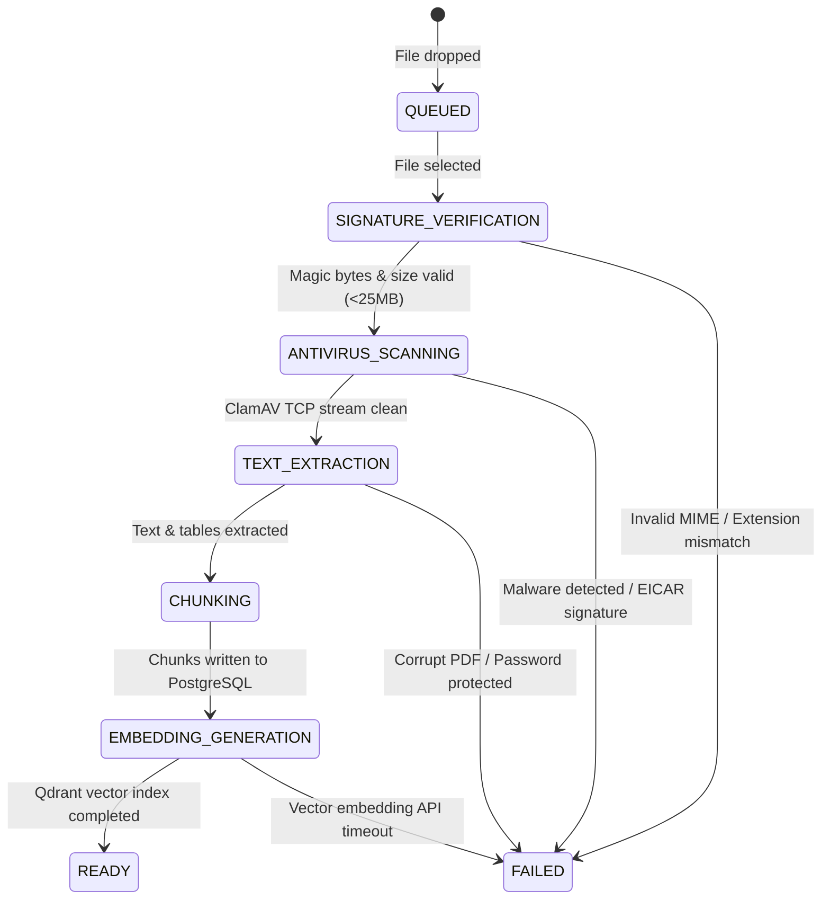

# Part VII: Frontend, Protocols, DevOps & Observability
### Authoritative Master Engineering & System Architecture Answers (Questions 209 to 228)

---

## Chapter 22: TypeScript 5, React 18, Pyodide WASM & Web Protocols

---

### Question 209 [Frontend - Basic]: Client UI Architecture & Component Hierarchy

#### Context & Motivation:
The frontend SPA is built using React 18 / 19, Vite 5, TypeScript 5, and Tailwind CSS v4. A Principal Full-Stack Engineer must be able to design, structure, and maintain a high-performance, accessible, and reactive client architecture capable of managing complex state machines, live streaming feeds, and responsive multi-pane layouts.

#### Master Answer & Architectural Explanation:

##### 1. Top-Level Application Layout & Component Tree
FusionRAG employs a hierarchical, modular layout architecture centered around `MainLayout.tsx` and `ChatLayout.tsx`. The interface is partitioned into five distinct layout regions that coordinate via React Context and TanStack Query:

```
+---------------------------------------------------------------------------------------------------------+
|                                              Header.tsx                                                 |
|  [Logo & Workspace]  [Search / Cmd+K]  [Active Mode: Auto/Hybrid]  [Theme Toggle]  [User Profile Menu]   |
+---------------------------------------------------------------------------------------------------------+
|      Sidebar.tsx      |                     ChatArea.tsx                     |   CitationDrawer.tsx     |
|                       |                                                      |   (Collapsible Sheet)    |
| - Workspace Tree      | +--------------------------------------------------+ |                          |
| - Project Folders     | | MessageList.tsx (TanStack Virtual Window)        | | - Source Document Meta   |
| - Keyset-Paginated    | |   - ChatMessage (User)                           | | - Page & Line Highlight  |
|   Conversations       | |   - ChatMessage (Assistant: Markdown + Shiki)    | | - Chunk Text Viewer      |
|   (Pinned & Recent)   | |   - ToolCallCard (Agent DAG Wave Visualizer)     | | - Cosine / RRF Score     |
| - Upload Progress     | |   - CodeInterpreterOutput (Pyodide Matplotlib)   | | - NLI Entailment Badge   |
|   Indicator           | +--------------------------------------------------+ |                          |
| - Storage Quota Bar   | | ChatInput.tsx (Composer)                         | |                          |
| - Global Document     | |   - Auto-growing Textarea & Draft Persistence    | |                          |
|   Manager Link        | |   - Attachment Chips (@doc / conversation scope) | |                          |
|                       | |   - Model & Temperature Sliders                  | |                          |
+-----------------------+------------------------------------------------------+--------------------------+
```

1. **Sidebar (`Sidebar.tsx`, `SidebarConversationList.tsx`, `SidebarFolders.tsx`)**:
   - Manages the user's project hierarchy, pinned threads, and keyset cursor-paginated conversations (`next_cursor`, `prev_cursor`).
   - Hosts the `SidebarUploadIndicator.tsx` to surface global background file upload stages (1–7) without interrupting chat interactions.
   - Houses the storage quota usage meter and navigation links to `/documents`, `/settings`, and `/admin/dashboard`.
2. **Main Chat Container (`ChatPage.tsx`, `ChatWindow.tsx`)**:
   - Manages active conversation lifecycle, SSE streaming controllers, and optimistic dispatch.
   - Coordinates message truncation and regeneration flows (`deleteBeforeStreamMessageId`).
3. **Message Feed (`MessageList.tsx`, `ChatMessage.tsx`)**:
   - Employs **TanStack Virtual (`useVirtualizer`)** for dynamic windowing of long conversation threads, maintaining 60 FPS even with thousands of DOM nodes.
   - Renders polymorphic message content: user prompts, streaming assistant markdown, tool call cards (`ToolCallCard.tsx`), and inline WebAssembly execution widgets.
4. **Composer (`ChatInput.tsx`, `ChatToolbar.tsx`)**:
   - Provides an auto-resizing textarea with draft persistence via `localStorage` keyed by conversation ID (`useDrafts.ts`).
   - Supports inline document tagging (`@document-name`), attachment dropzones, and keyboard shortcuts (`Enter` to submit, `Shift+Enter` for newline, `Cmd+K` for command palette).
5. **Document Source Drawer (`CitationDrawer.tsx`)**:
   - A slide-over sheet built with **Radix UI Dialog / Sheet primitives** that renders when any citation badge (`[1]`, `[Doc 2, Chunk 3]`) is clicked.
   - Highlights the exact chunk boundaries, surfaces NLI entailment status (`ENTAILED`, `CONTRADICTED`, `INSUFFICIENT`), and displays cross-encoder reranking scores.

##### 2. Route Guards & Navigation Security
Route security is enforced using **React Router v7** layout route boundaries:

```tsx
// frontend/src/routes/ProtectedRoute.tsx
import { Navigate, Outlet, useLocation } from "react-router-dom";
import { useAuth } from "../hooks/useAuth";

export const ProtectedRoute: React.FC = () => {
  const { user, isAuthenticated, isLoading } = useAuth();
  const location = useLocation();

  if (isLoading) {
    return <div className="flex h-screen items-center justify-center"><Spinner size="lg" /></div>;
  }

  if (!isAuthenticated || !user) {
    // Preserve attempted destination for post-login redirect
    return <Navigate to="/login" state={{ from: location }} replace />;
  }

  // Enforce mandatory email verification gate (NIST SP 800-63B)
  if (!user.is_verified) {
    return <Navigate to="/verify-email" replace />;
  }

  return <Outlet />;
};

// frontend/src/routes/AdminRoute.tsx
export const AdminRoute: React.FC = () => {
  const { user, isAuthenticated, isLoading } = useAuth();

  if (isLoading) return <Spinner size="lg" />;
  if (!isAuthenticated || user?.role !== "admin") {
    return <Navigate to="/chat" replace />;
  }
  return <Outlet />;
};
```

- **`PublicRoute`**: Redirects authenticated users away from `/login` and `/register` directly to `/chat`.
- **`ProtectedRoute`**: Validates session presence, active memory tokens, and user verification flags. If unverified, the user is redirected to `/verify-email`.
- **`AdminRoute`**: Restricts the operational monitoring dashboard (`/admin/dashboard`), telemetry traces, and evaluation runners to users holding the `admin` role claim.

##### 3. Responsive Design System with Tailwind CSS v4
Tailwind CSS v4 introduces the modern CSS-first engine using `@theme` block directives. FusionRAG implements full fluid responsiveness across 320px mobile viewports through 4K desktop monitors:
- **Dynamic Viewport Heights**: Utilizes `h-[100dvh]` (dynamic viewport height) across containers to prevent mobile browser URL bar jumping on iOS Safari and Android Chrome.
- **Collapsible Drawer Transitions**: The desktop sidebar collapses into a slide-over mobile drawer utilizing Radix UI's `Dialog.Content` with CSS transitions (`translate-x-0` vs `-translate-x-full`).
- **Breakpoint Strategies**:
  - `sm: (640px)`: Chat input controls stack vertically on phones; buttons become icon-only.
  - `md: (768px)`: Sidebar becomes toggleable via hamburger menu; composer controls expand inline.
  - `lg: (1024px)`: Sidebar docks permanently with collapsible state (`w-64` vs `w-16`); Message feed expands to fixed reading column (`max-w-3xl mx-auto`).
  - `xl: (1280px)`: Document Source Drawer docks as a third side-by-side pane rather than an overlay modal, allowing simultaneous document inspection while chatting.

---

### Question 210 [Frontend - Intermediate]: Server-Sent Events (SSE) Client Consumer Protocol

#### Context & Motivation:
FastAPI dispatches multi-agent reasoning, retrieval diagnostics, and LLM tokens over an HTTP/1.1 SSE stream at `/api/v1/chat/stream`. Standard browser `EventSource` only supports `GET` requests and cannot supply custom JSON request bodies or `Authorization` headers. The frontend must implement a robust, type-safe streaming consumer.

#### Master Answer & Architectural Explanation:

##### 1. The `useSSEChat` Hook & Native Fetch Async Generator
Because standard `EventSource` is limited to GET requests, FusionRAG constructs an `AsyncGenerator<SSEEvent>` powered by native `fetch` and `ReadableStreamDefaultReader<Uint8Array>` inside `frontend/src/api/client.ts`.

The hook `useSSEChat.ts` consumes this generator using the `for await...of` construct:

```typescript
// frontend/src/api/client.ts (Excerpt)
export async function* createSSEStream(
  path: string,
  body: object,
  signal?: AbortSignal
): AsyncGenerator<SSEEvent> {
  const url = BASE_URL + path;
  let response = await fetch(url, {
    method: "POST",
    headers: {
      "Content-Type": "application/json",
      "Authorization": `Bearer ${getAccessToken()}`,
    },
    body: JSON.stringify(body),
    signal,
    credentials: "include",
  });

  if (response.status === 401) {
    const tokenResponse = await executeRefresh();
    response = await fetch(url, {
      method: "POST",
      headers: {
        "Content-Type": "application/json",
        "Authorization": `Bearer ${tokenResponse.access_token}`,
      },
      body: JSON.stringify(body),
      signal,
      credentials: "include",
    });
  }

  if (!response.ok) {
    const errText = await response.text();
    throw new Error(`HTTP ${response.status}: ${errText}`);
  }

  const reader = response.body?.getReader();
  if (!reader) throw new Error("No response body reader available");

  const decoder = new TextDecoder("utf-8");
  let buffer = "";
  let currentEvent: SSEEventType | null = null;
  let currentData = "";

  while (true) {
    const { done, value } = await reader.read();
    if (done) break;

    buffer += decoder.decode(value, { stream: true });
    const lines = buffer.split("\n");
    buffer = lines.pop() || ""; // Retain incomplete trailing line in buffer

    for (const line of lines) {
      const trimmed = line.trim();
      if (!trimmed) {
        // Empty line signals dispatch of current SSE frame
        if (currentEvent && currentData) {
          try {
            yield { event: currentEvent, data: JSON.parse(currentData) };
          } catch (e) {
            console.error("SSE JSON Parse Error:", e, currentData);
          }
          currentEvent = null;
          currentData = "";
        }
        continue;
      }
      if (trimmed.startsWith("event:")) {
        currentEvent = trimmed.slice(6).trim() as SSEEventType;
      } else if (trimmed.startsWith("data:")) {
        const chunk = trimmed.slice(5).trim();
        currentData = currentData ? `${currentData}\n${chunk}` : chunk;
      }
    }
  }
}
```

##### 2. Handling the 5 Core Structured Event Types
The client handles a strictly typed stream of lifecycle events dispatched by the backend:

1. **`event: metadata`**:
   - Sent immediately after planning and retrieval.
   - Contains `conversation_id`, DAG execution plan, citations, and retrieval diagnostics (`retrieval_skipped`, `dense_count`, `sparse_count`).
   - Action: Stores citations in message state, initializes the assistant message bubble, and links `conversation_id` in URL parameters if initiating a new thread.
2. **`event: thought`**:
   - Emits internal reasoning steps from `MasterAgent` or specialist agents (e.g. `Thought: Decomposing user prompt into 2 retrieval sub-queries`).
   - Action: Renders an expandable thought block ("Reasoning process...") with an animated spinning indicator.
3. **`event: text`**:
   - Contains raw token deltas (`data: {"text": " token"}`).
   - Action: Appends delta to the current assistant message content string. Triggers low-latency typewriter animation.
4. **`event: citation`**:
   - Emits resolved document references with ground truth mappings (`document_name`, `chunk_id`, `page_number`, `similarity_score`).
   - Action: Attaches citations array to the message object for interactive badge rendering.
5. **`event: done`**:
   - Carries final aggregate statistics: `total_tokens`, `prompt_tokens`, `completion_tokens`, total latency, and final sanitized answer string.
   - Action: Sets message status from `streaming` to `completed`, releases the `AbortController`, triggers audio chime / browser notifications (`maybeNotifyStreamComplete`), and invalidates TanStack Query caches.

##### 3. Error Handling, Socket Drops & Partial Message Recovery
- **User Cancellation**: Clicking "Stop Generating" calls `abortController.abort()`. The catch block intercepts `AbortError`, flushes accumulated tokens, transitions message status to `interrupted`, and notifies the backend to terminate agent execution waves.
- **Socket Drops & Network Timeouts**: If the connection abruptly drops mid-stream, `useSSEChat` catches the network failure, marks the assistant message status as `interrupted`, and sets `connectionLost = true`.
- **`StreamingRecovery.tsx`**: Renders an inline banner beneath the partial message: *"Connection lost mid-response. [Resume Generation]"*. Clicking "Resume" dispatches a request with `truncateFromMessageId` or `deleteBeforeStreamMessageId`, sending the accumulated prompt history back to the backend to seamlessly synthesize the remainder without duplicating earlier text.

---

### Question 211 [Frontend - Advanced]: Pyodide WebAssembly (WASM) Sandbox Worker Protocol

#### Context & Motivation:
When users ask FusionRAG to analyze tabular data, perform statistical tests, or generate visual charts, executing untrusted code on the backend creates severe container-breakout and denial-of-service risks. Running Python inside the client browser via Pyodide WebAssembly provides a zero-cost, infinitely scalable, and mathematically secure sandbox.

#### Master Answer & Architectural Explanation:

##### 1. What is Pyodide and WebAssembly Sandboxing?
**Pyodide** is a port of CPython to WebAssembly (WASM) and Emscripten. It compiles the CPython 3.12 interpreter into a standalone `.wasm` binary that executes within the browser's WebAssembly virtual machine:
- **Memory Safety**: WASM runs inside a linear memory space isolated from the host operating system. The Python code has no access to host files, system sockets, or local processes.
- **Browser Security Sandbox**: The WASM runtime inherits the browser's same-origin security boundary. It cannot execute arbitrary system calls or access cookies/storage unless explicitly bridged via JavaScript.

##### 2. Architectural Trade-offs: Client WASM vs Server Backend Execution

| Dimension | Client-Side Pyodide (WASM) | Backend Server Sandbox (Docker/gVisor) |
| :--- | :--- | :--- |
| **Compute Cost** | **$0.00** (Zero backend CPU/RAM consumed; runs on user hardware) | High (requires dedicated worker pools, VMs, or microVMs) |
| **Security Surface** | **Zero Server Risk** (Impossible to perform RCE against server infrastructure) | Significant (risk of container escapes, kernel 0-days, lateral VPC movement) |
| **Data Privacy** | High (Client's confidential CSV/data never leaves their browser session) | Lower (Confidential data must be sent across network to execution worker) |
| **Scalability** | **Infinite Horizontal Scaling** ($100,000$ concurrent users = 0 server load) | Strict concurrency limits governed by backend CPU/Memory capacity |
| **Cold Start** | ~2–4 seconds initial WASM download (cached permanently via IndexedDB) | 50ms–200ms warm worker invocation |
| **Network Egress** | Zero backend network egress; Matplotlib renders directly to canvas | Network bandwidth consumed streaming rendered PNGs from server to client |

##### 3. Web Worker Protocol (`pyodide.worker.ts`)
To prevent heavy mathematical computations or chart generation from blocking React's main UI thread (which causes 60 FPS drops, typing latency, and UI freezes), Pyodide is completely isolated in a dedicated HTML5 Web Worker.

```
+--------------------------+                         +-------------------------------+
|     React Main Thread    |                         |  pyodide.worker.ts (WASM VM)  |
|                          |                         |                               |
| 1. User prompts chart    | --- RUN (code, files) ->| 2. Mount virtual files in FS  |
| 3. Displays progress bar |                         | 4. micropip / loadPackage()   |
| 5. Shows status update   | <- STATUS_UPDATE -------|    (pandas, numpy, matplotlib)|
|                          |                         | 6. Redirect sys.stdout/stderr |
|                          |                         | 7. exec(code, globals())      |
|                          |                         | 8. Intercept Matplotlib figs  |
| 9. CodeInterpreterOutput | <- RUN_RESULT ----------| 9. Convert BytesIO to Base64  |
|    renders PNG chart     |    (stdout, plots, ms)  |                               |
+--------------------------+                         +-------------------------------+
```

The worker communicates via a strictly typed bidirectional message protocol:

```typescript
// frontend/src/workers/pyodide.worker.ts (Excerpt)
export interface RunRequest {
  id: string;
  type: "RUN";
  code: string;
  files?: Record<string, string>; // filename -> virtual file content
}

export interface WorkerResponse {
  id: string;
  type: "RUN_RESULT" | "STATUS_UPDATE";
  success?: boolean;
  status?: string;
  stdout?: string;
  stderr?: string;
  plots?: string[]; // Array of base64 PNG data URLs
  executionTimeMs?: number;
  error?: string;
}
```

##### 4. Intercepting Matplotlib Plots & Base64 Rendering
Because browsers lack X11 or Wayland display servers, Matplotlib's default GUI backends (`TkAgg`, `QtAgg`) will fail. The worker script forces Matplotlib to use the headless **`Agg`** backend, intercepts all rendered figures from `plt.get_fignums()`, and encodes them into Base64 PNGs:

```python
# Injected sandbox wrapper script inside Web Worker
import sys, io, base64

_redirector.start()
_captured_plots = []

try:
    import matplotlib
    matplotlib.use('Agg')  # Headless Anti-Grain Geometry backend
    import matplotlib.pyplot as plt
    _has_mpl = True
except ImportError:
    _has_mpl = False

_exec_error = None
try:
    exec(user_code, globals())
except Exception as _e:
    _exec_error = _e

if _has_mpl:
    import matplotlib.pyplot as plt
    for fignum in plt.get_fignums():
        fig = plt.figure(fignum)
        buf = io.BytesIO()
        fig.savefig(buf, format='png', bbox_inches='tight', dpi=130)
        buf.seek(0)
        img_b64 = base64.b64encode(buf.read()).decode('ascii')
        _captured_plots.append(f"data:image/png;base64,{img_b64}")
    plt.close('all')

_stdout, _stderr = _redirector.stop()
if _exec_error is not None:
    raise _exec_error
```

The captured array of base64 strings is dispatched to the main thread and rendered by `CodeInterpreterOutput.tsx` as responsive, high-resolution PNG charts with zoom and download capabilities.

---

### Question 212 [Frontend - Intermediate]: 7-Stage Progressive Upload Pipeline

#### Context & Motivation:
Processing dense technical documents involves multiple asynchronous stages: client hashing, antivirus scanning, text extraction, chunking, and vector indexing. Providing immediate, transparent feedback prevents user frustration during multi-minute indexing jobs.

#### Master Answer & Architectural Explanation:

##### 1. The 7-Stage Upload State Machine
The upload lifecycle follows a deterministic 7-stage state machine defined in `frontend/src/lib/uploadStages.ts` and managed by `UploadQueueContext.tsx`:



1. **`QUEUED` (0–5%)**: File registered in client upload queue; awaiting concurrent upload slot (max concurrency: 3).
2. **`SIGNATURE_VERIFICATION` (10–15%)**: Client reads first 4KB via `FileReader` to verify magic numbers (`%PDF-`, `PK\x03\x04` for DOCX) and computes client-side SHA-256 hash.
3. **`ANTIVIRUS_SCANNING` (20–30%)**: Backend streams file over TCP to ClamAV daemon (`INSTREAM` command).
4. **`TEXT_EXTRACTION` (35–50%)**: `DocumentProcessingService` executes PyMuPDF / python-docx / OCR parsing to extract raw text, tables, and images.
5. **`CHUNKING` (55–65%)**: Semantic, recursive, or sentence-window chunkers break text into discrete chunks and persist them to PostgreSQL `document_chunks`.
6. **`EMBEDDING_GENERATION` (70–95%)**: Matryoshka 768-dim embeddings generated via Jina AI API and indexed into Qdrant collection with payload tenant fences.
7. **`READY` (100%)**: Document status reaches `completed`, embedding status reaches `completed`. Document is active and searchable.

##### 2. Optimistic State Transitions & Polling Synchronization
Because chunking and embedding occur asynchronously in background worker queues (Redis Streams), the frontend coordinates between optimistic client progress and server polling:

```typescript
// frontend/src/lib/uploadStages.ts (Excerpt)
export function deriveUploadStage(
  docStatus: DocumentStatus | undefined,
  embedding: EmbeddingStatus | undefined,
  startedAt: number | null,
): UploadStage {
  if (!docStatus || docStatus === "pending") {
    return { progress: 15, detail: "Uploaded — queued for processing…" };
  }
  if (docStatus === "processing") {
    // Cycles through sub-steps based on elapsed time
    return { progress: 40, detail: chunkingStep(startedAt) };
  }
  if (docStatus === "failed") {
    return { progress: 100, detail: "Processing failed — check document library." };
  }

  // Document chunked: now tracking Vector DB embedding progress
  if (!embedding || embedding.status === "pending") {
    return { progress: 70, detail: "Preparing to index in vector DB…" };
  }
  if (embedding.status === "generating") {
    const total = embedding.chunks_total || 1;
    const pct = Math.min(95, Math.round(70 + 25 * (embedding.embedded_chunks / total)));
    return {
      progress: pct,
      detail: `Indexing into vector DB — ${embedding.embedded_chunks} of ${embedding.chunks_total} chunks embedded`,
    };
  }
  if (embedding.status === "failed") {
    return { progress: 100, detail: VECTORIZATION_FAILED_MESSAGE };
  }
  return { progress: 100, detail: "Indexed in vector DB — ready to chat" };
}
```

##### 3. Actionable Error Recovery
When a stage fails, the UI surfaces specific diagnostic messages and remediation actions:
- **Zip-Bomb / Compression Ratio Exceeded**: Shows *"Decompression ratio exceeds 10:1 safety limit. File rejected for security."*
- **Malware Detected**: Highlights file in red: *"Security Alert: Malicious signature detected by ClamAV. File purged immediately."*
- **Vectorization Failure (`isVectorizationFailed`)**: The text is intact in PostgreSQL, but embedding failed due to rate limits. The UI displays an amber badge with a single-click **"Regenerate Embeddings"** trigger without requiring the user to re-upload the original 25MB file.

---

### Question 213 [Frontend - Intermediate]: Optimistic UI Updates & Cache Invalidation

#### Context & Motivation:
Under network latency of 200–500ms, waiting for the server to acknowledge an action makes chat applications feel sluggish. The frontend must implement optimistic updates to render user actions immediately while providing resilient rollback mechanisms on failure.

#### Master Answer & Architectural Explanation:

##### 1. Optimistic Message Dispatch Protocol
When a user clicks "Send", `useSSEChat` appends the message immediately to the UI feed before the network request is even established:

```typescript
// Optimistic insertion in useSSEChat.ts
const userMsg: ChatMessage = {
  id: crypto.randomUUID(),
  role: "user",
  content: question,
  created_at: new Date().toISOString(),
};

const assistantMsg: ChatMessage = {
  id: crypto.randomUUID(),
  role: "assistant",
  content: "",
  status: "pending",
  citations: [],
  toolCalls: [],
  created_at: new Date().toISOString(),
};

// Immediate state dispatch: zero UI latency
setChatMessages((prev) => [...prev, userMsg, assistantMsg]);
```

##### 2. Cache Invalidation with TanStack Query v5
TanStack Query manages server state across the SPA. When mutating documents, projects, or conversations, optimistic updates modify the in-memory cache directly:

```typescript
// frontend/src/hooks/useConversations.ts (Optimistic Deletion Example)
export const useDeleteConversation = () => {
  const queryClient = useQueryClient();

  return useMutation({
    mutationFn: (conversationId: string) => conversationsApi.delete(conversationId),
    onMutate: async (deletedId: string) => {
      // 1. Cancel any outgoing refetches to prevent overwriting optimistic state
      await queryClient.cancelQueries({ queryKey: [QUERY_KEYS.CONVERSATIONS] });

      // 2. Snapshot current cache for rollback
      const previousConversations = queryClient.getQueryData([QUERY_KEYS.CONVERSATIONS]);

      // 3. Optimistically remove conversation from UI list
      queryClient.setQueryData([QUERY_KEYS.CONVERSATIONS], (old: Conversation[] | undefined) =>
        old ? old.filter((c) => c.id !== deletedId) : []
      );

      return { previousConversations };
    },
    onError: (_err, _deletedId, context) => {
      // 4. Rollback to original snapshot on network error
      if (context?.previousConversations) {
        queryClient.setQueryData([QUERY_KEYS.CONVERSATIONS], context.previousConversations);
      }
      toast.error("Failed to delete conversation. Reverted changes.");
    },
    onSettled: () => {
      // 5. Always refetch to sync with server truth
      queryClient.invalidateQueries({ queryKey: [QUERY_KEYS.CONVERSATIONS] });
    },
  });
};
```

##### 3. Message Regeneration & Keyset Rollbacks
When editing an earlier message and resending, the frontend must truncate the UI feed immediately while preventing race conditions on the backend:
- `deleteBeforeStreamMessageId`: Sent to the backend to delete trailing messages from PostgreSQL before opening the new SSE stream.
- `truncateFromMessageId`: Truncates client-side React message state instantly to maintain visual consistency. If the subsequent stream fails, the previous message branch is restored from cache.

---

### Question 214 [Frontend - Intermediate]: Interactive Citations & Source Document Drawer

#### Context & Motivation:
RAG applications must establish verifiability by proving that every generated claim is grounded in retrieved context. The UI must render interactive citation badges directly inside markdown responses and provide a seamless inspection interface.

#### Master Answer & Architectural Explanation:

##### 1. Parsing Citations in Markdown Streams
LLM generation outputs citations formatted as bracketed tags, e.g. `[1]`, `[Doc: 2, Chunk: 5]`, or `[cite: uuid]`. 

To prevent broken markdown rendering, FusionRAG utilizes a custom **rehype/remark plugin** or an inline regex token replacement that converts textual citation tags into interactive React components:

```tsx
// Inside custom MarkdownRenderer.tsx
const renderCitation = (citationIndex: number) => {
  const citation = citations?.find((c) => c.chunk_index === citationIndex || c.citation_num === citationIndex);
  if (!citation) return <sup>[{citationIndex}]</sup>;

  return (
    <button
      onClick={() => onSelectCitation(citation)}
      className="inline-flex items-center px-1.5 py-0.5 mx-0.5 text-xs font-semibold text-primary bg-primary/10 hover:bg-primary/20 rounded border border-primary/30 transition-colors"
      title={`Source: ${citation.document_name} (Page ${citation.page_number || "N/A"})`}
    >
      [{citationIndex}]
    </button>
  );
};
```

##### 2. The Slide-Over `CitationDrawer`
Clicking a citation badge triggers the slide-over `CitationDrawer.tsx`, built using `@radix-ui/react-dialog`:
- **Smooth Animation**: Transitions from `translate-x-full` to `translate-x-0` via CSS transforms, keeping the chat conversation visible on the left.
- **Source Document Metadata**: Displays file name, MIME type icon, file size, SHA-256 checksum, ingestion timestamp, and original page count.
- **Exact Passage Highlighting**: Highlights the exact chunk sentences used by the model with subtle background shading (`bg-amber-100 dark:bg-amber-900/30`).
- **NLI Entailment Badge**: Displays the verification status evaluated by `SynthesisAgent`:
  - `ENTAILED` (Green): Factual claim is fully supported by context.
  - `INSUFFICIENT` (Amber): Claim is partially supported or speculative.
  - `CONTRADICTED` (Red): Context directly contradicts the claim.
- **Similarity & Rerank Scores**: Displays the Jina AI cross-encoder confidence score (e.g. `0.942`) and Reciprocal Rank Fusion rank (`#1 in hybrid search`).

---

### Question 215 [Frontend - Intermediate]: Rendering Complex Content: Markdown, KaTeX & Shiki

#### Context & Motivation:
Technical RAG responses include complex LaTeX mathematics, nested markdown tables, and multi-language code blocks. These elements must render accurately with fast syntax highlighting without causing re-render thrashing during real-time token streaming.

#### Master Answer & Architectural Explanation:

##### 1. LaTeX Mathematical Formatting with KaTeX
FusionRAG parses LaTeX expressions using `rehype-katex` and `remark-math`:
- **Inline Math**: Formatted using single dollar delimiters (`$E = mc^2$`).
- **Display Math**: Formatted using double dollar delimiters (`$$\int_{-\infty}^{\infty} e^{-x^2} dx = \sqrt{\pi}$$`).
- **Error Boundaries**: If the LLM generates malformed LaTeX (e.g. unclosed brackets), KaTeX is configured with `throwOnError: false`, gracefully falling back to raw monospace code rather than crashing the component tree.

##### 2. High-Performance Code Highlighting with Shiki
Traditional highlighters like `Prism.js` or `highlight.js` rely on regular expressions that often misclassify complex syntax. FusionRAG uses **Shiki**, which runs the exact same TextMate grammar engine as Visual Studio Code:
- **Dual Theme Support**: Automatically renders dark and light themes (`github-dark` and `github-light`) via CSS variables without re-tokenizing.
- **Copy-to-Clipboard**: Header bar includes language badges (`Python`, `TypeScript`, `SQL`), line numbers, and a copy button that displays a temporary checkmark icon (`Copied!`).
- **Run in Pyodide Button**: For executable Python code blocks, an inline **"Run in Browser"** button is attached, sending the code directly to `pyodide.worker.ts`.

##### 3. Memoization & Preventing Re-render Thrashing
Token streaming dispatches updates at 30–80 tokens per second. Re-parsing markdown and re-tokenizing Shiki blocks on every single character arrival would overwhelm the JavaScript main thread.

FusionRAG applies strict memoization patterns:
1. **`React.memo(ChatMessage)`**: The message list only re-renders the *active streaming assistant message*; all previous user and assistant messages remain untouched.
2. **Debounced Syntax Highlighting**: While a code block is actively receiving tokens, syntax highlighting falls back to lightweight plain text; Shiki tokenization triggers once the code fence closes (`` ``` ``) or streaming pauses.
3. **`useMemo` for AST Parsing**: Markdown AST generation is memoized against the message content string.

---

### Question 216 [TypeScript - Advanced]: TypeScript 5 Discriminated Unions & Generics

#### Context & Motivation:
A large-scale production frontend cannot tolerate `any` types or loose object schemas. TypeScript 5's type system provides compile-time safety across dynamic network streams, polymorphic agents, and UI component models.

#### Master Answer & Architectural Explanation:

##### 1. Discriminated Unions for SSE Stream Events
A **Discriminated Union** (or tagged union) is a pattern where multiple object types share a common literal property (the "discriminant"), enabling the TypeScript compiler to exhaustively narrow types inside branch statements.

```typescript
// frontend/src/types/stream.ts
export type SSEStreamEvent =
  | { event: "metadata"; data: { conversation_id: string; citations: Citation[]; diagnostics: Diagnostics } }
  | { event: "thought"; data: { agent: string; reasoning: string; step: number } }
  | { event: "text"; data: { text: string } }
  | { event: "tool_call_started"; data: { id: string; name: string; arguments: Record<string, unknown> } }
  | { event: "tool_call_completed"; data: { id: string; result: unknown } }
  | { event: "citation"; data: Citation }
  | { event: "done"; data: { answer: string; usage: TokenUsage; total_time_ms: number } }
  | { event: "error"; data: { code: string; message: string; details?: unknown } };

// Exhaustive type narrowing with compiler verification
export function handleStreamEvent(event: SSEStreamEvent): void {
  switch (event.event) {
    case "text":
      // TypeScript automatically narrows event.data to { text: string }
      appendToMessage(event.data.text);
      break;
    case "tool_call_started":
      // event.data narrowed to { id: string; name: string; arguments: ... }
      registerRunningTool(event.data.id, event.data.name);
      break;
    case "metadata":
      setConversationMetadata(event.data.conversation_id, event.data.citations);
      break;
    case "done":
      finalizeStream(event.data.answer, event.data.usage);
      break;
    case "thought":
    case "tool_call_completed":
    case "citation":
    case "error":
      break;
    default: {
      // Exhaustiveness check: compile error if a new union variant is added but unhandled
      const _exhaustiveCheck: never = event;
      throw new Error(`Unhandled event type: ${_exhaustiveCheck}`);
    }
  }
}
```

##### 2. TypeScript Utility Types
FusionRAG eliminates interface duplication using TypeScript utility types:
- **`Partial<T>`**: Used in patch requests (e.g. `updateConversation(id, data: Partial<ConversationSettings>)`).
- **`Pick<T, K>`**: Extracts specific properties for compact views (e.g. `type ConversationListItem = Pick<Conversation, 'id' | 'title' | 'last_message_at'>`).
- **`Omit<T, K>`**: Derives creation DTOs from database models (e.g. `type CreateDocumentDTO = Omit<Document, 'id' | 'created_at' | 'status'>`).
- **`Record<K, T>`**: Defines strict dictionary mappings (e.g. `Record<UploadStageId, UploadStageConfig>`).

##### 3. Generic Constraints
Generic constraints (`<T extends Constraint>`) ensure type safety across polymorphic components:

```typescript
// Generic document table component enforcing BaseDocument interface
export interface BaseDocument {
  id: string;
  created_at: string;
}

export function DocumentList<T extends BaseDocument>({
  items,
  renderItem,
}: {
  items: T[];
  renderItem: (item: T) => React.ReactNode;
}) {
  return (
    <div className="divide-y">
      {items.map((item) => (
        <div key={item.id}>{renderItem(item)}</div>
      ))}
    </div>
  );
}
```

---

### Question 217 [React 18 - Advanced]: React 18 Concurrent Rendering & Fiber Architecture

#### Context & Motivation:
High-frequency SSE streaming (up to 80 tokens/sec) and multi-agent wave updates can easily saturate the browser's main thread, causing user input lag in the composer. Understanding React 18 Fiber and concurrent features is critical for maintaining interface responsiveness.

#### Master Answer & Architectural Explanation:

##### 1. React Fiber Architecture & Concurrent Reconciliation
React Fiber is a complete rewrite of React's reconciliation engine. In the legacy stack-reconciler, tree traversal was recursive and synchronous—once rendering began, it could not be interrupted until the entire DOM tree reconciled.

**Fiber represents component instances as a doubly-linked list of fiber nodes**:
- Each fiber node contains pointers: `child`, `sibling`, and `return` (parent).
- **Two-Phase Architecture**:
  1. **Render / Reconciliation Phase (Interruptible)**: React traverses fiber nodes, computes diffs, and assigns priority levels (lanes). If high-priority work (e.g. user keystroke) arrives, React pauses execution, yields control to the browser event loop, and resumes or aborts the lower-priority work later.
  2. **Commit Phase (Synchronous & Non-Interruptible)**: Mutates the host DOM nodes and executes layout effects in one atomic batch.
- **Double Buffering**: React maintains two trees: the `current` tree (rendered on screen) and the `workInProgress` tree (built in background memory). On commit, React simply swaps the root pointer.

##### 2. Prioritizing User Input via `useTransition` and `useDeferredValue`
During heavy streaming, typing inside `ChatInput` must never drop frames. React 18 provides `useTransition` to decouple **urgent updates** (direct user input) from **transition updates** (heavy UI re-renders):

```tsx
export const ChatArea: React.FC = () => {
  const [inputValue, setInputValue] = useState("");
  const [streamContent, setStreamContent] = useState("");
  const [isPending, startTransition] = useTransition();

  // Urgent update: keyboard input updates immediately on main thread
  const handleInputChange = (e: React.ChangeEvent<HTMLTextAreaElement>) => {
    setInputValue(e.target.value);
  };

  // Non-urgent update: streaming token accumulation marked as transition
  const handleIncomingToken = (tokenDelta: string) => {
    startTransition(() => {
      setStreamContent((prev) => prev + tokenDelta);
    });
  };

  return (
    <div>
      <MessageDisplay content={streamContent} isUpdating={isPending} />
      <textarea value={inputValue} onChange={handleInputChange} />
    </div>
  );
};
```

Using `useTransition`, if the user types while a token chunk arrives, React interrupts the markdown rendering to process the keystroke instantly, ensuring the input textarea feels responsive.

##### 3. Stale Closures in High-Frequency SSE Streams
A common frontend bug during rapid streaming is the **stale closure**. In asynchronous stream loops, referencing state directly captures the initial render value:

```typescript
// CATASTROPHIC BUG: Stale closure
for await (const chunk of stream) {
  // `chatMessages` is closed over from the initial render!
  // Every chunk overwrites previous chunks instead of appending.
  setChatMessages([...chatMessages, { role: "assistant", content: chunk.text }]);
}

// CORRECT: Functional State Update
for await (const chunk of stream) {
  setChatMessages((prev) => {
    const next = [...prev];
    const last = next[next.length - 1];
    if (last && last.role === "assistant") {
      next[next.length - 1] = { ...last, content: last.content + chunk.text };
    }
    return next;
  });
}
```
Functional state updates pass the current internal Fiber state (`prev`) to the updater function, guaranteeing atomic updates without race conditions.

---

### Question 218 [Protocols - Intermediate]: Nginx Gateway Configuration & Reverse Proxying

#### Context & Motivation:
In production, Nginx acts as the reverse proxy gateway routing public traffic to FastAPI Uvicorn workers. Misconfigurations in buffer management or timeout windows will silently break SSE token streaming and multi-agent DAG pipelines.

#### Master Answer & Architectural Explanation:

##### 1. Why `proxy_buffering off;` and `proxy_cache off;` are Required for SSE
By default, Nginx is optimized for high-throughput static and RESTful workloads: it reads upstream responses into memory buffers (typically 4KB to 8KB) before transmitting them downstream to the client.

For **Server-Sent Events (SSE)**, proxy buffering is catastrophic:
- **Token Starvation**: LLM tokens arrive in small 10–50 byte increments. Nginx buffers these increments until the 4KB buffer fills, causing tokens to stall. The user sees a frozen screen followed by an abrupt burst of text.
- **Connection Timeouts**: While Nginx waits for its buffer to fill, no bytes are sent to the client, triggering browser socket read timeouts.

**Mandatory Configuration in `deployment/nginx/nginx.conf`**:
```nginx
location / {
    proxy_pass http://backend_upstream;
    proxy_http_version 1.1;

    # Critical SSE Streaming Directives
    proxy_buffering off;
    proxy_cache off;
    chunked_transfer_encoding on;
    proxy_set_header Connection '';

    # Extended timeout for long-running multi-agent DAG execution
    proxy_read_timeout 120s;
    proxy_send_timeout 30s;
    proxy_connect_timeout 10s;

    # Client IP and header forwarding
    proxy_set_header Host $host;
    proxy_set_header X-Real-IP $remote_addr;
    proxy_set_header X-Forwarded-For $proxy_add_x_forwarded_for;
    proxy_set_header X-Forwarded-Proto $scheme;
    proxy_set_header X-Request-ID $request_id;
}
```

##### 2. Header Forwarding for Security & Rate Limiting
FastAPI runs behind Nginx on a private Docker bridge network (`backend:8000`). Without header forwarding, FastAPI's `request.client.host` will always register as `172.18.0.x` (the Nginx container IP).

Forwarding headers ensures accurate client identification:
- **`X-Real-IP` & `X-Forwarded-For`**: Forward the original client public IP address. FastAPI's `ProductionMiddleware` and Redis sliding-window rate limiters use these headers to prevent DDoS attacks and enforce per-user rate limits.
- **`X-Forwarded-Proto`**: Informs FastAPI whether the external connection was `https` or `http`, allowing Starlette to generate correct secure redirect URLs and set `Secure` cookie attributes.
- **`X-Request-ID`**: Propagates Nginx's `$request_id` (or generates one) into FastAPI to maintain distributed trace correlation across logs.

##### 3. Keepalive and Timeout Architecture
Complex multi-agent DAGs (executing web searches, tabular aggregations, and multi-document synthesis) can run for 30–60 seconds before concluding.
- **`proxy_read_timeout 120s;`**: Increases Nginx's default 60-second read timeout to 120 seconds, preventing Nginx from closing the HTTP socket while an agent wave finishes executing.
- **Upstream Keepalive**:
  ```nginx
  upstream backend_upstream {
      server backend:8000;
      keepalive 32;
  }
  ```
  Maintains an active pool of persistent TCP connections between Nginx and Uvicorn, eliminating TCP handshake overhead for every incoming API request.

---

## Chapter 23: OpenTelemetry, Prometheus, Docker & Evaluation Governance

---

### Question 219 [Observability - Intermediate]: OpenTelemetry Distributed Tracing Architecture

#### Context & Motivation:
FusionRAG is a distributed system where a single user prompt triggers query decomposition, parallel dense/sparse retrieval, reranking, and multi-agent topological wave execution. Diagnosing latency bottlenecks requires end-to-end distributed tracing.

#### Master Answer & Architectural Explanation:

##### 1. OpenTelemetry Core Primitives
OpenTelemetry (OTel) provides vendor-neutral observability instrumentation:
- **`TracerProvider`**: The central factory that maintains tracer configuration, active resource attributes (`service.name=fusion-rag-backend`), samplers, and span processors.
- **`Tracer`**: The interface used to start and end spans (`tracer.start_as_current_span()`).
- **`Span`**: Represents a single contiguous unit of work. Contains name, start/end timestamps, status code, span attributes (key-value metadata), and span events.
- **`SpanContext`**: The immutable context containing `trace_id`, `span_id`, and `trace_flags`. It is serializable across network and process boundaries.
- **`Baggage`**: Contextual key-value pairs propagated across boundaries that are accessible to all downstream spans but not recorded as span attributes.

##### 2. W3C Trace Context Propagation (`traceparent` & `tracestate`)
To correlate frontend user actions with backend operations and Redis background workers, FusionRAG enforces the **W3C Trace Context** specification:

A `traceparent` header is formatted as:
$$\text{version (2 hex)} - \text{trace\_id (32 hex)} - \text{parent\_span\_id (16 hex)} - \text{trace\_flags (2 hex)}$$
Example: `00-4bf92f3577b34da6a3ce929d0e0e4736-00f067aa0ba902b7-01`

```python
# backend/app/core/telemetry/propagation.py (Excerpt)
from opentelemetry import context, trace
from opentelemetry.trace.propagation.tracecontext import TraceContextTextMapPropagator

_propagator = TraceContextTextMapPropagator()

def inject_trace_context(carrier: dict | None = None) -> dict:
    """Serializes active trace context into dictionary for Redis Streams or HTTP headers."""
    if carrier is None:
        carrier = {}
    _propagator.inject(carrier)
    return carrier

def extract_trace_context(carrier: dict | None = None) -> context.Context:
    """Deserializes W3C trace context from carrier, restoring active parent span."""
    if not carrier:
        return context.get_current()
    str_carrier = {str(k): str(v) for k, v in carrier.items()}
    return _propagator.extract(str_carrier)
```

In `ProductionMiddleware.py`, incoming HTTP headers are passed to `extract_trace_context(request.headers)`, creating a root span that continues the trace initiated by the client.

##### 3. Custom Spans Across Operational Boundaries
FusionRAG wraps critical sub-systems with explicit spans to monitor performance:

```python
from app.core.telemetry.setup import get_tracer
from opentelemetry.trace import StatusCode

tracer = get_tracer("fusion-rag.retrieval")

async def execute_hybrid_retrieval(query: str, filters: dict):
    with tracer.start_as_current_span("retrieval.hybrid_search") as parent_span:
        parent_span.set_attribute("rag.query_length", len(query))
        
        # Parallel dense search span
        with tracer.start_as_current_span("retrieval.dense_search") as dense_span:
            dense_span.set_attribute("vector_db.collection", "documents")
            dense_results = await qdrant_store.search_dense(query)
            dense_span.set_attribute("results.count", len(dense_results))

        # Parallel sparse search span
        with tracer.start_as_current_span("retrieval.sparse_search") as sparse_span:
            sparse_span.set_attribute("db.index", "gin_tsvector")
            sparse_results = await postgres_store.search_bm25(query)
            sparse_span.set_attribute("results.count", len(sparse_results))

        # Reranker cross-encoder span
        with tracer.start_as_current_span("retrieval.cross_encoder_rerank") as rerank_span:
            rerank_span.set_attribute("reranker.model", "jina-reranker-v2")
            final_chunks = await reranker.rerank(dense_results, sparse_results)
            
        return final_chunks
```

---

### Question 220 [Observability - Intermediate]: Jaeger Tracing Integration

#### Context & Motivation:
Exporting traces synchronously over network sockets would add intolerable latency to user requests. FusionRAG exports traces asynchronously via OpenTelemetry Protocol (OTLP) to Jaeger, visualizing multi-agent execution hierarchies.

#### Master Answer & Architectural Explanation:

##### 1. The `BatchSpanProcessor` Architecture
To guarantee zero latency impact on the request handling path, spans are buffered in memory and flushed in background batches:

```python
# backend/app/core/telemetry/setup.py
from opentelemetry.sdk.trace.export import BatchSpanProcessor
from opentelemetry.exporter.otlp.proto.grpc.trace_exporter import OTLPSpanExporter

exporter = OTLPSpanExporter(
    endpoint="jaeger:4317", # Jaeger OTLP gRPC endpoint
    insecure=True,
    timeout=3.0,
)

processor = BatchSpanProcessor(
    exporter,
    max_queue_size=2048,          # Maximum buffer capacity
    schedule_delay_millis=500,    # Export interval (flushes every 500ms)
    max_export_batch_size=512,    # Batch chunk size
    export_timeout_millis=3000,   # Network flush timeout
)
provider.add_span_processor(processor)
```

- **Ring Buffer**: When a span concludes (`span.end()`), it is pushed to a non-blocking in-memory queue.
- **Worker Thread**: A background daemon thread drains the queue every 500ms and sends an asynchronous protobuf gRPC payload to Jaeger on port `4317`.
- **Fail-Silent**: If Jaeger crashes, spans are dropped after `max_queue_size` fills, preventing memory leaks and avoiding request failures.

##### 2. Jaeger UI Waterfall Visualization
Jaeger UI (accessible at `:16686`) renders multi-agent execution DAGs as an interactive waterfall:

```
[Trace: 4bf92f3577b34da6] Total: 1,420ms | Spans: 14 | Service: fusion-rag-backend
+-- POST /api/v1/chat/stream ------------------------------------------------[1,420ms]
    +-- MasterAgent.plan_dag -------------------------[180ms]
    +-- AgentExecutionEngine.wave_0 -----------------------------------------[450ms]
    |   +-- ResearchAgent.task_1 (Dense Search) ----[210ms]
    |   +-- DocumentAgent.task_2 (Inspect Doc) -----[380ms]
    +-- AgentExecutionEngine.wave_1 -----------------------------------------[320ms]
    |   +-- AnalysisAgent.task_3 (AST Math) --------[45ms]
    |   +-- WebSearchAgent.task_4 (DuckDuckGo) -----[310ms]
    +-- SynthesisAgent.generate_grounded_answer -----------------------------[420ms]
```
- **Concurrency Identification**: Visual alignment of `ResearchAgent` and `DocumentAgent` side-by-side demonstrates parallel topological wave execution.
- **Latency Bottleneck Detection**: Highlights operations that dominate request duration (e.g. cross-encoder reranking vs LLM time-to-first-token).

##### 3. Error Span Visualization & Root Cause Analysis (RCA)
When an exception occurs within an agent or database query, the span is marked as failed:

```python
try:
    result = await execute_risky_task()
except Exception as e:
    span.record_exception(e)
    span.set_status(StatusCode.ERROR, description=str(e))
    raise
```

In the Jaeger UI, failed spans are highlighted with a **bright red badge**. Clicking the span reveals the stack trace, exception type, and the parameters in effect at the moment of failure.

---

### Question 221 [Observability - Intermediate]: Low-Cardinality Prometheus Metrics Architecture

#### Context & Motivation:
Prometheus scrapes system and business metrics from `/metrics` every 15 seconds. Including high-cardinality values in metric labels will cause memory exhaustion in the Prometheus TSDB, crashing monitoring infrastructure.

#### Master Answer & Architectural Explanation:

##### 1. Prometheus Metric Types
Prometheus exposes four core metric types:
1. **`Counter`**: A cumulative metric that only increases or resets to zero on restart (e.g. `http_requests_total`, `llm_token_usage_total`). Evaluated via `rate()` or `increase()`.
2. **`Gauge`**: A metric that fluctuates up and down, representing a snapshot value (e.g. `http_active_requests`, `worker_queue_lag`, memory usage).
3. **`Histogram`**: Samples observations into configurable buckets, counting frequencies and calculating sums (e.g. `http_request_duration_seconds`). Allows server-side percentile calculations (`histogram_quantile(0.99, ...)`).
4. **`Summary`**: Calculates configurable quantiles directly on the client side. (Rarely used in distributed architectures because summaries from multiple instances cannot be aggregated).

##### 2. The Dangers of Cardinality Explosion
**Metric Cardinality** is the number of unique time series generated by a metric, calculated as the Cartesian product of all its label values:

$$C = \prod_{i=1}^{n} |L_i|$$

Where $|L_i|$ is the number of distinct values for label $i$.

**Catastrophic Antipattern**:
```python
# DISASTROUS: Cardinality Explosion!
REQUEST_COUNTER = Counter(
    "rag_queries_total",
    "Queries",
    labelnames=["user_id", "document_id", "raw_query"] # Millions of unique combinations!
)
```
If a system has $100,000$ users, $500,000$ documents, and $1,000,000$ queries, Prometheus would be forced to allocate and index billions of distinct time series chunks in RAM, leading to Out-Of-Memory (OOM) crashes.

**Rule of Thumb**: Labels MUST have small, bounded sets of possible values (e.g. HTTP method, status code class, provider name, execution strategy). High-cardinality metadata belongs in OpenTelemetry trace attributes or structured logs, never in Prometheus metric labels.

##### 3. Core FusionRAG Prometheus Metrics (`backend/app/core/telemetry/metrics.py`)

```python
# 1. Active Requests (Gauge - No labels)
HTTP_SERVER_ACTIVE_REQUESTS = Gauge(
    "http_server_active_requests",
    "Current in-flight HTTP requests being processed"
)

# 2. LLM Tokens Total (Counter - Low-cardinality labels)
AGENT_LLM_TOKENS = Counter(
    "agent_llm_tokens_total",
    "Total tokens consumed by multi-agent LLM operations",
    labelnames=["provider", "model", "type", "agent_role"]
    # Labels: provider (gemini), model (gemini-3.5-flash-lite), type (prompt/completion), agent_role (master/research/synthesis)
)

# 3. Multi-Agent LLM Latency (Histogram - Logarithmic buckets)
AGENT_LLM_DURATION = Histogram(
    "agent_llm_duration_seconds",
    "Multi-agent LLM operation latency in seconds",
    labelnames=["provider", "model", "agent_role"],
    buckets=[0.1, 0.25, 0.5, 1.0, 2.0, 5.0, 10.0, 30.0]
)

# 4. Retrieval Stage Latency (Histogram)
RETRIEVAL_STAGE_DURATION = Histogram(
    "retrieval_stage_duration_seconds",
    "Retrieval duration broken down by stage in seconds",
    labelnames=["stage"], # Labels: 'dense', 'sparse', 'rrf_fusion', 'reranker'
    buckets=[0.005, 0.01, 0.025, 0.05, 0.1, 0.25, 0.5, 1.0]
)
```

---

### Question 222 [Observability - Advanced]: PII & Sensitive Data Sanitization in Traces

#### Context & Motivation:
Exporting raw user queries, retrieved document text, authorization headers, or database passwords to centralized telemetry systems (Jaeger, Datadog, Grafana Cloud) violates privacy regulations (GDPR, HIPAA, SOC 2). Observability pipelines must sanitize payloads prior to export.

#### Master Answer & Architectural Explanation:

##### 1. The `SanitizingSpanProcessor`
FusionRAG implements an automated sanitizer inside `backend/app/core/telemetry/sanitizer.py` that intercepts spans and strips sensitive data before passing them to the exporter:

```python
# backend/app/core/telemetry/sanitizer.py (Excerpt)
import re, hashlib
from typing import Any

SENSITIVE_KEYS = {
    "token", "password", "secret", "jwt_secret", "database_url",
    "authorization", "api_key", "gemini_api_key", "qdrant_api_key",
    "cookie", "set-cookie", "document_content", "raw_text"
}

_AUTH_BEARER_PATTERN = re.compile(r"(Bearer\s+)[A-Za-z0-9\-\._~\+\/]+=*", re.IGNORECASE)
_KEY_SECRET_PATTERN = re.compile(r"(key|secret|password|token|api_key)=['\"][^'\"]+['\"]", re.IGNORECASE)
_IP_PATTERN = re.compile(r"\b\d{1,3}\.\d{1,3}\.\d{1,3}\.\d{1,3}\b")

def sanitize_span_attribute(key: str, value: Any) -> Any:
    """Sanitizes span attribute keys and values."""
    if any(secret in key.lower() for secret in SENSITIVE_KEYS):
        return "[REDACTED]"

    if isinstance(value, str):
        # Redact Bearer tokens
        val = _AUTH_BEARER_PATTERN.sub(r"\1[REDACTED]", value)
        # Redact embedded password assignments
        val = _KEY_SECRET_PATTERN.sub(r"\1=[REDACTED]", val)
        # Truncate large payloads to prevent trace bloat
        return val[:256]

    return value
```

##### 2. Non-Reversible Tenant & User Pseudonymization
To correlate traces with user activity without exposing personal identities, user IDs are converted to one-way cryptographic SHA-256 hashes:

```python
def hash_user_id(user_id: str | None) -> str | None:
    """Produces a non-reversible SHA-256 hash for privacy-safe correlation."""
    if not user_id:
        return None
    salt = settings.TELEMETRY_USER_ID_SALT
    return hashlib.sha256(f"{user_id}:{salt}".encode("utf-8")).hexdigest()[:16]

# Span attribution:
span.set_attribute("user.hash", hash_user_id(current_user.id))
# NEVER: span.set_attribute("user.email", current_user.email)
```
Similarly, client IP addresses are truncated to `/24` subnets (e.g. `192.168.1.0/24`) to adhere to GDPR geolocation anonymization rules.

##### 3. Structured Logging with Correlation Context
Production logs are formatted as structured JSON via `python-json-logger`. Sensitive fields are filtered out at the formatter level, while retaining OpenTelemetry correlation identifiers:

```json
{
  "timestamp": "2026-09-09T23:14:02.105Z",
  "level": "INFO",
  "logger": "app.chat.services.multi_agent.execution_engine",
  "message": "Topological wave 1 execution completed successfully",
  "trace_id": "4bf92f3577b34da6a3ce929d0e0e4736",
  "span_id": "00f067aa0ba902b7",
  "request_id": "req-98f3b2",
  "user_hash": "a8c903ef12b84a92",
  "wave_index": 1,
  "tasks_executed": 2
}
```

---

### Question 223 [Observability - Intermediate]: Visual Admin Dashboard (`/admin/dashboard`)

#### Context & Motivation:
Operating a RAG platform requires visibility into token expenditure, model latency, retrieval performance, and evaluation regressions. FusionRAG provides an internal administrative dashboard at `/admin/dashboard`.

#### Master Answer & Architectural Explanation:

##### 1. Real-Time Operational KPIs
The dashboard (`frontend/src/pages/AdminDashboardPage.tsx`) aggregates metrics across two primary tabs: **Observability** and **Evaluation**:

```
+----------------------------------------------------------------------------------------------------+
|                                    FusionRAG Admin Console                                         |
|  [Tab: Observability Metrics & Traces]              [Tab: Evaluation & Regression Benchmarks]      |
+----------------------------------------------------------------------------------------------------+
|  Daily Active Users | Total Requests (24h) | L1/L2 Cache Hit Rate | Accumulated USD Cost | P95 Latency   |
|       1,420         |        84,920        |        78.4%         |        $14.82        |   820ms     |
+----------------------------------------------------------------------------------------------------+
|  Retrieval vs Generation Latency Breakdown (Stacked Area Chart)                                     |
|  [Dense: 45ms] [Sparse: 18ms] [Rerank: 65ms] [LLM TTFT: 240ms] [LLM Generation: 450ms]              |
+----------------------------------------------------------------------------------------------------+
|  Recent Distributed Traces (Last 50)                      | Real-Time System Health                |
|  - req-819a: POST /chat (1,240ms) [SUCCESS]               | - PostgreSQL: HEALTHY (Pool: 12/20)    |
|  - req-819b: POST /chat (4,120ms) [WAVE REPLAN TRIGGERED] | - Redis: HEALTHY (Memory: 142MB)       |
|  - req-819c: POST /documents (240ms) [COMPLETED]          | - Qdrant: HEALTHY (Points: 48,200)     |
+----------------------------------------------------------------------------------------------------+
```

- **Daily Active Users (DAU)**: Unique `user_hash` count over a rolling 24-hour window.
- **Cache Hit Ratio**: `(L1 Hits + L2 Hits) / Total Retrieval Requests`, monitoring cache effectiveness.
- **Estimated Operational Cost**: Token counts aggregated by pricing models ($0.075 / 1M prompt tokens, $0.30 / 1M completion tokens for Gemini Flash).
- **Latency Percentiles**: Real-time p50, p90, and p95 latency distributions computed from Prometheus histograms.

##### 2. Querying Prometheus vs PostgreSQL
The dashboard uses a hybrid query model:
- **Prometheus Queries**: Supplies high-frequency operational metrics (requests/sec, CPU/memory utilization, error rates, in-flight connections).
- **PostgreSQL Queries**: Supplies business data and historical records (user account statuses, document storage counts, audit logs, and persistent evaluation run tables).

##### 3. In-App DAG Tracing & Evaluation Execution
Administrators can execute benchmarks directly from the UI:
- **Trigger Benchmark Modal**: Allows launching benchmark runs across specific profiles (`quick`, `standard`, `full`, `nightly`) and datasets (`simple_rag_dataset.json`, `golden_v1.yaml`).
- **Regression Comparison Modal**: Selects a candidate run ID and baseline run ID, invoking `RegressionRunner` and rendering an HTML regression report with green/red status indicators for every metric.

---

### Question 224 [Evaluation - Advanced]: Automated RAG Evaluation Metrics (Ragas & DeepEval)

#### Context & Motivation:
Heuristic checks (like BLEU or ROUGE) are insufficient for evaluating generative RAG systems. Modern quality governance relies on LLM-as-a-Judge frameworks (Ragas, DeepEval) to compute semantic quality metrics across retrieval and generation.

#### Master Answer & Architectural Explanation:

##### 1. The 4 Core RAG Evaluation Metrics

```
                    +-----------------------+
                    |      User Query       |
                    +-----------------------+
                     /                     \
       Context Recall /                     \ Answer Relevancy
                     v                       v
          +--------------------+    Faithfulness    +--------------------+
          | Retrieved Context  | -----------------> |  Generated Answer  |
          +--------------------+                    +--------------------+
                     ^
                     | Context Precision
          +--------------------+
          | Ground Truth Facts |
          +--------------------+
```

1. **Faithfulness (Groundedness)**:
   - **Definition**: Measures whether every factual claim in the generated answer can be directly inferred from the retrieved context. Detects hallucinations.
   - **Formula**:
     $$\text{Faithfulness} = \frac{|\text{Number of Claims Entailed by Context}|}{|\text{Total Number of Extracted Claims}|}$$
   - Scale: $0.0$ to $1.0$. Threshold: $\ge 0.90$.

2. **Answer Relevancy**:
   - **Definition**: Measures how directly the answer addresses the user's prompt, penalizing incomplete, redundant, or evasive responses.
   - **Mathematical Implementation**: Generates $n$ synthetic questions from the generated answer using an LLM, embeds them using a dense embedding model, and calculates the mean cosine similarity against the original user query:
     $$\text{Answer Relevancy} = \frac{1}{n} \sum_{i=1}^{n} \frac{\mathbf{q} \cdot \mathbf{q}_i^{\text{gen}}}{\|\mathbf{q}\| \|\mathbf{q}_i^{\text{gen}}\|}$$

3. **Context Precision**:
   - **Definition**: Evaluates whether the most relevant chunks are ranked at the top of the context window. Penalizes ranking irrelevant chunks above relevant ones.
   - **Formula** (Mean Average Precision):
     $$\text{Context Precision@K} = \frac{1}{|\text{Relevant Chunks}|} \sum_{k=1}^{K} \left( P@k \times I_k \right)$$
     where $I_k \in \{0, 1\}$ indicates relevance of the chunk at rank $k$.

4. **Context Recall**:
   - **Definition**: Measures whether the retrieval pipeline retrieved all ground-truth facts required to answer the prompt.
   - **Formula**:
     $$\text{Context Recall} = \frac{|\text{Ground Truth Claims Found in Retrieved Context}|}{|\text{Total Ground Truth Claims}|}$$

##### 2. LLM-as-a-Judge Prompting Architecture
Evaluation runners use structured, deterministic prompting (with `temperature=0.0`) to compute these scores:

```python
# Conceptual LLM-as-a-Judge Faithfulness Prompt
FAITHFULNESS_PROMPT = """
You are an expert AI Judge evaluating RAG system grounding.
Task:
1. Break down the GENERATED ANSWER into individual, atomic factual claims.
2. For each claim, determine if it is directly ENTAILED by the RETRIEVED CONTEXT.
3. Respond ONLY with a valid JSON object matching the schema:
{
  "claims": [
    {"claim": "string", "entailed": true, "reasoning": "string"}
  ],
  "faithfulness_score": float
}

RETRIEVED CONTEXT:
{context}

GENERATED ANSWER:
{answer}
"""
```

---

### Question 225 [Evaluation - Advanced]: Golden Dataset Regression Testing

#### Context & Motivation:
Modifying chunking parameters, reranking thresholds, or system prompts can inadvertently degrade retrieval quality. FusionRAG uses versioned golden datasets to benchmark code changes against established performance baselines.

#### Master Answer & Architectural Explanation:

##### 1. Anatomy of a Golden Dataset Entry
Golden datasets (`datasets/golden/golden_v1.yaml`, `golden_multi_agent.yaml`) define verified query-context-answer tuples:

```yaml
# datasets/golden/golden_v1.yaml (Excerpt)
- sample_id: "gold-042"
  question: "What is the maximum allowed compression ratio before ClamAV flags a zip-bomb?"
  authorized_documents:
    - "engineering_policies.md"
  expected_chunks:
    - "chunk-policy-sec-09"
    - "chunk-policy-sec-10"
  golden_answer: "The platform enforces a maximum decompression ratio of 10:1. Any archive exceeding this limit is rejected as a potential zip-bomb."
  required_tools: []
  expected_strategy: "DIRECT"
  ground_truth_claims:
    - "Maximum decompression ratio limit is 10:1."
    - "Archives exceeding 10:1 are rejected as zip-bombs."
```

##### 2. The Offline Benchmark Runner (`scripts/benchmark.py`)
The benchmark runner executes the RAG pipeline over the golden dataset under deterministic conditions:
- **`--mock` Mode**: Bypasses external LLM API calls with deterministic fixture responses, isolating retrieval quality (Hit Rate, MRR, Recall@K) from LLM generation variance.
- **Execution Profiles**:
  - `quick`: 10 samples (smoke verification for local commits).
  - `standard`: 50 samples (standard hybrid search verification).
  - `full`: 200 samples (full multi-agent DAG verification).
  - `nightly`: 500+ samples (comprehensive stress test running on a 2:00 AM UTC cron).
- **Concurrency Control**: Employs `asyncio.Semaphore(4)` to prevent rate-limit throttling from upstream embedding and LLM APIs.

##### 3. Relational Schema for Evaluation Tracking
Benchmark runs and metric scores are persisted in PostgreSQL:
- **`evaluation_runs`**: Records `run_id`, `profile`, `dataset_version`, `evaluator_version`, `status`, `avg_latency`, and `created_at`.
- **`evaluation_results`**: Records per-sample outputs (`sample_id`, `actual_answer`, `retrieved_chunks`, `latency_ms`).
- **`evaluation_metrics`**: Stores granular metric values (`metric_name`, `score`, `evaluation_run_id`).

This allows querying historical quality trends and detecting gradual performance drift across releases.

---

### Question 226 [Evaluation - Master]: Regression Governance Policy & CI Quality Gates

#### Context & Motivation:
A commit that causes a 5% drop in retrieval faithfulness or introduces hallucinations must never reach production. FusionRAG implements automated CI quality gates that block pull requests if regressions are detected.

#### Master Answer & Architectural Explanation:

##### 1. The Dual-Gate Regression Governance Policy
The `RegressionRunner` (`app/evaluation/runners/regression_runner.py`) enforces a **Dual-Gate Governance Policy**:

```
                                  Candidate Evaluation Run
                                             |
                                             v
                      +----------------------------------------------+
                      | Gate 1: Absolute Minimum Quality Floor Check |
                      +----------------------------------------------+
                                             |
                      +----------------------+-----------------------+
                      |                                              |
                   PASSED                                         FAILED
                      |                                              |
                      v                                              v
      +----------------------------------------------+       [BUILD FAILED]
      | Gate 2: Maximum Allowable Baseline Drop Check|       "Score 0.84 < Floor 0.90"
      +----------------------------------------------+
                      |
        +-------------+-------------+
        |                           |
     PASSED                      FAILED
        |                           |
        v                           v
  [BUILD PASSED]             [BUILD FAILED]
  "Ready to merge"           "Delta -0.04 > Max Allowed -0.03"
```

1. **Gate 1: Absolute Minimum Quality Floor**:
   Every metric must satisfy a hard lower bound, regardless of baseline comparison:
   - $\text{Hit Rate} \ge 0.90$
   - $\text{Mean Reciprocal Rank (MRR)} \ge 0.90$
   - $\text{Citation Grounding} \ge 0.90$
   - $\text{Math Calculation Accuracy} \ge 0.99$
   - $\text{Prompt Injection Resistance} \ge 0.99$
   If any candidate score falls below its floor, the run fails immediately with `status: BELOW_QUALITY_FLOOR`.

2. **Gate 2: Maximum Allowable Baseline Degradation**:
   The candidate run is compared against an approved baseline artifact (`baseline_v1.json`):
   $$\Delta_{\text{metric}} = \text{Score}_{\text{candidate}} - \text{Score}_{\text{baseline}}$$
   $$\text{Constraint}: \Delta_{\text{metric}} \ge -0.03 \quad (\text{Max allowed degradation is } 3\%)$$
   $$\text{Latency Constraint}: \frac{\text{Latency}_{\text{candidate}} - \text{Latency}_{\text{baseline}}}{\text{Latency}_{\text{baseline}}} \le +20\%$$

##### 2. GitHub Actions CI Quality Gate Workflow
The quality gate runs on every pull request targeting `main`:

```yaml
# .github/workflows/evaluation.yml (Excerpt)
name: Evaluation Quality Gate

on:
  pull_request:
    branches: [main]

jobs:
  rag-regression-gate:
    runs-on: ubuntu-latest
    steps:
      - uses: actions/checkout@v4
      - name: Set up Python 3.12
        uses: actions/setup-python@v5
        with:
          python-version: "3.12"

      - name: Run Candidate Benchmark
        run: |
          python backend/scripts/benchmark.py \
            --profile standard \
            --dataset datasets/golden/golden_v1.yaml \
            --output-dir ./eval_output

      - name: Enforce Regression Policy
        run: |
          python backend/scripts/regression.py \
            --candidate-json ./eval_output/benchmark_report.json \
            --baseline-file app/evaluation/baselines/baseline_v1.json \
            --max-score-drop 0.03 \
            --max-latency-increase 20.0
```

##### 3. Diagnostic Reporting
If a quality check fails, `scripts/regression.py` exits with code `1`, blocking PR merge. It outputs an error table and generates an HTML artifact:

```
========================================================================================
                          REGRESSION GATE EVALUATION FAILED
========================================================================================
Metric                Candidate   Baseline   Delta     Status / Threshold
----------------------------------------------------------------------------------------
hit_rate              0.920       0.940      -0.020    PASSED (Floor: 0.90, Max Drop: -0.03)
mrr                   0.860       0.910      -0.050    FAILED: EXCEEDS_MAX_DROP (-0.03)
citation_grounding    0.880       0.920      -0.040    FAILED: BELOW_QUALITY_FLOOR (0.90)
avg_latency           480ms       410ms      +17.0%    PASSED (Max Increase: +20.0%)
========================================================================================
Report generated: ./eval_output/regression_report.html
```

---

### Question 227 [DevOps - Intermediate]: Docker Multi-Stage Builds & Security Hardening

#### Context & Motivation:
Deploying monolithic images that contain compilers, build dependencies, or root privileges introduces security vulnerabilities and inflates deployment times. Containers must be minimal, hardened, and strictly rootless.

#### Master Answer & Architectural Explanation:

##### 1. Multi-Stage Docker Builds
FusionRAG implements multi-stage builds for both backend and frontend, separating compilation environments from final runtime images:

```dockerfile
# backend/Dockerfile
# ============================================================================
# Stage 1: Build & Dependency Wheel Compilation
# ============================================================================
FROM python:3.12-slim AS builder

WORKDIR /build
COPY requirements.txt ./

# Install compilation headers, build wheels, and clean pip cache
RUN pip install --no-cache-dir -r requirements.txt

# ============================================================================
# Stage 2: Hardened Runtime Container
# ============================================================================
FROM python:3.12-slim

WORKDIR /app

# Install minimal operational dependencies (curl for container healthcheck)
RUN apt-get update && apt-get install -y --no-install-recommends \
    curl \
    && rm -rf /var/lib/apt/lists/*

# Copy only installed site-packages from builder stage
COPY --from=builder /usr/local/lib/python3.12/site-packages /usr/local/lib/python3.12/site-packages
COPY --from=builder /usr/local/bin /usr/local/bin

ENV PATH="/usr/local/bin:$PATH"

# Create rootless application user & group
RUN groupadd -g 999 appuser && \
    useradd -r -u 999 -g appuser appuser

# Set up storage directories with restricted ownership
RUN mkdir -p /app/data && \
    chown -R appuser:appuser /app/data

# Copy source code with unprivileged user ownership
COPY --chown=appuser:appuser . .

USER appuser
EXPOSE 8000

CMD ["sh", "-c", "python -m alembic upgrade head && uvicorn app.main:app --host 0.0.0.0 --port 8000"]
```

- **Build Dependency Isolation**: Compilers (`gcc`, `g++`, `make`), header packages, and package managers never exist in the production image.
- **Image Size Reduction**: Eliminating build tools and package caches drops image size from **1.8GB down to 245MB**, accelerating CI/CD container registry pull times.

##### 2. Non-Root Security Hardening
Running containers as `root` (UID 0) is a major container security antipattern:
- If an attacker achieves Remote Code Execution (RCE) via an unpatched Python dependency, they obtain root privileges inside the container.
- If a container breakout exploit exists (e.g. runc vulnerabilities), the attacker gains root privileges on the underlying Kubernetes host node.
- **Mitigation**: Configuring `USER appuser` (UID 999) ensures the process cannot write to system paths (`/usr`, `/etc`), bind to privileged low ports (<1024), or manipulate kernel parameters.

##### 3. `.dockerignore` Exclusion Hygiene
Local development directories and sensitive files are strictly excluded via `.dockerignore`:

```dockerignore
.git
.gitignore
.env
.env.*
*.pyc
__pycache__
.pytest_cache
tests/
venv/
.venv/
data/
*.pem
*.key
node_modules/
dist/
```
This ensures local secrets (`.env`, private encryption keys) and developer cache artifacts are never accidentally baked into public Docker layers.

---

### Question 228 [DevOps - Advanced]: Linux Namespaces, Cgroups & Container Resource Limits

#### Context & Motivation:
Containers are not hardware virtual machines; they are standard Linux processes isolated by kernel features. Understanding Linux namespaces and cgroups is essential for preventing noisy-neighbor starvation, tuning memory limits, and handling process lifecycle signals.

#### Master Answer & Architectural Explanation:

##### 1. Linux Kernel Primitives: Namespaces vs Cgroups
Containers are powered by two distinct Linux kernel mechanisms:

```
+-------------------------------------------------------------------------------+
|                             Linux Kernel (Host)                               |
|                                                                               |
|  +-----------------------------------+   +---------------------------------+  |
|  |       NAMESPACES (Isolation)      |   |       CGROUPS (Resource Limits) |  |
|  | - PID: Isolated Process Tree      |   | - memory.max: Hard RAM ceiling  |  |
|  | - NET: Virtual Interfaces & Ports |   | - memory.high: Soft RAM thrott. |  |
|  | - MNT: Private Filesystem Mounts  |   | - cpu.max: Quota / Period ratio |  |
|  | - IPC: System V & POSIX Queues    |   | - io.weight: Disk I/O priority  |  |
|  | - UTS: Isolated Hostname          |   +---------------------------------+  |
|  | - USER: Unprivileged UID/GID Maps |                                        |
|  +-----------------------------------+                                        |
+-------------------------------------------------------------------------------+
```

- **Namespaces (Isolation - "What the process can see")**:
  - `PID`: Container process sees itself as PID 1, completely isolated from host processes.
  - `NET`: Virtual Ethernet pair (`veth`), private routing table, and private loopback.
  - `MNT`: Isolated filesystem hierarchy; the container only sees its root filesystem (`/`).
  - `IPC`: Isolates inter-process shared memory segments and semaphores.
  - `UTS`: Allows setting container hostnames independently of the host.
  - `USER`: Maps the container's internal UID 0 to an unprivileged host UID.
- **Control Groups / cgroups v2 (Metering - "What the process can use")**:
  - Sets hard constraints on CPU shares, memory limits, and disk I/O throughput.

##### 2. The Linux Out-Of-Memory (OOM) Killer Mechanics
When a container exceeds its cgroup memory limit (`memory.max`):
1. The kernel attempts to reclaim memory by purging page caches.
2. If memory remains exhausted, the kernel's **OOM Killer** is invoked.
3. The kernel computes `badness_score` for all processes in the cgroup:
   $$\text{oom\_score} \propto \frac{\text{Memory Used}}{\text{Total Available Memory}} + \text{oom\_score\_adj}$$
4. The kernel selects the offending process (usually Python Uvicorn worker or document parser) and delivers an uncatchable **`SIGKILL` (Signal 9)**.
5. The container immediately exits with **Exit Code 137** ($128 + 9$).

**Mitigation in Production**:
- In `docker-compose.yml` or Kubernetes manifests, define explicit resource limits:
  ```yaml
  deploy:
    resources:
      limits:
        cpus: '2.0'
        memory: 4096M
      reservations:
        cpus: '0.5'
        memory: 1024M
  ```
- Configure `memory.high` in cgroups v2 to throttle memory allocation and signal garbage collection before the hard `memory.max` ceiling triggers an uncatchable `SIGKILL`.

##### 3. The PID 1 Zombie Reaping Problem
In Unix systems, **PID 1** has two unique system responsibilities:
1. **Adopting Orphans**: When a parent process terminates before its child, the orphaned child is re-parented to PID 1.
2. **Zombie Reaping**: When a child process terminates, it enters a `zombie` state (`[defunct]`) until its parent reads its exit status via the `wait()` or `waitpid()` system call. If PID 1 does not execute a reaping loop, zombies accumulate in the kernel process table until the host's PID limit is exhausted, preventing any new processes from spawning.

**The Container Issue**:
Standard runtimes (like `python main.py` or `uvicorn`) are not designed to act as init systems. When document parsing tasks spawn child processes (e.g. `pdf2image`, `tesseract`, or `unzip`), zombie processes accumulate inside the container.

**The Solution (`tini` / `dumb-init`)**:
FusionRAG uses a lightweight init system like `tini` as container PID 1:
```dockerfile
# Add Tini
ENTRYPOINT ["/usr/bin/tini", "--"]
CMD ["uvicorn", "app.main:app", "--host", "0.0.0.0", "--port", "8000"]
```
- `tini` registers itself as the sub-reaper, continuously reaping orphaned zombie children.
- It properly forwards termination signals (`SIGTERM`, `SIGINT`) down the entire process tree, ensuring graceful shutdown without leaving stranded worker processes.
