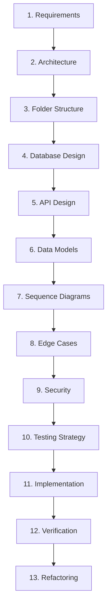

# Engineering Roadmap: Hybrid RAG Chatbot Development Plan

This document establishes the official milestone-based roadmap for building the production-grade **Hybrid RAG Chatbot**. 

---

## The Milestone Development Workflow

To ensure production-grade software quality, every milestone in this roadmap MUST strictly follow the 13-stage lifecycle. No code implementation may begin for a milestone until stages 1–10 (Design & Planning) are completed and documented.



1.  **Requirements:** Translate the high-level PRD specifications for the milestone into exact, testable technical requirements.
2.  **Architecture:** Design component interactions and integration points within the system.
3.  **Folder Structure:** Define the structural modifications or additions to the file layout.
4.  **Database Design:** Define schema alterations, new indexes, migrations, or data storage layouts.
5.  **API Design:** Define REST endpoints, inputs, outputs, error responses, or SSE streaming payloads.
6.  **Data Models:** Define target runtime structures (e.g., Pydantic schemas, TypeScript types).
7.  **Sequence Diagrams:** Document critical cross-component calls, asynchronous message queues, or data flows.
8.  **Edge Cases:** Enumerate failures (e.g., zero-byte uploads, vector DB connection timeouts) and specify behavior.
9.  **Security Considerations:** Address vulnerabilities unique to this milestone (e.g., SQL injection, prompt injection, directory traversal).
10. **Testing Strategy:** Define unit test mock boundaries, integration fixtures, and end-to-end user journeys.
11. **Implementation:** Write clean, modular, and linted application code.
12. **Verification:** Execute unit, integration, and E2E test suites; perform manual sanity checking.
13. **Refactoring:** Address code smells, redundant variables, optimize query calls, and clean up inline documentation before closing the milestone.

---

## Milestone 1: Project Foundation

### Purpose
Establish a containerized development environment, basic monorepo/directory architecture, continuous integration (CI) workflow, and a baseline system skeleton.

### Business Value
Reduces developer onboarding time from days to under 15 minutes, ensuring unified environment parity across development, testing, and production.

### Features
*   `docker-compose` definition for local services (PostgreSQL, Vector DB, Redis).
*   Base web server skeleton (FastAPI) and frontend shell (Vite + React).
*   CI setup (GitHub Actions) for linting and type checks.
*   Central configuration management (Pydantic settings) reading from `.env`.

### Milestone Development Workflow
1.  **Requirements:** A developer must be able to boot the empty application skeleton locally with a single command and have code automatically linted on check-in.
2.  **Architecture:** Client-server separation. FastAPI backend communicating with a relational DB container.
3.  **Folder Structure:** Modular layout separating `/backend` (Python) and `/frontend` (React/Vite).
4.  **Database Design:** Dockerized PostgreSQL with an empty schema and a vector extension installation script.
5.  **API Design:** Health check endpoint (`GET /api/v1/health`) returning server, database, and container status.
6.  **Data Models:** System Config model mapping environment variables.
7.  **Sequence Diagrams:** Basic startup sequence showing application fetching settings and verifying database connection.
8.  **Edge Cases:** DB container is down during startup (implement reconnection retry loop up to 5 times).
9.  **Security:** Ensure `.env` is ignored by Git; check for hardcoded secrets using pre-commit hooks.
10. **Testing Strategy:** Verify the `/health` endpoint returns `200 OK` via a test runner.
11. **Implementation:** Scaffold code folders, write settings manager, health check route, and configure Docker files.
12. **Verification:** Run `docker-compose up` locally and verify the health check response via curl.
13. **Refactoring:** Clean up dependency definitions (using `uv` and `npm`).

### Dependencies
None.

### Deliverables
*   `docker-compose.yml`
*   `pyproject.toml` (managed by `uv`)
*   `package.json`
*   `/backend/app/main.py`
*   `/frontend/src/App.tsx`
*   `.github/workflows/ci.yml`

### Definition of Done & Quality Gates
*   `docker-compose up --build` runs without error.
*   `GET /api/v1/health` returns HTTP 200 with database connection success status.
*   CI pipelines pass successfully for linting (`ruff`, `eslint`) and formatting checks.
*   Documentation (`README.md`) outlines local startup instructions.

### Scope Control (Potential Scope Creep)
*   *Rejected:* Setting up Kubernetes configurations, multi-cloud deployment scripts, or setting up a dynamic dev-portal website.

### Estimated Complexity
Low (1-2 days).

### Runnable Result
A running Docker-compose stack where accessing `http://localhost:8000/api/v1/health` returns status code `200` with JSON status payloads.

---

## Milestone 2: Authentication

### Purpose
Implement secure user registration, login, session validation, and route protection for both frontend and backend.

### Business Value
Protects user document storage and chat histories, preventing unauthorized access and data leaks.

### Features
*   JWT-based session authentication.
*   User registration and hashed password storage.
*   Protected backend routes and client-side route guards.

### Milestone Development Workflow
1.  **Requirements:** Secure authentication, password strength validation, session expiration.
2.  **Architecture:** Stateless session handling utilizing short-lived JWT access tokens and HTTP-only refresh token cookies.
3.  **Folder Structure:** `/backend/app/auth/` containing routes, security utils, and token logic.
4.  **Database Design:** Create `users` table: UUID, email (indexed, unique), hashed_password, created_at, role.
5.  **API Design:**
    *   `POST /api/v1/auth/register` (email, password) -> HTTP 201
    *   `POST /api/v1/auth/login` (email, password) -> JWT access token, HTTP-only refresh cookie
    *   `POST /api/v1/auth/logout` -> clear cookies
6.  **Data Models:** `UserRegister`, `UserLogin`, `TokenPayload` schemas.
7.  **Sequence Diagrams:** Sequence of login: request -> verify password -> issue tokens -> save cookie -> return access token.
8.  **Edge Cases:** Duplicate email registration (graceful error return), expired token presentation (return 401 with "token_expired" code).
9.  **Security:** Hashing passwords using `bcrypt`/`argon2`. No JWT secret keys in repository code. High-entropy signing keys.
10. **Testing Strategy:** Unit tests for password hash helper functions; integration tests for login/register endpoints using a test database.
11. **Implementation:** Write auth router, database models, user repository, and frontend login form components.
12. **Verification:** Automated tests verify that accessing `/api/v1/documents` without a token yields `401 Unauthorized`.
13. **Refactoring:** Extract auth extraction middleware for clean DI (Dependency Injection) in route controllers.

### Dependencies
Milestone 1.

### Deliverables
*   `users` table schema and Alembic migration.
*   Auth route controllers (`/auth/register`, `/auth/login`).
*   Authentication context provider and LoginForm component in React frontend.

### Definition of Done & Quality Gates
*   User passwords are encrypted in the database.
*   Frontend displays login and registration forms, redirecting to a protected dashboard upon successful sign-in.
*   Backend blocks unauthorized requests with HTTP 401.

### Scope Control (Potential Scope Creep)
*   *Rejected:* Single Sign-On (SSO), SAML integration, OAuth2 providers (Google/GitHub login), Multi-Factor Authentication (MFA), password reset email templates.

### Estimated Complexity
Medium (3-4 days).

### Runnable Result
An application where attempting to view the dashboard redirects to `/login`, and successful signup/login grants access to an authenticated session.

---

## Milestone 3: Document Management

### Purpose
Enable users to upload files, group them into collections, search through their document library, and delete files.

### Business Value
Gives users agency over the raw content they wish to query, allowing metadata organization (collections) to partition different domains of knowledge.

### Features
*   File upload handler for multiple formats.
*   Collection CRUD endpoints (create, read, update, delete).
*   File library dashboard showing upload date, size, and ingestion status.

### Milestone Development Workflow
1.  **Requirements:** Users must be able to upload documents up to 25MB and tag them into user-defined collections.
2.  **Architecture:** File upload metadata goes to the SQL database; raw files are stored on disk (local uploads directory) with randomized, safe filenames.
3.  **Folder Structure:** Add `/backend/data/uploads/` storage path; add `/backend/app/documents/` modules.
4.  **Database Design:**
    *   `collections` table: UUID, name, user_id, created_at.
    *   `documents` table: UUID, filename, storage_path, size_bytes, collection_id, user_id, status, created_at.
5.  **API Design:**
    *   `POST /api/v1/collections` (name) -> Collection
    *   `POST /api/v1/documents/upload` (multipart/form-data: file, collection_id) -> DocumentMetadata
    *   `DELETE /api/v1/documents/{id}` -> HTTP 204
6.  **Data Models:** `CollectionSchema`, `DocumentMetadataSchema`.
7.  **Sequence Diagrams:** Upload flow: client -> upload endpoint -> write local file -> save db record -> return status.
8.  **Edge Cases:** File upload with empty extension, zero-byte file, duplicate filenames within the same collection.
9.  **Security:** Limit file sizes via request body constraints; sanitize filenames to prevent path traversal (`../`).
10. **Testing Strategy:** Mock HTTP file upload requests; integration tests verify database records align with file metadata.
11. **Implementation:** Write database repos, router endpoints, file storage service, and dynamic Document List component in React.
12. **Verification:** Verify uploaded files are written to the local uploads folder and database records are generated correctly.
13. **Refactoring:** Separate local storage operations into a decoupled storage interface to allow future S3 compliance (if ever needed).

### Dependencies
Milestone 2.

### Deliverables
*   Database tables for `collections` and `documents`.
*   File storage manager class.
*   Document & collection management APIs.
*   Collection creator and document library views in the UI.

### Definition of Done & Quality Gates
*   Files are written securely to the configured local storage directory.
*   Attempting to upload files $> 25\text{MB}$ triggers an immediate client warning and HTTP 413 error.
*   Deleting a document deletes both the database record and the actual file on disk.

### Scope Control (Potential Scope Creep)
*   *Rejected:* Cloud object storage (S3/GCS) integration, dynamic document sharing between users, file annotation overlays.

### Estimated Complexity
Medium (3-5 days).

### Runnable Result
An authenticated session where a user can create a collection, upload files to it, and see them displayed in a structured file manager table with options to delete.

---

## Milestone 4: Document Processing

### Purpose
Build the background extraction pipeline to parse content from uploaded files (PDF, DOCX, TXT, MD, HTML, CSV) and clean the text.

### Business Value
Extracts readable text from diverse file types, sanitizing layout artifacts to prepare high-quality inputs for vector embedding and retrieval.

### Features
*   Background workers (using Python thread pool or lightweight Celery task) to parse documents asynchronously.
*   Custom parsing modules for PDF, DOCX, HTML, CSV, and Markdown.
*   Text cleaning utility (boilerplate footer removal, double whitespace removal).

### Milestone Development Workflow
1.  **Requirements:** Asynchronous processing of files on upload; updating the document status from `Queued` to `Processing` and `Completed` (or `Failed`).
2.  **Architecture:** Ingestion worker polling a background task queue (or executing in a background thread) to isolate CPU-intensive parsing from the main web loop.
3.  **Folder Structure:** `/backend/app/ingestion/` containing parsers, cleaners, and worker orchestrator.
4.  **Database Design:** No structural schema updates; status update triggers inside `documents` table.
5.  **API Design:**
    *   `GET /api/v1/documents/{id}/status` -> returns processing state, error details.
6.  **Data Models:** `DocumentStatusPayload` containing state and logs.
7.  **Sequence Diagrams:** Asynchronous parsing trigger: client -> upload document -> trigger background job -> response immediately; worker parses document -> updates status in database.
8.  **Edge Cases:** Parsing password-protected PDFs, handling corrupt files, CSV files containing empty rows or invalid formatting.
9.  **Security:** Restrict parser library settings to prevent XML External Entity (XXE) attacks on DOCX files, and script block execution on HTML parsing.
10. **Testing Strategy:** Write regression tests with sample files (.pdf, .docx, .html, .csv) to ensure parsed text matches expected text outputs.
11. **Implementation:** Integrate `PyPDF`, `python-docx`, and parser scripts; configure background processing threads.
12. **Verification:** Upload a complex PDF and verify the raw database records match the text structure.
13. **Refactoring:** Standardize parser interfaces so each parser extends a base class `BaseParser` with a single `.parse(file_path: Path) -> str` signature.

### Dependencies
Milestone 3.

### Deliverables
*   Parser registry classes (`PDFParser`, `DocxParser`, etc.).
*   Background parser worker task.
*   Status-check frontend component with auto-polling UI indicator.

### Definition of Done & Quality Gates
*   All supported file formats parse without crashing the server.
*   Errors during parsing write details to database status logs and flag state as `Failed`.
*   Ingestion does not block main API response cycles (async processing verified).

### Scope Control (Potential Scope Creep)
*   *Rejected:* Multi-engine OCR integration (Tesseract/PaddleOCR) for scanned PDFs, translation systems, transcription of audio/video files.

### Estimated Complexity
Medium-High (4-6 days).

### Runnable Result
Uploading a complex multi-page PDF or HTML file completes immediately, and the UI status poll updates from "Processing" to "Completed" with the document text ready for indexing.

---

## Milestone 5: Embedding Pipeline

### Purpose
Implement text chunking strategies (recursive character and semantic) and generate dense vector representations.

### Business Value
Converts raw, unstructured text into semantic numerical vectors that represent the conceptual meaning of sentences, enabling non-keyword search.

### Features
*   Adjustable chunk size & overlap calculators.
*   Recursive character and semantic chunk splitters.
*   Embedding service integration supporting local Transformers and cloud providers (OpenAI).

### Milestone Development Workflow
1.  **Requirements:** Convert parsed document texts into segmented chunks (e.g., 512 tokens) and generate vectors matching embedding model dimensions.
2.  **Architecture:** Modular chunking service feeding an embedding service client; output ready for vector storage.
3.  **Folder Structure:** `/backend/app/ingestion/chunking.py` and `/backend/app/services/embeddings.py`.
4.  **Database Design:**
    *   `chunks` table: UUID, document_id, content, chunk_index, token_count, metadata (page, section).
5.  **API Design:** Internal service method `generate_embeddings(chunks: List[Chunk]) -> List[List[float]]`.
6.  **Data Models:** `ChunkSchema` containing text, index, and associated metadata.
7.  **Sequence Diagrams:** Processing sequence: parsing complete -> text sent to chunker -> chunk array generated -> chunks sent to embedding provider -> vectors returned.
8.  **Edge Cases:** Texts smaller than chunk size (generate single chunk), API rate limits or timeout failures from cloud embedding providers (implement retry loops with backoff).
9.  **Security:** Limit API requests to cloud providers to avoid cost inflation; sanitize payloads before sending to APIs.
10. **Testing Strategy:** Assert chunk count and chunk overlaps are correctly calculated; test semantic boundaries using a mocked vector similarity check.
11. **Implementation:** Write recursive character chunker, semantic splitter, embedding interface, and unit tests.
12. **Verification:** Check that a sample 10,000-character document is successfully converted into expected, overlapping chunk chunks.
13. **Refactoring:** Optimize embedding calls by batching chunks (e.g., batch size 16) instead of sending single requests.

### Dependencies
Milestone 4.

### Deliverables
*   Chunking utility classes.
*   Embedding API client manager.
*   `chunks` database table.

### Definition of Done & Quality Gates
*   Chunking is correctly executed on completed parsed documents.
*   Embedding generation yields valid vector dimensions (e.g., 1536 float arrays for OpenAI).
*   Bulk vector operations utilize batch requests to minimize network roundtrips.

### Scope Control (Potential Scope Creep)
*   *Rejected:* Custom fine-tuning of embedding models on domain datasets, dynamic cluster-based semantic indexing.

### Estimated Complexity
Medium (3-4 days).

### Runnable Result
Ingested documents automatically segment into chunks, generate corresponding vector embeddings, and save the metadata chunks to the database.

---

## Milestone 6: Sparse Retrieval

### Purpose
Set up the sparse index database (BM25) and implement traditional keyword-based retrieval.

### Business Value
Ensures precise matching for search queries containing technical codes, serial numbers, exact names, and specific acronyms.

### Features
*   BM25 index builder.
*   Text preprocessing (stemming, tokenization, stop-word removal).
*   Sparse retrieval querying engine.

### Milestone Development Workflow
1.  **Requirements:** Build a searchable BM25 index on chunk databases; query endpoint to return top matches with keyword relevance scores.
2.  **Architecture:** Local BM25 engine (e.g., using PostgreSQL pg_trgm/fts or rank_bm25 library) to maintain low resource overhead.
3.  **Folder Structure:** `/backend/app/retrieval/sparse.py`.
4.  **Database Design:** If using Postgres for FTS, add full-text search index (`gin` index on `content` column of `chunks` table).
5.  **API Design:** Internal search method `retrieve_sparse(query: str, limit: int, filters: Dict) -> List[SearchResult]`.
6.  **Data Models:** `SparseSearchResult` representing chunk ID, score, and content.
7.  **Sequence Diagrams:** Query -> Sparse Search engine -> Postgres Full-Text Search execute -> return ranked results.
8.  **Edge Cases:** Empty query string, query containing only stop-words (return empty list), queries matching nothing (fail gracefully with empty result).
9.  **Security:** Parametrize query variables to prevent SQL injection during keyword searches.
10. **Testing Strategy:** Create a test dataset with specific keywords (e.g., product code "X-909") and assert sparse retrieval surfaces the target chunk at rank 1.
11. **Implementation:** Configure Postgres FTS configurations, write BM25 query logic, and implement index update triggers.
12. **Verification:** Execute search queries via python console and verify matching scores.
13. **Refactoring:** Ensure standard tokenization rules are identical between chunk ingestion and search execution.

### Dependencies
Milestone 5.

### Deliverables
*   BM25 database index configurations.
*   Sparse retrieval service.
*   Internal search endpoints for testing.

### Definition of Done & Quality Gates
*   All ingested chunks are instantly indexed in the sparse store.
*   Queries matching specific keywords return correct target chunks.
*   Search latency for sparse index remains $< 50\text{ ms}$ for 10,000 records.

### Scope Control (Potential Scope Creep)
*   *Rejected:* Setting up Elasticsearch/OpenSearch clusters, building custom synonym dictionaries.

### Estimated Complexity
Medium (2-3 days).

### Runnable Result
An internal test CLI or endpoint where query `X-909` returns document chunks containing that specific code within milliseconds.

---

## Milestone 7: Dense Retrieval

### Purpose
Configure the Vector Database (Qdrant, Chroma, or pgvector) and build the semantic similarity search engine.

### Business Value
Enables conceptual retrieval based on meaning, allowing the chatbot to locate relevant context even if the user uses different vocabulary than the document.

### Features
*   Vector database connector and schema config.
*   Vector collection indexer (HNSW).
*   Dense search execution using cosine similarity.

### Milestone Development Workflow
1.  **Requirements:** Index chunk vectors in Vector DB; query endpoint to retrieve nearest vectors based on cosine similarity.
2.  **Architecture:** Dedicated Vector DB container connected to the web backend via REST/gRPC client.
3.  **Folder Structure:** `/backend/app/retrieval/dense.py`.
4.  **Database Design:** Vector DB schema with collection name, embedding dimension size, and vector distance metric (Cosine/L2).
5.  **API Design:** Internal method `retrieve_dense(query_vector: List[float], limit: int) -> List[DenseResult]`.
6.  **Data Models:** `DenseSearchResult` holding chunk ID, cosine similarity score, and metadata payload.
7.  **Sequence Diagrams:** Ingestion vector write: backend -> bulk upsert -> Vector DB index. Query: query text -> generate query vector -> Vector DB search -> return matching chunks.
8.  **Edge Cases:** Vector database connection loss (retry with backoff), vector dimension mismatch on query execution.
9.  **Security:** Restrict Vector DB dashboard/API ports to localhost/internal network; protect client configurations.
10. **Testing Strategy:** Test that similar concepts (e.g., "automobile" and "car") yield high dense retrieval match ranks.
11. **Implementation:** Write Vector DB repository, connection helper, and index generation commands.
12. **Verification:** Verify that chunk vectors are successfully created in the vector DB collections upon upload.
13. **Refactoring:** Wrap vector operations in a repository pattern class to easily mock the DB for unit testing.

### Dependencies
Milestone 5.

### Deliverables
*   Vector DB Docker setup.
*   Dense retrieval indexer and search class.
*   Integration tests verifying vector storage and retrieval.

### Definition of Done & Quality Gates
*   Vector DB successfully receives and stores vectors from ingestion pipelines.
*   Dense search retrieval performs cosine similarity calculations.
*   Vector DB search latency is $< 100\text{ ms}$ for test loads.

### Scope Control (Potential Scope Creep)
*   *Rejected:* Dynamic clustering of vector spaces, multi-modal vector search (images, audio).

### Estimated Complexity
Medium (3-4 days).

### Runnable Result
A functional dense retriever where submitting query vectors returns semantically relevant chunk texts.

---

## Milestone 8: Hybrid Retrieval

### Purpose
Integrate sparse and dense search pipelines, perform metadata filtering, and merge findings using Reciprocal Rank Fusion (RRF).

### Business Value
Combines the precision of keyword search with the semantic understanding of vector search to produce retrieval results superior to either method alone.

### Features
*   Parallel execution of sparse and dense retrievers.
*   Metadata filter compiler (e.g. scoping to collections, file types).
*   Reciprocal Rank Fusion (RRF) algorithm implementation.

### Milestone Development Workflow
1.  **Requirements:** Execute parallel queries, apply metadata filters, combine ranks via RRF, and output a unified, ranked list of chunks.
2.  **Architecture:** Orchestration module coordinating DB connections and executing the mathematical fusion of ranks.
3.  **Folder Structure:** `/backend/app/retrieval/hybrid.py` and `/backend/app/retrieval/rrf.py`.
4.  **Database Design:** Ensure indexes exist on metadata filter columns (e.g. collection ID, user ID).
5.  **API Design:**
    *   `POST /api/v1/search` (query, collection_id, limits) -> List[HybridSearchResult]
6.  **Data Models:** `HybridSearchResult` specifying chunk ID, combined RRF score, sparse score, dense score, and metadata.
7.  **Sequence Diagrams:** Query -> parallel async call to BM25 and Vector DB -> compile results -> run RRF algorithm -> return top K.
8.  **Edge Cases:** Empty results from one search index (RRF should handle single-list inputs cleanly), score ties (apply consistent fallback ordering).
9.  **Security:** Ensure filters are strictly typed to prevent SQL injection or metadata query pollution.
10. **Testing Strategy:** Assert that chunks appearing in both search paths are correctly ranked higher by RRF than those in only one path.
11. **Implementation:** Write async query orchestrator, RRF calculator, filter parser, and search router.
12. **Verification:** Query via the API and ensure results include both keyword matches and semantic matches merged.
13. **Refactoring:** Optimize RRF execution loops to run in $O(N)$ time.

### Dependencies
Milestones 6 and 7.

### Deliverables
*   RRF rank merger service.
*   Hybrid search service with filter controls.
*   `POST /api/v1/search` API endpoint.

### Definition of Done & Quality Gates
*   Hybrid search returns unified search lists.
*   Filters correctly restrict search scopes to selected collections.
*   RRF latency remains $< 150\text{ ms}$ for average execution runs.

### Scope Control (Potential Scope Creep)
*   *Rejected:* Query routing agents choosing search methods dynamically, complex semantic graph searches.

### Estimated Complexity
Medium-High (3-5 days).

### Runnable Result
An endpoint `/api/v1/search` that returns merged search outputs when queried with a prompt and a collection ID.

---

## 9. Milestones 9 to 16 Quick Index

```
Milestone 9:  Retrieval Optimization (Query Rewriting, Expansion, Reranking, Compression)
Milestone 10: LLM Integration (Prompt templates, Fallback strategies, SDK Setup)
Milestone 11: Conversation System (Memory management, Web UI chat, SSE streaming)
Milestone 12: Evaluation (Groundedness and RAG metrics, Feedback loops)
Milestone 13: Observability (Trace visuals, Ingestion logs, Metric reporting)
Milestone 14: Performance Optimization (Caching layers, Batching, DB indexing)
Milestone 15: Security Hardening (Input sanitization, Key encryption, Rate limits)
Milestone 16: Production Release (Deployment prep, Docker verification, Launch)
```

---

## Milestone 9: Retrieval Optimization

### Purpose
Implement query rewriting, synonym expansion, Cross-Encoder reranking, and context compression.

### Business Value
Maximizes retrieval precision, filters irrelevant chunks, and fits only the most information-rich sentences into the context window, lowering token cost and improving accuracy.

### Features
*   Query Rewriter (LLM-driven standalone query generation).
*   Synonym Query Expansion (BM25 keyword addition).
*   Cross-Encoder Reranker integration.
*   Context Compressor (sentence-level pruning).

### Milestone Development Workflow
1.  **Requirements:** Rewrite follow-ups into standalone queries, run expansion, rerank the top 25 chunks to get top 5, and compress context length.
2.  **Architecture:** Add reranker class and compression module between RRF output and LLM prompt generation.
3.  **Folder Structure:** `/backend/app/retrieval/rerank.py` and `/backend/app/retrieval/compressor.py`.
4.  **Database Design:** No DB schema additions.
5.  **API Design:** Internal service method `optimize_retrieval(query: str, history: List[Message]) -> List[CompressedChunk]`.
6.  **Data Models:** `OptimizedChunk` with original text, compressed text, and rerank relevance score.
7.  **Sequence Diagrams:** Raw query -> Rewrite (LLM) -> Hybrid Search -> RRF -> Reranker -> Compressor -> Output Chunks.
8.  **Edge Cases:** Reranker model returns empty/low scores (implement fallback to return raw RRF chunks), compressor reduces text to zero words.
9.  **Security:** Restrict external API tokens for Cohere/Rerank services; protect against API timeout vulnerabilities.
10. **Testing Strategy:** Verify reranked output shows higher semantic alignment. Check that rewritten questions contain references to historical entities.
11. **Implementation:** Integrate local reranker (`sentence-transformers`) or cloud reranker (Cohere API); write query rewriting logic.
12. **Verification:** Trace logs to see chunk scores transition before and after reranker step execution.
13. **Refactoring:** Cache reranker models in memory on startup instead of reloading model weights on every query.

### Dependencies
Milestone 8.

### Deliverables
*   Query rewriter module.
*   Cross-Encoder reranking engine interface.
*   Context compression service.

### Definition of Done & Quality Gates
*   Top chunks are re-ordered correctly based on Cross-Encoder scores.
*   Queries containing conversational history are rewritten to explicit standalone queries.
*   Context compression successfully reduces chunk token count.

### Scope Control (Potential Scope Creep)
*   *Rejected:* Continuous learning rerankers trained on user clicks, multi-hop sub-query extraction networks.

### Estimated Complexity
High (5-7 days).

### Runnable Result
A structured service step where inputting `"Where did they build the office?"` (with history context of `"Google"`) returns search results rewritten for `"Google office construction location"` and reranked using a Cross-Encoder.

---

## Milestone 10: LLM Integration

### Purpose
Configure prompt templates, integrate LLM providers, and establish generation fallback strategies.

### Business Value
Secures reliable generation interfaces, ensuring that the model responds strictly using document context and fails gracefully when documents do not contain the answer.

### Features
*   LLM Provider clients (OpenAI, Anthropic, local Ollama).
*   Prompt template compiler.
*   Groundedness instruction guards and fallback error responders.

### Milestone Development Workflow
1.  **Requirements:** Parse prompt templates, inject retrieved context, prompt LLM to generate response, and handle non-matching context errors.
2.  **Architecture:** Generator Service wrapper isolating external API SDK configurations.
3.  **Folder Structure:** `/backend/app/generation/` containing routers, prompt directories, and provider connectors.
4.  **Database Design:**
    *   `prompt_templates` table: UUID, system_instruction, user_template, version, is_active.
5.  **API Design:** Internal method `generate_response(prompt: str, streaming: bool) -> Generator[str]`.
6.  **Data Models:** `GenerationRequest` containing system instruction overrides and input parameters.
7.  **Sequence Diagrams:** Context Chunks + Query -> Prompt Template Compiler -> API call to LLM -> Return raw text stream.
8.  **Edge Cases:** Context chunks are empty (trigger immediate fallback message without LLM call), LLM API key expired (return HTTP 503).
9.  **Security:** Limit prompt templates to exclude dangerous user inputs that might override system commands (prompt injection prevention).
10. **Testing Strategy:** Mock LLM client responses; assert prompt templates assemble variables (context, history, query) in correct formatting.
11. **Implementation:** Write Prompt Compiler, API clients, template CRUD routes, and database seeding scripts.
12. **Verification:** Inspect prompt outputs via debug logs to ensure contexts are formatted properly.
13. **Refactoring:** Implement standard retry logic for LLM APIs (e.g. using `tenacity` library).

### Dependencies
Milestone 9.

### Deliverables
*   LLM provider interface wrappers.
*   Prompt template compiler service.
*   Database tables and migration scripts for prompt templates.

### Definition of Done & Quality Gates
*   LLM client communicates with configured providers.
*   Response fallback executes correctly when retrieval context is empty.
*   RAG prompt template compiles successfully with variable mappings.

### Scope Control (Potential Scope Creep)
*   *Rejected:* Self-hosting LLMs (e.g., Llama-3 70B) in production pipelines, creating custom fine-tuned base models.

### Estimated Complexity
Medium (2-3 days).

### Runnable Result
An internal test call where providing relevant text chunks and a query yields a grounded answer from the LLM.

---

## Milestone 11: Conversation System

### Purpose
Build the conversational state memory, Server-Sent Events (SSE) streaming API, and responsive web chat interface.

### Business Value
Provides a production-grade user experience with real-time text generation, message histories, and reference linking.

### Features
*   Database-backed chat session storage.
*   SSE streaming endpoint.
*   Frontend chat window with citation rendering and document preview panels.

### Milestone Development Workflow
1.  **Requirements:** Real-time token streaming, chat history storage, interactive citation markers, clean layout.
2.  **Architecture:** Chat session state manager reading/writing to PostgreSQL; backend SSE controller; React front-end processing event streams.
3.  **Folder Structure:** `/backend/app/chat/` and `/frontend/src/components/chat/`.
4.  **Database Design:**
    *   `conversations` table: UUID, user_id, title, created_at.
    *   `messages` table: UUID, conversation_id, role (user/assistant), content, citations (JSON array of chunk UUIDs), created_at.
5.  **API Design:**
    *   `POST /api/v1/chat/{conversation_id}/message` (content) -> SSE stream of tokens & citation metadata.
    *   `GET /api/v1/conversations` -> List[Conversation]
6.  **Data Models:** `MessageSchema`, `ConversationSchema`.
7.  **Sequence Diagrams:** User sends message -> Query rewrite -> Retrieve chunks -> Save user message -> Call LLM -> Stream tokens to client -> Save assistant response with citations -> Stream closed.
8.  **Edge Cases:** Connection drop mid-stream (gracefully commit partial message to database), streaming special markdown structures (ensure tables or code blocks do not break client renderers).
9.  **Security:** Validate user ownership of `conversation_id` before reading history or posting messages.
10. **Testing Strategy:** Mock EventSource connections to test streaming response parsing; integration test for message history persistence.
11. **Implementation:** Write SSE streaming API, React chat layout, markdown renderer, and session managers.
12. **Verification:** Open application frontend, ask questions, and check that tokens render instantly and inline citations function as links.
13. **Refactoring:** Clean up React state hooks to prevent visual layout shifts during streaming cycles.

### Dependencies
Milestones 3 and 10.

### Deliverables
*   `conversations` and `messages` tables.
*   SSE generation API endpoint.
*   Frontend Chat UI workspace.

### Definition of Done & Quality Gates
*   Streaming responses render without visual layouts breaks.
*   Chat sessions persist correctly upon browser refreshes.
*   Clicking a citation tag (e.g., `[1]`) opens the document viewer to the correct chunk text.

### Scope Control (Potential Scope Creep)
*   *Rejected:* Voice to text input, offline export of chat transcripts (PDF/TXT), translation of chat history on the fly.

### Estimated Complexity
High (5-7 days).

### Runnable Result
A complete web application workspace where users can login, select a collection, start a chat, stream answers, and view inline document citations.

---

## Milestone 12: Evaluation

### Purpose
Integrate an automated evaluation engine using LLM-as-a-judge patterns to score groundedness, answer relevance, and retrieval precision.

### Business Value
Ensures high response quality, flags regression in accuracy, and provides metrics to measure the impact of search tuning.

### Features
*   LLM-as-a-judge scoring runner.
*   User feedback logging (thumbs up/down with text comment).
*   Admin evaluation dashboard interface.

### Milestone Development Workflow
1.  **Requirements:** Automatically score groundedness and relevance for 10% of queries; record and aggregate user feedback ratings.
2.  **Architecture:** Post-generation hook executing scoring runs asynchronously to prevent user latency penalties.
3.  **Folder Structure:** `/backend/app/evaluation/` containing scoring prompts and evaluation managers.
4.  **Database Design:**
    *   `evaluations` table: UUID, message_id, groundedness_score, relevance_score, feedback_value (int), feedback_text.
5.  **API Design:**
    *   `POST /api/v1/messages/{id}/feedback` (value, text) -> HTTP 200
    *   `GET /api/v1/admin/evaluations` -> List[EvaluationStats]
6.  **Data Models:** `FeedbackSubmission`, `EvaluationReport`.
7.  **Sequence Diagrams:** Assistant response finished -> Dispatch async eval job -> judge LLM scores response -> Write metrics to `evaluations` table.
8.  **Edge Cases:** Failure of evaluation LLM (abort evaluation run silently, do not affect user chat), user changes feedback multiple times (overwrite existing record).
9.  **Security:** Limit evaluation endpoint access strictly to logged-in users; restrict admin evaluation reports to admins.
10. **Testing Strategy:** Feed known "hallucinated" answers to the evaluator and assert it marks them with low groundedness scores.
11. **Implementation:** Write evaluation prompts, background executor hook, feedback API routes, and admin metric displays.
12. **Verification:** Sanity check feedback submissions and review generated judge scores in the admin panel.
13. **Refactoring:** Group evaluation score updates into batch DB transaction blocks.

### Dependencies
Milestone 11.

### Deliverables
*   `evaluations` table schema.
*   LLM evaluation helper classes.
*   Feedback submission system (API + UI).
*   Admin dashboard evaluation analytics panel.

### Definition of Done & Quality Gates
*   User feedback submissions correctly update database records.
*   Judge evaluations run asynchronously without introducing response latency.
*   Admin panel displays aggregated quality indicators (average groundedness, total negatives).

### Scope Control (Potential Scope Creep)
*   *Rejected:* Advanced automated dataset generation pipelines, real-time fine-tuning based on bad feedback.

### Estimated Complexity
Medium (3-4 days).

### Runnable Result
An interactive feedback button next to chat responses, and an admin view displaying a dashboard of overall groundedness metrics.

---

## Milestone 13: Observability

### Purpose
Build a detailed search trace viewer and set up structured server logging to inspect the exact retrieval pathway.

### Business Value
Allows developer auditing of the complex hybrid search pipeline, showing exactly why a chunk was selected, merged, or discarded.

### Features
*   Retrieval step tracer backend payload constructor.
*   Collapsible frontend trace viewer (shows rewritten queries, raw chunks, sparse/dense scores, RRF scores, rerank scores, and final prompt).
*   Structured backend console logs.

### Milestone Development Workflow
1.  **Requirements:** Construct a detailed JSON payload of the entire retrieval step chain; expose visual tree representations of the data stream in the frontend.
2.  **Architecture:** Context tracing wrappers tracking state throughout the retrieval pipeline functions.
3.  **Folder Structure:** `/backend/app/observability/` modules.
4.  **Database Design:** No database updates required; tracing data is sent in-memory with the message payload or logged to files.
5.  **API Design:**
    *   `GET /api/v1/messages/{id}/trace` -> TracePayload
6.  **Data Models:** `TracePayloadSchema` detailing each retrieval stage.
7.  **Sequence Diagrams:** Client requests trace -> API fetches trace payload for target message -> Returns structured pipeline details.
8.  **Edge Cases:** Trace data exceeds message payload size limits (compress trace payload), trace requested for legacy messages missing trace logs.
9.  **Security:** Restrict trace data access to authenticated owners of the conversation.
10. **Testing Strategy:** Assert trace payloads contain non-empty data arrays for rewritten query, retrieved chunks, and compiler templates.
11. **Implementation:** Instrument pipeline functions to collect trace information, write API routes, and build the React trace visualization tree.
12. **Verification:** Ask a question, click "Inspect Retrieval", and inspect the scores and the prompt formatting.
13. **Refactoring:** Abstract trace collection logic to run with minimal CPU overhead.

### Dependencies
Milestone 11.

### Deliverables
*   Pipeline tracing modules.
*   Trace viewer backend endpoints.
*   React interactive Trace Inspector drawer component.

### Definition of Done & Quality Gates
*   Trace viewer provides full visibility into the prompt template layout.
*   Sparse, dense, RRF, and Cross-Encoder scores are shown for each chunk.
*   Execution timings are tracked and displayed for each stage of retrieval.

### Scope Control (Potential Scope Creep)
*   *Rejected:* Integration with heavy enterprise APM systems (Datadog/Dynatrace), real-time memory profile visualizers.

### Estimated Complexity
Medium-High (4-5 days).

### Runnable Result
Clicking "Inspect Retrieval" under a chat bubble opens a window displaying the exact search stages and LLM prompt.

---

## Milestone 14: Performance Optimization

### Purpose
Implement semantic query caching, database search optimizations, and pipeline parallelization.

### Business Value
Lowers system operating costs, improves API response speeds under load, and optimizes local GPU/CPU hardware usage.

### Features
*   Semantic Caching service.
*   PostgreSQL index optimizations.
*   Asynchronous parallel execution of sparse and dense search pipelines.

### Milestone Development Workflow
1.  **Requirements:** Cache responses to semantically identical queries ($>0.95$ similarity); execute retrieval tasks in parallel async groups.
2.  **Architecture:** Introduce Redis or in-memory semantic cache check before launching retrieval pipelines.
3.  **Folder Structure:** `/backend/app/cache/` containing caching service classes.
4.  **Database Design:** Add indexes to key join columns; tune Vector DB parameters (e.g., HNSW $M$ and $ef\_construction$ parameters).
5.  **API Design:** Internal caching decorator signatures `check_cache(query: str) -> CachedResponse`.
6.  **Data Models:** `CacheEntry` representation.
7.  **Sequence Diagrams:** Query -> check semantic cache -> Hit (return immediately) -> Miss (run parallel hybrid search -> cache output -> return).
8.  **Edge Cases:** Cache pollution (clear cache on new document uploads to ensure context freshness), cache size limits (LRU eviction policies).
9.  **Security:** Ensure cache keys are segregated by user sessions to prevent cross-user data leakage.
10. **Testing Strategy:** Benchmark search queries before and after optimization to measure latency reductions.
11. **Implementation:** Write semantic caching manager, configure Redis, apply DB index upgrades, and parallelize python search functions.
12. **Verification:** Confirm that identical subsequent queries return answers in under $50\text{ ms}$ (cache hits).
13. **Refactoring:** Optimize memory consumption by using light embedding vectors for cache validation.

### Dependencies
Milestones 8 and 13.

### Deliverables
*   Semantic caching engine.
*   Database index migrations.
*   Performance benchmark test suite report.

### Definition of Done & Quality Gates
*   Subsequent similar queries trigger cache hits and bypass retrieval/generation pipelines.
*   Hybrid search latency drops below $150\text{ ms}$ on standard 10,000 chunk libraries.
*   System memory usage remains stable during sustained load tests.

### Scope Control (Potential Scope Creep)
*   *Rejected:* Designing complex distributed multi-region caching structures, edge caching networks.

### Estimated Complexity
Medium (3-4 days).

### Runnable Result
Running identical questions consecutively yields near-instantaneous streaming start (TTFT $< 50\text{ ms}$) marked with a "Cached Response" UI indicator.

---

## Milestone 15: Security Hardening

### Purpose
Secure raw keys at rest, implement request rate limiting, sanitize user inputs, and run basic vulnerability assessments.

### Business Value
Ensures the chatbot meets security compliance requirements and prevents user service abuse or unauthorized data access.

### Features
*   AES-256 encryption for stored API keys.
*   Rate limiting middleware.
*   Input validation and prompt injection filters.

### Milestone Development Workflow
1.  **Requirements:** Restrict users to a maximum of 60 requests per minute; sanitize input queries; encrypt server keys.
2.  **Architecture:** Encryption handlers for DB models, request interception middleware on backend routes.
3.  **Folder Structure:** `/backend/app/security/` utility functions.
4.  **Database Design:** Adjust data type constraints to support encrypted binary data strings.
5.  **API Design:** Return HTTP 429 Too Many Requests when rate limits are exceeded.
6.  **Data Models:** Updated encrypted schema fields.
7.  **Sequence Diagrams:** Incoming request -> check rate limits -> validate inputs -> decrypt provider key -> process generation.
8.  **Edge Cases:** Decryption failures (throw secure server error without exposing key components in stack trace).
9.  **Security:** Prevent prompt injection by scanning queries for standard override phrases; enforce secure HTTP headers.
10. **Testing Strategy:** Run automated scripts to trigger rate limiting; run injection payloads and assert the application rejects them.
11. **Implementation:** Integrate `cryptography` libraries, set up rate-limiting middleware, and configure security headers.
12. **Verification:** Confirm rate limit triggers block requests with HTTP 429 responses.
13. **Refactoring:** Clean up error message formats to ensure no internal system traces are exposed to clients.

### Dependencies
Milestone 11.

### Deliverables
*   Encryption key managers.
*   Rate limiting API middleware.
*   Vulnerability test script suite.

### Definition of Done & Quality Gates
*   Rate limiter successfully blocks excessive user requests.
*   Prompt injections are intercepted before hitting retrieval.
*   Sensitive database columns are encrypted.

### Scope Control (Potential Scope Creep)
*   *Rejected:* Implementing full enterprise Web Application Firewalls (WAF), formal SOC2 compliance audit reports.

### Estimated Complexity
Medium (3-4 days).

### Runnable Result
An environment where sending query bursts triggers HTTP 429, and sending prompt injection payloads triggers input validation errors.

---

## Milestone 16: Production Release

### Purpose
Finalize the release build, compile documentation, and deploy to target environment.

### Business Value
Delivers the final product to users and recruiters, serving as a functional showcase of the engineer's capabilities.

### Features
*   Production-ready Docker configuration.
*   Database seeding script.
*   Comprehensive installation, user, and architecture documentation.

### Milestone Development Workflow
1.  **Requirements:** Generate optimized static frontend builds, consolidate database migration paths, write clean setup guides.
2.  **Architecture:** Setup production reverse proxy (Nginx) container to handle SSL, serve client files, and proxy backend requests.
3.  **Folder Structure:** Final workspace root configurations, clean build folders.
4.  **Database Design:** Production-ready PostgreSQL configurations with auto-backups.
5.  **API Design:** All endpoints verified clean.
6.  **Data Models:** No changes.
7.  **Sequence Diagrams:** Deploy and run lifecycle diagram.
8.  **Edge Cases:** Missing database migration version targets during upgrade (ensure migrations automatically reconcile schemas).
9.  **Security:** Disable debug flags globally across frontend and backend in production configurations.
10. **Testing Strategy:** Perform a fresh clone of the repository and execute all onboarding instructions to confirm a clean install.
11. **Implementation:** Compile React application to static assets, configure Nginx, package deployment guides, and seed sample files.
12. **Verification:** Validate clean workspace installation and test app performance on a clean server.
13. **Refactoring:** Remove any leftover development utilities or temporary test scripts.

### Dependencies
Milestone 15.

### Deliverables
*   Production `docker-compose.prod.yml` configuration.
*   Seeding scripts and datasets.
*   Comprehensive `docs/` folder (architecture, API, user guides).
*   Demonstration recording links.

### Definition of Done & Quality Gates
*   A new clone of the repo starts successfully using the setup documentation.
*   100% of automated tests pass successfully.
*   No known critical bugs exist in the backlog.

### Scope Control (Potential Scope Creep)
*   *Rejected:* Writing custom deployment integrations for multiple cloud providers, setup of complex server monitoring networks.

### Estimated Complexity
Medium (2-3 days).

### Runnable Result
A clean, production-built system that deploys and runs using a single docker command.

---

## Quality Gates & Exit Criteria Summary

Before completing any milestone, the codebase must clear the following gates:

```
[PASS] Code compiles and starts without errors
[PASS] 100% of unit & integration tests pass
[PASS] Linting and formatting checks pass
[PASS] Code contains no hardcoded credentials or API keys
[PASS] Documentation (README/APIs) is updated
[PASS] No known critical bugs in the milestone features
```
