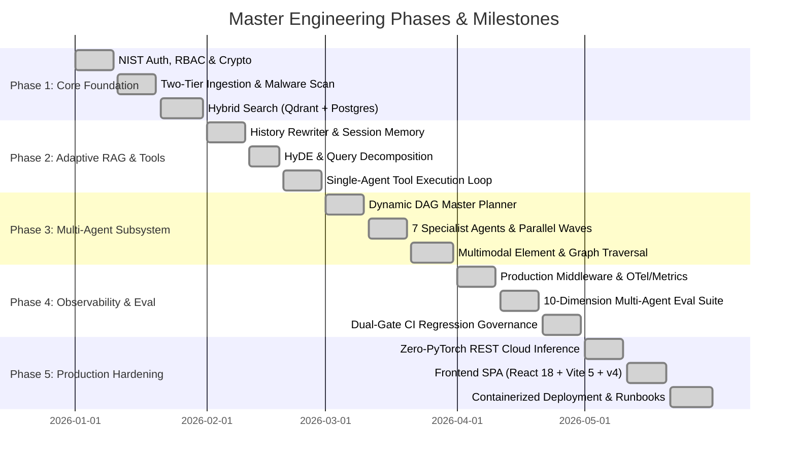

# Product Requirements Document & Master Project Plan: Fusion RAG Platform

## 1. Executive Summary & System Vision

The **Fusion RAG Platform** is an enterprise-grade, observable, and resilient reference implementation of modern AI engineering. It demonstrates how to transition Retrieval-Augmented Generation from a fragile toy prototype into a high-throughput, secure, multi-agent distributed system with strictly citation-grounded outputs.

This document serves as the **Master Product Requirements Document (PRD) and Project Execution Plan**, detailing the chronological and architectural phases, milestones, technical deliverables, and verification criteria implemented across the platform.

---

## 2. Master Project Plan: Phases & Milestones

---

### Phase 1: Security Foundation, Ingestion & Hybrid RAG Baseline

**Primary Objective**: Build an authoritative transactional backend with NIST-compliant authentication, secure document validation/antivirus scanning, two-tier storage, and a baseline hybrid retrieval pipeline (Dense Vector + Lexical Sparse + RRF + Cross-Encoder).

#### Key Milestones & Deliverables:
1. **Milestone 1.1 — Authentication & Identity Governance**:
   - Argon2id password hashing with random salt.
   - Stateless JWT HS256 access tokens (15m expiry) and single-use rotated HTTP-only refresh cookies (7d expiry).
   - Replay attack revocation: any reuse of a revoked refresh token triggers immediate invalidation of all user sessions.
   - OAuth 2.0 social authentication (Google and GitHub).
   - Transactional email verification and passwordless magic links via Resend API.
   - Sliding-window Redis rate limiter with login brute-force lockout (5 attempts per 300s window).
   - Cryptographic envelope encryption (`ENCRYPTION_MASTER_KEY` wrapping per-user Data Encryption Keys in `user_encryption_keys`).

2. **Milestone 1.2 — Two-Tier Document Ingestion & Malware Defense**:
   - **Global Library Documents** (`scope=LIBRARY`): Shared across all sessions, addressable via `@documents` mentions.
   - **Conversation Attachments** (`scope=CONVERSATION`): Scoped to an active chat, automatically cascade-deleted on conversation removal.
   - Multi-format parsers: PDF, DOCX, TXT, Markdown, HTML, CSV, Images (PNG/JPG/WEBP via Gemini Vision OCR).
   - Pre-ingestion validation: Magic-byte inspection, zip-bomb expansion ratio checks ($< 100\times$, max 25 MB).
   - Fail-closed ClamAV antivirus socket scanner (`clamd` TCP port 3310).
   - SHA-256 content deduplication avoiding redundant processing.
   - Multi-target storage providers (`STORAGE_PROVIDER`: Database BLOB, Local Filesystem, or AWS S3 / MinIO).

3. **Milestone 1.3 — Baseline Hybrid Retrieval Engine**:
   - Dense vector indexing via Qdrant (768-dim cosine metric, strict tenant payload filtering).
   - Sparse lexical retrieval via PostgreSQL Full-Text Search (`to_tsvector`, `ts_rank_cd` over GIN indexes) with fallback to in-memory BM25.
   - Reciprocal Rank Fusion (`RRF`, $k=60$) merging dense and lexical rankings.
   - Diversity filtering via Maximal Marginal Relevance (`MMR`, $\lambda=0.5$).
   - REST API Cross-Encoder reranking via Jina AI (`jina-reranker-v2-base-multilingual`), bounded by `asyncio.Semaphore(4)`.
   - Token-budgeted context selection (`CONTEXT_MAX_TOKENS=6000`).

#### Verification & Exit Criteria:
- Unit & integration test suites validating NIST token rotation and replay revocation.
- Antivirus scanner rejects infected EICAR test strings; magic-byte validator rejects renamed executables.
- Golden retrieval benchmark achieves $\text{MRR} \ge 0.95$ and $\text{Hit Rate} \ge 0.90$.

---

### Phase 2: Adaptive RAG, Conversation Memory & Agentic Tool Calling

**Primary Objective**: Enable conversational multi-turn intelligence, resolve pronoun ambiguity across turns, adapt retrieval strategy dynamically based on query type, and allow LLM tool execution.

#### Key Milestones & Deliverables:
1. **Milestone 2.1 — History-Aware Retrieval & Session Memory**:
   - `LLMHistoryRewriter`: Heuristic detection of pronouns/follow-ups; uses Gemini to rewrite context-dependent questions into standalone search queries based on the last 6 messages.
   - Redis rewrite cache (`rewrite:{conversation_id}:{last_message_id}:{query_hash}`, TTL 2h).
   - `@documents` mention extraction and document context stickiness detection.
   - Rolling conversation memory: Sliding window of 12 messages with automated background rolling summaries triggered at 20 messages (`conversation_summaries`).

2. **Milestone 2.2 — Adaptive RAG & Query Routing**:
   - `QueryClassifier`: Categorizes questions into `direct`, `hyde`, `multi_hop`, or `specialist`.
   - `SafeHyDEExecutor`: Generates hypothetical document embeddings to bridge semantic vocabulary gaps.
   - `QueryDecomposer`: Splits compound queries into up to 3 sub-queries.
   - Hierarchical chunk expansion: Parent-Child chunking (400-char child chunks mapped to 1500-char parent context) and Sentence-Window expansion ($\pm 2$ sentences).

3. **Milestone 2.3 — Single-Agent Tool Execution Loop**:
   - `AgentExecutor`: Bounded LLM function calling loop (max 5 iterations).
   - Registered tools: `SafeCalculator` (AST-sandboxed math), `WebSearchTool` (SerpAPI / Firecrawl / DuckDuckGo), `SemanticSearchTool`, `ChunkRetrievalTool`, `DocumentRetrievalTool`, `CitationLookupTool`, `DateTimeTool`.
   - Protection against recursion, tool timeouts (30s), and payload limits (50,000 chars).

#### Verification & Exit Criteria:
- Follow-up questions ("What were its main findings?") resolve accurately to the primary subject.
- Math calculations executed deterministically via AST without LLM hallucination.
- Single-agent tool loop terminates cleanly within bounds.

---

### Phase 3: Hierarchical Multi-Agent Orchestration & Knowledge Graph Subsystem

**Primary Objective**: Architect a production-grade multi-agent execution pipeline with dynamic DAG decomposition, topological wave concurrency ($4.00\times$ speedup), 7 specialist agents, multimodal extraction, and Knowledge Graph traversal.

#### Key Milestones & Deliverables:
1. **Milestone 3.1 — Master Planner & Dynamic DAG Construction**:
   - `MasterAgent`: Generates structured `ExecutionPlan` JSON defining tasks, specialist assignments, dependency links, and evidence requirements.
   - `PlanValidator`: Validates JSON schema, verifies capability authorization, and detects cycles via Kahn's algorithm.
   - `TaskRouter` & `CapabilityRegistry`: Capability matching with latency and cost budget bounds (`MAX_ESTIMATED_AGENT_COST_UNITS=100`, `MAX_ESTIMATED_LATENCY_MS=30000`).

2. **Milestone 3.2 — 7 Production Specialist Agents & Parallel Wave Execution**:
   - `AgentExecutionEngine`: Executes tasks in topological waves via `asyncio.gather` with upstream result propagation.
   - Specialist roster:
     - `ResearchAgent`: Sub-query planning, cosine deduplication, multi-query Fusion RAG.
     - `DocumentAgent`: Direct chunk inspection and conversation-scoped metadata lookup.
     - `AnalysisAgent`: AST arithmetic and symbolic calculation via `MathEngine`.
     - `WebSearchAgent`: Live internet queries with structured snippet extraction.
     - `TableAgent`: Markdown/CSV structured table extraction and SQL-like aggregations (`SUM`, `AVG`, `GROWTH`).
     - `VisionAgent`: Diagram inspection, OCR transcription, and chart trend extraction.
     - `GraphAgent`: Knowledge graph multi-hop entity and relationship traversal.
   - `ResultEvaluator` & `Replanner`: Scores evidence sufficiency; triggers targeted replanning without re-executing successful upstream tasks (max 2 iterations).
   - `SynthesisAgent`: Grounded streaming synthesis with strict `<retrieved_context>` XML fencing and citation provenance.

3. **Milestone 3.3 — Multimodal Enrichment & Knowledge Graph Ingestion**:
   - `DocumentEnrichmentService`: Asynchronous, idempotent enrichment post-chunking.
   - Multimodal storage in `document_elements` (tables and figures).
   - Knowledge graph extraction: Entities (`graph_entities`), mentions (`entity_mentions`), relationships (`graph_relationships`), and evidence (`relationship_evidence`).

#### Verification & Exit Criteria:
- Multi-agent DAG executes Wave 0 tasks concurrently ($4.00\times$ speedup over serial execution).
- Cyclic plan dependencies fail-fast during validation.
- Knowledge Graph queries resolve multi-hop relationships across connected documents.

---

### Phase 4: Full Observability Suite, Evaluation Framework & CI Governance

**Primary Objective**: Build an enterprise observability infrastructure and automated quality evaluation suite to prevent regressions and monitor live operations.

#### Key Milestones & Deliverables:
1. **Milestone 4.1 — Production Middleware & Telemetry**:
   - Single `ProductionMiddleware` ASGI handler:
     - Graceful server draining (503 on shutdown).
     - `X-Request-ID` correlation tracking.
     - OpenTelemetry HTTP server span with W3C trace propagation.
     - Low-cardinality Prometheus metrics (`requests`, `duration`, `in_flight`) using parameterized route templates.
     - Secure headers: CSP, HSTS, X-Content-Type-Options, X-Frame-Options.
     - `TelemetrySanitizer`: Strips raw document text, prompts, and tokens from traces.

2. **Milestone 4.2 — 10-Dimension Multi-Agent Evaluation**:
   - Offline benchmark harness measuring:
     1. Planning Accuracy ($\ge 0.80$)
     2. Routing Accuracy ($\ge 0.80$)
     3. Dependency Execution ($\ge 0.80$)
     4. Bounded Replanning ($\ge 0.80$)
     5. Calculation Accuracy ($\ge 0.99$)
     6. Synthesis Grounding ($\ge 0.80$)
     7. Refusal Faithfulness ($\ge 0.90$)
     8. Contradiction Detection ($\ge 0.80$)
     9. Indirect Injection Resistance ($\ge 0.99$)
     10. Replanning Exhaustion Handling ($\ge 0.80$)
   - Golden benchmark datasets: `golden_rag_dataset`, `golden_multi_agent_v1`.

3. **Milestone 4.3 — Dual-Gate CI Regression Governance**:
   - Automated CLI runner (`backend/scripts/regression.py`).
   - Dual-Gate enforcement: Absolute minimum floor AND maximum score drop ($\le 0.03$ degradation from baseline).
   - Latency regression guard: Flags candidates with $> 20\%$ latency degradation.

#### Verification & Exit Criteria:
- Automated CI pipeline runs regression suite on PRs, failing builds if any metric breaches safety gates.
- Prometheus `/metrics` and Grafana dashboards reflect zero high-cardinality label leaks.

---

### Phase 5: Production Hardening, Zero-PyTorch Cloud Inference & Modern Frontend

**Primary Objective**: Eliminate heavy local GPU dependencies, implement durable background task queuing, and deploy a responsive React SPA.

#### Key Milestones & Deliverables:
1. **Milestone 5.1 — Zero-PyTorch REST Cloud Architecture**:
   - Dense embeddings via Jina AI API (`jina-embeddings-v3`, 768-dim) or Gemini (`text-embedding-004`).
   - Cross-encoder reranking via Jina AI REST API (`jina-reranker-v2-base-multilingual`).
   - LLM generation via Google Gemini API (`gemini-3.5-flash-lite`).
   - Multi-key workload isolation: Dedicated API keys for LLM, Planner, and Fallback.
   - Container image size $< 450\text{ MB}$ with sub-second cold start.

2. **Milestone 5.2 — Durable Queue & Scalability Infrastructure**:
   - `RedisStreamTaskQueue`: Redis Streams with consumer groups (`group:document_workers`), retry sorted sets (`queue:jobs:retry`), and dead-letter queue (`stream:jobs:dead_letter`).
   - `DurableIngestionReaper`: Periodically recovers stale processing documents.
   - `DurableCleanupWorker`: Purges orphan Qdrant vectors and files upon document deletion.
   - `InMemoryIndexCache`: LRU cache tracking active chunk state to bypass Qdrant when knowledge bases are empty.

3. **Milestone 5.3 — Modern Frontend Client SPA**:
   - React 18, Vite 5, TypeScript, Tailwind CSS v4, and `@tailwindcss/vite`.
   - TanStack Query v5 for server state caching; TanStack Virtual for virtualized message scrolling.
   - Radix UI accessible component primitives.
   - Shiki code syntax highlighting and KaTeX LaTeX math rendering.
   - Real-time SSE streaming with interactive inline citation drawers.
   - PWA support with offline asset caching via `vite-plugin-pwa` and `workbox-window`.
   - Admin observability dashboard (`/admin/dashboard`) displaying live KPIs, execution trace waterfalls, and benchmark reports.

#### Verification & Exit Criteria:
- Frontend passes strict TypeScript typechecking and linting with zero warnings.
- End-to-end smoke tests (login flow, document upload, multi-agent chat, account deletion) pass.
- Containerized deployment boots via `docker compose up -d` with healthy service checks.

---

## 3. Technical Requirements Matrix

| Requirement | Target Specification | Enforcement Mechanism |
|---|---|---|
| **Retrieval Latency** | $< 250\text{ ms}$ (p95, $\le 10,000$ chunks) | Hybrid RRF + shared BM25 cache + Jina semaphores |
| **Streaming TTFT** | $< 600\text{ ms}$ Time-To-First-Token | Gemini SSE streaming + direct ASGI yielding |
| **Backend Container** | $< 450\text{ MB}$ image size | Python Alpine/Slim image, zero PyTorch/CUDA |
| **Grounded Faithfulness**| $\ge 90\%$ on golden benchmark | Context selector + `<retrieved_context>` XML fencing |
| **Security Standard** | NIST SP 800-63B + OWASP LLM Top 10 | Argon2id + JWT rotation + ClamAV + Injection scanner |
| **Database Reliability**| Zero pool starvation deadlocks | SQLAlchemy `pool_size=50`, `max_overflow=50` |
| **Queue Durability** | At-least-once job delivery with dead-lettering | Redis Streams consumer groups + ACK + Reaper |

---

## 4. Operational Principles

1. **Grounded Over Hallucination**: Citation provenance is mandatory. Refusal is strictly enforced when evidence is missing.
2. **Total Observability**: Every routing choice, DAG task, retrieval score, and token volume is visible in UI trace inspectors and Prometheus metrics.
3. **Decoupled Architecture**: Ingestion, storage, retrieval, orchestration, and generation operate as independent, swappable domain services.
4. **Cloud-First Zero PyTorch**: All deep learning inference runs via optimized REST APIs, ensuring standard CPU compatibility and instant container boot.
5. **Fail-Closed Security**: Missing or insecure production credentials cause startup to halt immediately.
