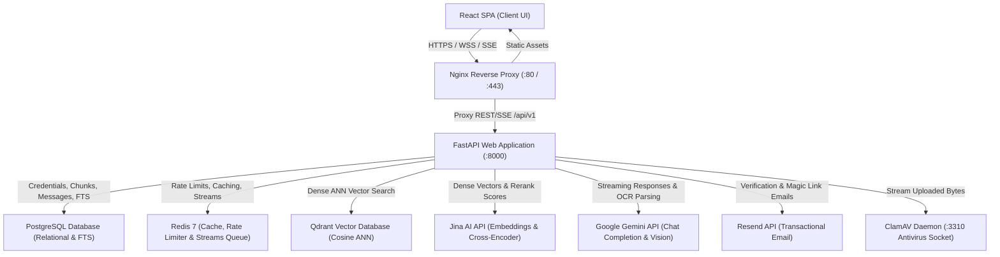
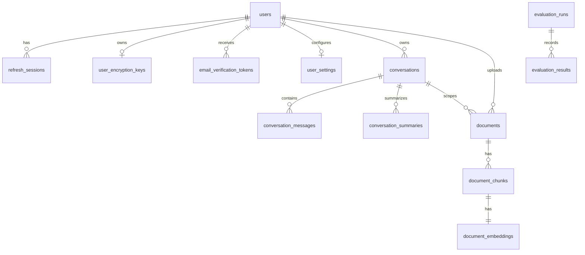
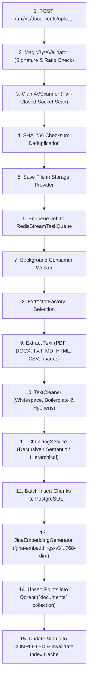
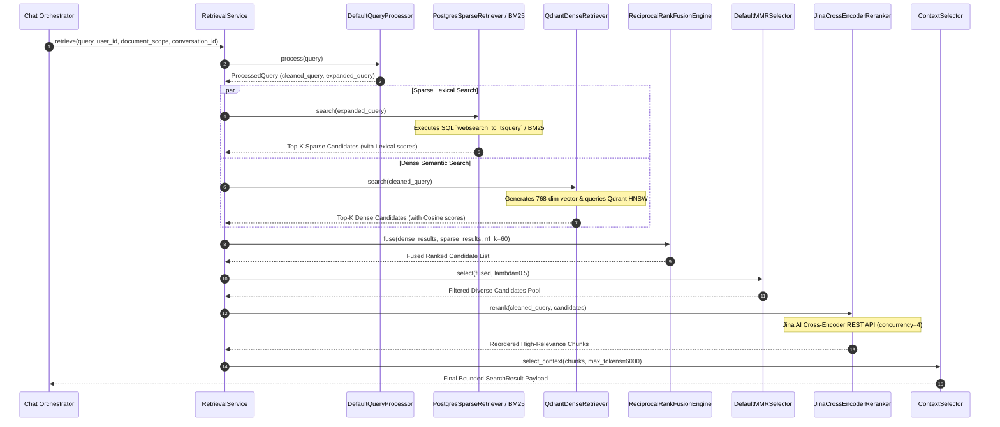

# Reverse Engineering Manual: Production-Grade Hybrid RAG Chatbot

This document provides an exhaustive, authoritative technical blueprint of the **Hybrid RAG Chatbot** system. It details the architecture, design choices, data models, pipelines, algorithms, and step-by-step instructions required to build this system from scratch without AI assistance.

---

## 1. System Architecture & Tech Stack

The platform is designed with a decoupled, asynchronous, and modular architecture. Responsibilities are partitioned across three primary tiers: a React Client SPA, a FastAPI Application Server, and backing data stores (PostgreSQL, Qdrant, and Redis), integrating with cloud REST AI providers (Jina AI, Google Gemini, Resend).

### Relational Stack Topology



### Component Selection Rationale

1. **FastAPI (Python 3.12+)**: High performance via ASGI, native `async/await` throughout all database and network paths, strict Pydantic v2 data validation, and automated OpenAPI documentation.
2. **React + Vite + TypeScript**: Component modularity, sub-second Hot Module Replacement (HMR) powered by ESbuild, and compile-time type safety across all frontend models and API clients.
3. **PostgreSQL**: Authoritative transactional system of record for users, sessions, documents, chunks, and conversation history. Provides native lexical Full-Text Search (`to_tsvector`, `ts_rank_cd`, `websearch_to_tsquery` on GIN indexes). Connection pool scaled (`pool_size=50`, `max_overflow=50`) to prevent anyio thread starvation deadlocks.
4. **Qdrant**: High-performance vector database written in Rust. Supports HNSW approximate nearest neighbor (ANN) search with strict tenant payload filtering (`user_id`, `document_id`, `document_scope`, `conversation_id`).
5. **Redis 7**: Connection-pooled `redis.asyncio` client powering ephemeral caching (`ns:embeddings:*`, `ns:retrieval_results:*`, `ns:llm_responses:*`), sliding-window rate limiting, and durable background job execution via Redis Streams (`stream:jobs:document_processing`).
6. **Zero-PyTorch Cloud Inference**: Offloads embedding generation (`jina-embeddings-v3`, 768-dim), cross-encoder reranking (`jina-reranker-v2-base-multilingual`), and LLM generation (`gemini-3.5-flash-lite`) to external REST APIs, keeping container sizes $< 450\text{ MB}$ and startup latency sub-second.

---

## 2. Database Schema & Data Models

### 2.1. PostgreSQL Relational Schema

The relational schema is implemented via SQLAlchemy 2.0 async ORM models, organized into domain modules:



#### 1. `users`
Tracks user credentials, account activation, email verification status, and OAuth identities.
* `id` (`UUID`, Primary Key, default `uuid.uuid4`)
* `email` (`VARCHAR(255)`, unique, index, not null)
* `hashed_password` (`VARCHAR(255)`, nullable for OAuth users)
* `role` (`VARCHAR(50)`, default `"user"`, not null)
* `is_active` (`BOOLEAN`, default `True`, not null)
* `is_verified` (`BOOLEAN`, default `False`, not null)
* `oauth_provider` (`VARCHAR(50)`, nullable) — e.g. `"google"`, `"github"`
* `oauth_sub` (`VARCHAR(255)`, nullable, index)
* `created_at` / `updated_at` (`TIMESTAMPTZ`, not null)
* **Constraints**: `UniqueConstraint("oauth_provider", "oauth_sub")`

#### 2. `refresh_sessions`
Manages stateful refresh tokens for single-use JWT session rotation.
* `id` (`UUID`, Primary Key, default `uuid.uuid4`)
* `token_hash` (`VARCHAR(255)`, unique, index, not null)
* `user_id` (`UUID`, Foreign Key to `users.id` with `ondelete="CASCADE"`, not null)
* `expires_at` (`TIMESTAMPTZ`, not null)
* `is_revoked` (`BOOLEAN`, default `False`, not null)
* `created_at` / `last_used_at` (`TIMESTAMPTZ`, not null)
* `revoked_at` (`TIMESTAMPTZ`, nullable)
* `user_agent` (`VARCHAR(512)`, nullable)
* `ip_address` (`VARCHAR(100)`, nullable)

#### 3. `user_encryption_keys`
Stores per-user Data Encryption Keys (wrapped by master key) for client-side envelope encryption.
* `user_id` (`UUID`, Foreign Key to `users.id` with `ondelete="CASCADE"`, Primary Key)
* `wrapped_dek` (`TEXT`, not null)
* `key_version` (`INTEGER`, default `1`, not null)
* `created_at` / `updated_at` (`TIMESTAMPTZ`, not null)

#### 4. `email_verification_tokens`
Stores expiring email verification and OTP codes generated by Resend.
* `id` (`UUID`, Primary Key, default `uuid.uuid4`)
* `user_id` (`UUID`, Foreign Key to `users.id` with `ondelete="CASCADE"`, not null, index)
* `token_hash` (`VARCHAR(255)`, unique, index, not null)
* `otp_code` (`VARCHAR(6)`, index, not null)
* `attempts` (`INTEGER`, default `0`, not null)
* `expires_at` (`TIMESTAMPTZ`, not null)
* `is_used` (`BOOLEAN`, default `False`, not null)
* `created_at` (`TIMESTAMPTZ`, not null)

#### 5. `user_settings`
Stores user UI preferences, folders, and conversation tags.
* `user_id` (`UUID`, Foreign Key to `users.id` with `ondelete="CASCADE"`, Primary Key)
* `folders` (`JSON`, default `[]`, not null)
* `pinned_conversations` (`JSON`, default `[]`, not null)
* `conversation_tags` (`JSON`, default `{}`, not null)
* `document_folders` / `document_folder_mappings` (`JSON`, not null)
* `document_custom_order` / `document_filter_presets` (`JSON`, not null)
* `preferences` (`JSON`, default `{}`, not null)
* `created_at` / `updated_at` (`TIMESTAMPTZ`, not null)

#### 6. `conversations`
Maintains chat sessions and metadata with optimistic locking.
* `id` (`UUID`, Primary Key, default `uuid.uuid4`)
* `user_id` (`UUID`, Foreign Key to `users.id` with `ondelete="CASCADE"`, not null, index)
* `title` (`VARCHAR(255)`, not null)
* `state` (`VARCHAR(50)`, default `"active"`, not null)
* `settings` (`JSON`, default `{}`, not null)
* `version` (`INTEGER`, default `1`, not null) — *Optimistic locking column*
* `metadata` (`JSON`, default `{}`, not null)
* `created_at` / `updated_at` / `last_message_at` (`TIMESTAMPTZ`, not null)

#### 7. `conversation_messages`
Stores individual chat turns (user prompts, system notes, assistant answers, tool runs).
* `id` (`UUID`, Primary Key, default `uuid.uuid4`)
* `conversation_id` (`UUID`, Foreign Key to `conversations.id` with `ondelete="CASCADE"`, not null, index)
* `role` (`VARCHAR(50)`, not null) — *user, assistant, system, tool*
* `content` (`TEXT`, not null)
* `status` (`VARCHAR(50)`, default `"completed"`, not null)
* `citations` (`JSON`, nullable) — *Array of inline citation references*
* `prompt_tokens` / `completion_tokens` (`INTEGER`, default `0`, not null)
* `tool_calls` (`JSON`, nullable)
* `attachments` / `structured_content` (`JSON`, nullable)
* `metadata` (`JSON`, nullable)
* `created_at` (`TIMESTAMPTZ`, not null)

#### 8. `conversation_summaries`
Maintains rolling summaries of historical messages to conserve LLM context windows.
* `id` (`UUID`, Primary Key, default `uuid.uuid4`)
* `conversation_id` (`UUID`, Foreign Key to `conversations.id` with `ondelete="CASCADE"`, not null, index)
* `summary` (`TEXT`, not null)
* `summary_version` (`INTEGER`, default `1`, not null)
* `covered_from_message_id` / `covered_until_message_id` (`UUID`, not null)
* `message_count` (`INTEGER`, not null)
* `created_at` (`TIMESTAMPTZ`, not null)

#### 9. `documents`
Tracks document metadata, two-tier scoping, validation status, and ingestion state.
* `id` (`UUID`, Primary Key, default `uuid.uuid4`)
* `user_id` (`UUID`, Foreign Key to `users.id` with `ondelete="CASCADE"`, not null)
* `conversation_id` (`UUID`, Foreign Key to `conversations.id` with `ondelete="SET NULL"`, nullable, index)
* `scope` (`VARCHAR(50)`, default `"LIBRARY"`, not null) — *`"LIBRARY"` or `"CONVERSATION"`*
* `filename` (`VARCHAR(255)`, not null) — *Stored identifier*
* `original_filename` (`VARCHAR(255)`, not null)
* `content_type` (`VARCHAR(100)`, not null)
* `file_size` (`INTEGER`, not null)
* `checksum` (`VARCHAR(64)`, index, not null) — *SHA-256 deduplication*
* `status` (`VARCHAR(50)`, default `"queued"`, not null) — *queued, processing, completed, failed*
* `extractor_version` (`VARCHAR(20)`, default `"v1"`, not null)
* `failure_reason` (`TEXT`, nullable)
* `page_count` / `word_count` / `language` (`INTEGER`/`VARCHAR`, nullable)
* `created_at` / `updated_at` (`TIMESTAMPTZ`, not null)
* `processing_started_at` / `processing_completed_at` (`TIMESTAMPTZ`, nullable)

#### 10. `document_chunks`
Stores text segments split from documents, equipped with PostgreSQL FTS vectors.
* `id` (`UUID`, Primary Key, default `uuid.uuid4`)
* `document_id` (`UUID`, Foreign Key to `documents.id` with `ondelete="CASCADE"`, not null)
* `chunk_index` (`INTEGER`, not null)
* `text` (`TEXT`, not null)
* `character_start` / `character_end` (`INTEGER`, not null)
* `token_estimate` (`INTEGER`, not null)
* `metadata` (`JSON`, default `{}`, not null)
* `search_vector` (`TSVECTOR`, generated always as `to_tsvector('english', coalesce(text, ''))` stored, indexed via GIN)
* `created_at` (`TIMESTAMPTZ`, not null)
* **Constraints**: `UniqueConstraint("document_id", "chunk_index")`

#### 11. `document_embeddings`
Tracks the embedding generation status for vector points.
* `id` (`UUID`, Primary Key, default `uuid.uuid4`)
* `chunk_id` (`UUID`, Foreign Key to `document_chunks.id` with `ondelete="CASCADE"`, unique, not null)
* `embedding_provider` (`VARCHAR(50)`, not null) — e.g. `"jina"`
* `embedding_model` (`VARCHAR(100)`, not null) — e.g. `"jina-embeddings-v3"`
* `embedding_dimension` (`INTEGER`, not null) — e.g. `768`
* `embedding_version` (`VARCHAR(50)`, not null)
* `status` (`VARCHAR(50)`, not null) — *pending, generating, completed, failed*
* `created_at` / `updated_at` (`TIMESTAMPTZ`, not null)

#### 12. `document_files`
Binary BLOB storage fallback table (when not using local or S3 filesystem).
* `key` (`VARCHAR(255)`, Primary Key)
* `content` (`BYTEA`, not null)

#### 13. `durable_cleanup_jobs`
Durable queue to clean up orphan vector records and files upon document deletion.
* `id` (`UUID`, Primary Key, default `uuid.uuid4`)
* `resource_type` (`VARCHAR(50)`, not null) — *vector, file*
* `resource_id` (`UUID`, not null)
* `payload` (`JSON`, default `{}`, not null)
* `status` (`VARCHAR(20)`, default `"PENDING"`, not null) — *PENDING, COMPLETED, FAILED*
* `attempts` (`INTEGER`, default `0`, not null)
* `last_error` (`TEXT`, nullable)
* `created_at` / `updated_at` (`TIMESTAMPTZ`, not null)
* **Constraints**: `UniqueConstraint("resource_type", "resource_id")`

#### 14. `evaluation_runs` & `evaluation_results` & `benchmark_runs`
Stores benchmark execution runs, token costs, latency measurements, and QA sample evaluation metrics (Faithfulness, Answer Relevancy, Context Recall/Precision).

---

### 2.2. Qdrant Payload & Indexing Configuration

Qdrant stores 768-dimensional dense embeddings with **Cosine Distance** matching in the `documents` collection.

#### Payload Schema
```json
{
  "chunk_id": "string (UUID)",
  "document_id": "string (UUID)",
  "user_id": "string (UUID)",
  "document_scope": "string (LIBRARY or CONVERSATION)",
  "conversation_id": "string (UUID, nullable)",
  "chunk_index": "integer",
  "language": "string",
  "metadata": "object"
}
```

#### Required Qdrant Payload Indexes
Payload keyword indexes (`PayloadSchemaType.KEYWORD`) are created on:
1. `user_id` (Mandatory tenant boundary isolation)
2. `document_id` (Enables document deletion and point resolution)
3. `document_scope` (Enables global library vs. conversation-scoped filtering)
4. `conversation_id` (Restricts search to active chat session)
5. `tags` (Allows tag-based filtering)
6. `metadata` (Enables arbitrary metadata filters)

---

## 3. Document Ingestion & Processing Pipeline



### 3.1. Parsing Strategies
The [`ExtractorFactory`](file:///d:/fun/hybrid_rag/backend/app/documents/infrastructure/extractors.py) dynamically instantiates extractors:
* **PDF**: Text and tables extracted page-by-page via `pypdf`, preserving logical reading order and stripping header/footer noise.
* **DOCX**: Iterates through paragraphs, lists, and tables via `python-docx`.
* **HTML**: Uses `BeautifulSoup4` to remove `<script>`, `<style>`, and `<head>` tags, preserving headings (`<h1>`-`<h6>`), `<p>`, and tabular data.
* **TXT & Markdown**: Direct UTF-8 text ingestion preserving markdown structures.
* **CSV**: Parses rows via `csv.DictReader` into semantic key-value text lines.
* **Images**: Multimodal OCR parsing using Google Gemini Vision to extract structured descriptions, tables, and transcripts.

### 3.2. Hierarchical Chunking
The [`ChunkingService`](file:///d:/fun/hybrid_rag/backend/app/documents/services/chunking.py) supports:
1. **Recursive Character Chunking**: Splits by `["\n\n", "\n", " ", ""]` maintaining `chunk_size` (default 500) and `chunk_overlap` (default 50).
2. **Semantic Chunking**: Splits on embedding cosine similarity shifts between consecutive sentences.
3. **Parent-Child & Sentence-Window**: Indexes small child chunks (400 chars) for granular retrieval, resolving parent chunks (1500 chars) or surrounding sentence windows during context selection.

---

## 4. Advanced Hybrid Retrieval Pipeline



---

## 5. Adaptive RAG & Multi-Agent Orchestration

When queries require multi-step reasoning, hypothetical answers, or tools, the `AdaptiveRAGOrchestrator` runs a dynamic control loop:

1. **Query Classifier**: Evaluates prompt syntax and complexity to assign strategy:
   - `direct`: Single-shot hybrid retrieval for direct factual questions.
   - `hyde`: Generates a hypothetical answer document via `SafeHyDEExecutor` before dense vector search.
   - `multi_hop`: Decomposes questions into sequential sub-retrieval queries via `QueryDecomposer`.
   - `specialist`: Dispatches sub-tasks to specialist multi-agent workers.
2. **Evidence Sufficiency Evaluator**: Evaluates whether retrieved candidate chunks satisfy the query's information needs. If similarity or coverage is below threshold, triggers `Replanner`.
3. **Agentic Tool Sandbox**:
   - `SafeCalculator`: AST-based arithmetic evaluator blocking dangerous operations and preventing exponential CPU attacks.
   - `WebSearchTool`: Internet search fallback via SerpAPI / Firecrawl.

---

## 6. Observability, Evaluations & Telemetry

1. **In-App Admin Console (`/admin/dashboard`)**:
   - Real-time KPI summary (requests, total tokens, average latency, total cost).
   - Execution trace inspector showing granular time spent in query rewriting, vector ANN search, sparse search, RRF fusion, cross-encoder reranking, and generation.
   - Evaluation runner UI with rendered HTML benchmark reports.
2. **Prometheus Metrics**:
   - Exposed at `/api/v1/observability/metrics` with low-cardinality labels (zero PII/user_id leaks).
3. **OpenTelemetry & Jaeger**:
   - Distributed trace spans exported to Jaeger (`:4317` gRPC / `:4318` HTTP), with `TelemetrySanitizer` stripping raw document text, prompts, and tokens.
4. **Grafana Pre-Provisioned Dashboards (`:3000`)**:
   - `Hybrid RAG — Retrieval & Pipeline`
   - `Hybrid RAG — LLM & Providers`
   - `Hybrid RAG — Queue & Workers`
   - `Hybrid RAG — HTTP & API SLO`

---

## 7. Rebuilding Roadmap (Step-by-Step Guide)

Follow these steps to rebuild the Hybrid RAG Chatbot from scratch:

### Step 1: Environment & Tooling Setup
1. Install Python 3.12+, Node.js v18+, Docker Desktop, and Astral `uv`.
2. Initialize backend directory with `pyproject.toml` and frontend with Vite React TypeScript.

### Step 2: Database Setup & Migrations
1. Define SQLAlchemy async ORM models in `backend/app/db/models.py`.
2. Configure Alembic migrations (`alembic revision --autogenerate -m "initial"` and `alembic upgrade head`).

### Step 3: Core Security, Rate Limiting & Queue
1. Implement Argon2id password hashing and JWT token provider in `backend/app/auth/`.
2. Implement `RateLimiter` with Redis sliding window and in-memory fallback.
3. Implement `RedisStreamTaskQueue` for background jobs.

### Step 4: Ingestion Pipeline & Storage
1. Implement extractors (PDF, DOCX, HTML, TXT, CSV, Vision OCR) in `backend/app/documents/infrastructure/extractors.py`.
2. Implement text cleaning and chunking in `backend/app/documents/services/chunking.py`.
3. Implement ClamAV antivirus socket streaming and magic-byte signature validation.

### Step 5: Vector Store & Dense/Sparse Retrieval
1. Implement `QdrantVectorStore` in `backend/app/documents/infrastructure/persistence/vector_store.py`.
2. Implement `PostgresSparseRetriever` (PostgreSQL FTS) and `InMemoryBM25Index`.
3. Implement `ReciprocalRankFusionEngine`, `DefaultMMRSelector`, and `JinaCrossEncoderReranker`.

### Step 6: Adaptive RAG, Agentic Tools & Chat Orchestration
1. Implement `AdaptiveRAGOrchestrator`, `StrategyRouter`, `EvidenceSufficiencyEvaluator`, and `Replanner`.
2. Implement `SafeCalculator` and `WebSearchTool`.
3. Implement `PromptBuilder` with `<retrieved_context>` XML fencing and `GeminiProvider` streaming SSE.

### Step 7: Frontend Development
1. Build React SPA with `ThemeContext`, `AuthContext`, and `UploadQueueContext`.
2. Implement Markdown rendering with Shiki syntax highlighting, citation drawer, and SSE streaming.
3. Implement Document Manager and Admin Observability Dashboard (`/admin/dashboard`).

### Step 8: Containerization & Observability
1. Create multi-stage `Dockerfile` for backend and frontend.
2. Build `docker-compose.yml` and `docker-compose.observability.yml` to orchestrate PostgreSQL, Redis, Qdrant, Prometheus, Jaeger, Grafana, Nginx, and app containers.
