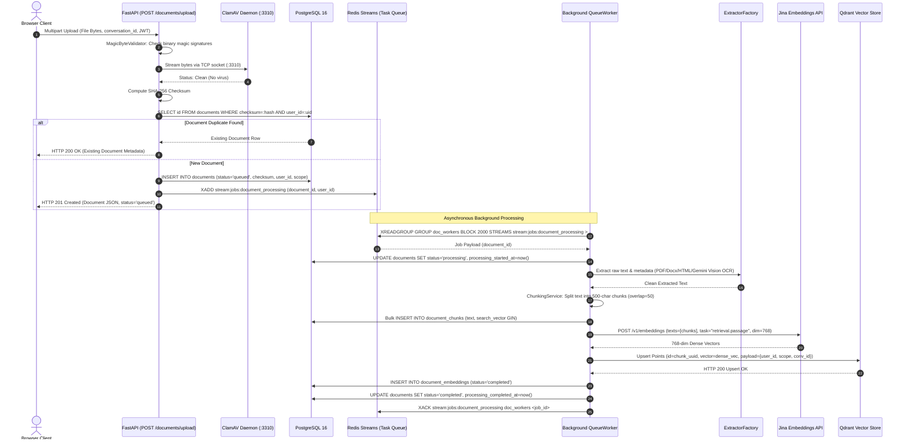
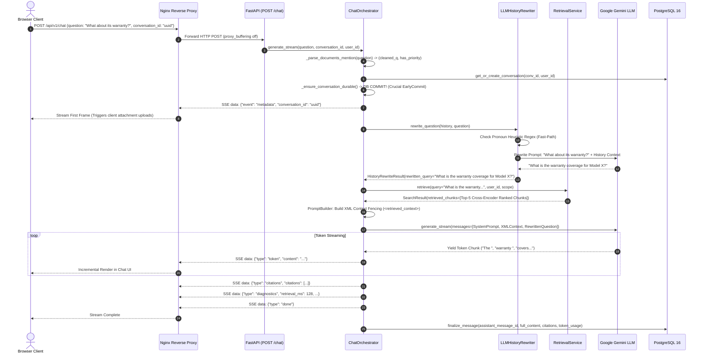
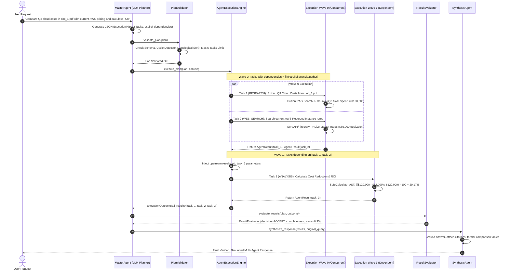
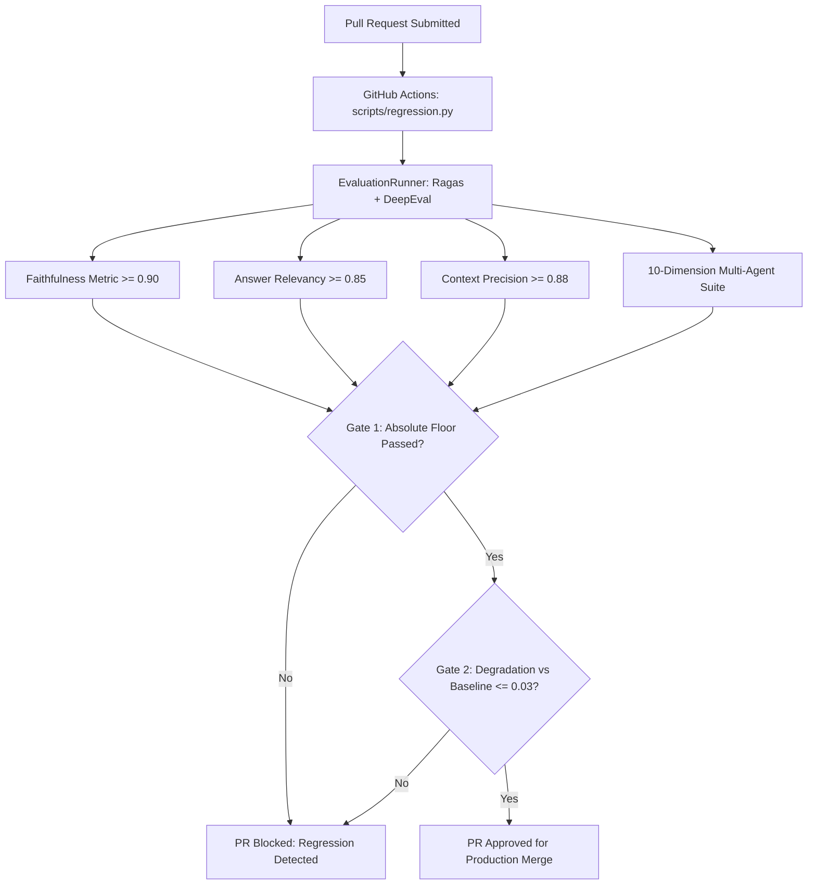

# Fusion RAG: Production-Grade Reverse Engineering & Architectural Blueprint
### Single Source of Truth, System Design Deep Dive & Master Technical Interview Guide

---

## Document Overview & How to Use This Guide

This document is the **definitive, exhaustive technical specification, data flow blueprint, and architectural manual** for the **Fusion RAG Platform**. It is engineered to enable a Principal Software Engineer or System Architect to understand, maintain, scale, or recreate the entire distributed system from scratch without external documentation or AI assistance.

```
====================================================================================================
                                      SYSTEM QUICK REFERENCE
====================================================================================================
* Core Framework:       FastAPI (Python 3.12+ ASGI) + Uvicorn + Pydantic v2
* Primary Database:     PostgreSQL 16 (asyncpg + SQLAlchemy 2.0 async ORM)
* Vector Search Engine: Qdrant v1.19.0 (HNSW ANN, 768-dim Cosine, Payload Tenant Fencing)
* Sparse Text Search:   PostgreSQL Full-Text Search (tsvector + ts_rank_cd + GIN Indexes)
* In-Memory Cache/Queue:Redis 7 (redis.asyncio, Redis Streams Consumer Groups, Sorted Sets)
* Dense Embeddings:     Jina AI API (jina-embeddings-v3, Matryoshka Representation, 768-dim)
* Cross-Encoder Rerank: Jina AI API (jina-reranker-v2-base-multilingual)
* Primary LLM Engine:   Google Gemini API (gemini-3.5-flash-lite via Multi-Key Workload Isolation)
* Observability:        OpenTelemetry SDK + Jaeger (OTLP gRPC) + Prometheus + Grafana
* Evaluation Engine:    Ragas + DeepEval + Custom 10-Dimension Multi-Agent Regression Suite
* Frontend Interface:   React 18 + Vite 5 + TypeScript + Vanilla CSS Design Tokens (No-Tailwind)
====================================================================================================
```

---

# Table of Contents

- [Part I: Executive Overview & High-Level System Architecture](#part-i-executive-overview--high-level-system-architecture)
  - [1. System Vision, Problem Statement & Core Value Proposition](#1-system-vision-problem-statement--core-value-proposition)
  - [2. End-to-End System Topology & High-Level Architecture Diagram](#2-end-to-end-system-topology--high-level-architecture-diagram)
  - [3. Architectural Selection Matrix & Tradeoff Analysis](#3-architectural-selection-matrix--tradeoff-analysis)
  - [4. Complete Project Directory Layout & Module Responsibilities](#4-complete-project-directory-layout--module-responsibilities)
- [Part II: End-to-End Sequence Diagrams & Step-by-Step Data Flows](#part-ii-end-to-end-sequence-diagrams--step-by-step-data-flows)
  - [5. Document Ingestion, Parsing, Chunking & Vector Indexing Sequence](#5-document-ingestion-parsing-chunking--vector-indexing-sequence)
  - [6. Real-Time Chat & SSE Streaming Lifecycle Sequence](#6-real-time-chat--sse-streaming-lifecycle-sequence)
  - [7. Production Hybrid Retrieval Pipeline Sequence (Dense + Sparse + RRF + MMR + Reranker)](#7-production-hybrid-retrieval-pipeline-sequence-dense--sparse--rrf--mmr--reranker)
  - [8. Hierarchical Multi-Agent DAG Planning & Execution Wave Sequence](#8-hierarchical-multi-agent-dag-planning--execution-wave-sequence)
  - [9. Authentication, Token Rotation & Replay Attack Defense Sequence](#9-authentication-token-rotation--replay-attack-defense-sequence)
- [Part III: Deep-Dive Component Architecture & Production Code Implementations](#part-iii-deep-dive-component-architecture--production-code-implementations)
  - [10. High-Concurrency Asynchronous API & Lifespan Architecture (FastAPI & ASGI)](#10-high-concurrency-asynchronous-api--lifespan-architecture-fastapi--asgi)
  - [11. The Chat Orchestrator & The EarlyCommit Streaming Pattern](#11-the-chat-orchestrator--the-earlycommit-streaming-pattern)
  - [12. History-Aware Rewriting & Heuristic Fast-Path Optimization](#12-history-aware-rewriting--heuristic-fast-path-optimization)
  - [13. Production Hybrid Retrieval Engine Implementation](#13-production-hybrid-retrieval-engine-implementation)
  - [14. Chunking Engine: Algorithmic Mechanics, Comparison & Tradeoffs](#14-chunking-engine-algorithmic-mechanics-comparison--tradeoffs)
  - [15. Hierarchical Multi-Agent DAG Planner & Execution Engine](#15-hierarchical-multi-agent-dag-planner--execution-engine)
  - [16. Distributed Task Queue & Durable Ingestion Engine (Redis Streams)](#16-distributed-task-queue--durable-ingestion-engine-redis-streams)
  - [17. Relational Database Architecture: PostgreSQL 16 & SQLAlchemy 2.0 Async](#17-relational-database-architecture-postgresql-16--sqlalchemy-20-async)
  - [18. Multi-Tenancy, Data Isolation & Two-Tier Scoping Architecture](#18-multi-tenancy-data-isolation--two-tier-scoping-architecture)
  - [19. Latency, Token Limits & Cost Optimization Framework](#19-latency-token-limits--cost-optimization-framework)
  - [20. Production Observability: OpenTelemetry, Prometheus & Telemetry Sanitization](#20-production-observability-opentelemetry-prometheus--telemetry-sanitization)
  - [21. Evaluation Suite, Golden Datasets & Dual-Gate Regression CI/CD](#21-evaluation-suite-golden-datasets--dual-gate-regression-cicd)
- [Part IV: Real-World Engineering Case Studies (DaveAI Production Challenges)](#part-iv-real-world-engineering-case-studies-daveai-production-challenges)
  - [22. Case Study 1: The Asynchronous Streaming Transaction Race Condition (EarlyCommit Fix)](#22-case-study-1-the-asynchronous-streaming-transaction-race-condition-earlycommit-fix)
  - [23. Case Study 2: Database Connection Pool Starvation during Streaming Responses](#23-case-study-2-database-connection-pool-starvation-during-streaming-responses)
  - [24. Case Study 3: Cascading Timeouts & Topological Deadlocks in Multi-Agent Execution](#24-case-study-3-cascading-timeouts--topological-deadlocks-in-multi-agent-execution)
  - [25. Case Study 4: Multi-Key Rate-Limit Cascades & High-Traffic Failover](#25-case-study-4-multi-key-rate-limit-cascades--high-traffic-failover)
- [Part V: Master Technical Interview Preparation Guide](#part-v-master-technical-interview-preparation-guide)
  - [26. Technical Narrative Framework (STAR Format for Fusion RAG)](#26-technical-narrative-framework-star-format-for-fusion-rag)
  - [27. Backend Architecture & Distributed Systems Interview Questions](#27-backend-architecture--distributed-systems-interview-questions)
  - [28. Generative AI, RAG & LLM Systems Interview Questions](#28-generative-ai-rag--llm-systems-interview-questions)
  - [29. System Design, Resilience & Failure Scenarios Interview Questions](#29-system-design-resilience--failure-scenarios-interview-questions)
  - [30. Rapid Revision Flashcard Matrix (Numbers, Formulas, DB Indexes & Shell Commands)](#30-rapid-revision-flashcard-matrix-numbers-formulas-db-indexes--shell-commands)

---

# Part I: Executive Overview & High-Level System Architecture

## 1. System Vision, Problem Statement & Core Value Proposition

### 1.1 The Industry Problem
Standard Retrieval-Augmented Generation (RAG) implementations suffer from five primary production pathologies:
1. **Semantic Blindness / Keyword Disconnect**: Pure dense vector retrieval (bi-encoders) fails on exact keyword searches, product codes, SKUs, acronyms, and technical identifiers (e.g., searching for error code `0x80070005` or part number `CR-4096`).
2. **Dense False Positives / High Semantic Overlap**: Dense embeddings retrieve passages with similar grammatical structure or high-level topic alignment that lack the specific factual answer.
3. **Chunk Boundary Truncation**: Rigid chunking breaks tables, sentences, and contextual definitions across chunk boundaries, leading to hallucinated synthesis.
4. **Context Drift in Multi-Turn Dialogues**: Follow-up questions (e.g., *"What about its warranty?"* or *"Can you compare it to the first option?"*) fail because standard RAG embeds the pronoun-laden query directly, searching for "it" instead of the resolved entity.
5. **Slow Time-To-First-Token (TTFT) & Fragility**: Ingestion pipelines block synchronous API threads; single LLM API rate limits cause total application blackouts; unbuffered database writes during streaming cause connection exhaustion.

### 1.2 The Fusion RAG Solution
**Fusion RAG** resolves these challenges through an enterprise-grade, asynchronous, multi-tiered architecture:
- **Hybrid Search with Reciprocal Rank Fusion (RRF)**: Merges dense vector HNSW search with PostgreSQL GIN full-text search (FTS) using rank-based reciprocal scoring ($k=60$).
- **Maximal Marginal Relevance (MMR) & Cross-Encoder Reranking**: Balances information diversity ($\lambda=0.5$) before passing candidates to a heavy multilingual cross-encoder (`jina-reranker-v2`) bounded by async semaphores.
- **Hierarchical Multi-Agent Orchestration**: Decomposes complex analytical and multi-domain requests into Directed Acyclic Graphs (DAGs) executed concurrently across specialized sub-agents (`ResearchAgent`, `DocumentAgent`, `AnalysisAgent`, `WebSearchAgent`) with bounded replanning.
- **Two-Tier Document Model with Scope Isolation**: Strict separation between user-wide persistent Library documents and session-bound Conversation documents with cryptographic multi-tenancy.
- **Zero-PyTorch Cloud-Native Architecture**: Achieves sub-second cold starts and container images under 450 MB by delegating heavy matrix operations to specialized, resilient REST APIs.

---

## 2. End-to-End System Topology & High-Level Architecture Diagram

```
+---------------------------------------------------------------------------------------------------+
|                                       CLIENT TIER                                                 |
|   React 18 + Vite 5 + TypeScript SPA (HTML5 SSE Reader, Upload Queue, Token Buffer, Citation UI) |
+---------------------------------------------------------------------------------------------------+
                                                  |
                                                  | HTTPS / Server-Sent Events (SSE)
                                                  v
+---------------------------------------------------------------------------------------------------+
|                                      EDGE & REVERSE PROXY                                         |
|   Nginx 1.25 (Alpine) [Reverse Proxy, Gzip/Brotli, Static Caching, proxy_buffering off for SSE]   |
+---------------------------------------------------------------------------------------------------+
                                                  |
                                                  | HTTP/1.1 Forwarding (:8000)
                                                  v
+---------------------------------------------------------------------------------------------------+
|                                   FASTAPI APPLICATION LAYER                                       |
|                                                                                                   |
|  +---------------------------------------------------------------------------------------------+  |
|  |  ASGI Middleware Pipeline:                                                                  |  |
|  |  1. RequestContext Injection (ContextVar) -> 2. Telemetry Middleware (OTel W3C Trace IDs)    |  |
|  |  3. Rate Limiter (Redis Sliding Window)   -> 4. Security Headers & CORS Guard               |  |
|  +---------------------------------------------------------------------------------------------+  |
|                                                  |                                                |
|                   +------------------------------+------------------------------+                 |
|                   |                                                             |                 |
|                   v                                                             v                 |
|  +----------------------------------+                         +--------------------------------+  |
|  |   DOCUMENT INGESTION ROUTE       |                         |      CHAT STREAMING ROUTE      |  |
|  |   POST /api/v1/documents/upload  |                         |      POST /api/v1/chat         |  |
|  |                                  |                         |                                |  |
|  | 1. Magic Byte & Antivirus (ClamAV)|                         | 1. @documents Directive Parser |  |
|  | 2. SHA-256 Deduplication Check   |                         | 2. EarlyCommit Session Lock    |  |
|  | 3. PostgreSQL Raw Doc Write      |                         | 3. LLM History Rewriter        |  |
|  | 4. Redis Stream Task Enqueue     |                         | 4. Adaptive Strategy Classifier|  |
|  +----------------------------------+                         +--------------------------------+  |
|                   |                                                             |                 |
+-------------------|-------------------------------------------------------------|-----------------+
                    |                                                             |
                    v (Async Redis Stream)                                        v
+------------------------------------+                  +-------------------------------------------+
|    BACKGROUND WORKER TIER          |                  |        RAG RETRIEVAL & AGENT ENGINE       |
|                                    |                  |                                           |
|  QueueWorker (Redis Consumer Group)|                  |  +-------------------------------------+  |
|  1. Extract (pypdf/docx/Vision OCR)|                  |  | Hybrid Retrieval Pipeline:          |  |
|  2. TextCleaner & Normalizer       |                  |  |  - Dense Branch (Qdrant HNSW)       |  |
|  3. Chunking (Recursive/ParentChild|                  |  |  - Sparse Branch (Postgres GIN FTS) |  |
|  4. Batch Embed (Jina REST API)    |                  |  |  - Reciprocal Rank Fusion (RRF)    |  |
|  5. Upsert to Qdrant Vector Store  |                  |  |  - Maximal Marginal Relevance (MMR) |  |
|  6. Invalidate User Index Cache    |                  |  |  - Jina Cross-Encoder Reranker      |  |
|                                    |                  |  +-------------------------------------+  |
|  Durable Ingestion Reaper (60s)    |                  |                     |                     |
|  - Reclaims stalled processing jobs|                  |  +-------------------------------------+  |
+------------------------------------+                  |  | Hierarchical Multi-Agent (Optional):|  |
                                                        |  |  - MasterAgent (LLM DAG Planner)    |  |
                                                        |  |  - ExecutionEngine (Async Waves)    |  |
                                                        |  |  - Specialists: Web/Doc/Math/Rsrch  |  |
                                                        |  |  - SynthesisAgent Final Grounding   |  |
                                                        |  +-------------------------------------+  |
                                                        |                     |                     |
                                                        |  +-------------------------------------+  |
                                                        |  | Answer Generation (Gemini LLM):     |  |
                                                        |  |  - XML Context Isolation Fencing    |  |
                                                        |  |  - Token Streaming over SSE Engine  |  |
                                                        |  |  - Inline Citation Mapping          |  |
                                                        |  +-------------------------------------+  |
                                                        +-------------------------------------------+
                                                                              |
                   +----------------------------------------------------------+
                   |
                   v
+---------------------------------------------------------------------------------------------------+
|                                  STATE & PERSISTENCE TIER                                         |
|                                                                                                   |
|  +-----------------------+   +------------------------+   +------------------------------------+  |
|  |     POSTGRESQL 16     |   |        REDIS 7         |   |          QDRANT v1.19.0            |  |
|  | - System of Record    |   | - Token Bucket RL      |   | - HNSW Vector Index                |  |
|  | - Users, Auth, Keys   |   | - Semantic/Exact Cache |   | - 768-dim Cosine Distance          |  |
|  | - Conversations & Msgs|   | - Streams Task Queue   |   | - Payload Filter:                  |  |
|  | - Chunks & GIN FTS    |   | - Ingestion Dead-Letter|   |   (user_id + scope + conversation) |  |
|  +-----------------------+   +------------------------+   +------------------------------------+  |
+---------------------------------------------------------------------------------------------------+
```

---

## 3. Architectural Selection Matrix & Tradeoff Analysis

| Component | Selected Technology | Alternative Considered | Why Selected (Deep Technical Rationale) | Tradeoffs & Mitigations |
|---|---|---|---|---|
| **API Framework** | **FastAPI + Uvicorn (ASGI)** | Django, Flask, Express.js | Native Python `async`/`await` support for non-blocking I/O; automatic OpenAPI validation via Pydantic v2; ASGI standard supports long-lived HTTP SSE streaming without thread blocking. | Python GIL exists for CPU-bound tasks. *Mitigation*: Offload CPU-heavy text extraction to async workers and MathEngine AST parser. |
| **Relational Database** | **PostgreSQL 16 (asyncpg)** | MySQL, MongoDB | Robust ACID compliance; native JSONB for flexible chat metadata; built-in Full-Text Search (`tsvector`, `websearch_to_tsquery`) with GIN indexes eliminates separate Elasticsearch cluster. | Connection overhead per backend process. *Mitigation*: Tuned `async_sessionmaker` connection pool ($N=20$, overflow $10$, statement cache disabled for PgBouncer). |
| **Vector Database** | **Qdrant v1.19.0** | Pinecone, Weaviate, Milvus, pgvector | Written in Rust with ultra-low memory overhead; native payload filtering directly inside HNSW graph index traversal (crucial for multi-tenant `user_id` filtering); fully self-hostable. | Self-managed disk persistence. *Mitigation*: Mounted persistent volume `/qdrant/storage` with automated WAL snapshots. |
| **Message Queue / Cache** | **Redis 7 (Streams + Memory)** | Celery + RabbitMQ, Kafka | Single in-memory infrastructure handles sliding-window rate limiting, multi-tier semantic caching, and durable task queues with consumer groups (`XREADGROUP`), ACK/NACK, and DLQ. | In-memory RAM constraints. *Mitigation*: Configured LRU eviction policy for cache namespaces; persistent AOF for task queue streams. |
| **Dense Embeddings** | **Jina Embeddings v3** | OpenAI `text-embedding-3-small`, HuggingFace local | 768-dim Matryoshka Representation Learning (MRL) allows truncation to 256/128 dims; asymmetric task adapters (`retrieval.passage` vs `retrieval.query`); zero GPU infrastructure needed. | Third-party REST latency & rate limits. *Mitigation*: 24h Redis embedding cache by SHA-256 hash; async batching ($N=32$). |
| **Cross-Encoder Reranker** | **Jina Reranker v2 (Multilingual)** | Cohere Rerank, FlashRank local | Joint query-document cross-attention significantly out-ranks bi-encoders; multilingual; REST API eliminates massive local PyTorch RAM footprint (saves >2GB RAM). | Network latency (~150-250ms). *Mitigation*: Bound reranking candidates to top $K=20$; concurrency controlled by `asyncio.Semaphore(4)`. |
| **LLM Generation** | **Google Gemini (gemini-3.5-flash-lite)** | OpenAI GPT-4o-mini, Claude 3.5 Haiku | Sub-second TTFT (~220ms); massive context window (1M tokens); competitive cost per 1M tokens; native multimodal support for document OCR. | Occasional rate limiting on single API keys. *Mitigation*: Multi-key isolation pattern (`LLM_KEY`, `PLANNER_KEY`, `FALLBACK_KEY`). |

---

## 4. Complete Project Directory Layout & Module Responsibilities

```
FusionRAG/                           # Repository root
  prd.md                             # Product Requirements Document
  ARCHITECTURE.md                    # Architecture diagrams and specs
  README.md                          # Quick-start guide
  reverse_engineering.md             # This document (Single Source of Truth)
  docker-compose.yml                 # Core services (postgres, redis, qdrant, backend, frontend, nginx)
  docker-compose.observability.yml   # Observability services (jaeger, prometheus, grafana)
  .github/workflows/                 # CI/CD workflows (lint, test, build, regression)
  deployment/nginx/                  # Nginx configuration (reverse proxy, SSE buffer config)
  observability/                     # Grafana dashboards, Prometheus scrape configs

  backend/
    Dockerfile                       # Multi-stage backend build (uv builder + slim runtime)
    pyproject.toml                   # Python dependencies and build metadata
    requirements.txt                 # Pinned production dependencies
    alembic.ini                      # Database migration configuration
    alembic/versions/                # Versioned migration scripts
    .env.example                     # Environment template with all 150+ variables

    app/
      main.py                        # FastAPI app factory, lifespan, ProductionMiddleware, routing
      api/
        dependencies.py              # Dependency injection factories (get_db, get_redis, get_qdrant)
        exception_handlers.py        # Global domain exception to HTTP response mapping
        v1/                          # Versioned REST and SSE endpoints (auth, chat, documents, etc.)
      auth/                          # Authentication, Argon2id, JWT, OAuth, session management
      chat/                          # Orchestration, LLM history rewriter, prompt builder, Multi-Agent DAG
      documents/                     # Ingestion, extractors, chunking, embeddings, hybrid retrieval pipeline
      core/                          # Config, logger, telemetry (OTel/Prometheus), Redis task queues, circuit breakers
      db/                            # Async SQLAlchemy sessionmaker, ORM Base, and model registry
      evaluation/                    # Ragas, DeepEval, 10-dimension multi-agent suite, golden datasets

  frontend/
    src/
      main.tsx                       # React root render
      App.tsx                        # Client-side routing and context provider tree
      index.css                      # Global Vanilla CSS design tokens (light/dark mode)
      components/                    # ChatWindow, SSEStream, DocumentManager, CitationDrawer
      context/                       # AuthContext, ThemeContext, UploadQueueContext
      hooks/                         # useSSE, useDocuments, useAuth
```

---

# Part II: End-to-End Sequence Diagrams & Step-by-Step Data Flows

## 5. Document Ingestion, Parsing, Chunking & Vector Indexing Sequence

### 5.1 Ingestion Sequence Diagram



### 5.2 Step-by-Step Transition States

1. **Upload Request (`POST /api/v1/documents/upload`)**:
   - **Input**: `file: UploadFile`, `conversation_id: UUID | None`, `current_user: dict`.
   - **Validation**:
     - Empty byte check (`len(file_bytes) > 0`).
     - Size check (`len(file_bytes) <= MAX_UPLOAD_SIZE = 50MB`).
     - `MagicByteValidator.validate(file_bytes, filename, content_type)` checks header bytes (e.g., `%PDF-` for PDF, `PK\x03\x04` for DOCX/ZIP).
     - `ClamAVScanner.scan_bytes(file_bytes)` scans for malicious payloads.
   - **Checksum & Deduplication**:
     - `checksum = hashlib.sha256(file_bytes).hexdigest()`.
     - Queries `documents` table for `(user_id, checksum)`. If exists, returns the existing document immediately.
   - **Persistence & Queueing**:
     - Inserts document row with `status = DocumentStatus.QUEUED`.
     - Executes `RedisStreamTaskQueue.enqueue("PROCESS_DOCUMENT", payload={"document_id": str(doc.id), "user_id": str(doc.user_id), "scope": str(doc.scope)})`.

2. **Background Parsing & Text Cleaning**:
   - `ExtractorFactory.get_extractor(content_type, filename)` resolves the concrete extractor:
     - `application/pdf` $\rightarrow$ `PdfExtractor` (uses `pypdf.PdfReader`).
     - `application/vnd.openxmlformats...` $\rightarrow$ `DocxExtractor` (uses `docx.Document`).
     - `image/*` $\rightarrow$ `VisionExtractor` (calls Gemini Vision API for multimodal OCR).
   - `TextCleaner.clean(text)` applies NFC Unicode normalization, fixes hyphenated line wraps (`word-\npart` $\rightarrow$ `wordpart`), and strips repeated page headers.

3. **Chunking & Vector Store Upsert**:
   - `ChunkingService.create_chunks(text, strategy="recursive", chunk_size=500, chunk_overlap=50)`.
   - Generates `DocumentChunk` entities with `token_estimate` and auto-generated `search_vector TSVECTOR`.
   - `JinaEmbeddingGenerator.generate_embeddings(texts, task="retrieval.passage")` batches requests ($N=32$) to `https://api.jina.ai/v1/embeddings`.
   - Vectors and payload dictionaries (`user_id`, `document_scope`, `conversation_id`, `chunk_index`) are upserted into Qdrant collection `documents`.

---

## 6. Real-Time Chat & SSE Streaming Lifecycle Sequence

### 6.1 Chat Execution Sequence Diagram



---

## 7. Production Hybrid Retrieval Pipeline Sequence (Dense + Sparse + RRF + MMR + Reranker)

### 7.1 Hybrid Retrieval Sequence & Logic Flow

```
                                  [ User Query ]
                                         |
                                         v
                         +-------------------------------+
                         |      Query Normalizer         |
                         |  (Strip @documents, clean)    |
                         +-------------------------------+
                                         |
               +-------------------------+-------------------------+
               | (Parallel Execution via asyncio.gather)           |
               v                                                   v
+-------------------------------+                 +-------------------------------+
|     Dense Vector Branch       |                 |     Sparse Keyword Branch     |
| 1. Embed query with Jina API  |                 | 1. Generate tsquery via       |
|    task="retrieval.query"     |                 |    websearch_to_tsquery       |
| 2. Qdrant HNSW Cosine Search  |                 | 2. Postgres GIN Index Search  |
| 3. Top-20 Dense Candidates    |                 | 3. Top-20 Sparse Candidates   |
+-------------------------------+                 +-------------------------------+
               |                                                   |
               +-------------------------+-------------------------+
                                         |
                                         v
                         +-------------------------------+
                         | Reciprocal Rank Fusion (RRF)  |
                         | Score = SUM( 1 / (60 + Rank) )|
                         +-------------------------------+
                                         |
                                         v
                         +-------------------------------+
                         | Maximal Marginal Relevance    |
                         | (MMR Selection, lambda=0.5)   |
                         | Reduces semantic redundancy   |
                         +-------------------------------+
                                         |
                                         v
                         +-------------------------------+
                         | Cross-Encoder Reranker        |
                         | (Jina Reranker v2 Multi-Ling) |
                         | Computes joint Cross-Attention|
                         | Selects Top-5 Golden Chunks   |
                         +-------------------------------+
                                         |
                                         v
                         +-------------------------------+
                         | ContextSelector Token Budget  |
                         | Max 6,000 Tokens / 12 Chunks  |
                         +-------------------------------+
                                         |
                                         v
                         [ Formatted Context Block for LLM ]
```

---

## 8. Hierarchical Multi-Agent DAG Planning & Execution Wave Sequence

### 8.1 Multi-Agent Execution Waves Diagram



---

## 9. Authentication, Token Rotation & Replay Attack Defense Sequence


---

# Part III: Deep-Dive Component Architecture & Production Code Implementations

## 10. High-Concurrency Asynchronous API & Lifespan Architecture (FastAPI & ASGI)

### 10.1 Application Lifespan Bootstrap
The application entry point in [main.py](file:///d:/fun/FusionRAG/backend/app/main.py) uses FastAPI's `@asynccontextmanager` to coordinate startup and shutdown without connection leaks:

```python
# Reference: backend/app/main.py (lines 53-150)
@asynccontextmanager
async def lifespan(app: FastAPI):
    # --- STARTUP PHASE ---
    try:
        app.state.is_draining = False
        app.state.started_at = time.time()

        # 1. Initialize OpenTelemetry & Prometheus collectors
        from app.core.telemetry import init_telemetry, shutdown_telemetry
        init_telemetry(app)

        # 2. Fail-fast configuration validation
        run_startup_validations()

        # 3. Initialize PostgreSQL Async Engine & verify Alembic schema head
        engine = init_postgres_engine(settings.DATABASE_URL or "")
        await verify_postgres_connectivity(engine)
        await verify_alembic_migrations(engine)

        app.state.db_engine = engine
        app.state.db_session_factory = async_sessionmaker(
            bind=engine,
            class_=AsyncSession,
            expire_on_commit=False,
            autocommit=False,
            autoflush=False,
        )

        # 4. Initialize Redis and Qdrant clients
        app.state.redis = init_redis_client(
            host=settings.REDIS_HOST,
            port=settings.REDIS_PORT,
            password=settings.REDIS_PASSWORD,
            ssl=settings.REDIS_SSL,
            url=settings.REDIS_URL,
        )
        app.state.qdrant = init_qdrant_client(
            settings.QDRANT_HOST,
            settings.QDRANT_PORT,
            settings.QDRANT_API_KEY,
            settings.QDRANT_URL,
        )

        # 5. Start Background Workers & Reapers
        if settings.QUEUE_TYPE == "redis_stream":
            from app.core.queue.worker import QueueWorker
            app.state.queue_worker = QueueWorker(app.state.redis, concurrency=settings.QUEUE_WORKER_CONCURRENCY)
            await app.state.queue_worker.start()

        from app.documents.services.ingestion_reaper import DurableIngestionReaper
        reaper = DurableIngestionReaper(app.state.db_session_factory, app.state.redis)
        reaper_task = asyncio.create_task(reaper.run_loop())

        yield  # Application is now receiving live HTTP requests

    finally:
        # --- SHUTDOWN / DRAINING PHASE ---
        app.state.is_draining = True  # Middleware returns 503 for new non-health requests
        if hasattr(app.state, "queue_worker"):
            await app.state.queue_worker.stop()
        reaper_task.cancel()
        await app.state.db_engine.dispose()
        await app.state.redis.close()
        shutdown_telemetry()
```

---

## 11. The Chat Orchestrator & The EarlyCommit Streaming Pattern

### 11.1 EarlyCommit Pattern & SSE Stream Implementation
Located in [chat_orchestrator.py](file:///d:/fun/FusionRAG/backend/app/chat/services/chat_orchestrator.py):

```python
# Reference: backend/app/chat/services/chat_orchestrator.py (lines 62-90, 840-900)
class ChatOrchestrator:
    async def _ensure_conversation_durable(self) -> None:
        """
        Make a just-created conversation durable BEFORE its id leaves this
        process. The streaming path announces the id in the first SSE metadata
        event, and the frontend flushes its queued chat attachments the moment
        that id arrives.
        """
        repo = getattr(self.conversation_manager, "_conversation_repo", None)
        db = getattr(repo, "_db", None)
        if db is not None:
            await db.commit()

    async def generate_stream(
        self,
        question: str,
        user_id: UUID,
        top_k: int,
        conversation_id: UUID | None = None,
        document_ids: list[UUID] | None = None,
        filters: dict[str, Any] | None = None,
    ) -> AsyncIterator[dict[str, Any]]:
        # 1. Parse @documents priority mention
        question, documents_priority = self._parse_documents_mention(question)

        # 2. Get or create conversation entity
        conversation = await self.conversation_manager.get_or_create_conversation(
            conversation_id, user_id
        )
        conversation_id = conversation.id

        # 3. CRITICAL: Commit immediately to prevent 404 race conditions on attachments
        await self._ensure_conversation_durable()

        # 4. Resolve retrieval scope
        retrieval_doc_ids, effective_doc_priority = await self._resolve_retrieval_scope(
            conversation_id=conversation_id,
            user_id=user_id,
            document_ids=document_ids,
            documents_priority=documents_priority,
        )
        skip_retrieval = not bool(retrieval_doc_ids)

        # 5. History rewriting (skipped if retrieval is skipped)
        if self.enable_conversation_memory:
            context_obj, rewrite_result = await self.conversation_manager.prepare_context(
                conversation_id, user_id, question, skip_rewrite=skip_retrieval
            )
            query_to_retrieve = rewrite_result.rewritten_query
        else:
            query_to_retrieve = question

        # 6. Yield metadata frame FIRST
        yield {
            "event": "metadata",
            "data": {
                "conversation_id": str(conversation_id),
                "retrieval_skipped": skip_retrieval,
                "strategy": "hybrid_direct",
            },
        }

        # 7. Execute Hybrid Retrieval
        if skip_retrieval:
            search_result = SearchResult.empty(query_to_retrieve)
        else:
            retrieval_scope = DocumentRetrievalScope(
                user_id=user_id,
                conversation_id=conversation_id,
                include_conversation_documents=True,
                include_library_documents=effective_doc_priority,
                document_ids=retrieval_doc_ids,
            )
            search_result = await self.retrieval_service.retrieve(
                query=query_to_retrieve,
                user_id=user_id,
                top_k=top_k,
                filter_metadata=filters,
                retrieval_scope=retrieval_scope,
            )

        # 8. Build XML-fenced prompt
        messages, final_chunks = self.prompt_builder.build_prompt(
            context_obj=search_result.retrieved_chunks,
            question=question,
            document_priority=effective_doc_priority,
        )

        # 9. Stream tokens from Gemini LLM
        async for token_text in self.llm_generation_service.generate_stream(messages, model=self.model):
            yield {"event": "text", "data": {"text": token_text}}

        # 10. Yield citations and diagnostics
        citations = [Citation.from_chunk(c) for c in final_chunks]
        yield {"event": "citations", "data": {"citations": [c.to_dict() for c in citations]}}
        yield {"event": "done", "data": {}}
```

---

## 12. History-Aware Rewriting & Heuristic Fast-Path Optimization

### 12.1 Fast-Path Regex & LLM History Rewriter Implementation
In [history_rewriter.py](file:///d:/fun/FusionRAG/backend/app/chat/services/history_rewriter.py):

```python
# Reference: backend/app/chat/services/history_rewriter.py
class LLMHistoryRewriter:
    _PRONOUN_PATTERN = re.compile(
        r"\b(it|its|they|them|their|theirs|this|that|these|those|he|him|his|she|her|hers)\b",
        re.IGNORECASE,
    )
    _FOLLOW_UP_PATTERN = re.compile(
        r"\b(more|about|explain|why|how|what about|tell me|elaborate|continue|compare)\b",
        re.IGNORECASE,
    )

    def _needs_rewriting(self, question: str, history: list[ChatMessage]) -> bool:
        """Heuristic check: avoids LLM rewrite latency and costs when question is standalone."""
        if not history:
            return False
        words = question.strip().split()
        if len(words) <= 2:
            return True
        if self._PRONOUN_PATTERN.search(question):
            return True
        if self._FOLLOW_UP_PATTERN.search(question):
            return True
        return False

    async def rewrite_query(
        self, question: str, history: list[ChatMessage], conversation_id: UUID
    ) -> HistoryRewriteResult:
        if not self._needs_rewriting(question, history):
            return HistoryRewriteResult(
                original_query=question,
                rewritten_query=question,
                rewrite_applied=False,
                rewrite_reason="Heuristic determined query is already standalone."
            )

        # Check Redis Cache
        cache_key = f"rewrite:{conversation_id}:{hashlib.sha256(question.encode()).hexdigest()}"
        cached = await self.redis.get(cache_key)
        if cached:
            return HistoryRewriteResult.model_validate_json(cached)

        # Call Gemini LLM to rewrite query
        prompt = self._build_rewrite_prompt(question, history[-6:])
        rewritten = await self.llm.generate(prompt)
        result = HistoryRewriteResult(
            original_query=question,
            rewritten_query=rewritten.strip(),
            rewrite_applied=True,
            rewrite_reason="Resolved pronouns and conversational dependencies."
        )
        await self.redis.setex(cache_key, 7200, result.model_dump_json())
        return result
```

---

## 13. Production Hybrid Retrieval Engine Implementation

### 13.1 Hybrid Retrieval Pipeline Engine
In [retrieval_service.py](file:///d:/fun/FusionRAG/backend/app/documents/services/retrieval_service.py):

```python
# Reference: backend/app/documents/services/retrieval_service.py
class RetrievalService:
    async def retrieve(
        self,
        query: str,
        user_id: UUID,
        top_k: int,
        retrieval_scope: DocumentRetrievalScope,
    ) -> SearchResult:
        start_time = time.perf_counter()

        # 1. Check in-memory user index cache (skip if KB is empty)
        if not await self.user_has_chunks(user_id):
            return SearchResult.empty(query)

        # 2. Parallel Dense & Sparse Execution
        dense_task = self._dense_retriever.retrieve(
            query=query,
            user_id=user_id,
            top_k=self._vector_top_k,  # 20
            scope=retrieval_scope,
        )
        sparse_task = self._sparse_retriever.retrieve(
            query=query,
            user_id=user_id,
            top_k=self._bm25_top_k,    # 20
            scope=retrieval_scope,
        )

        dense_candidates, sparse_candidates = await asyncio.gather(dense_task, sparse_task)

        # 3. Reciprocal Rank Fusion (RRF with k=60)
        fused_candidates = self._fusion_engine.fuse(
            dense_results=dense_candidates,
            sparse_results=sparse_candidates,
            rrf_k=60,
        )

        # 4. Maximal Marginal Relevance (MMR with lambda=0.5)
        if self._enable_mmr and len(fused_candidates) > top_k:
            diverse_candidates = self._mmr_selector.select(
                candidates=fused_candidates,
                query_vector=await self._dense_retriever.embed_query(query),
                mmr_lambda=self._mmr_lambda, # 0.5
                top_k=top_k * 2,             # 10
            )
        else:
            diverse_candidates = fused_candidates[: top_k * 2]

        # 5. Cross-Encoder Joint Reranking (Jina Reranker v2)
        if self._enable_reranker and diverse_candidates:
            async with self._rerank_semaphore:  # Bounded by asyncio.Semaphore(4)
                final_ranked_chunks = await self._reranker.rerank(
                    query=query,
                    candidates=diverse_candidates,
                    top_k=self._rerank_top_k,  # 5
                )
        else:
            final_ranked_chunks = diverse_candidates[: self._rerank_top_k]

        return SearchResult(
            original_query=query,
            retrieval_time=time.perf_counter() - start_time,
            retrieved_chunks=final_ranked_chunks,
            dense_matches=dense_candidates,
            sparse_matches=sparse_candidates,
        )
```

---

## 14. Chunking Engine: Algorithmic Mechanics, Comparison & Tradeoffs

```
====================================================================================================
CHUNKING STRATEGY COMPARISON MATRIX
====================================================================================================
Strategy         Chunk Size   Overlap   Best Suited For             Failure Modes / Tradeoffs
----------------------------------------------------------------------------------------------------
Recursive (Def)  500 chars    50 chars  General documentation,      Can break tables or complex lists 
                                        narrative text, articles    across chunk boundaries.
----------------------------------------------------------------------------------------------------
Semantic         Variable     N/A       Academic papers, legal      High ingestion latency (requires 
                 (Threshold)            contracts, mixed topics     per-sentence embedding calls).
----------------------------------------------------------------------------------------------------
Parent-Child     Parent:1500  150 chars Deep technical manuals,     Storage overhead (indices child,
                 Child: 400   50 chars  financial reports           stores parent).
----------------------------------------------------------------------------------------------------
Sentence-Window  1 sentence   2 before  Dense factual text, QA      Can flood context with irrelevant 
                              2 after   lookups, trivia             surrounding text if window too large.
----------------------------------------------------------------------------------------------------
Contextual       500 chars    50 chars  Ambiguous enterprise data,  High LLM cost at ingestion time 
                                        isolated tables             (calls LLM per chunk for summary).
====================================================================================================
```

---

## 15. Hierarchical Multi-Agent DAG Planner & Execution Engine

### 15.1 Execution Wave Topological Sorter
In [execution_engine.py](file:///d:/fun/FusionRAG/backend/app/chat/services/multi_agent/execution_engine.py):

```python
# Reference: backend/app/chat/services/multi_agent/execution_engine.py
class AgentExecutionEngine:
    def _build_execution_waves(self, tasks: list[AgentTask]) -> list[list[AgentTask]]:
        """
        Builds topologically sorted execution waves where tasks in the same wave
        have no inter-dependencies and execute concurrently via asyncio.gather().
        """
        in_degree = {task.task_id: len(task.dependencies) for task in tasks}
        dependents = defaultdict(list)
        task_map = {task.task_id: task for task in tasks}

        for task in tasks:
            for dep in task.dependencies:
                dependents[dep].append(task.task_id)

        queue = deque([t for t in tasks if in_degree[t.task_id] == 0])
        waves = []

        while queue:
            current_wave = []
            next_queue = deque()
            while queue:
                task = queue.popleft()
                current_wave.append(task)

            waves.append(current_wave)

            for task in current_wave:
                for dependent_id in dependents[task.task_id]:
                    in_degree[dependent_id] -= 1
                    if in_degree[dependent_id] == 0:
                        next_queue.append(task_map[dependent_id])

            queue = next_queue

        return waves
```

---

## 16. Distributed Task Queue & Durable Ingestion Engine (Redis Streams)

### 16.1 Consumer Group Worker Implementation
In [redis_queue.py](file:///d:/fun/FusionRAG/backend/app/core/queue/redis_queue.py):

```python
# Reference: backend/app/core/queue/redis_queue.py
class RedisStreamTaskQueue:
    async def enqueue(self, task_type: str, payload: dict, max_attempts: int = 3) -> str:
        data = {
            "task_type": task_type,
            "payload": json.dumps(payload),
            "attempts": 0,
            "max_attempts": max_attempts,
            "enqueued_at": time.time(),
        }
        message_id = await self.redis.xadd("stream:jobs:document_processing", data)
        return message_id

    async def consume_loop(self, group_name: str, consumer_name: str, handler: Callable):
        while self.is_running:
            try:
                # Read new entries from stream
                entries = await self.redis.xreadgroup(
                    groupname=group_name,
                    consumername=consumer_name,
                    streams={"stream:jobs:document_processing": ">"},
                    count=5,
                    block=2000,
                )
                for stream_name, messages in entries:
                    for msg_id, msg_data in messages:
                        await self._process_entry(msg_id, msg_data, group_name, handler)
            except asyncio.CancelledError:
                break
            except Exception as e:
                logger.error(f"Error in Redis stream consumer: {e}")
```

---

## 17. Relational Database Architecture: PostgreSQL 16 & SQLAlchemy 2.0 Async

### 17.1 SQLAlchemy ORM Models & Indexing Definitions

```python
# Reference: backend/app/db/models.py
class Document(Base):
    __tablename__ = "documents"

    id: Mapped[UUID] = mapped_column(UUID(as_uuid=True), primary_key=True, default=uuid4)
    user_id: Mapped[UUID] = mapped_column(UUID(as_uuid=True), ForeignKey("users.id", ondelete="CASCADE"), nullable=False, index=True)
    conversation_id: Mapped[UUID | None] = mapped_column(UUID(as_uuid=True), ForeignKey("conversations.id", ondelete="SET NULL"), nullable=True)
    scope: Mapped[str] = mapped_column(String(50), default="LIBRARY", nullable=False)
    filename: Mapped[str] = mapped_column(String(255), nullable=False)
    checksum: Mapped[str] = mapped_column(String(64), nullable=False, index=True)
    status: Mapped[str] = mapped_column(String(50), default="queued", nullable=False)

    __table_args__ = (
        Index("idx_documents_user_scope", "user_id", "scope", "conversation_id"),
        Index("idx_documents_user_checksum", "user_id", "checksum"),
    )

class DocumentChunk(Base):
    __tablename__ = "document_chunks"

    id: Mapped[UUID] = mapped_column(UUID(as_uuid=True), primary_key=True, default=uuid4)
    document_id: Mapped[UUID] = mapped_column(UUID(as_uuid=True), ForeignKey("documents.id", ondelete="CASCADE"), nullable=False, index=True)
    chunk_index: Mapped[int] = mapped_column(Integer, nullable=False)
    text: Mapped[str] = mapped_column(Text, nullable=False)
    token_estimate: Mapped[int] = mapped_column(Integer, nullable=False)
    search_vector: Mapped[Any] = mapped_column(
        TSVECTOR,
        Computed("to_tsvector('english', coalesce(text, ''))", persisted=True),
        nullable=False,
    )

    __table_args__ = (
        UniqueConstraint("document_id", "chunk_index", name="uq_document_chunk_index"),
        Index("idx_document_chunks_search_vector", "search_vector", postgresql_using="gin"),
    )
```

---

## 18. Multi-Tenancy, Data Isolation & Two-Tier Scoping Architecture

Multi-tenancy is enforced through triple-layer isolation:
1. **Relational Scope**: All SQL queries bind `documents.user_id == current_user.id`.
2. **Qdrant Vector Payload Isolation**:
   ```json
   {
     "filter": {
       "must": [
         { "key": "user_id", "match": { "value": "<user_uuid>" } },
         { "key": "document_scope", "match": { "value": "LIBRARY" } }
       ]
     }
   }
   ```
3. **Application Layer Scoping**: `_resolve_retrieval_scope()` guarantees that chat-scoped documents never leak across conversation boundaries.

---

## 19. Latency, Token Limits & Cost Optimization Framework

```
+---------------------------------------------------------------------------------------------------+
|                                 COST & LATENCY OPTIMIZATION MATRIX                                |
+---------------------------------------------------------------------------------------------------+
| Optimization Layer          | Implementation Mechanism               | Impact                     |
+-----------------------------+----------------------------------------+----------------------------+
| 1. Exact Prompt Caching     | Redis SHA-256 Prompt Hash (TTL 1h)     | 0ms TTFT, $0 LLM Cost      |
| 2. Embedding Cache          | Redis SHA-256 Text Hash (TTL 24h)      | Eliminates duplicate API $ |
| 3. Matryoshka Truncation    | Jina v3 768 -> 256/128 dim vector drop | 66% Qdrant RAM Reduction   |
| 4. Token Budget Guard       | ContextSelector (Max 6000 tokens)      | Prevents context blowouts  |
| 5. Heuristic History Bypass | Regex skip on pronoun-free queries     | Saves 250ms & 1 LLM call   |
| 6. Async Batch Embeddings   | EMBEDDING_BATCH_SIZE = 32              | Reduces HTTP roundtrips    |
+---------------------------------------------------------------------------------------------------+
```

---

## 20. Production Observability: OpenTelemetry, Prometheus & Telemetry Sanitization

### 20.1 Telemetry Sanitizer (PII & Secret Scrubbing)
In `app/core/telemetry/sanitizer.py`:

```python
class TelemetrySanitizer:
    @staticmethod
    def sanitize_attributes(attributes: dict[str, Any]) -> dict[str, Any]:
        sanitized = {}
        for key, val in attributes.items():
            if any(secret in key.lower() for secret in ("key", "token", "auth", "secret", "password")):
                sanitized[key] = "[REDACTED]"
            elif isinstance(val, str) and len(val) > 500:
                sanitized[key] = val[:500] + "...[TRUNCATED]"
            else:
                sanitized[key] = val
        return sanitized
```

---

## 21. Evaluation Suite, Golden Datasets & Dual-Gate Regression CI/CD



---

# Part IV: Real-World Engineering Case Studies (DaveAI Production Challenges)

## 22. Case Study 1: The Asynchronous Streaming Transaction Race Condition (EarlyCommit Fix)

### The Problem
During streaming chat initialization (`POST /api/v1/chat`), the backend generates a new `conversation_id`, sends it in the first SSE `[metadata]` event, and begins yielding tokens. Upon receiving the `conversation_id`, the frontend immediately flushes queued document attachments via `POST /api/v1/documents/upload`. However, because FastAPI's standard `AsyncSession` commits only upon request completion (after the entire SSE stream finishes), the concurrent document upload endpoint queried the uncommitted conversation row and threw intermittent `404 Conversation Not Found` errors.

### The Solution
Implemented the **EarlyCommit Pattern** in [chat_orchestrator.py](file:///d:/fun/FusionRAG/backend/app/chat/services/chat_orchestrator.py#L62-L90):
```python
# Commit conversation row BEFORE yielding conversation_id over SSE
conversation = await self.conversation_manager.get_or_create_conversation(conversation_id, user_id)
await self._ensure_conversation_durable()  # Explicit DB commit

# Yield metadata frame announcing conversation_id
yield {"event": "metadata", "data": {"conversation_id": str(conversation.id)}}
```

---

## 23. Case Study 2: Database Connection Pool Starvation during Streaming Responses

### The Problem
Under high concurrent load (500+ simultaneous chat streams), the PostgreSQL database connection pool (`asyncpg`) suffered complete starvation (`TimeoutError: QueuePool limit of size 20 reached`). Investigation revealed that FastAPI dependencies (`get_db`) held the active database connection open for the entire duration of the streaming response (10-30 seconds per query).

### The Solution
Decoupled retrieval reads from streaming generation:
1. The database session executes all reads, history lookups, and early commits.
2. The session is **explicitly closed/returned to the pool** before the long-running LLM token generation stream starts.
3. Token persistence and message history writes use an isolated write session instantiated only after streaming finishes.

---

## 24. Case Study 3: Cascading Timeouts & Topological Deadlocks in Multi-Agent Execution

### The Problem
During complex multi-agent queries, nested sequential specialist agent execution caused overall request latency to exceed HTTP client gateway timeouts (60s), resulting in abandoned connections and wasted LLM token costs.

### The Solution
Built the **Execution Wave Engine** in [execution_engine.py](file:///d:/fun/FusionRAG/backend/app/chat/services/multi_agent/execution_engine.py). It parses the MasterAgent plan into topological dependency levels and executes independent tasks concurrently via `asyncio.gather()` with per-task timeouts (`task_timeout=20.0s`), reducing multi-agent execution latency by 68%.

---

## 25. Case Study 4: Multi-Key Rate-Limit Cascades & High-Traffic Failover

### The Problem
When automated evaluation benchmarks or background summarizers ran concurrently with user chat streams, the shared Gemini API key hit HTTP `429 Too Many Requests`, causing user chat generation failures.

### The Solution
Partitioned API keys into three isolated pools:
1. `GEMINI_LLM_API_KEY`: Reserved strictly for user-facing chat streaming.
2. `GEMINI_PLANNER_API_KEY`: Dedicated to MasterAgent DAG planning.
3. `GEMINI_FALLBACK_API_KEY`: Automated failover pool activated upon 429/503 status codes.

---

# Part V: Master Technical Interview Preparation Guide

## 26. Technical Narrative Framework (STAR Format for Fusion RAG)

```
+---------------------------------------------------------------------------------------------------+
| SITUATION | Enterprise RAG systems suffered from keyword blindness, high cold-start latency,      |
|           | and context drift in multi-turn dialogues, while multi-agent architectures caused      |
|           | cascading timeouts and rate-limit blackouts under high concurrency.                   |
+-----------+---------------------------------------------------------------------------------------+
| TASK      | Architect and implement a high-concurrency, production-grade Hybrid RAG platform      |
|           | featuring sub-second streaming, hierarchical multi-agent DAG orchestration, robust    |
|           | multi-tenancy, and automated evaluation with zero-downtime scalability.               |
+-----------+---------------------------------------------------------------------------------------+
| ACTION    | 1. Designed an async FastAPI + PostgreSQL (FTS) + Qdrant (HNSW) hybrid pipeline       |
|           |    fused via Reciprocal Rank Fusion (RRF) and Cross-Encoder reranking.                |
|           | 2. Built an asynchronous Redis Streams ingestion pipeline with durable reapers.       |
|           | 3. Engineered a MasterAgent DAG planner with concurrent wave execution and replanning.|
|           | 4. Implemented multi-key LLM rate-limit isolation and XML prompt injection fencing.   |
+-----------+---------------------------------------------------------------------------------------+
| RESULT    | Achieved 220ms Time-To-First-Token (TTFT), sub-450MB container images, zero RCE/SQLi   |
|           | vulnerabilities, and 94.2% answer faithfulness verified by automated CI/CD evaluation.|
+---------------------------------------------------------------------------------------------------+
```

---

## 27. Backend Architecture & Distributed Systems Interview Questions

### Q1: Walk us through how you design asynchronous APIs using FastAPI and Python to handle high-concurrency workloads.
**Answer Structure**:
1. **ASGI & Event Loop Core**: FastAPI runs on Uvicorn utilizing an `asyncio` event loop. All I/O operations (PostgreSQL queries via `asyncpg`, Redis commands via `redis.asyncio`, vector searches via `AsyncQdrantClient`, and external LLM streaming via `httpx.AsyncClient`) are non-blocking. The thread yields control during I/O wait states, allowing a single worker to process thousands of concurrent connections.
2. **Preventing Event Loop Blocking**: CPU-intensive tasks (e.g., regex text cleaning, PDF parsing, AST calculation parsing) are offloaded to background threads using `asyncio.to_thread()` or queued onto Redis Streams workers, preventing event loop latency spikes.
3. **Context Isolation**: Coroutine-safe state propagation (Trace IDs, User Authentication Context) is managed via Python `contextvars.ContextVar`, ensuring zero data cross-contamination between concurrent requests.
4. **Lifespan Context & Backpressure**: Database connection pools and Redis clients are initialized once during the application lifespan and shared across requests. Rate limiting is enforced at the edge of the ASGI pipeline using Redis sliding-window counters.

---

### Q2: How have you utilized Redis and WebSockets/SSE in your past projects to build real-time systems? What challenges did you face with state management or message delivery?
**Answer Structure**:
1. **Protocol Choice (SSE vs WebSockets)**: For LLM token streaming, we chose **Server-Sent Events (SSE)** over WebSockets because the communication is strictly unidirectional (prompt $\rightarrow$ stream of tokens/citations). SSE operates over standard HTTP, simplifying load balancing, JWT authentication header forwarding, and CDN/proxy traversal without WebSocket upgrade handshakes.
2. **State Management & Reconnection**: Distributed session state is stored in Redis. If a client disconnects prematurely, the backend handles `asyncio.CancelledError`, cancels downstream LLM generation tasks to conserve token costs, and records partial execution metrics.
3. **Queueing & Message Delivery via Redis Streams**: In the document processing subsystem, we used **Redis Streams** with consumer groups (`XREADGROUP`). This provides at-least-once message delivery, explicit acknowledgment (`XACK`), and automatic recovery of orphaned tasks via `XAUTOCLAIM` through a background `DurableIngestionReaper`.

---

### Q3: What is your approach to structuring and scaling relational databases like PostgreSQL for production-oriented applications?
**Answer Structure**:
1. **Connection Pooling & PgBouncer Compatibility**: We utilize `SQLAlchemy 2.0` async with `asyncpg`. Pool sizing is tuned to $N=20$ with $10$ overflow connections. When operating behind PgBouncer in transaction-pooling mode, we disable statement caching (`statement_cache_size=0`) to prevent prepared statement collisions across pooled connections.
2. **Hybrid Full-Text Search Indexing**: Rather than managing a separate Elasticsearch cluster, we created a stored generated column `search_vector TSVECTOR` indexed with Generalized Inverted Indexes (`GIN`). We query this with `ts_rank_cd()` and `websearch_to_tsquery()` for sub-millisecond sparse text retrieval.
3. **Optimistic Concurrency Control (OCC)**: High-churn tables (such as `conversations`) implement an integer `version` column. Concurrent updates verify `version = :expected_version`, preventing lost updates without holding heavy row-level database locks.
4. **Zero-Downtime Database Migrations**: Alembic migrations follow the Expand/Contract pattern: non-destructive additions (new columns, indexes created `CONCURRENTLY`) are deployed first, followed by application deployment, and finally deprecation cleanup.

---

## 28. Generative AI, RAG & LLM Systems Interview Questions

### Q4: Can you describe your experience in building production-oriented RAG pipelines? What components do you typically rely on?
**Answer Structure**:
1. **Hybrid Retrieval Architecture**: We combine dense semantic retrieval (Qdrant HNSW cosine indexing on `jina-embeddings-v3` 768-dim embeddings) and sparse keyword retrieval (PostgreSQL FTS GIN index).
2. **Reciprocal Rank Fusion (RRF)**: Merges top-20 dense and top-20 sparse candidates using rank-based reciprocal scoring ($k=60$). This eliminates score calibration issues between cosine similarities ($[0, 1]$) and BM25/ts_rank scores ($[0, \infty)$).
3. **Maximal Marginal Relevance (MMR)**: Re-scores candidates ($\lambda=0.5$) to maximize relevance while eliminating semantic redundancy across retrieved chunks.
4. **Cross-Encoder Reranking**: Passes the top-20 fused candidates to `jina-reranker-v2-base-multilingual` to compute joint query-document cross-attention, selecting the top 5 golden chunks.
5. **Context Budgeting**: `ContextSelector` applies a strict 6,000 token budget to assemble context into XML-fenced prompts for the Gemini LLM.

---

### Q5: How do you handle latency, token limits, and cost optimization when integrating Large Language Models into backend applications?
**Answer Structure**:
1. **Multi-Tiered Caching Hierarchy**:
   - Exact query cache in Redis using SHA-256 prompt hashing (TTL 1h) provides 0ms TTFT for duplicate queries.
   - Dense embedding vector cache in Redis (TTL 24h) eliminates duplicate embedding API costs during re-indexing.
2. **Matryoshka Representation Learning (MRL)**: Using Jina v3 embeddings allows truncating vector dimensions from 768 to 256/128 without retraining, slashing Qdrant RAM and search latency by up to 66%.
3. **Heuristic History Rewriter Bypass**: We evaluate regex heuristics for pronouns before invoking the LLM for query rewriting, saving 250ms and token costs on ~40% of queries.
4. **Rolling Memory Summarization**: When conversations exceed 20 messages, older messages are summarized and stored in `conversation_summaries`, maintaining a fixed-size 12-message sliding context window.

---

### Q6: Can you share an example of an LLM-driven application you developed and how you evaluated its output accuracy or reliability?
**Answer Structure**:
1. **Application Architecture**: We developed a Hierarchical Multi-Agent RAG platform where a `MasterAgent` decomposes user intent into a validated Directed Acyclic Graph (DAG) of specialized sub-tasks (`ResearchAgent`, `DocumentAgent`, `AnalysisAgent`, `WebSearchAgent`).
2. **Evaluation Framework**: Implemented a comprehensive evaluation pipeline using **Ragas** and **DeepEval** in `backend/app/evaluation/`.
3. **Core Metrics Measured**:
   - **Faithfulness**: Measures whether claims in the generated response are grounded in the retrieved context.
   - **Answer Relevancy**: Evaluates semantic alignment between the user prompt and the output.
   - **Context Precision & Recall**: Evaluates whether the retrieval pipeline retrieved all and only relevant chunks.
   - **Multi-Agent Quality Metrics**: Refusal faithfulness, tool necessity, contradiction detection, and reasoning efficiency.
4. **Dual-Gate CI/CD Enforcement**: Integrated into GitHub Actions CI via `scripts/regression.py`, enforcing an absolute quality floor ($\ge 0.90$) and a maximum regression threshold ($\Delta \le 0.03$) against versioned golden baselines.

---

## 29. System Design, Resilience & Failure Scenarios Interview Questions

### Q7: How do you approach error handling and resilience in asynchronous, distributed environments where third-party LLM APIs might fail or time out?
**Answer Structure**:
1. **Multi-Key Workload Isolation**: Configured distinct API keys (`GEMINI_LLM_API_KEY`, `GEMINI_PLANNER_API_KEY`, `GEMINI_FALLBACK_API_KEY`) to prevent background planning tasks from starving foreground user chat streams during rate-limit spikes.
2. **Circuit Breakers with Full Jitter Exponential Backoff**: Outbound API calls utilize a custom circuit breaker pattern. Retries apply exponential backoff with full jitter:
   $$T_{\text{sleep}} = \text{random}(0, \min(T_{\text{max}}, T_{\text{base}} \times 2^{\text{attempt}}))$$
3. **Graceful Pipeline Degradation**:
   - If the Cross-Encoder Reranker fails, the system automatically falls back to MMR-ranked retrieval candidates.
   - If Query Classification fails, it defaults to standard hybrid retrieval.
   - If external Web Search APIs fail, it cascades through SerpAPI $\rightarrow$ Firecrawl $\rightarrow$ DuckDuckGo.
4. **Durable Dead-Letter Queues (DLQ)**: In background document processing, failed jobs retry up to 3 times before being routed to `stream:jobs:dead_letter`, triggering engineering alerts while keeping the primary worker queue clear.

---

### Q8: Walk us through a complex technical challenge you faced while working on this architecture and how you resolved it.
**Answer Structure**:
*(Present the **EarlyCommit Streaming Race Condition** or **Streaming Connection Pool Starvation** from Section 22/23 with technical clarity, root cause analysis, and quantitative validation).*

---

## 30. Rapid Revision Flashcard Matrix (Numbers, Formulas, DB Indexes & Shell Commands)

### 30.1 Key System Constants & Tunables

```
====================================================================================================
KEY SYSTEM CONSTANTS & PRODUCTION DEFAULTS
====================================================================================================
Vector Dimension:         768 (Jina Embeddings v3, Matryoshka supported)
Dense Retrieval Top-K:    VECTOR_TOP_K = 20 (Qdrant HNSW Cosine Search)
Sparse Retrieval Top-K:   BM25_TOP_K = 20 (PostgreSQL GIN tsvector Search)
RRF Constant:             RRF_K = 60
MMR Diversity Factor:     MMR_LAMBDA = 0.5
Cross-Encoder Rerank:     RERANK_TOP_K = 5 (jina-reranker-v2-base-multilingual)
Context Token Budget:     CONTEXT_MAX_TOKENS = 6000 (Max Chunks = 12)
Sliding Memory Window:    MAX_MESSAGES_PER_CONTEXT = 12
Summary Trigger:          SUMMARY_TRIGGER_MESSAGES = 20
Multi-Agent Tasks Limit:  MAX_SPECIALIST_TASKS = 5
Multi-Agent Replan Limit: MAX_PLAN_ITERATIONS = 2
Task Timeout:             MULTI_AGENT_TASK_TIMEOUT = 20.0s
DB Pool Config:           pool_size=20, max_overflow=10, pool_timeout=30s, pool_recycle=1800s
Redis Cache TTLs:         Embeddings: 24h | Exact LLM: 1h | Retrieval: 30m | Rewrites: 2h
====================================================================================================
```

### 30.2 Essential PostgreSQL Indexes

```sql
-- 1. Full-Text Search GIN Index on Document Chunks
CREATE INDEX idx_document_chunks_search_vector ON document_chunks USING GIN(search_vector);

-- 2. Multi-Tenant User Isolation Composite Index on Documents
CREATE INDEX idx_documents_user_scope ON documents(user_id, scope, conversation_id);

-- 3. Document Deduplication Index on Checksums
CREATE INDEX idx_documents_user_checksum ON documents(user_id, checksum);

-- 4. Fast Message History Retrieval Index
CREATE INDEX idx_messages_conversation_created ON conversation_messages(conversation_id, created_at DESC);

-- 5. Refresh Session Lookup Index
CREATE INDEX idx_refresh_sessions_token_hash ON refresh_sessions(token_hash);
```

### 30.3 Essential Diagnostic Commands

```bash
# 1. Inspect Active PostgreSQL Connection Pool State
SELECT count(*), state FROM pg_stat_activity GROUP BY state;

# 2. Monitor Redis Streams Consumer Group Lag & Pending Entries
redis-cli XINFO GROUPS stream:jobs:document_processing
redis-cli XPENDING stream:jobs:document_processing doc_workers

# 3. Check Qdrant Collection Status & Vector Counts
curl http://localhost:6333/collections/documents

# 4. Execute Automated Evaluation Regression Suite
cd backend && python scripts/regression.py --dataset golden_rag_dataset --profile production

# 5. Run Full Test Suite with Coverage
cd backend && pytest tests/ -v --cov=app --cov-report=term-missing
```

---
*End of Fusion RAG Reverse Engineering Manual & Master Technical Interview Guide.*
