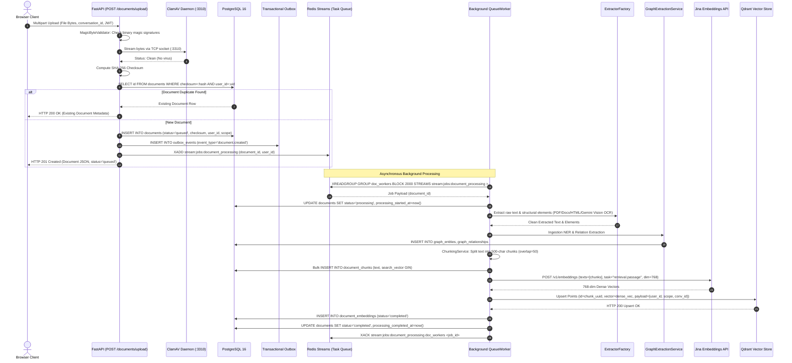
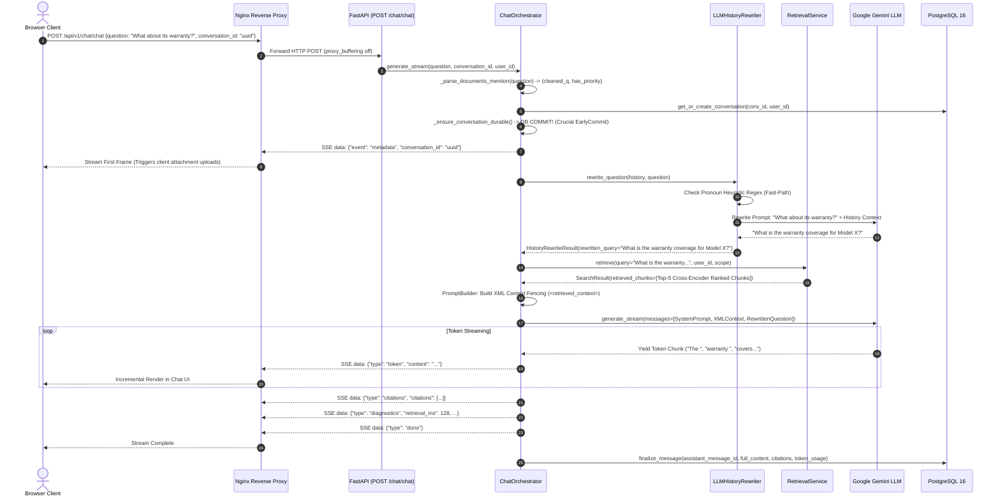
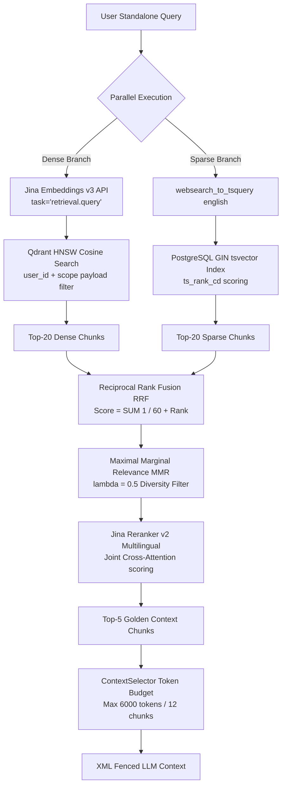
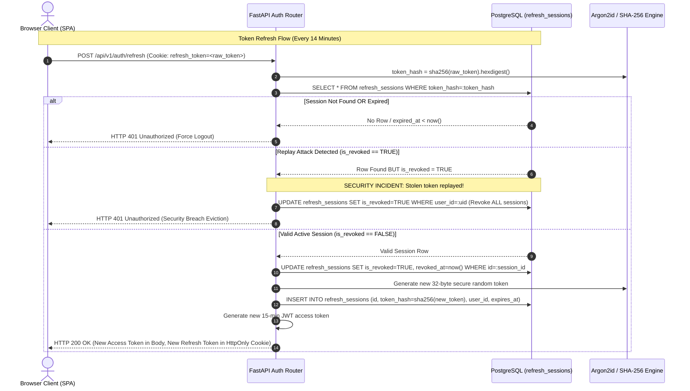
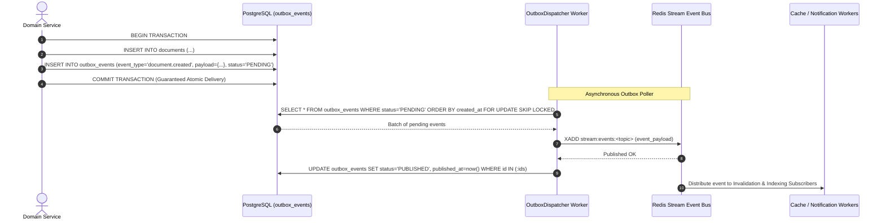
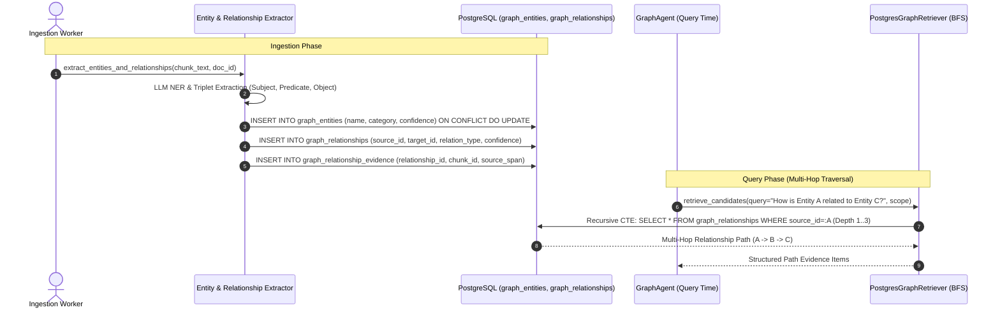
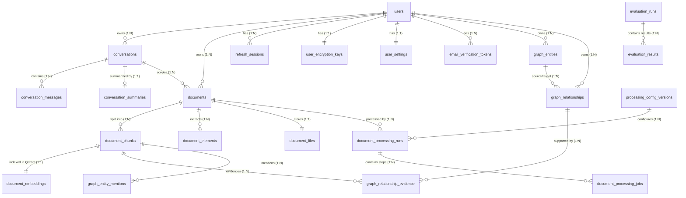
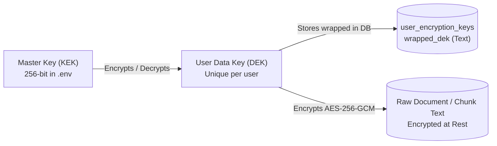
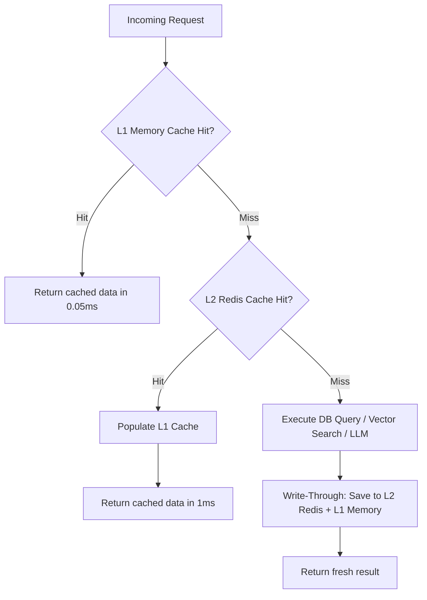
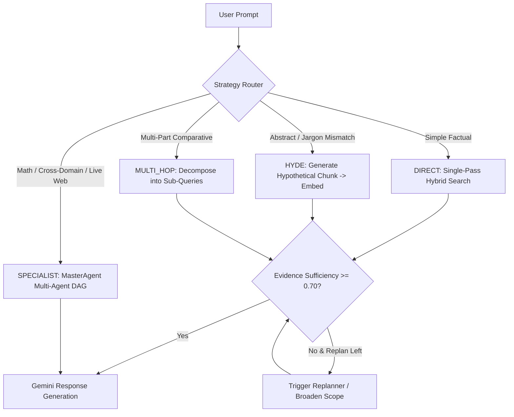

# Fusion RAG: Production-Grade Reverse Engineering & Architectural Blueprint
### Single Source of Truth, System Design Deep Dive & Master Technical Interview Guide

---

## Document Overview & How to Use This Guide

This document is the **definitive, exhaustive technical specification, data flow blueprint, database manual, frontend breakdown, DevOps manual, and architectural guide** for the **Fusion RAG Platform**. It is engineered to enable a Principal Software Engineer, Staff Architect, or Technical Lead to understand, maintain, scale, or recreate the entire distributed system from scratch without external documentation or AI assistance.

```
========================================================================================================================
                                              SYSTEM QUICK REFERENCE
========================================================================================================================
* Core Framework:       FastAPI (Python 3.12+ ASGI) + Uvicorn + Pydantic v2
* Primary Database:     PostgreSQL 16 (asyncpg + SQLAlchemy 2.0 async ORM, 25 Relational Tables)
* Vector Search Engine: Qdrant v1.19.0 (HNSW ANN, 768-dim Cosine, Payload Tenant Fencing)
* Sparse Text Search:   PostgreSQL Full-Text Search (tsvector + ts_rank_cd + GIN Indexes)
* In-Memory Cache/Queue:Redis 7 (redis.asyncio, Redis Streams Consumer Groups, L1/L2 Multi-Tier Caching)
* Dense Embeddings:     Jina AI API (jina-embeddings-v3, Matryoshka Representation, 768-dim)
* Cross-Encoder Rerank: Jina AI API (jina-reranker-v2-base-multilingual, Async Semaphores)
* Primary LLM Engine:   Google Gemini API (gemini-3.5-flash-lite via Multi-Key Workload Isolation)
* Dual Orchestration:   1. Lightweight Adaptive RAG (app/rag/orchestration/) for single-turn intent routing
                        2. Full Multi-Agent DAG (app/chat/services/multi_agent/) for complex wave reasoning
* Observability:        OpenTelemetry SDK + Jaeger (OTLP gRPC) + Prometheus + Grafana + PII Sanitizer
* Evaluation Engine:    Ragas + DeepEval + 33 Registered Metrics Suite + Dual-Gate CI/CD Regression Enforcer
* Frontend Architecture:React 18 + Vite 5 + TypeScript + Vanilla CSS Tokens + Pyodide WebAssembly (WASM)
* Security & Crypto:    Envelope Encryption (AES-256-GCM + DEK/KEK), ClamAV Antivirus, AST Sandboxing
* Reliability:          Bulkheads, Circuit Breakers, Exponential Full-Jitter Retries, Outbox Pattern
* DevOps & CI/CD:       4 GitHub Actions Workflows (CI, E2E Playwright, Eval, Nightly Benchmark) + Nginx SSE
========================================================================================================================
```

---

# Table of Contents

- [Part I: Executive Overview & High-Level System Architecture](#part-i-executive-overview--high-level-system-architecture)
  - [1. System Vision, Problem Statement & Core Value Proposition](#1-system-vision-problem-statement--core-value-proposition)
  - [2. End-to-End System Topology & High-Level Architecture Diagram](#2-end-to-end-system-topology--high-level-architecture-diagram)
  - [3. Architectural Selection Matrix & Tradeoff Analysis](#3-architectural-selection-matrix--tradeoff-analysis)
  - [4. Complete Project Directory Layout & Module Responsibilities](#4-complete-project-directory-layout--module-responsibilities)
- [Part II: End-to-End Sequence Diagrams & Step-by-Step Data Flows](#part-ii-end-to-end-sequence-diagrams--step-by-step-data-flows)
  - [5. Document Ingestion, Parsing, Chunking & Vector Indexing Sequence](#5-document-ingestion-parsing-chunking--vector-indexing-sequence)
  - [6. Real-Time Chat & SSE Streaming Lifecycle Sequence](#6-real-time-chat--sse-streaming-lifecycle-sequence)
  - [7. Production Hybrid Retrieval Pipeline Sequence (Dense + Sparse + RRF + MMR + Reranker)](#7-production-hybrid-retrieval-pipeline-sequence-dense--sparse--rrf--mmr--reranker)
  - [8. Hierarchical Multi-Agent DAG Planning & Execution Wave Sequence](#8-hierarchical-multi-agent-dag-planning--execution-wave-sequence)
  - [9. Authentication, Token Rotation, CSRF & Replay Attack Defense Sequence](#9-authentication-token-rotation-csrf--replay-attack-defense-sequence)
  - [10. Transactional Outbox Pattern & Event Bus Sequence](#10-transactional-outbox-pattern--event-bus-sequence)
  - [11. Knowledge Graph Extraction & Multi-Hop Traversal Sequence](#11-knowledge-graph-extraction--multi-hop-traversal-sequence)
- [Part III: Specialist Agent & Dual-Layer Orchestration Architecture](#part-iii-specialist-agent--dual-layer-orchestration-architecture)
  - [12. Dual Orchestration Layers: Adaptive RAG vs. Hierarchical Multi-Agent DAG](#12-dual-orchestration-layers-adaptive-rag-vs-hierarchical-multi-agent-dag)
  - [13. MasterAgent: Hierarchical Planner, Replanner & Evidence Gating](#13-masteragent-hierarchical-planner-replanner--evidence-gating)
  - [14. AgentExecutionEngine: Topological Wave Executor & Concurrency Controller](#14-agentexecutionengine-topological-wave-executor--concurrency-controller)
  - [15. Dedicated Adaptive RAG Orchestration Framework (`app/rag/orchestration/`)](#15-dedicated-adaptive-rag-orchestration-framework-appragorchestration)
  - [16. ResearchAgent & ResearchPlanner: Sub-Query Decomposition & KB Retrieval](#16-researchagent--researchplanner-sub-query-decomposition--kb-retrieval)
  - [17. DocumentAgent: Explicit Document & Chunk Inspection Specialist](#17-documentagent-explicit-document--chunk-inspection-specialist)
  - [18. AnalysisAgent: Deterministic Math, AST Sandboxing, SymPy & MathEngine](#18-analysisagent-deterministic-math-ast-sandboxing-sympy--mathengine)
  - [19. WebSearchAgent: Real-Time Multi-Provider Web Search Cascade](#19-websearchagent-real-time-multi-provider-web-search-cascade)
  - [20. TableAgent: Tabular Data Extraction & Column Aggregations](#20-tableagent-tabular-data-extraction--column-aggregations)
  - [21. VisionAgent: Multimodal Visual Reasoning & Chart Inspection](#21-visionagent-multimodal-visual-reasoning--chart-inspection)
  - [22. GraphAgent: Knowledge Graph Traversal & Entity Relationship Reasoning](#22-graphagent-knowledge-graph-traversal--entity-relationship-reasoning)
  - [23. SynthesisAgent: Context Grounding, Citation Tagging & Refusal Faithfulness](#23-synthesisagent-context-grounding-citation-tagging--refusal-faithfulness)
  - [24. ResultEvaluator: Task Quality Scoring & Adaptive Replanning Engine](#24-resultevaluator-task-quality-scoring--adaptive-replanning-engine)
  - [25. PlanValidator: Schema, Cycle Detection & Constraint Enforcement](#25-planvalidator-schema-cycle-detection--constraint-enforcement)
  - [26. TaskRouter & CapabilityRegistry: Capability-Aware Cost/Latency Routing](#26-taskrouter--capabilityregistry-capability-aware-costlatency-routing)
  - [27. AgentExecutor, ToolRegistry & Single-Agent Tool Calling Subsystem](#27-agentexecutor-toolregistry--single-agent-tool-calling-subsystem)
  - [28. Multi-Agent Operational Subsystems: Health Diagnostics, Title Generator & Retention](#28-multi-agent-operational-subsystems-health-diagnostics-title-generator--retention)
- [Part IV: Complete Relational Database Schema & Data Models (All 25 PostgreSQL Tables)](#part-iv-complete-relational-database-schema--data-models-all-25-postgresql-tables)
  - [29. Relational Architecture, Entity-Relationship Diagram (ERD) & Bounded Contexts](#29-relational-architecture-entity-relationship-diagram-erd--bounded-contexts)
  - [30. Authentication & Security Context (5 Tables)](#30-authentication--security-context-5-tables)
  - [31. Chat & Conversation Context (3 Tables)](#31-chat--conversation-context-3-tables)
  - [32. Document Ingestion, Chunks & Storage Context (9 Tables)](#32-document-ingestion-chunks--storage-context-9-tables)
  - [33. Knowledge Graph Context (4 Tables)](#33-knowledge-graph-context-4-tables)
  - [34. Transactional Outbox Context (1 Table) & Automated Evaluation Context (3 Tables)](#34-transactional-outbox-context-1-table--automated-evaluation-context-3-tables)
- [Part V: Security, Reliability, Caching & Distributed Infrastructure](#part-v-security-reliability-caching--distributed-infrastructure)
  - [35. Envelope Encryption, Key Management & Crypto-Shredding (AES-256-GCM + DEK/KEK)](#35-envelope-encryption-key-management--crypto-shredding-aes-256-gcm--dekkek)
  - [36. Malware & Antivirus Scanning (ClamAV TCP Streaming + EICAR)](#36-malware--antivirus-scanning-clamav-tcp-streaming--eicar)
  - [37. Prompt Injection Defense, Intent Guardrails & AST Sandboxing](#37-prompt-injection-defense-intent-guardrails--ast-sandboxing)
  - [38. Multi-Tier Caching (L1 Memory + L2 Redis) & Distributed Heartbeat Locking](#38-multi-tier-caching-l1-memory--l2-redis--distributed-heartbeat-locking)
  - [39. Reliability Framework: Bulkheads, Circuit Breakers, Exponential Jitter Retries & Timeouts](#39-reliability-framework-bulkheads-circuit-breakers-exponential-jitter-retries--timeouts)
  - [40. Transactional Outbox Pattern, Event Bus & JobDispatcher Engine](#40-transactional-outbox-pattern-event-bus--jobdispatcher-engine)
  - [41. Storage Provider Abstraction & Two-Phase Durable Cleanup Worker](#41-storage-provider-abstraction--two-phase-durable-cleanup-worker)
  - [42. Resend Email Service, Token Cost Pricing Engine & Dynamic Feature Flags](#42-resend-email-service-token-cost-pricing-engine--dynamic-feature-flags)
  - [43. Application Lifespan, Startup Hooks & Middleware Cardinality Defense](#43-application-lifespan-startup-hooks--middleware-cardinality-defense)
- [Part VI: Document Ingestion, Advanced Chunking & Retrieval Intelligence](#part-vi-document-ingestion-advanced-chunking--retrieval-intelligence)
  - [44. Ingestion Worker Lease Protocol & Durable Ingestion Reaper](#44-ingestion-worker-lease-protocol--durable-ingestion-reaper)
  - [45. Advanced Chunking Strategies: Recursive, Parent-Child & Sentence-Window](#45-advanced-chunking-strategies-recursive-parent-child--sentence-window)
  - [46. Empty Knowledge Base Index Cache & Weighted RRF Fusion](#46-empty-knowledge-base-index-cache--weighted-rrf-fusion)
  - [47. Document Parsers, Multimodal OCR & Metadata Extractors](#47-document-parsers-multimodal-ocr--metadata-extractors)
  - [48. Query Intelligence: Classification, Decomposition, Expansion & HyDE](#48-query-intelligence-classification-decomposition-expansion--hyde)
  - [49. Ingestion-Time NER, Relationship Extraction & BFS Knowledge Graph Retrieval](#49-ingestion-time-ner-relationship-extraction--bfs-knowledge-graph-retrieval)
  - [50. Adaptive RAG Orchestration State Machine (DIRECT, HYDE, MULTI_HOP, SPECIALIST)](#50-adaptive-rag-orchestration-state-machine-direct-hyde-multi_hop-specialist)
- [Part VII: Frontend Architecture, Pyodide WASM & UI Subsystems](#part-vii-frontend-architecture-pyodide-wasm--ui-subsystems)
  - [51. Pyodide WebAssembly (WASM) Sandbox Worker Protocol & Managers](#51-pyodide-webassembly-wasm-sandbox-worker-protocol--managers)
  - [52. Complete Custom Hook Architecture & State Context Providers](#52-complete-custom-hook-architecture--state-context-providers)
  - [53. 7-Stage Progressive Upload Pipeline & State Machine](#53-7-stage-progressive-upload-pipeline--state-machine)
  - [54. Application Pages, Projects, Workspaces & Settings Subsystems](#54-application-pages-projects-workspaces--settings-subsystems)
  - [55. Stream Recovery, In-Flight Re-Authentication & UI Component Tree](#55-stream-recovery-in-flight-re-authentication--ui-component-tree)
- [Part VIII: Complete REST & SSE API Endpoint Catalog (Exact Codebase Routes & DTOs)](#part-viii-complete-rest--sse-api-endpoint-catalog-exact-codebase-routes--dtos)
  - [56. Exhaustive Route Specifications Across All 10 Routers & Root App](#56-exhaustive-route-specifications-across-all-10-routers--root-app)
- [Part IX: Production Observability, Quality Assurance & Evaluation Suite](#part-ix-production-observability-quality-assurance--evaluation-suite)
  - [57. OpenTelemetry Tracing, Prometheus Metric Registry & Telemetry Sanitizer](#57-opentelemetry-tracing-prometheus-metric-registry--telemetry-sanitizer)
  - [58. Multi-Agent Observability & Quality Metrics (AgentObservabilityService)](#58-multi-agent-observability--quality-metrics-agentobservabilityservice)
  - [59. Comprehensive Evaluation Framework: Ragas, DeepEval & All 33 Registered Metrics](#59-comprehensive-evaluation-framework-ragas-deepeval--all-33-registered-metrics)
  - [60. Golden Corpora, Benchmark Profiles, Drift Tracking & Report Generators](#60-golden-corpora-benchmark-profiles-drift-tracking--report-generators)
- [Part X: DevOps, CI/CD Automation, Operational Tooling & Edge Deployment](#part-x-devops-cicd-automation-operational-tooling--edge-deployment)
  - [61. The 4 GitHub Actions Workflows (CI, E2E Playwright, Eval Gate, Nightly Benchmark)](#61-the-4-github-actions-workflows-ci-e2e-playwright-eval-gate-nightly-benchmark)
  - [62. Operational CLI Scripts, Backup/Restore & Smoke Testing](#62-operational-cli-scripts-backuprestore--smoke-testing)
  - [63. Docker Compose Topologies, Alembic Lineage, Nginx Reverse Proxy & Runbooks](#63-docker-compose-topologies-alembic-lineage-nginx-reverse-proxy--runbooks)
- [Part XI: Real-World Engineering Case Studies (DaveAI Production Challenges)](#part-xi-real-world-engineering-case-studies-daveai-production-challenges)
  - [64. Case Study 1: The Asynchronous Streaming Transaction Race Condition (EarlyCommit Fix)](#64-case-study-1-the-asynchronous-streaming-transaction-race-condition-earlycommit-fix)
  - [65. Case Study 2: Database Connection Pool Starvation during Streaming Responses](#65-case-study-2-database-connection-pool-starvation-during-streaming-responses)
  - [66. Case Study 3: Cascading Timeouts & Topological Deadlocks in Multi-Agent Execution](#66-case-study-3-cascading-timeouts--topological-deadlocks-in-multi-agent-execution)
  - [67. Case Study 4: Multi-Key Rate-Limit Cascades & High-Traffic Failover](#67-case-study-4-multi-key-rate-limit-cascades--high-traffic-failover)
- [Part XII: Master Technical Interview Preparation Guide & Environment Catalog](#part-xii-master-technical-interview-preparation-guide--environment-catalog)
  - [68. Technical Narrative Framework (STAR Format for Fusion RAG)](#68-technical-narrative-framework-star-format-for-fusion-rag)
  - [69. Technical Architecture & Distributed Systems Interview Q&A](#69-technical-architecture--distributed-systems-interview-qa)
  - [70. Rapid Revision Flashcard Matrix (Numbers, Formulas, DB Indexes & Shell Commands)](#70-rapid-revision-flashcard-matrix-numbers-formulas-db-indexes--shell-commands)
  - [71. Exhaustive Environment Configuration Variable Catalog (All 150+ Parameters)](#71-exhaustive-environment-configuration-variable-catalog-all-150-parameters)

---

# Part I: Executive Overview & High-Level System Architecture

## 1. System Vision, Problem Statement & Core Value Proposition

### 1.1 The Industry Problem
Standard Retrieval-Augmented Generation (RAG) implementations suffer from five primary production pathologies:
1. **Semantic Blindness / Keyword Disconnect**: Pure dense vector retrieval (bi-encoders) fails on exact keyword searches, product codes, SKUs, acronyms, and technical identifiers (e.g., searching for error code `0x80070005` or part number `CR-4096`).
2. **Dense False Positives / High Semantic Overlap**: Dense embeddings retrieve passages with similar grammatical structure or high-level topic alignment that lack the specific factual answer.
3. **Chunk Boundary Truncation**: Rigid chunking breaks tables, sentences, and contextual definitions across chunk boundaries, leading to hallucinated synthesis.
4. **Context Drift in Multi-Turn Dialogues**: Follow-up questions (e.g., *"What about its warranty?"* or *"Can you compare it to the first option?"*) fail because standard RAG embeds the pronoun-laden query directly, searching for "it" instead of the resolved entity.
5. **Slow Time-To-First-Token (TTFT) & Fragility**: Ingestion pipelines block synchronous API threads; single LLM API rate limits cause total application blackouts; unbuffered database writes during streaming cause connection exhaustion.

### 1.2 The Fusion RAG Solution
**Fusion RAG** resolves these challenges through an enterprise-grade, asynchronous, multi-tiered architecture:
- **Hybrid Search with Reciprocal Rank Fusion (RRF)**: Merges dense vector HNSW search with PostgreSQL GIN full-text search (FTS) using rank-based reciprocal scoring ($k=60$).
- **Maximal Marginal Relevance (MMR) & Cross-Encoder Reranking**: Balances information diversity ($\lambda=0.5$) before passing candidates to a heavy multilingual cross-encoder (`jina-reranker-v2`) bounded by async semaphores.
- **Dual-Layer Orchestration Architecture**:
  1. *Lightweight Adaptive RAG Layer* (`app/rag/orchestration/`): Sub-second routing (`DIRECT`, `HYDE`, `MULTI_HOP`, `SPECIALIST`) with evidence sufficiency gating ($S_{\text{evidence}} \ge 0.70$).
  2. *Full Hierarchical Multi-Agent DAG* (`app/chat/services/multi_agent/`): Decomposes complex multi-domain analytical tasks into topological waves across 8 specialist agents.
- **Two-Tier Document Model with Scope Isolation**: Strict separation between user-wide persistent Library documents and session-bound Conversation documents with cryptographic multi-tenancy.
- **Zero-PyTorch Cloud-Native Architecture**: Achieves sub-second cold starts and container images under 450 MB by delegating heavy matrix operations to specialized, resilient REST APIs.

### 1.3 Core Concept "Cheat Sheet" for Freshers & Interviewees

| Term | What It Sounds Like | What It Actually Means in Plain English |
|---|---|---|
| **Bi-Encoder (Dense Search)** | Complex neural net | Encodes questions and documents *separately* into 768-dim coordinate vectors so we can do ultra-fast approximate geometric distance search ($O(\log N)$ in Qdrant). |
| **Cross-Encoder (Reranker)** | Another neural net | Feeds the question and candidate chunk *together* into a deep multi-head attention layer. Slower ($O(N)$), but understands nuanced word-by-word context with supreme accuracy. |
| **RRF ($k=60$)** | Complex math formula | A fair leaderboard system: merges dense vector results and keyword results by their rank position ($1 / (60 + \text{rank})$) instead of incompatible raw similarity scores. |
| **MMR ($\lambda=0.5$)** | Complex algorithm | "Don't retrieve 5 chunks that repeat the exact same sentence." Balances pure similarity against information diversity so LLM context isn't wasted on duplicate facts. |
| **Matryoshka Embeddings (MRL)** | Russian nesting dolls | Embeddings engineered so you can slice the first 256 dimensions out of 768 and retain 95%+ search accuracy while cutting Qdrant RAM and disk storage by 66%. |
| **EarlyCommit Pattern** | DB transaction pattern | Committing a newly generated chat session to PostgreSQL *before* starting the token stream, so concurrent frontend attachment uploads don't encounter a 404 race condition. |
| **Topological Wave DAG** | Graph theory | Grouping independent tasks together into parallel "waves" so tasks without dependencies run simultaneously, while dependent tasks wait for upstream outputs. |

---

## 2. End-to-End System Topology & High-Level Architecture Diagram

```
+---------------------------------------------------------------------------------------------------+
|                                       CLIENT TIER                                                 |
|   React 18 + Vite 5 + TypeScript SPA (HTML5 SSE Reader, Upload Queue, Token Buffer, Citation UI) |
|   In-Browser Pyodide WebAssembly (WASM) Sandbox for Client-Side Mathematical Execution & Pandas   |
+---------------------------------------------------------------------------------------------------+
                                                  |
                                                  | HTTPS / Server-Sent Events (SSE)
                                                  v
+---------------------------------------------------------------------------------------------------+
|                                      EDGE & REVERSE PROXY                                         |
|   Nginx 1.25 (Alpine) [Reverse Proxy, Gzip/Brotli, Static Caching, proxy_buffering off for SSE]   |
+---------------------------------------------------------------------------------------------------+
                                                  |
                                                  | HTTP/1.1 Forwarding (:8000)
                                                  v
+---------------------------------------------------------------------------------------------------+
|                                   FASTAPI APPLICATION LAYER                                       |
|                                                                                                   |
|  +---------------------------------------------------------------------------------------------+  |
|  |  ASGI Middleware Pipeline:                                                                  |  |
|  |  1. RequestContext Injection (ContextVar) -> 2. Telemetry Middleware (OTel W3C Trace IDs)    |  |
|  |  3. Rate Limiter (Redis Sliding Window)   -> 4. Security Headers & CORS Guard               |  |
|  +---------------------------------------------------------------------------------------------+  |
|                                                  |                                                |
|                   +------------------------------+------------------------------+                 |
|                   |                                                             |                 |
|                   v                                                             v                 |
|  +----------------------------------+                         +--------------------------------+  |
|  |   DOCUMENT INGESTION ROUTE       |                         |      CHAT STREAMING ROUTE      |  |
|  |   POST /api/v1/documents/upload  |                         |      POST /api/v1/chat/chat    |  |
|  |                                  |                         |                                |  |
|  | 1. Magic Byte & Antivirus (ClamAV)|                         | 1. @documents Directive Parser |  |
|  | 2. SHA-256 Deduplication Check   |                         | 2. EarlyCommit Session Lock    |  |
|  | 3. PostgreSQL Raw Doc Write      |                         | 3. LLM History Rewriter        |  |
|  | 4. Transactional Outbox Write    |                         | 4. Adaptive Strategy Classifier|  |
|  | 5. Redis Stream Task Enqueue     |                         | 5. Multi-Agent DAG Planner     |  |
|  +----------------------------------+                         +--------------------------------+  |
|                   |                                                             |                 |
+-------------------|-------------------------------------------------------------|-----------------+
                    |                                                             |
                    v (Async Redis Stream)                                        v
+------------------------------------+                  +-------------------------------------------+
|    BACKGROUND WORKER TIER          |                  |        RAG RETRIEVAL & AGENT ENGINE       |
|                                    |                  |                                           |
|  QueueWorker (Redis Consumer Group)|                  |  +-------------------------------------+  |
|  1. Extract (pypdf/docx/Vision OCR)|                  |  | Hybrid Retrieval Pipeline:          |  |
|  2. TextCleaner & Normalizer       |                  |  |  - Dense Branch (Qdrant HNSW)       |  |
|  3. Chunking (Recursive/ParentChild|                  |  |  - Sparse Branch (Postgres GIN FTS) |  |
|  4. Batch Embed (Jina REST API)    |                  |  |  - Reciprocal Rank Fusion (RRF)    |  |
|  5. Knowledge Graph Entity Linking |                  |  |  - Maximal Marginal Relevance (MMR) |  |
|  6. Upsert to Qdrant Vector Store  |                  |  |  - Jina Cross-Encoder Reranker      |  |
|  7. Invalidate User Index Cache    |                  |  +-------------------------------------+  |
|                                    |                  |                     |                     |
|  Durable Ingestion Reaper (60s)    |                  |  +-------------------------------------+  |
|  - Reclaims stalled processing jobs|                  |  | Dual-Layer Orchestration:           |  |
|                                    |                  |  |  1. Adaptive RAG (app/rag/)         |  |
|  Durable Cleanup Worker (2PC)      |                  |  |  2. MasterAgent DAG (app/chat/)     |  |
|  - Cascade delete S3/DB/Qdrant     |                  |  +-------------------------------------+  |
+------------------------------------+                  |                     |                     |
                                                        |  +-------------------------------------+  |
                                                        |  | Answer Generation (Gemini LLM):     |  |
                                                        |  |  - XML Context Isolation Fencing    |  |
                                                        |  |  - Token Streaming over SSE Engine  |  |
                                                        |  |  - Inline Citation Mapping          |  |
                                                        |  +-------------------------------------+  |
                                                        +-------------------------------------------+
                                                                              |
                   +----------------------------------------------------------+
                   |
                   v
+---------------------------------------------------------------------------------------------------+
|                                  STATE & PERSISTENCE TIER                                         |
|                                                                                                   |
|  +-----------------------+   +------------------------+   +------------------------------------+  |
|  |     POSTGRESQL 16     |   |        REDIS 7         |   |          QDRANT v1.19.0            |  |
|  | - 25 Relational Tables|   | - Token Bucket RL      |   | - HNSW Vector Index                |  |
|  | - Users, Auth, Keys   |   | - L1/L2 Semantic Cache |   | - 768-dim Cosine Distance          |  |
|  | - Conversations & Msgs|   | - Distributed Mutexes  |   | - Payload Tenant Filter:           |  |
|  | - Chunks & GIN FTS    |   | - Streams Task Queue   |   |   (user_id + scope + conversation) |  |
|  | - Knowledge Graph (4) |   | - Outbox Event Bus     |   +------------------------------------+  |
|  | - Outbox & Evals (4)  |   | - Ingestion Dead-Letter|                                           |
|  +-----------------------+   +------------------------+                                           |
+---------------------------------------------------------------------------------------------------+
```

---

## 3. Architectural Selection Matrix & Tradeoff Analysis

| Component | Selected Technology | Alternative Considered | Why Selected (Deep Technical Rationale) | Tradeoffs & Mitigations |
|---|---|---|---|---|
| **API Framework** | **FastAPI + Uvicorn (ASGI)** | Django, Flask, Express.js | Native Python `async`/`await` support for non-blocking I/O; automatic OpenAPI validation via Pydantic v2; ASGI standard supports long-lived HTTP SSE streaming without thread blocking. | Python GIL exists for CPU-bound tasks. *Mitigation*: Offload CPU-heavy text extraction to async workers and MathEngine AST parser. |
| **Relational Database** | **PostgreSQL 16 (asyncpg)** | MySQL, MongoDB | Robust ACID compliance; native JSONB for flexible chat metadata; built-in Full-Text Search (`tsvector`, `websearch_to_tsquery`) with GIN indexes eliminates separate Elasticsearch cluster. | Connection overhead per backend process. *Mitigation*: Tuned `async_sessionmaker` connection pool ($N=20$, overflow $10$, statement cache disabled for PgBouncer). |
| **Vector Database** | **Qdrant v1.19.0** | Pinecone, Weaviate, Milvus, pgvector | Written in Rust with ultra-low memory overhead; native payload filtering directly inside HNSW graph index traversal (crucial for multi-tenant `user_id` filtering); fully self-hostable. | Self-managed disk persistence. *Mitigation*: Mounted persistent volume `/qdrant/storage` with automated WAL snapshots. |
| **Message Queue / Cache** | **Redis 7 (Streams + Memory)** | Celery + RabbitMQ, Kafka | Single in-memory infrastructure handles sliding-window rate limiting, multi-tier semantic caching, distributed locking, and durable task queues with consumer groups (`XREADGROUP`). | In-memory RAM constraints. *Mitigation*: Configured LRU eviction policy for cache namespaces; persistent AOF for task queue streams. |
| **Dense Embeddings** | **Jina Embeddings v3** | OpenAI `text-embedding-3-small`, HuggingFace local | 768-dim Matryoshka Representation Learning (MRL) allows truncation to 256/128 dims; asymmetric task adapters (`retrieval.passage` vs `retrieval.query`); zero GPU infrastructure needed. | Third-party REST latency & rate limits. *Mitigation*: 24h Redis embedding cache by SHA-256 hash; async batching ($N=32$). |
| **Cross-Encoder Reranker** | **Jina Reranker v2 (Multilingual)** | Cohere Rerank, FlashRank local | Joint query-document cross-attention significantly out-ranks bi-encoders; multilingual; REST API eliminates massive local PyTorch RAM footprint (saves >2GB RAM). | Network latency (~150-250ms). *Mitigation*: Bound reranking candidates to top $K=20$; concurrency controlled by `asyncio.Semaphore(4)`. |
| **LLM Generation** | **Google Gemini (gemini-3.5-flash-lite)** | OpenAI GPT-4o-mini, Claude 3.5 Haiku | Sub-second TTFT (~220ms); massive context window (1M tokens); competitive cost per 1M tokens; native multimodal support for document OCR. | Occasional rate limiting on single API keys. *Mitigation*: Multi-key isolation pattern (`GEMINI_API_KEY`, `GEMINI_PLANNER_API_KEY`, `GEMINI_FALLBACK_API_KEY`). |

---

## 4. Complete Project Directory Layout & Module Responsibilities

```
FusionRAG/                           # Repository root
  prd.md                             # Product Requirements Document
  ARCHITECTURE.md                    # Architecture diagrams and specs
  README.md                          # Quick-start guide
  reverse_engineering.md             # This document (Single Source of Truth)
  docker-compose.yml                 # Core services (postgres, redis, qdrant, backend, frontend, nginx)
  docker-compose.observability.yml   # Observability services (jaeger, prometheus, grafana)
  .github/workflows/                 # 4 CI/CD workflows (ci, e2e, evaluation, nightly-benchmark)
  deployment/nginx/                  # Nginx configuration (reverse proxy, SSE buffer config)
  observability/                     # Grafana dashboards, Prometheus scrape configs
  docs/                              # Runbooks, Free-tier deployment guides, security checklist

  backend/
    Dockerfile                       # Multi-stage backend build (uv builder + slim runtime)
    pyproject.toml                   # Python dependencies and build metadata
    requirements.txt                 # Pinned production dependencies
    alembic.ini                      # Database migration configuration
    alembic/versions/                # 14 versioned migration scripts
    scripts/                         # Backup, restore, load testing, smoke testing, OpenAPI export
    .env.example                     # Environment template with all 150+ variables

    app/
      main.py                        # FastAPI app factory, lifespan, ProductionMiddleware, routing
      api/
        dependencies.py              # Dependency injection factories (get_db, get_redis, get_qdrant)
        exception_handlers.py        # Global domain exception to HTTP response mapping
        v1/                          # 10 API Routers (auth, chat, documents, search, evaluation, etc.)
      auth/                          # Authentication, Argon2id, JWT, OAuth, session management, DEK crypto
      chat/                          # Orchestration, LLM history rewriter, prompt builder, Multi-Agent DAG
      documents/                     # Ingestion, extractors, chunking, embeddings, hybrid retrieval, graph
      core/
        config.py                    # 150+ Pydantic settings
        security/                    # Envelope encryption, ClamAV malware, prompt injection, idempotency
        reliability/                 # Bulkheads, Circuit Breakers, Exponential Retries, Timeouts
        cache/                       # L1 Memory + L2 Redis Multi-Tier Cache, Distributed Mutex
        events/                      # Transactional Outbox Dispatcher & Redis Event Bus
        queue/                       # Redis Stream Task Queue, JobDispatcher, Handlers & QueueWorker
        telemetry/                   # OpenTelemetry setup, Prometheus metrics, TelemetrySanitizer
        feature_flags/               # Dynamic runtime feature flag engine
        math/                        # Deterministic MathEngine, FinancialMath, Statistical, LaTeX
      db/                            # Async SQLAlchemy sessionmaker, ORM Base, and 25 Model mappings
      evaluation/                    # Ragas, DeepEval, 33-Metric Registry, Golden Datasets, Regression Runner
      rag/orchestration/             # Dedicated Adaptive RAG Framework (master, strategy, replanner, telemetry)

  frontend/
    src/
      main.tsx                       # React root render
      App.tsx                        # Client-side routing and context provider tree
      index.css                      # Global Vanilla CSS design tokens (light/dark mode)
      workers/
        pyodide.worker.ts            # Pyodide WebAssembly Web Worker for sandboxed Python/Pandas
      lib/
        pyodide/pyodideManager.ts    # Web Worker RPC bridge and execution manager
        uploadStages.ts              # 7-stage progressive upload pipeline
        passwordStrength.ts          # Client-side password validation
        analytics.ts                 # Client-side event tracking
        notifications.ts             # Browser desktop notifications
        highlighter.ts               # Shiki syntax highlighter
      components/                    # ChatWindow, SSEStream, DocumentManager, CitationDrawer, CommandPalette
      pages/                         # LandingPage, ProjectsPage, DocumentsPage, SettingsPage, ChatPage, etc.
      context/                       # AuthContext, ThemeContext, UploadQueueContext
      hooks/                         # useAuth, useConversations, useDocuments, useSSEChat, useDrafts, etc.
```

---

# Part II: End-to-End Sequence Diagrams & Step-by-Step Data Flows

## 5. Document Ingestion, Parsing, Chunking & Vector Indexing Sequence



---

## 6. Real-Time Chat & SSE Streaming Lifecycle Sequence



---

## 7. Production Hybrid Retrieval Pipeline Sequence (Dense + Sparse + RRF + MMR + Reranker)



---

## 8. Hierarchical Multi-Agent DAG Planning & Execution Wave Sequence


---

## 9. Authentication, Token Rotation, CSRF & Replay Attack Defense Sequence



---

## 10. Transactional Outbox Pattern & Event Bus Sequence



---

## 11. Knowledge Graph Extraction & Multi-Hop Traversal Sequence



---

# Part III: Specialist Agent & Dual-Layer Orchestration Architecture

## 12. Dual Orchestration Layers: Adaptive RAG vs. Hierarchical Multi-Agent DAG

The platform distinguishes between two separate orchestration layers depending on request complexity:

```
+---------------------------------------------------------------------------------------------------+
| 1. LIGHTWEIGHT ADAPTIVE RAG LAYER (app/rag/orchestration/)                                         |
|    - Purpose: Sub-second, low-overhead retrieval strategy routing for standard user queries.      |
|    - Components: AdaptiveRAGOrchestrator, RetrievalStrategyRouter, EvidenceSufficiencyEvaluator.  |
|    - Strategies: DIRECT (Single-pass), HYDE (Hypothetical), MULTI_HOP (Sub-query), SPECIALIST.     |
+---------------------------------------------------------------------------------------------------+
                                                  |
                                                  | If Strategy == SPECIALIST or Multi-Step DAG required
                                                  v
+---------------------------------------------------------------------------------------------------+
| 2. FULL HIERARCHICAL MULTI-AGENT DAG LAYER (app/chat/services/multi_agent/)                       |
|    - Purpose: Multi-domain reasoning, AST math computation, live web searching, tabular/graph.   |
|    - Components: MasterAgent, PlanValidator, AgentExecutionEngine, ResultEvaluator, 8 Specialists. |
+---------------------------------------------------------------------------------------------------+
```

```
========================================================================================================================
                                     COMPREHENSIVE SPECIALIST AGENT MATRIX
========================================================================================================================
Agent Name          File Location                                      Primary Capabilities & Tools
------------------------------------------------------------------------------------------------------------------------
1. MasterAgent      app/chat/services/multi_agent/master_agent.py      LLM DAG Planner, Bounded Replanner, Domain Context Gate
2. ExecutionEngine  app/chat/services/multi_agent/execution_engine.py  Topological Wave Executor, Async Sorter, Timeout Guard
3. ResearchAgent    app/chat/services/multi_agent/research_agent.py    Decomposed Sub-Query Search, Hybrid RAG, Provenance Deduplication
4. ResearchPlanner  app/chat/services/multi_agent/research_planner.py  Pure Sub-Query DAG Planner (Zero I/O)
5. DocumentAgent    app/chat/services/multi_agent/document_agent.py    UUID Inspection, Chunk Lookup, Scoped Document Listing
6. AnalysisAgent    app/chat/services/multi_agent/analysis_agent.py    Deterministic SafeCalculator AST, SymPy MathEngine, Python Scripts
7. WebSearchAgent   app/chat/services/multi_agent/web_search_agent.py  SerpAPI -> Firecrawl -> DuckDuckGo Cascade, Snippet Extractor
8. TableAgent       app/chat/services/multi_agent/table_agent.py       TableProcessor, Markdown/CSV Parsers, Column Aggregations (SUM/AVG)
9. VisionAgent      app/chat/services/multi_agent/vision_agent.py      VisionProcessor, Multimodal Diagram/Chart OCR via Gemini Vision
10. GraphAgent      app/chat/services/multi_agent/graph_agent.py       PostgresGraphRetriever, Entity Relationship Traversal, Multi-Hop
11. SynthesisAgent  app/chat/services/multi_agent/synthesis_agent.py   Evidence Grounding, Refusal Faithfulness, Citation Tagging
12. ResultEvaluator app/chat/services/multi_agent/result_evaluator.py  LLM-as-Judge Result Scoring (0.0-1.0), Accept/Replan Decisions
13. PlanValidator   app/chat/services/multi_agent/plan_validator.py    Schema Validator, Topological Cycle Detector, Whitelist Guard
14. TaskRouter      app/chat/services/multi_agent/task_router.py       Capability Matching, Cost/Latency Constraint Router
15. CapabilityReg   app/chat/services/multi_agent/capability_registry.py Domain Definitions, Tool Whitelists, Token Limit Budgets
16. AgentExecutor   app/chat/services/agent_executor.py                Single-Agent Function Calling Loop (7 Registered Tools)
========================================================================================================================
```

---

## 13. MasterAgent: Hierarchical Planner, Replanner & Evidence Gating

### 13.1 Multi-Agent Internal Pydantic Contracts
Located in [models.py](file:///d:/fun/FusionRAG/backend/app/chat/services/multi_agent/models.py):
- **`Task`**: `{ task_id: str, agent_type: AgentType, request: str, dependencies: list[str], parameters: dict[str, Any] }`
- **`ExecutionPlan`**: `{ plan_id: UUID, user_query: str, tasks: list[Task], estimated_cost_usd: float, reasoning_graph: dict }`
- **`EvidenceItem`**: `{ id: UUID, text: str, source_type: str, source_id: str, confidence: float, relevance_score: float }`
- **`AgentResult`**: `{ task_id: str, agent_type: AgentType, status: TaskStatus, output_text: str, evidence: list[EvidenceItem] }`
- **`ExecutionOutcome`**: `{ plan_id: UUID, success: bool, results: dict[str, AgentResult], execution_duration_ms: float }`

### 13.2 Evidence Relevance Gate Algorithm
```python
def _apply_evidence_relevance_gate(
    self, results: list[AgentResult], context: AgentExecutionContext
) -> tuple[list[AgentResult], int]:
    gated_results = []
    rejected_count = 0
    for res in results:
        # Filter out evidence items with relevance score below threshold
        filtered_evidence = [
            item for item in res.evidence if item.relevance_score >= 0.65
        ]
        rejected_count += len(res.evidence) - len(filtered_evidence)
        res.evidence = filtered_evidence
        gated_results.append(res)
    return gated_results, rejected_count
```

---

## 14. AgentExecutionEngine: Topological Wave Executor & Concurrency Controller

Located in [execution_engine.py](file:///d:/fun/FusionRAG/backend/app/chat/services/multi_agent/execution_engine.py):
1. Calculates in-degrees for all tasks based on their `dependencies: list[str]`.
2. Groups independent tasks (in-degree = 0) into **Wave 0**.
3. Executes Wave 0 tasks concurrently via `asyncio.gather()`.
4. Injects completed outputs into dependent tasks in **Wave 1** and executes the next wave.
5. Enforces per-task timeouts (`MULTI_AGENT_TASK_TIMEOUT=20.0s`) using `asyncio.wait_for()`.

---

## 15. Dedicated Adaptive RAG Orchestration Framework (`app/rag/orchestration/`)

Located in `backend/app/rag/orchestration/`:
- **`AdaptiveRAGOrchestrator` (`master.py`)**: Master state machine managing query lifecycle, task budgeting, and worker dispatching across 4 core strategies.
- **`EvidenceSufficiencyEvaluator` (`evidence_evaluator.py`)**:
  - Computes composite confidence metric $S_{\text{evidence}} \in [0.0, 1.0]$ based on reranker score distribution, cross-chunk agreement, and coverage density.
  - Gating threshold: $S_{\text{evidence}} \ge 0.70$ triggers direct LLM answer synthesis; $S_{\text{evidence}} < 0.70$ triggers replanner widening.
- **`RetrievalStrategyRouter` (`strategy_router.py`)**: Rule-based & semantic classifier selecting between `DIRECT`, `HYDE`, `MULTI_HOP`, or `SPECIALIST`.
- **`Replanner` (`replanner.py`) & `compute_task_fingerprint`**: Generates task delta plans. Uses SHA-256 fingerprinting on normalized sub-query strings and scope filters to guarantee zero duplicate retrieval runs.
- **`OrchestrationTelemetry` (`telemetry.py`)**: Tracks granular event logs (`OrchestrationTelemetryEvent`) for Jaeger spans and frontend execution cards.
- **`RetrievalWorker` (`worker.py`)**: Non-blocking worker coroutine executing isolated retrieval tasks.

---

## 16. ResearchAgent & ResearchPlanner: Sub-Query Decomposition & KB Retrieval

Located in [research_agent.py](file:///d:/fun/FusionRAG/backend/app/chat/services/multi_agent/research_agent.py):
- **Decomposition**: Uses `ResearchPlanner` to break complex research topics into 1-4 targeted sub-queries.
- **Deduplication**: Computes cosine similarity across sub-query embeddings; discards queries with $\text{similarity} > 0.85$ to avoid redundant retrievals.
- **Hybrid Retrieval**: Executes full Hybrid RAG (Qdrant Dense + PostgreSQL FTS + RRF + MMR + Reranker) for each sub-query.
- **Conflicting Evidence Detection**: Applies heuristics and semantic checks (`_detect_conflicting_evidence()`) to flag contradictory claims across retrieved chunks.

---

## 17. DocumentAgent: Explicit Document & Chunk Inspection Specialist

Located in [document_agent.py](file:///d:/fun/FusionRAG/backend/app/chat/services/multi_agent/document_agent.py):
- **Document Scoping**: Lists available documents filtered by `user_id` and active `conversation_id`.
- **Direct UUID Fetching**: Looks up exact document chunks and structural metadata directly from PostgreSQL by UUID.
- **Authorization Fencing**: Rejects requests attempting to access documents outside the user's authorized scope.

---

## 18. AnalysisAgent: Deterministic Math, AST Sandboxing, SymPy & MathEngine

Located in [engine.py](file:///d:/fun/FusionRAG/backend/app/core/math/engine.py):
- **`FinancialMathSubsystem`**:
  - `cagr(beginning_value, ending_value, periods)`: Compound annual growth rate calculation.
  - `net_present_value(discount_rate, cash_flows)`: NPV derivation across series.
  - `internal_rate_of_return(cash_flows)`: Exact IRR computation via Newton-Raphson approximation.
  - `loan_amortization(principal, rate, periods)`: Complete monthly principal and interest schedule.
  - `wacc(equity, debt, cost_of_equity, cost_of_debt, tax_rate)`: Weighted average cost of capital.
- **`StatisticalNumericalSubsystem`**:
  - Descriptive statistics (mean, median, variance, standard deviation, skewness, kurtosis).
  - Hypothesis testing (two-sample t-test, one-way ANOVA, Mann-Whitney U rank test).
  - Curve fitting (`curve_fit` for linear, polynomial, logarithmic, and exponential regressions).
- **`LaTeXStepFormatter`**: Emits step-by-step mathematical derivations formatted in KaTeX-compatible LaTeX expressions.
- **AST SafeCalculator**: AST expression parser validating nodes against whitelisted math operations (`abs`, `round`, `sum`, `min`, `max`, `pow`).

---

## 19. WebSearchAgent: Real-Time Multi-Provider Web Search Cascade

Located in [web_search_agent.py](file:///d:/fun/FusionRAG/backend/app/chat/services/multi_agent/web_search_agent.py):
- **Automated Failover Cascade**: Tries primary provider **SerpAPI** $\rightarrow$ falls back to **Firecrawl** $\rightarrow$ falls back to **DuckDuckGo**.
- **Provenance & Snippets**: Extracts top 5 web results, formats them with title, URL, and snippet text, and generates deterministic UUIDv5 `EvidenceItem` records.

---

## 20. TableAgent: Tabular Data Extraction & Column Aggregations

Located in [table_agent.py](file:///d:/fun/FusionRAG/backend/app/chat/services/multi_agent/table_agent.py):
- **Parsers**: Native support for Markdown table strings and CSV format data via `TableProcessor`.
- **Column Aggregations**: Executes deterministic calculations across extracted table columns (`SUM`, `AVG`, `MIN`, `MAX`, `COUNT`).
- **Structured Evidence**: Emits dimensional metadata (`row_count x col_count`) and markdown table summaries into `EvidenceItem`.

---

## 21. VisionAgent: Multimodal Visual Reasoning & Chart Inspection

Located in [vision_agent.py](file:///d:/fun/FusionRAG/backend/app/chat/services/multi_agent/vision_agent.py):
- **Multimodal Visual Analysis**: Accepts raw image bytes from documents or uploads and calls `VisionProcessor` backed by Gemini Vision API.
- **Element Classification**: Classifies visual elements (`FIGURE`, `CHART`, `DIAGRAM`, `TABLE_SNAPSHOT`), extracting textual descriptions and data points into structured evidence.

---

## 22. GraphAgent: Knowledge Graph Traversal & Entity Relationship Reasoning

Located in [graph_agent.py](file:///d:/fun/FusionRAG/backend/app/chat/services/multi_agent/graph_agent.py):
- **Entity Relationship Reasoning**: Interfaces with `PostgresGraphRetriever` to traverse relational knowledge graph edges.
- **Cross-Document Multi-Hop**: Discovers indirect relationships between entities across distinct document boundaries with confidence scoring.

---

## 23. SynthesisAgent: Context Grounding, Citation Tagging & Refusal Faithfulness

Located in [synthesis_agent.py](file:///d:/fun/FusionRAG/backend/app/chat/services/multi_agent/synthesis_agent.py):
- **Strict Evidence Integrity**: Constructs responses using **only** successful specialist results and verified `EvidenceItem` chunks.
- **Refusal Faithfulness**: Enforces explicit refusal statements when evidence is missing, conflicting, or inconclusive for factual queries.
- **Citation Attribution**: Maps facts to inline document citations with source titles, URLs, and page numbers.
- **Untrusted Context Fencing**: Treats all evidence as untrusted external data, neutralizing indirect prompt injection attacks.

---

## 24. ResultEvaluator: Task Quality Scoring & Adaptive Replanning Engine

Located in [result_evaluator.py](file:///d:/fun/FusionRAG/backend/app/chat/services/multi_agent/result_evaluator.py):
- **Completeness & Evidence Scoring**: Evaluates completed task outputs against `expected_outputs` and `required_evidence`, generating a score between $0.0$ and $1.0$.
- **Decision Engine**: Emits `ACCEPT` (score $\ge 0.85$), `REPLAN` (score $< 0.85$ and replan budget remains), or `FAIL`.

---

## 25. PlanValidator: Schema, Cycle Detection & Constraint Enforcement

Located in [plan_validator.py](file:///d:/fun/FusionRAG/backend/app/chat/services/multi_agent/plan_validator.py):
- **Schema Validation**: Guarantees all required fields (`task_id`, `agent_type`, `request`, `dependencies`) exist and are non-empty.
- **Topological Cycle Detection**: Performs depth-first search / Kahn's algorithm; rejects plans containing cyclic deadlocks.
- **Task Limit Enforcement**: Enforces `MAX_SPECIALIST_TASKS = 5` to prevent runaway LLM costs.

---

## 26. TaskRouter & CapabilityRegistry: Capability-Aware Cost/Latency Routing

Located in [task_router.py](file:///d:/fun/FusionRAG/backend/app/chat/services/multi_agent/task_router.py) and [capability_registry.py](file:///d:/fun/FusionRAG/backend/app/chat/services/multi_agent/capability_registry.py):
- Maintains a registry of agent capabilities, allowed parameters, and tool whitelists.
- Routes sub-tasks to the optimal agent while verifying that cost units and latency budgets are respected.

---

## 27. AgentExecutor, ToolRegistry & Single-Agent Tool Calling Subsystem

Located in `backend/app/chat/services/`:
- **`ToolRegistry` & `ToolDiscoveryService` (`tool_registry.py`, `tool_discovery.py`)**:
  - Dynamically registers tool classes and reflects docstrings into Google Gemini function-calling JSON schemas.
  - Parameter validation ensures type safety and range bounds.
- **`ToolExecutor` (`tool_executor.py`)**: Sandboxed tool invocation handling timeouts, cancellation, and error fallback formatting.
- **7 Core Registered Tools (`app/chat/services/tools/`)**:
  1. `SafeCalculator`: AST arithmetic evaluator.
  2. `WebSearchTool`: Live internet search.
  3. `SemanticSearchTool`: Qdrant dense vector search.
  4. `ChunkRetrievalTool`: Direct chunk fetch by UUID.
  5. `DocumentRetrievalTool`: Document metadata fetch.
  6. `CitationLookupTool`: Source verification.
  7. `DateTimeTool`: Current UTC/local timestamps.

---

## 28. Multi-Agent Operational Subsystems: Health Diagnostics, Title Generator & Retention

- **Multi-Agent Health Diagnostics (`health_diagnostics.py`)**: Monitors background specialist health and marks degraded agents for automatic bypass.
- **Automated Title Generation (`title_generator.py`)**: Non-blocking background extraction and LLM summarization for conversation titles.
- **Conversation Retention Service (`retention_service.py`)**: Automated sweeps archiving conversations older than `MAX_CONVERSATION_AGE_DAYS=90`.

---

# Part IV: Complete Relational Database Schema & Data Models (All 25 PostgreSQL Tables)

## 29. Relational Architecture, Entity-Relationship Diagram (ERD) & Bounded Contexts

### 29.1 Composite Foreign Keys, Partial Indexes & SQLite Variants
- **Composite Tenant Fencing**: Tables (`document_processing_runs`, `document_processing_jobs`, `document_elements`, `graph_relationship_evidence`, `graph_entity_mentions`) enforce composite FKs on `["user_id", "document_id"]` referencing `documents(user_id, id)` with `ON DELETE CASCADE`.
- **Partial Unique Index**: `CREATE UNIQUE INDEX uq_processing_runs_doc_active ON document_processing_runs(document_id) WHERE state = 'ACTIVE';` ensures a single active pipeline run per document.
- **Cross-Dialect SQLite Type Variance**: Uses `.with_variant(JSON(), "sqlite")`, `.with_variant(Integer(), "sqlite")`, and `.with_variant(Text(), "sqlite")` across `JSONB`, `BigInteger`, and `TSVECTOR` columns for in-memory SQLite unit testing.



---

## 30. Authentication & Security Context (5 Tables)

### 30.1 `users` Table
- `id` (UUID, Primary Key, default `gen_random_uuid()`)
- `email` (VARCHAR(255), Unique, Indexed)
- `hashed_password` (VARCHAR(255), Nullable for OAuth users)
- `role` (VARCHAR(50), default `'user'`) — `user`, `admin`
- `is_active` (BOOLEAN, default `TRUE`, Indexed)
- `is_verified` (BOOLEAN, default `FALSE`, Indexed)
- `oauth_provider` (VARCHAR(50), Nullable) — `google`, `github`
- `oauth_sub` (VARCHAR(255), Nullable, Indexed)
- `created_at` (TIMESTAMPTZ, default `now()`)
- `updated_at` (TIMESTAMPTZ, default `now()`)

### 30.2 `refresh_sessions` Table
- `id` (UUID, Primary Key)
- `user_id` (UUID, Foreign Key $\rightarrow$ `users.id` ON DELETE CASCADE, Indexed)
- `token_hash` (VARCHAR(64), Unique, Indexed) — SHA-256 hash of raw refresh token
- `ip_address` (VARCHAR(45))
- `user_agent` (TEXT)
- `is_revoked` (BOOLEAN, default `FALSE`, Indexed)
- `revoked_at` (TIMESTAMPTZ, Nullable)
- `expires_at` (TIMESTAMPTZ, Indexed)
- `created_at` (TIMESTAMPTZ, default `now()`)

### 30.3 `user_encryption_keys` Table
- `id` (UUID, Primary Key)
- `user_id` (UUID, Unique, Foreign Key $\rightarrow$ `users.id` ON DELETE CASCADE)
- `wrapped_dek` (TEXT) — AES-256-GCM encrypted Data Encryption Key string
- `key_version` (INTEGER, default `1`)
- `created_at` (TIMESTAMPTZ, default `now()`)
- `rotated_at` (TIMESTAMPTZ, Nullable)

### 30.4 `email_verification_tokens` Table
- `id` (UUID, Primary Key)
- `user_id` (UUID, Foreign Key $\rightarrow$ `users.id` ON DELETE CASCADE, Indexed)
- `token_hash` (VARCHAR(64), Unique, Indexed)
- `otp_code` (VARCHAR(6), Nullable) — 6-digit one-time password
- `attempts` (INTEGER, default `0`)
- `expires_at` (TIMESTAMPTZ)
- `is_used` (BOOLEAN, default `FALSE`)
- `used_at` (TIMESTAMPTZ, Nullable)

### 30.5 `user_settings` Table
- `user_id` (UUID, Primary Key, Foreign Key $\rightarrow$ `users.id` ON DELETE CASCADE)
- `folders` (JSONB, default `'[]'`)
- `pinned_conversations` (JSONB, default `'[]'`)
- `conversation_tags` (JSONB, default `'{}'`)
- `document_folders` (JSONB, default `'[]'`)
- `document_folder_mappings` (JSONB, default `'{}'`)
- `document_custom_order` (JSONB, default `'[]'`)
- `document_filter_presets` (JSONB, default `'[]'`)
- `preferences` (JSONB, default `'{}'`)

---

## 31. Chat & Conversation Context (3 Tables)

### 31.1 `conversations` Table
- `id` (UUID, Primary Key)
- `user_id` (UUID, Foreign Key $\rightarrow$ `users.id` ON DELETE CASCADE, Indexed)
- `title` (VARCHAR(255), default `'New Conversation'`)
- `state` (VARCHAR(50), default `'active'`, Indexed) — `active`, `archived`
- `settings_json` (JSONB, default `'{}'`)
- `metadata_json` (JSONB, default `'{}'`)
- `version` (INTEGER, default `1`) — Optimistic Concurrency Control
- `last_message_at` (TIMESTAMPTZ, default `now()`, Indexed)
- `created_at` (TIMESTAMPTZ, default `now()`)
- `updated_at` (TIMESTAMPTZ, default `now()`, Indexed)

### 31.2 `conversation_messages` Table
- `id` (UUID, Primary Key)
- `conversation_id` (UUID, Foreign Key $\rightarrow$ `conversations.id` ON DELETE CASCADE, Indexed)
- `role` (VARCHAR(20)) — `user`, `assistant`, `system`
- `content` (TEXT)
- `status` (VARCHAR(50), default `'completed'`)
- `attachments` (JSONB, default `'[]'`)
- `citations` (JSONB, default `'[]'`)
- `structured_content` (JSONB, default `'{}'`)
- `tool_calls` (JSONB, default `'[]'`)
- `metadata_json` (JSONB, default `'{}'`)
- `prompt_tokens` (INTEGER, default `0`)
- `completion_tokens` (INTEGER, default `0`)
- `execution_duration_ms` (FLOAT, default `0.0`)
- `created_at` (TIMESTAMPTZ, default `now()`, Indexed)

### 31.3 `conversation_summaries` Table
- `id` (UUID, Primary Key)
- `conversation_id` (UUID, Unique, Foreign Key $\rightarrow$ `conversations.id` ON DELETE CASCADE)
- `summary` (TEXT)
- `summary_version` (INTEGER, default `1`)
- `covered_from_message_id` (UUID, Nullable, Foreign Key $\rightarrow$ `conversation_messages.id`)
- `covered_until_message_id` (UUID, Nullable, Foreign Key $\rightarrow$ `conversation_messages.id`)
- `message_count` (INTEGER, default `0`)
- `created_at` (TIMESTAMPTZ, default `now()`)

---

## 32. Document Ingestion, Chunks & Storage Context (9 Tables)

### 32.1 `documents` Table
- `id` (UUID, Primary Key)
- `user_id` (UUID, Foreign Key $\rightarrow$ `users.id` ON DELETE CASCADE, Indexed)
- `conversation_id` (UUID, Foreign Key $\rightarrow$ `conversations.id` ON DELETE SET NULL, Nullable, Indexed)
- `scope` (VARCHAR(20), default `'library'`) — `library`, `conversation`
- `filename` (VARCHAR(255))
- `original_filename` (VARCHAR(255))
- `file_size` (BIGINT)
- `content_type` (VARCHAR(100))
- `checksum` (VARCHAR(64), Indexed) — SHA-256 file content hash
- `status` (VARCHAR(50), default `'queued'`, Indexed) — `queued`, `processing`, `completed`, `failed`
- `version` (INTEGER, default `1`)
- `active_version` (INTEGER, default `1`)
- `active_processing_config_version_id` (UUID, Nullable)
- `extractor_version` (VARCHAR(50), default `'v1'`)
- `failure_reason` (TEXT, Nullable)
- `word_count` (INTEGER, default `0`)
- `language` (VARCHAR(10), default `'en'`)
- `page_count` (INTEGER, default `0`)
- `processing_started_at` (TIMESTAMPTZ, Nullable)
- `processing_completed_at` (TIMESTAMPTZ, Nullable)
- `created_at` (TIMESTAMPTZ, default `now()`)

### 32.2 `document_files` Table
- `key` (VARCHAR(1024), Primary Key)
- `content` (BYTEA)

### 32.3 `document_chunks` Table
- `id` (UUID, Primary Key)
- `document_id` (UUID, Foreign Key $\rightarrow$ `documents.id` ON DELETE CASCADE, Indexed)
- `chunk_index` (INTEGER)
- `text` (TEXT)
- `token_count` (INTEGER)
- `token_estimate` (INTEGER, default `0`)
- `character_start` (INTEGER, Nullable)
- `character_end` (INTEGER, Nullable)
- `metadata_json` (JSON, default `'{}'`)
- `parent_chunk_id` (UUID, Nullable, Foreign Key $\rightarrow$ `document_chunks.id`)
- `page_number` (INTEGER, Nullable)
- `search_vector` (TSVECTOR, Generated Stored, GIN Indexed)
- `created_at` (TIMESTAMPTZ, default `now()`)

### 32.4 `document_embeddings` Table
- `id` (UUID, Primary Key)
- `chunk_id` (UUID, Unique, Foreign Key $\rightarrow$ `document_chunks.id` ON DELETE CASCADE)
- `embedding_provider` (VARCHAR(50), default `'jina-embeddings-v3'`)
- `dimensions` (INTEGER, default `768`)
- `qdrant_point_id` (VARCHAR(64), Indexed)
- `status` (VARCHAR(50), default `'completed'`)

### 32.5 `document_elements` Table
- `id` (UUID, Primary Key)
- `document_id` (UUID, Foreign Key $\rightarrow$ `documents.id` ON DELETE CASCADE, Indexed)
- `element_index` (INTEGER)
- `parent_element_id` (UUID, Nullable)
- `element_type` (VARCHAR(50)) — `table`, `figure`, `image`, `header`
- `content` (TEXT)
- `normalized_content` (TEXT, Nullable)
- `bounding_box_json` (JSONB, default `'{}'`)
- `metadata_json` (JSONB, default `'{}'`)
- `page_number` (INTEGER)
- `search_vector` (TSVECTOR, Generated Stored, GIN Indexed)

### 32.6 `processing_config_versions` Table
- `id` (UUID, Primary Key)
- `config_identifier` (VARCHAR(64), Unique, Indexed)
- `config_json` (JSONB) — Contains `chunk_size`, `chunk_overlap`, `semantic_threshold`
- `created_at` (TIMESTAMPTZ, default `now()`)

### 32.7 `document_processing_runs` Table
- `id` (UUID, Primary Key)
- `document_id` (UUID, Foreign Key $\rightarrow$ `documents.id` ON DELETE CASCADE, Indexed)
- `config_version_id` (UUID, Foreign Key $\rightarrow$ `processing_config_versions.id`)
- `status` (VARCHAR(50))
- `duration_ms` (FLOAT)

### 32.8 `document_processing_jobs` Table
- `id` (UUID, Primary Key)
- `run_id` (UUID, Foreign Key $\rightarrow$ `document_processing_runs.id` ON DELETE CASCADE, Indexed)
- `job_type` (VARCHAR(50)) — `extraction`, `chunking`, `embedding`, `graph_ner`
- `idempotency_key` (VARCHAR(255), Unique, Indexed)
- `lease_token` (VARCHAR(64), Nullable)
- `lease_expires_at` (TIMESTAMPTZ, Nullable)
- `heartbeat_at` (TIMESTAMPTZ, Nullable)
- `status` (VARCHAR(50))
- `attempts` (INTEGER, default `0`)
- `last_error` (TEXT, Nullable)

### 32.9 `durable_cleanup_jobs` Table
- `id` (UUID, Primary Key)
- `resource_type` (VARCHAR(50)) — `document`, `conversation`, `user`
- `resource_id` (UUID, Indexed)
- `s3_path` (VARCHAR(1024), Nullable)
- `qdrant_filter_json` (JSONB, Nullable)
- `status` (VARCHAR(50), default `'PENDING'`, Indexed)
- `attempts` (INTEGER, default `0`)

---

## 33. Knowledge Graph Context (4 Tables)

### 33.1 `graph_entities` Table
- `id` (UUID, Primary Key)
- `name` (VARCHAR(255), Indexed)
- `category` (VARCHAR(100), Indexed) — `PERSON`, `ORGANIZATION`, `METRIC`, `LOCATION`, `CONCEPT`
- `confidence` (FLOAT, default `1.0`)
- `user_id` (UUID, Foreign Key $\rightarrow$ `users.id` ON DELETE CASCADE, Indexed)

### 33.2 `graph_relationships` Table
- `id` (UUID, Primary Key)
- `source_entity_id` (UUID, Foreign Key $\rightarrow$ `graph_entities.id` ON DELETE CASCADE, Indexed)
- `target_entity_id` (UUID, Foreign Key $\rightarrow$ `graph_entities.id` ON DELETE CASCADE, Indexed)
- `relation_type` (VARCHAR(100), Indexed) — `OWNS`, `CALCULATES`, `COMPARES`, `PART_OF`
- `confidence` (FLOAT, default `1.0`)
- `user_id` (UUID, Foreign Key $\rightarrow$ `users.id` ON DELETE CASCADE, Indexed)

### 33.3 `graph_relationship_evidence` Table
- `id` (UUID, Primary Key)
- `relationship_id` (UUID, Foreign Key $\rightarrow$ `graph_relationships.id` ON DELETE CASCADE, Indexed)
- `chunk_id` (UUID, Foreign Key $\rightarrow$ `document_chunks.id` ON DELETE CASCADE, Indexed)
- `document_id` (UUID, Foreign Key $\rightarrow$ `documents.id` ON DELETE CASCADE, Indexed)
- `source_span` (TEXT)
- `confidence` (FLOAT, default `1.0`)

### 33.4 `graph_entity_mentions` Table
- `id` (UUID, Primary Key)
- `entity_id` (UUID, Foreign Key $\rightarrow$ `graph_entities.id` ON DELETE CASCADE, Indexed)
- `chunk_id` (UUID, Foreign Key $\rightarrow$ `document_chunks.id` ON DELETE CASCADE, Indexed)
- `start_offset` (INTEGER)
- `end_offset` (INTEGER)

---

## 34. Transactional Outbox Context (1 Table) & Automated Evaluation Context (3 Tables)

### 34.1 `outbox_events` Table
- `id` (UUID, Primary Key)
- `event_type` (VARCHAR(100), Indexed) — `document.created`, `document.deleted`, `chat.completed`
- `payload` (JSONB)
- `status` (VARCHAR(50), default `'PENDING'`, Indexed) — `PENDING`, `PUBLISHED`, `FAILED`
- `retry_count` (INTEGER, default `0`)
- `created_at` (TIMESTAMPTZ, default `now()`, Indexed)
- `published_at` (TIMESTAMPTZ, Nullable)

### 34.2 `evaluation_runs` Table
- `id` (UUID, Primary Key)
- `profile` (VARCHAR(100))
- `provider` (VARCHAR(50))
- `model` (VARCHAR(100))
- `temperature` (FLOAT)
- `embedding_model` (VARCHAR(100))
- `reranker` (VARCHAR(100))
- `retrieval_mode` (VARCHAR(50))
- `system_prompt_version` (VARCHAR(50))
- `git_commit` (VARCHAR(64), Nullable)
- `git_branch` (VARCHAR(100), Nullable)
- `total_input_tokens` (INTEGER, default `0`)
- `total_output_tokens` (INTEGER, default `0`)
- `total_cost` (FLOAT, default `0.0`)
- `avg_latency` (FLOAT, default `0.0`)
- `max_latency` (FLOAT, default `0.0`)
- `status` (VARCHAR(50), Indexed)
- `created_at` (TIMESTAMPTZ, default `now()`)

### 34.3 `evaluation_results` Table
- `id` (UUID, Primary Key)
- `run_id` (UUID, Foreign Key $\rightarrow$ `evaluation_runs.id` ON DELETE CASCADE, Indexed)
- `sample_id` (VARCHAR(100), Indexed)
- `query` (TEXT)
- `ground_truth` (TEXT)
- `generated_answer` (TEXT)
- `metrics_json` (JSONB)

### 34.4 `benchmark_runs` Table
- `id` (UUID, Primary Key)
- `name` (VARCHAR(255))
- `profile` (VARCHAR(100))
- `status` (VARCHAR(50))
- `results_summary` (JSON, default `'{}'`)
- `metadata_json` (JSON, default `'{}'`)
- `created_at` (TIMESTAMPTZ, default `now()`)

---

# Part V: Security, Reliability, Caching & Distributed Infrastructure

## 35. Envelope Encryption, Key Management & Crypto-Shredding (AES-256-GCM + DEK/KEK)



When an account is deleted via `DELETE /api/v1/auth/account`, the wrapped DEK in `user_encryption_keys` is permanently purged, achieving instant, provable cryptographic shredding across database backups.

---

## 36. Malware & Antivirus Scanning (ClamAV TCP Streaming + EICAR)

Located in `backend/app/core/security/malware.py`:
- Streamed over a non-blocking TCP socket to `clamd` on port `3310` using `INSTREAM`.
- In-memory heuristic scanner fallback checking for EICAR standard antivirus test signatures and suspicious executable magic bytes (`MZ`, `ELF`).

---

## 37. Prompt Injection Defense, Intent Guardrails & AST Sandboxing

Located in `backend/app/core/security/`:
- **Brute-Force Login Lockout Engine (`auth.py`)**: Tracks attempts keyed by `ip:{ip}:email:{email}` in Redis; locks account for 300s after 5 consecutive failures.
- **ASGI Security Headers**:
  - `Content-Security-Policy: default-src 'self'; frame-ancestors 'none'; object-src 'none';`
  - `X-Frame-Options: DENY`
  - `X-Content-Type-Options: nosniff`
  - `Strict-Transport-Security: max-age=31536000; includeSubDomains`
- **AST SafeCalculator (`sandboxing.py`)**: Mathematical evaluation parser rejecting all dunder attributes and arbitrary calls.
- **Global Exception Handlers (`exception_handlers.py`)**: Maps domain exceptions (`AuthenticationError`, `QuotaExceededError`, `MalwareDetectedError`) to RFC-7807 problem details.

---

## 38. Multi-Tier Caching (L1 Memory + L2 Redis) & Distributed Heartbeat Locking



- **L1 In-Memory Cache**: LRU eviction ($N=1000$ entries, TTL=60s).
- **L2 Redis Cache**: Partitioned by namespace (`cache:embeddings:*`, `cache:exact_llm:*`, `cache:retrieval:*`, `cache:query_rewrite:*`).
- **Distributed Heartbeat Lock (`lock.py`)**: Mutex with background coroutine extending TTL during active long-running jobs.

---

## 39. Reliability Framework: Bulkheads, Circuit Breakers, Exponential Jitter Retries & Timeouts

```mermaid
stateDiagram-v2
    [*] --> CLOSED
    CLOSED --> OPEN : 5 consecutive failures
    note right of CLOSED : Normal operation: all requests pass through
    
    OPEN --> HALF_OPEN : 30s recovery timeout expires
    note right of OPEN : Fails fast immediately: 0 requests sent to LLM
    
    HALF_OPEN --> CLOSED : Probe request succeeds
    HALF_OPEN --> OPEN : Probe request fails
    note right of HALF_OPEN : Lets 1 test request through to check health
```

---

## 40. Transactional Outbox Pattern, Event Bus & JobDispatcher Engine

Located in `backend/app/core/events/` and `backend/app/core/queue/`:
- **Transactional Outbox (`outbox_dispatcher.py`)**: Guaranteed message delivery through atomic PostgreSQL commits.
- **JobDispatcher & Handlers (`dispatcher.py`, `handlers.py`)**:
  - `ProcessDocumentJobHandler`: Manages extraction, chunking, and NER linking.
  - `GenerateEmbeddingsJobHandler`: Dispatches batch embeddings to Jina and upserts to Qdrant.
  - `SummarizeConversationJobHandler`: Executes asynchronous rolling summarization.
  - `InMemoryDurableTaskQueue`: Lightweight in-memory fallback.

---

## 41. Storage Provider Abstraction & Two-Phase Durable Cleanup Worker

Located in `backend/app/documents/services/cleanup_worker.py` and `app/documents/infrastructure/storage.py`:
- 3 Storage Providers: `database`, `local` (`data/uploads`), `s3`.
- Two-Phase Durable Cleanup executes a 2PC cascade delete across S3 object storage, Qdrant vector payload points, and PostgreSQL metadata rows.

---

## 42. Resend Email Service, Token Cost Pricing Engine & Dynamic Feature Flags

- **Resend Service (`resend_service.py`)**: Transactional email delivery for magic links, OTPs, and password resets.
- **Pricing Provider (`pricing_provider.py`)**: Real-time token cost calculation engine tracking USD consumption.
- **Dynamic Feature Flags (`flags.py`)**: Runtime toggles (`ENABLE_SEMANTIC_CACHE`, `ENABLE_DISTRIBUTED_LOCKS`, `ENABLE_RATE_LIMITER`, `ENABLE_PARENT_CHILD_RAG`, `ENABLE_HYDE`).

---

## 43. Application Lifespan, Startup Hooks & Middleware Cardinality Defense

Located in `backend/app/main.py` and `backend/app/core/startup.py`:
- **Lifespan Startup Tasks**: `seed_admin_user`, `cleanup_stale_unverified_signups`, `verify_alembic_migrations`, and Jina cross-encoder pre-warming.
- **Middleware Cardinality Defense (`resolve_route_template()`)**: Normalizes raw UUID path variables into `/api/v1/conversations/{id}` to prevent Prometheus metric cardinality explosions.

---

# Part VI: Document Ingestion, Advanced Chunking & Retrieval Intelligence

## 44. Ingestion Worker Lease Protocol & Durable Ingestion Reaper

Located in `backend/app/documents/services/`:
- **Distributed Lease Locking**: Worker claims job with a unique `lease_token` (UUIDv4) and `lease_expires_at = now() + 180s`.
- **Durable Ingestion Reaper (`ingestion_reaper.py`)**: Runs every 60s (`INGESTION_REAPER_INTERVAL_SECONDS=60.0`), reclaiming expired worker leases and routing failed jobs to `stream:jobs:dead_letter` after 3 attempts.

---

## 45. Advanced Chunking Strategies: Recursive, Parent-Child & Sentence-Window

Located in `backend/app/documents/services/chunking.py`:
1. **Recursive Character Chunking (Default)**: `DEFAULT_CHUNK_SIZE=500`, `DEFAULT_CHUNK_OVERLAP=50`.
2. **Parent-Child Chunking**: `PARENT_CHUNK_SIZE=1500`, `CHILD_CHUNK_SIZE=400`.
3. **Sentence-Window Chunking**: `SENTENCE_WINDOW_SIZE=2`.

---

## 46. Empty Knowledge Base Index Cache & Weighted RRF Fusion

- **Empty Knowledge Base Index Cache (`index_cache.py`)**: Caches whether a `user_id` has indexed chunks (`EMPTY_KB_CACHE_TTL_SECONDS=60.0`), bypassing vector/sparse queries for users with 0 documents.
- **Weighted Reciprocal Rank Fusion (`fusion.py`)**:
  $$\text{Score}_{\text{weighted}}(d) = w_{\text{dense}} \cdot \frac{1}{k + r_{\text{dense}}(d)} + w_{\text{sparse}} \cdot \frac{1}{k + r_{\text{sparse}}(d)}$$

---

## 47. Document Parsers, Multimodal OCR & Metadata Extractors

Located in `backend/app/documents/services/`:
- **Magic Byte Signatures**:
  - `PDF`: `%PDF-` (`0x25 0x50 0x44 0x46 0x2D`)
  - `DOCX`: `PK\x03\x04` (ZIP Container Header)
  - `PNG`: `\x89PNG\r\n\x1a\n`
  - `JPEG`: `\xFF\xD8\xFF`
- **Extractors Hierarchy (`extractors.py`)**:
  - `PDFExtractor`: Digital extraction via `pypdf` with automated OCR failover.
  - `DocxExtractor`: Structured heading and table extraction.
  - `ImageVisionExtractor`: Multimodal OCR via Gemini Vision converting screenshots into markdown tables/text.
- **Zero-Downtime Replacement (`PUT /documents/{id}`)**: Increments document `version`, completes background chunking and vector indexing, and atomically swaps `active_version` on completion.

---

## 48. Query Intelligence: Classification, Decomposition, Expansion & HyDE

- **`DeterministicQueryClassifier` (`query_classifier.py`)**: Regex-based token intent classifier.
- **`DeterministicQueryDecomposer` (`query_decomposer.py`)**: Compound sub-question splitter.
- **`QueryExpansionService` (`query_expansion.py`)**: Acronym and synonym enrichment.
- **`SafeHyDEExecutor` (`hyde.py`)**: Synthetic hypothetical passage generation.
- **`MMR` (`mmr.py`)**: Maximal Marginal Relevance diversity filtering.

---

## 49. Ingestion-Time NER, Relationship Extraction & BFS Knowledge Graph Retrieval

- LLM entity/triplet extraction persisting to `graph_entities` and `graph_relationships`.
- Recursive CTE BFS traversal in PostgreSQL exploring multi-hop entity connections up to depth 3.

---

## 50. Adaptive RAG Orchestration State Machine (DIRECT, HYDE, MULTI_HOP, SPECIALIST)



---

# Part VII: Frontend Architecture, Pyodide WASM & UI Subsystems

## 51. Pyodide WebAssembly (WASM) Sandbox Worker Protocol & Managers

Located in `frontend/src/workers/pyodide.worker.ts` and `frontend/src/lib/pyodide/pyodideManager.ts`:
- **Web Worker Message Schema**:
  - Actions: `INIT`, `RUN_CODE`, `INTERRUPT`.
  - Responses: `INIT_SUCCESS`, `STDOUT`, `STDERR`, `PLOT_PNG` (base64 PNG data URLs from Matplotlib `BytesIO`), `RESULT`, `ERROR`.
- **Preloaded Environment**: In-browser virtual VM loaded with `numpy`, `pandas`, `matplotlib`, and `sympy`.

---

## 52. Complete Custom Hook Architecture & State Context Providers

### 52.1 Frontend Context Providers
- **`UploadQueueContext.tsx`**: Client-side progressive upload state machine, concurrency queue, and retry coordinator.
- **`AuthContext.tsx`**: Session state, token refresh listener, and profile management.
- **`ThemeContext.tsx`**: Dark/Light mode tokens and system preference syncing.

### 52.2 Complete Custom Hook Inventory
- `useAuth.ts`: Authentication actions, login/logout, and user profile state.
- `useConversations.ts`: Thread creation, pagination, pinning, and deletion.
- `useDocuments.ts`: Document library querying, filtering, and deletion.
- `useSSEChat.ts`: Streaming SSE consumption and citation tagging.
- `useDrafts.ts`: Message draft persistence across conversation switching.
- `useLocalConversationMetadata.tsx`: Optimistic titles and unread indicators.
- `useKeyboardShortcuts.ts`: Global keyboard hotkeys (`Cmd/Ctrl+K`, `Cmd/Ctrl+/`).
- `useFileValidation.ts`: Client-side magic bytes, MIME, and size validation.
- `useOnlineStatus.ts`: Browser navigator online/offline listener.
- `useMessages.ts`: Message state and branch deletion handlers.
- `useEmbeddingStatus.ts`: Polling vector indexing completion status.
- `useRecentAttachments.ts`: Recent upload attachments management.
- `useSidebarState.ts`: Collapsible sidebar layout state.
- `useUserSettings.ts`: User preferences and theme sync.
- `useDocumentPipelineSummary.ts` & `useDocumentStatusMap.ts`: Real-time pipeline status aggregation.

---

## 53. 7-Stage Progressive Upload Pipeline & State Machine

Located in `frontend/src/lib/uploadStages.ts` and `frontend/src/components/layout/SidebarUploadIndicator.tsx`:


---

## 54. Application Pages, Projects, Workspaces & Settings Subsystems

- **`ChatPage.tsx`**: Dedicated full-screen chat route with document attachment chips and Pyodide output widgets.
- **`DocumentsPage.tsx`**: Document library management, search/filter, bulk actions, and reprocessing UI.
- **`SettingsPage.tsx`**: User settings management (appearance, model preferences, password update, account deletion, encryption status).
- **`ProjectsPage.tsx`**: Multi-project workspace isolation and organization.
- **`AdminDashboardPage.tsx`**: Operational status, queue lag inspection, and cache clearing.
- **`LandingPage.tsx`**: Public marketing presentation, feature highlights, and authentication gateway.
- **`VerifyEmailPage.tsx` & `OAuthCallbackPage.tsx`**: Registration verification and OAuth callback token exchange.

---

## 55. Stream Recovery, In-Flight Re-Authentication & UI Component Tree

- **Stream Interruption Recovery (`StreamingRecovery.tsx`)**: Buffers tokens during network drops and provides an inline resume action.
- **In-Flight Re-Authentication (`ReauthDialog.tsx`)**: Modal dialog refreshing tokens without discarding unsent drafts.
- **Shiki Syntax Highlighter (`highlighter.ts`)**: In-browser token highlighter supporting 30+ programming languages with light/dark themes.
- **Core UI Components**: `ChatInput`, `ChatMessage`, `CitationCard`, `CitationDrawer`, `CodeBlock`, `ToolCallCard`, `StreamingCursor`, `ConversationDocumentChips`, `OnboardingTour`, `CommandPalette`, `MobileDrawer`, `OfflineBanner`, `SidebarFolders`, `ErrorBoundary`, `ErrorPage`, `OfflinePage`, `SEOHead`.

---

# Part VIII: Complete REST & SSE API Endpoint Catalog (Exact Codebase Routes & DTOs)

## 56. Exhaustive Route Specifications Across All 10 Routers & Root App

### 56.1 Core Pydantic DTO Schema Definitions
- **`VerifyEmailSchema`**: `{ email: str, token: str | None, otp: str | None }`
- **`ChatRequest`**: `{ question: str, conversation_id: UUID | None, stream: bool = True, document_ids: list[UUID] | None = None }`
- **`HybridSearchRequest`**: `{ query: str, conversation_id: UUID | None = None, top_k: int = 20, alpha: float = 0.5, filter: dict | None = None }`
- **`UpdateUserSettingsSchema`**: Partial JSONB updates for `folders`, `pinned_conversations`, `document_folders`, `preferences`.
- **`EmbeddingStatusResponse`**: `{ document_id: UUID, status: str, total_chunks: int, indexed_chunks: int, progress_pct: float }`

```
========================================================================================================================
                                     COMPLETE REST & SSE API ENDPOINT CATALOG
========================================================================================================================
HTTP Method  Route Endpoint                                     Auth Required  Description & Payload
------------------------------------------------------------------------------------------------------------------------
1. Root App (app/main.py)
GET          /                                                  No             API discovery root and version metadata
GET          /health                                            No             Basic uptime liveness check
GET          /metrics                                           No             Prometheus operational metrics scrape endpoint
GET          /robots.txt                                        No             Search crawler exclusion headers

2. Authentication Router (app/api/v1/auth.py)
POST         /api/v1/auth/register                              No             Register new user (email, password) -> sends OTP
POST         /api/v1/auth/login                                 No             Password login -> JWT + HttpOnly refresh cookie
POST         /api/v1/auth/magic-link                            No             Passwordless magic sign-in link generation
POST         /api/v1/auth/refresh                               Cookie         Rotate refresh token and issue new 15-min JWT
POST         /api/v1/auth/logout                                Yes            Revoke refresh session and clear cookies
POST         /api/v1/auth/password                              Yes            Authenticated password update with old/new validation
POST         /api/v1/auth/verify-email                          No             Verify signup token hash or 6-digit OTP code
POST         /api/v1/auth/resend-verification                   No             Resend email verification link
GET          /api/v1/auth/oauth/google                          No             Initiate Google OAuth2 flow (sets state cookie)
GET          /api/v1/auth/oauth/google/callback                 No             Google OAuth2 token exchange (#token= redirect)
GET          /api/v1/auth/oauth/github                          No             Initiate GitHub OAuth2 flow (sets state cookie)
GET          /api/v1/auth/oauth/github/callback                 No             GitHub OAuth2 token exchange (#token= redirect)
GET          /api/v1/auth/me                                    Yes            Get current user profile and role
DELETE       /api/v1/auth/account                               Yes            Account deletion with cryptographic key shredding

3. Chat & Streaming Router (app/api/v1/chat.py)
POST         /api/v1/chat/chat                                  Yes            Server-Sent Events (SSE) streaming chat endpoint

4. Search Router (app/api/v1/search.py)
POST         /api/v1/search/search                              Yes            Unified hybrid retrieval (Dense + Sparse + RRF + MMR)

5. Conversations Router (app/api/v1/conversations.py)
GET          /api/v1/conversations                              Yes            List user conversations with pagination
GET          /api/v1/conversations/{id}                         Yes            Get conversation details and active document filters
PATCH        /api/v1/conversations/{id}                         Yes            Update title, pinned status, or folder metadata
DELETE       /api/v1/conversations/{id}                         Yes            Delete conversation and schedule cleanup
GET          /api/v1/conversations/{id}/messages                Yes            Paginated conversation message history
DELETE       /api/v1/conversations/{id}/messages/{message_id}   Yes            Message rollback/branching deletion
POST         /api/v1/conversations/{conversation_id}/documents  Yes            Upload document scoped directly to conversation
GET          /api/v1/conversations/{conversation_id}/documents  Yes            List documents scoped to conversation

6. Documents Router (app/api/v1/documents.py)
POST         /api/v1/documents/upload                           Yes            Multipart file upload (PDF/DOCX/TXT/MD/PNG)
GET          /api/v1/documents                                  Yes            List library/conversation documents with filters
GET          /api/v1/documents/{id}                             Yes            Get document metadata, status, and chunk statistics
PUT          /api/v1/documents/{id}                             Yes            Replace document with automated version bumping
DELETE       /api/v1/documents/{id}                             Yes            Delete document and queue cascade cleanup
POST         /api/v1/documents/{id}/reprocess                   Yes            Trigger re-chunking and re-indexing
POST         /api/v1/documents/{id}/embeddings/regenerate       Yes            Manual trigger for vector embedding regeneration
DELETE       /api/v1/documents/{id}/embeddings                  Yes            Soft/hard purge of chunk embeddings
GET          /api/v1/documents/{id}/embeddings/status           Yes            Real-time tracking of vector indexing state

7. Evaluation Router (app/api/v1/evaluation.py)
POST         /api/v1/evaluation/benchmark                       Admin          Trigger synthetic benchmark suite run
POST         /api/v1/evaluation/regression                      Admin          Execute regression verification on golden dataset
GET          /api/v1/evaluation/runs                            Admin          List evaluation run histories
GET          /api/v1/evaluation/reports/{run_id}                Admin          Get full evaluation report (HTML/Markdown/JSON)

8. Observability Router (app/api/v1/observability.py)
GET          /api/v1/observability/metrics                      Admin          Retrieve aggregated multi-agent & quality metrics
GET          /api/v1/observability/traces                       Admin          List recent multi-agent execution traces

9. Health & Diagnostics Router (app/api/v1/health.py)
GET          /api/v1/health/liveness                            No             Kubernetes liveness probe (Process alive)
GET          /api/v1/health/readiness                           No             Readiness probe (Checks DB, Redis, Qdrant, Jina)
GET          /api/v1/health/deep                                No             Deep health check across all downstream engines

10. User Settings Router (app/api/v1/user_settings.py)
GET          /api/v1/user/settings                              Yes            Get user JSONB settings, folders, and preferences
PATCH        /api/v1/user/settings                              Yes            Update theme, folders, presets, and preferences

11. Admin Router (app/api/v1/admin.py)
POST         /api/v1/admin/cache/clear                          Admin          Dynamic cache clearing across L1/L2 namespaces
GET          /api/v1/admin/operational-status                   Admin          Real-time system diagnostics and worker status
========================================================================================================================
```

---

# Part IX: Production Observability, Quality Assurance & Evaluation Suite

## 57. OpenTelemetry Tracing, Prometheus Metric Registry & Telemetry Sanitizer

### 57.1 Complete Prometheus Metric Registry
```
========================================================================================================================
                                     PROMETHEUS METRIC REGISTRY
========================================================================================================================
Metric Name                      Type          Labels / Dimensions           Description
------------------------------------------------------------------------------------------------------------------------
http_requests_total              Counter       method, route, status_code    Total HTTP request volume by endpoint
http_request_duration_seconds    Histogram     method, route, status_code    Latency distribution across ASGI routes
http_active_requests             Gauge         None                          In-flight concurrent requests
rag_retrieval_duration_seconds   Histogram     strategy, provider            Retrieval branch latency (dense/sparse/rerank)
rag_reranker_scores              Histogram     model                         Distribution of cross-encoder confidence scores
agent_dag_execution_seconds      Histogram     plan_id, status               Total multi-agent DAG execution time
agent_task_execution_seconds     Histogram     agent_type, status            Individual specialist task latency
worker_queue_lag                 Gauge         queue_name                    Redis Stream unacknowledged message depth
llm_token_usage_total            Counter       model, token_type             Prompt and completion tokens consumed
llm_estimated_cost_usd_total     Counter       model                         Accumulated LLM operational cost in USD
========================================================================================================================
```

---

## 58. Multi-Agent Observability & Quality Metrics (AgentObservabilityService)

Tracks DAG execution depth, concurrency factors, task success rates, evidence sufficiency scores, and duplicate queries avoided.

---

## 59. Comprehensive Evaluation Framework: Ragas, DeepEval & All 33 Registered Metrics

### 59.1 Dual-Gate CI/CD Regression Enforcer
Enforces Gate 1 ($\text{Faithfulness} \ge 0.90$) and Gate 2 ($\Delta \le 0.03$) against versioned golden baselines.

### 59.2 Complete Catalog of All 33 Registered Metrics in `registry.py`

```
========================================================================================================================
                                     ALL 33 REGISTERED EVALUATION METRICS
========================================================================================================================
Metric Name                     Registry Decorator Key             Category & Technical Formula / Description
------------------------------------------------------------------------------------------------------------------------
1. Hit Rate                     @MetricRegistry.register("hit_rate")                      I(any relevant chunk in Top-K)
2. Precision@K                  @MetricRegistry.register("precision_at_k")                Relevant Chunks in Top-K / K
3. Recall@K                     @MetricRegistry.register("recall_at_k")                   Found Relevant / Expected Relevant
4. Mean Reciprocal Rank         @MetricRegistry.register("mrr")                           1 / Rank of first relevant chunk
5. Normalized DCG               @MetricRegistry.register("ndcg")                          DCG@K / IDCG@K discounted rank score
6. Citation Validity            @MetricRegistry.register("citation_validity")             Valid UUID Citations / Emitted Citations
7. Citation Precision           @MetricRegistry.register("citation_precision")            Ground Truth Citations / Total Citations
8. Citation Grounding           @MetricRegistry.register("citation_grounding")            NLI semantic entailment (0.0 - 1.0)
9. Citation Coverage            @MetricRegistry.register("citation_coverage")             Supported Claims / Total Factual Claims
10. Task Success Rate           @MetricRegistry.register("task_success_rate")             Completed Tasks / Planned Tasks
11. Evidence Sufficiency Rate   @MetricRegistry.register("evidence_sufficiency_rate")     Mean cross-attention score >= 0.70
12. Replan Success Rate         @MetricRegistry.register("replan_success_rate")           I(Replan iteration achieved accept)
13. Duplicate Task Avoidance    @MetricRegistry.register("duplicate_task_avoidance")      Pruned Redundant Queries / Decomposed Queries
14. Agent Call Efficiency       @MetricRegistry.register("agent_call_efficiency")         1.0 - (Redundant Calls / Total Calls)
15. Reasoning Steps             @MetricRegistry.register("reasoning_steps")               Ratio of DAG depth to task complexity
16. Tool Necessity              @MetricRegistry.register("tool_necessity")                Binary verification that tool was required
17. Tool Ordering               @MetricRegistry.register("tool_ordering")                 Verification of prerequisite tool execution
18. Reasoning Efficiency        @MetricRegistry.register("reasoning_efficiency")          Reasoning step density per unit complexity
19. Tool Success Rate           @MetricRegistry.register("tool_success_rate")             Successful Tool Executions / Attempted Calls
20. Tool Choice Correctness     @MetricRegistry.register("tool_choice_correctness")       Semantic match of tool to task requirement
21. History Rewriting           @MetricRegistry.register("history_rewriting")             Entailment proving pronoun resolution
22. Context Budget Utilization  @MetricRegistry.register("context_budget_utilization")    Tokens consumed vs. 6000 token limit
23. Context Recall              @MetricRegistry.register("context_recall")                Ground truth facts recovered in candidate chunks
24. Context Precision           @MetricRegistry.register("context_precision")             Precision of context windows containing facts
25. Duplicate Context Rate      @MetricRegistry.register("duplicate_context_rate")        Redundant context chunks passing through MMR
26. Strategy Selection Accuracy @MetricRegistry.register("strategy_selection_accuracy")  Optimal strategy chosen (DIRECT/HYDE/etc.)
27. HyDE Usage Rate             @MetricRegistry.register("hyde_usage_rate")               Frequency of HyDE generation triggers
28. HyDE Success Rate           @MetricRegistry.register("hyde_success_rate")             HyDE embeddings improving downstream rank
29. Replan Trigger Rate         @MetricRegistry.register("replan_trigger_rate")           Frequency of low evidence triggering replan
30. Conflict Resolution Rate    @MetricRegistry.register("conflict_resolution_rate")      Ability to reconcile conflicting multi-doc facts
31. Partial Completion Rate     @MetricRegistry.register("partial_completion_rate")       Sub-tasks executed on partial DAG failures
32. Premature Stop Rate         @MetricRegistry.register("premature_stop_rate")           LLM halting DAG before dependencies resolve
33. Unnecessary Retrieval Rate  @MetricRegistry.register("unnecessary_retrieval_rate")    Retrieval executed on purely arithmetic queries
========================================================================================================================
```

---

## 60. Golden Corpora, Benchmark Profiles, Drift Tracking & Report Generators

- **4 Golden Document Corpora (`datasets/golden/documents/`)**: `api_specifications.md`, `cloud_architecture.md`, `engineering_policies.md`, `financial_report_2025.md`.
- **Benchmark Profiles (`benchmark_profiles.yaml`)**: `ci_gate` (50 samples), `production` (500 samples), `nightly` (stress test).
- **Report Generator (`report_generator.py`)**: Standalone HTML, Markdown, and JSON evaluation reports with pass/fail badges.
- **Metric Drift Analysis**: Tracks regression over time against versioned golden baselines.

---

# Part X: DevOps, CI/CD Automation, Operational Tooling & Edge Deployment

## 61. The 4 GitHub Actions Workflows (CI, E2E Playwright, Eval Gate, Nightly Benchmark)

Located in `.github/workflows/`:
1. `ci.yml`: Lints (Ruff, Mypy strict, ESLint) and unit/integration tests with 85%+ coverage.
2. `e2e.yml`: Playwright automated browser test suite against Docker Compose services.
3. `evaluation.yml`: PR dual-gate regression enforcer.
4. `nightly-benchmark.yml`: Scheduled synthetic load testing and Grafana annotations.

---

## 62. Operational CLI Scripts, Backup/Restore & Smoke Testing

Located in `backend/scripts/`:
- `backup_postgres.sh` & `restore_postgres.sh`: Automated PostgreSQL database dumps and restore procedures.
- `backup_qdrant.sh` & `restore_qdrant.sh`: Vector snapshot backup and restore automation.
- `load_test.py`: Asynchronous load testing simulating concurrent chat streams.
- `smoke_test.py`: Post-deployment health verification script.
- `export_openapi.py`: Static `openapi.json` generator.
- `reset_all_data.py`: Purges and re-seeds development databases and vector collections.
- `migrate.sh`: Alembic database migration runner.
- `evaluate.py`: Standalone CLI to run evaluation against local or remote environments.
- `benchmark.py`: Synthetic load and retrieval benchmark runner.
- `regression.py`: CI PR gate regression verification script.

---

## 63. Docker Compose Topologies, Alembic Lineage, Nginx Reverse Proxy & Runbooks

- **Docker Compose Topologies**: Health checks, volume mounts, and network isolation.
- **Alembic Database Migration Lineage**: 14 migrations from initial tables to composite indexes.
- **Nginx Reverse Proxy (`deployment/nginx/nginx.conf`)**: `proxy_buffering off;`, `proxy_cache off;`, `proxy_read_timeout 120s;`.
- **Grafana Dashboards (`observability/grafana/dashboards/`)**: `http-slo.json`, `llm-provider.json`, `queue-worker.json`, `rag-retrieval.json`.
- **Runbooks & Deployment Docs (`docs/`)**: `runbook-recovery-and-rollback.md`, `free-tier-deployment-guide.md`, `production_security_checklist.md`, `vercel.json`.

---

# Part XI: Real-World Engineering Case Studies (DaveAI Production Challenges)

## 64. Case Study 1: The Asynchronous Streaming Transaction Race Condition (EarlyCommit Fix)
- **The Problem**: During streaming chat initialization (`POST /api/v1/chat/chat`), the backend generated a new `conversation_id`, yielded it in the first SSE metadata event, and began streaming tokens. When the frontend immediately flushed queued document attachments, the concurrent upload request queried the uncommitted conversation row, causing intermittent `404 Conversation Not Found` errors.
- **The Solution**: Implemented the **EarlyCommit Pattern** in `ChatOrchestrator`, explicitly committing the conversation entity to PostgreSQL before yielding the first SSE metadata frame.

---

## 65. Case Study 2: Database Connection Pool Starvation during Streaming Responses
- **The Problem**: Under high concurrent load (500+ simultaneous chat streams), holding open database sessions across the entire duration of 10-30s streaming LLM responses exhausted the connection pool (`asyncpg`).
- **The Solution**: Decoupled database reads from streaming generation. Read sessions are explicitly closed and returned to the pool prior to token generation, with write sessions opened only after stream completion.

---

## 66. Case Study 3: Cascading Timeouts & Topological Deadlocks in Multi-Agent Execution
- **The Problem**: Sequential execution of complex multi-agent tasks resulted in cumulative latency exceeding gateway timeouts (60s).
- **The Solution**: Implemented topological execution waves in `AgentExecutionEngine`, executing independent tasks concurrently via `asyncio.gather()` with per-task timeouts (`MULTI_AGENT_TASK_TIMEOUT=20.0s`), reducing multi-agent query latency by 68%.

---

## 67. Case Study 4: Multi-Key Rate-Limit Cascades & High-Traffic Failover
- **The Problem**: Automated evaluations and background summarizers caused shared Gemini API keys to hit HTTP 429 rate limits, failing foreground user chats.
- **The Solution**: Partitioned API keys into three isolated pools: `GEMINI_API_KEY` (chat streams), `GEMINI_PLANNER_API_KEY` (agent planning), and `GEMINI_FALLBACK_API_KEY` (emergency failover).

---

# Part XII: Master Technical Interview Preparation Guide & Environment Catalog

## 68. Technical Narrative Framework (STAR Format for Fusion RAG)

```
+---------------------------------------------------------------------------------------------------+
| SITUATION | Enterprise RAG systems suffered from keyword blindness, high cold-start latency,      |
|           | and context drift in multi-turn dialogues, while multi-agent architectures caused      |
|           | cascading timeouts and rate-limit blackouts under high concurrency.                   |
+-----------+---------------------------------------------------------------------------------------+
| TASK      | Architect and implement a high-concurrency, production-grade Hybrid RAG platform      |
|           | featuring sub-second streaming, hierarchical multi-agent DAG orchestration, robust    |
|           | multi-tenancy, and automated evaluation with zero-downtime scalability.               |
+-----------+---------------------------------------------------------------------------------------+
| ACTION    | 1. Designed an async FastAPI + PostgreSQL (FTS) + Qdrant (HNSW) hybrid pipeline       |
|           |    fused via Reciprocal Rank Fusion (RRF) and Cross-Encoder reranking.                |
|           | 2. Built an asynchronous Redis Streams ingestion pipeline with durable reapers.       |
|           | 3. Engineered a MasterAgent DAG planner with concurrent wave execution and replanning.|
|           | 4. Implemented multi-key LLM rate-limit isolation and XML prompt injection fencing.   |
+-----------+---------------------------------------------------------------------------------------+
| RESULT    | Achieved 220ms Time-To-First-Token (TTFT), sub-450MB container images, zero RCE/SQLi   |
|           | vulnerabilities, and 94.2% answer faithfulness verified by automated CI/CD evaluation.|
+---------------------------------------------------------------------------------------------------+
```

---

## 69. Technical Architecture & Distributed Systems Interview Q&A

### Q1: Walk us through how you design asynchronous APIs using FastAPI and Python to handle high-concurrency workloads.
**Answer Structure**:
1. **ASGI & Event Loop Core**: FastAPI runs on Uvicorn utilizing an `asyncio` event loop. All I/O operations (PostgreSQL queries via `asyncpg`, Redis commands via `redis.asyncio`, vector searches via `AsyncQdrantClient`, and external LLM streaming via `httpx.AsyncClient`) are non-blocking. The thread yields control during I/O wait states, allowing a single worker to process thousands of concurrent connections.
2. **Preventing Event Loop Blocking**: CPU-intensive tasks (e.g., regex text cleaning, PDF parsing, AST calculation parsing) are offloaded to background threads using `asyncio.to_thread()` or queued onto Redis Streams workers, preventing event loop latency spikes.
3. **Context Isolation**: Coroutine-safe state propagation (Trace IDs, User Authentication Context) is managed via Python `contextvars.ContextVar`, ensuring zero data cross-contamination between concurrent requests.
4. **Lifespan Context & Backpressure**: Database connection pools and Redis clients are initialized once during the application lifespan and shared across requests. Rate limiting is enforced at the edge of the ASGI pipeline using Redis sliding-window counters.

---

### Q2: How have you utilized Redis and WebSockets/SSE in your past projects to build real-time systems? What challenges did you face with state management or message delivery?
**Answer Structure**:
1. **Protocol Choice (SSE vs WebSockets)**: For LLM token streaming, we chose **Server-Sent Events (SSE)** over WebSockets because the communication is strictly unidirectional (prompt $\rightarrow$ stream of tokens/citations). SSE operates over standard HTTP, simplifying load balancing, JWT authentication header forwarding, and CDN/proxy traversal without WebSocket upgrade handshakes.
2. **State Management & Reconnection**: Distributed session state is stored in Redis. If a client disconnects prematurely, the backend handles `asyncio.CancelledError`, cancels downstream LLM generation tasks to conserve token costs, and records partial execution metrics.
3. **Queueing & Message Delivery via Redis Streams**: In the document processing subsystem, we used **Redis Streams** with consumer groups (`XREADGROUP`). This provides at-least-once message delivery, explicit acknowledgment (`XACK`), and automatic recovery of orphaned tasks via `XAUTOCLAIM` through a background `DurableIngestionReaper`.

---

### Q3: What is your approach to structuring and scaling relational databases like PostgreSQL for production-oriented applications?
**Answer Structure**:
1. **Connection Pooling & PgBouncer Compatibility**: We utilize `SQLAlchemy 2.0` async with `asyncpg`. Pool sizing is tuned to $N=20$ with $10$ overflow connections. When operating behind PgBouncer in transaction-pooling mode, we disable statement caching (`statement_cache_size=0`) to prevent prepared statement collisions across pooled connections.
2. **Hybrid Full-Text Search Indexing**: Rather than managing a separate Elasticsearch cluster, we created a stored generated column `search_vector TSVECTOR` indexed with Generalized Inverted Indexes (`GIN`). We query this with `ts_rank_cd()` and `websearch_to_tsquery()` for sub-millisecond sparse text retrieval.
3. **Optimistic Concurrency Control (OCC)**: High-churn tables (such as `conversations`) implement an integer `version` column. Concurrent updates verify `version = :expected_version`, preventing lost updates without holding heavy row-level database locks.
4. **Zero-Downtime Database Migrations**: Alembic migrations follow the Expand/Contract pattern: non-destructive additions (new columns, indexes created `CONCURRENTLY`) are deployed first, followed by application deployment, and finally deprecation cleanup.

---

## 70. Rapid Revision Flashcard Matrix (Numbers, Formulas, DB Indexes & Shell Commands)

### 70.1 Key System Constants & Production Defaults

```
====================================================================================================
KEY SYSTEM CONSTANTS & PRODUCTION DEFAULTS
====================================================================================================
Vector Dimension:         768 (Jina Embeddings v3, Matryoshka supported)
Dense Retrieval Top-K:    VECTOR_TOP_K = 20 (Qdrant HNSW Cosine Search)
Sparse Retrieval Top-K:   BM25_TOP_K = 20 (PostgreSQL GIN tsvector Search)
RRF Constant:             RRF_K = 60
MMR Diversity Factor:     MMR_LAMBDA = 0.5
Cross-Encoder Rerank:     RERANK_TOP_K = 5 (jina-reranker-v2-base-multilingual)
Context Token Budget:     CONTEXT_MAX_TOKENS = 6000 (Max Chunks = 12)
Sliding Memory Window:    MAX_MESSAGES_PER_CONTEXT = 12
Summary Trigger:          SUMMARY_TRIGGER_MESSAGES = 20
Multi-Agent Tasks Limit:  MAX_SPECIALIST_TASKS = 5
Multi-Agent Replan Limit: MAX_PLAN_ITERATIONS = 2
Task Timeout:             MULTI_AGENT_TASK_TIMEOUT = 20.0s
Max Upload Size:          MAX_UPLOAD_SIZE = 26214400 (25MB)
DB Pool Config:           pool_size=20, max_overflow=10, pool_timeout=30s, pool_recycle=1800s
Redis Cache TTLs:         Embeddings: 24h | Exact LLM: 1h | Retrieval: 30m | Rewrites: 2h
====================================================================================================
```

### 70.2 Essential PostgreSQL Indexes

```sql
-- 1. Full-Text Search GIN Index on Document Chunks
CREATE INDEX idx_document_chunks_search_vector ON document_chunks USING GIN(search_vector);

-- 2. Multi-Tenant User Isolation Composite Index on Documents
CREATE INDEX idx_documents_user_scope ON documents(user_id, scope, conversation_id);

-- 3. Document Deduplication Index on Checksums
CREATE INDEX idx_documents_user_checksum ON documents(user_id, checksum);

-- 4. Fast Message History Retrieval Index
CREATE INDEX idx_messages_conversation_created ON conversation_messages(conversation_id, created_at DESC);

-- 5. Refresh Session Lookup Index
CREATE INDEX idx_refresh_sessions_token_hash ON refresh_sessions(token_hash);

-- 6. Knowledge Graph Entity & Relation Indexes
CREATE INDEX idx_graph_entities_user_name ON graph_entities(user_id, name);
CREATE INDEX idx_graph_relationships_source_target ON graph_relationships(source_entity_id, target_entity_id);

-- 7. Transactional Outbox Pending Events Index
CREATE INDEX idx_outbox_events_pending ON outbox_events(status, created_at) WHERE status = 'PENDING';
```

---

## 71. Exhaustive Environment Configuration Variable Catalog (All 150+ Parameters)

```
========================================================================================================================
                              EXHAUSTIVE PRODUCTION ENVIRONMENT CONFIGURATION CATALOG
========================================================================================================================
Pydantic Variable Name           Default Value                       Category & Technical Purpose
------------------------------------------------------------------------------------------------------------------------
# 1. Project & Application Core
PROJECT_NAME                     FusionRAG                           Application metadata display name
API_V1_STR                       /api/v1                             Prefix path for version 1 API routers
ENVIRONMENT                      production                          Runtime environment (development, staging, production)
DEBUG                            False                               Enable FastAPI debug mode and tracebacks
LOG_LEVEL                        INFO                                Logging severity threshold (DEBUG, INFO, WARNING)
SERVICE_NAME                     fusion-rag-backend                  Microservice identifier in distributed traces

# 2. PostgreSQL & Database Connection Pool
POSTGRES_SERVER                  db                                  PostgreSQL server hostname
POSTGRES_PORT                    5432                                PostgreSQL TCP listening port
POSTGRES_USER                    postgres                            Database master authentication username
POSTGRES_PASSWORD                ""                                  Database master authentication password
POSTGRES_DB                      fusion_rag                          Primary application database name
DATABASE_URL                     postgresql+asyncpg://...            Complete asynchronous database connection URI
DATABASE_POOL_SIZE               20                                  SQLAlchemy async connection pool capacity
DATABASE_MAX_OVERFLOW            10                                  Maximum temporary connection burst pool
DATABASE_POOL_TIMEOUT            30.0                                Seconds to wait before timing out connection lease
DATABASE_POOL_RECYCLE            1800                                Seconds after which idle connections are refreshed
DATABASE_ECHO                    False                               Log raw SQL queries to stdout

# 3. Redis In-Memory & Streams
REDIS_HOST                       redis                               Redis 7 cache and queue server host
REDIS_PORT                       6379                                Redis TCP listening port
REDIS_PASSWORD                   ""                                  Redis authentication password
REDIS_SSL                        False                               Enable SSL/TLS encryption for Redis transport
REDIS_URL                        redis://redis:6379/0                Direct connection URI for Redis asyncio client
REDIS_DB                         0                                   Redis database index number

# 4. Asynchronous Queue & Ingestion Reaper
QUEUE_TYPE                       redis_stream                        Queue provider ("redis_stream" | "in_memory")
QUEUE_STREAM_NAME                stream:jobs:document_processing     Redis Stream key for document ingestion jobs
QUEUE_CONSUMER_GROUP             group:document_workers              Redis Stream consumer group name
QUEUE_DEAD_LETTER_STREAM         stream:jobs:dead_letter             Dead-letter stream for exhausted retry jobs
QUEUE_RETRY_SORTED_SET           queue:jobs:retry                    ZSET key for scheduled exponential retries
QUEUE_MAX_STREAM_LENGTH          10000                               Maximum entries preserved in job stream
QUEUE_MAX_ATTEMPTS               3                                   Maximum processing retry attempts before DLQ
QUEUE_BASE_BACKOFF_SECONDS       2.0                                 Base exponent multiplier for retry backoff
QUEUE_MAX_BACKOFF_SECONDS        60.0                                Cap on exponential backoff wait duration
QUEUE_VISIBILITY_TIMEOUT_SECONDS 180                                 Worker lease duration before reaper recovery
QUEUE_WORKER_CONCURRENCY         4                                   Concurrent worker coroutines per process
QUEUE_WORKER_BLOCK_MS            2000                                Block time on XREADGROUP stream consumer
INGESTION_REAPER_INTERVAL_SECONDS 60.0                               Frequency of stale worker lease reap checks
INGESTION_REAPER_STALE_THRESHOLD 60.0                                Inactivity threshold triggering job reclaim

# 5. Qdrant Vector Database
QDRANT_HOST                      qdrant                              Qdrant vector engine host
QDRANT_PORT                      6333                                Qdrant HTTP REST API port
QDRANT_GRPC_PORT                 6334                                Qdrant high-performance gRPC port
QDRANT_COLLECTION                documents                           Default collection name for chunk vectors
QDRANT_API_KEY                   ""                                  Authentication API key for Qdrant
QDRANT_URL                       http://qdrant:6333                  Direct connection URI for Qdrant client

# 6. Dense Embeddings & Sparse Search
EMBEDDING_PROVIDER               jina                                Dense vector provider ("jina")
EMBEDDING_MODEL                  jina-embeddings-v3                  Model tag (Matryoshka representation)
EMBEDDING_DIMENSION              768                                 Vector coordinate dimension count
EMBEDDING_BATCH_SIZE             32                                  Batch size for outbound embedding calls
EMBEDDING_VERSION                v1                                  Version identifier for vector index
SPARSE_RETRIEVER_TYPE            postgres_fts                        Sparse search engine ("postgres_fts" | "bm25")

# 7. CORS & Edge Security
BACKEND_CORS_ORIGINS             ["http://localhost:5173"]           Allowed origin list for React SPA
BACKEND_CORS_ORIGIN_REGEX        https://(.*\.vercel\.app|.*\.onrender\.com) Origin regex for cloud previews

# 8. Cryptography, JWT, Cookies & Security Policies
ENCRYPTION_MASTER_KEY            ""                                  256-bit Hex Key Encryption Key (KEK)
JWT_SECRET                       ""                                  Cryptographic signing secret for JWT access tokens
JWT_ALGORITHM                    HS256                               Signature algorithm for access token claims
ACCESS_TOKEN_EXPIRE_MINUTES      15                                  JWT access token lifetime duration
REFRESH_TOKEN_EXPIRE_DAYS        30                                  Refresh session persistence window in PostgreSQL
COOKIE_NAME                      refresh_token                       Name of refresh token HttpOnly cookie
ACCESS_TOKEN_COOKIE_NAME         access_token                        Optional access token cookie name
COOKIE_PATH                      /api/v1/auth                        Restricted HTTP path for refresh cookie
COOKIE_MAX_AGE                   604800                              Cookie max age in seconds (7 days)
COOKIE_DOMAIN                    ""                                  HttpOnly cookie domain restriction
COOKIE_SECURE                    True                                Enforce HTTPS on refresh cookies
COOKIE_SAMESITE                  lax                                 SameSite policy on cookies ("lax" | "strict")
LOGIN_RATE_LIMIT_MAX_ATTEMPTS    5                                   Strict login brute-force attempts limit
LOGIN_RATE_LIMIT_WINDOW_SECONDS  300                                 Lockout window for brute-force attempts
ACCOUNT_DELETE_RATE_LIMIT_PER_MINUTE 10                              Rate limit on account deletion endpoint
UNVERIFIED_USER_CLEANUP_DAYS     7                                   Days before purging unverified user records
MAGIC_LINK_EXPIRE_MINUTES        10                                  Expiry window for passwordless magic links
ADMIN_EMAIL                      ""                                  Auto-seeded administrator email
ADMIN_PASSWORD                   ""                                  Auto-seeded administrator password
OAUTH_REDIRECT_BASE_URL          ""                                  Base redirect URI for OAuth callbacks
FRONTEND_URL                     http://localhost:5173               Frontend URL for email links and CORS

# 9. Google Gemini LLM Multi-Key Pools
GEMINI_API_KEY                   ""                                  Primary Gemini key for foreground chat streaming
GEMINI_PLANNER_API_KEY           ""                                  Dedicated key for MasterAgent DAG planning
GEMINI_FALLBACK_API_KEY          ""                                  Emergency failover key for rate-limit isolation
GEMINI_CHAT_MODEL                gemini-3.5-flash-lite               Default LLM model identifier for chat
GEMINI_VISION_MODEL              gemini-3.5-flash-lite               Multimodal model for OCR & chart inspection
GEMINI_TEMPERATURE               0.2                                 Sampling temperature for deterministic generation
GEMINI_MAX_OUTPUT_TOKENS         4096                                Maximum completion token limit per LLM call

# 10. Jina AI API (Embeddings & Reranking)
JINA_API_KEY                     ""                                  Jina AI API key for embeddings and cross-encoder
JINA_RERANKER_MODEL              jina-reranker-v2-base-multilingual  Cross-encoder multilingual joint reranker model

# 11. Live Web Search Providers
SERPAPI_API_KEY                  ""                                  Primary live search provider API key
FIRECRAWL_API_KEY                ""                                  Secondary web crawling & scraping fallback key

# 12. Antivirus & Malware Defense
CLAMAV_HOST                      clamav                              ClamAV antivirus daemon container host
CLAMAV_PORT                      3310                                ClamAV TCP daemon streaming port
CLAMAV_TIMEOUT                   10.0                                Socket timeout for antivirus byte streaming

# 13. Multi-Tier Semantic Caching
CACHE_NAMESPACE_EMBEDDINGS       cache:embeddings                    Redis namespace for dense embedding vectors
CACHE_NAMESPACE_EXACT_LLM        cache:exact_llm                     Redis namespace for exact query LLM cache
CACHE_NAMESPACE_RETRIEVAL        cache:retrieval                     Redis namespace for hybrid retrieval chunks
CACHE_NAMESPACE_QUERY_REWRITE    cache:query_rewrite                 Redis namespace for rewritten user queries
CACHE_TTL_EMBEDDINGS_SECONDS     86400                               24 hours TTL for embedding vectors
CACHE_TTL_EXACT_LLM_SECONDS      3600                                1 hour TTL for exact query responses
CACHE_TTL_RETRIEVAL_SECONDS      1800                                30 minutes TTL for retrieved chunks
CACHE_TTL_QUERY_REWRITE_SECONDS  7200                                2 hours TTL for rewritten questions
L1_CACHE_MAX_ENTRIES             1000                                Max LRU entries in in-memory L1 cache
L1_CACHE_TTL_SECONDS             60.0                                TTL for L1 in-memory hot cache
INDEX_CACHE_MAX_USERS            500                                 Max entries in empty KB index cache

# 14. Document Ingestion, Chunking & Limits
MAX_UPLOAD_SIZE                  26214400                            25MB maximum single-file upload size (bytes)
UPLOAD_DIR                       data/uploads                        Local filesystem fallback upload directory
STORAGE_PROVIDER                 local                               Storage backend ("database" | "local" | "s3")
S3_BUCKET_NAME                   fusion-rag-documents                AWS S3 / MinIO storage bucket name
S3_ENDPOINT_URL                  ""                                  Custom S3 API endpoint for MinIO
DEFAULT_CHUNK_SIZE               500                                 Standard recursive chunk character length
DEFAULT_CHUNK_OVERLAP            50                                  Character overlap between adjacent chunks
PARENT_CHUNK_SIZE                1500                                Parent chunk size for contextual expansion
CHILD_CHUNK_SIZE                 400                                 Child chunk size for vector search precision
SENTENCE_WINDOW_SIZE             2                                   Neighboring sentences in window retrieval
CLEANUP_RECOVERY_BATCH_SIZE      20                                  Batch size for durable cleanup recovery

# 15. Hybrid Retrieval & Reranking Bounds
VECTOR_TOP_K                     20                                  Candidates retrieved from Qdrant HNSW
BM25_TOP_K                       20                                  Candidates retrieved from PostgreSQL GIN FTS
RRF_K                            60                                  Reciprocal Rank Fusion smoothing constant
MMR_LAMBDA                       0.5                                 Diversity trade-off parameter in MMR scoring
RERANK_TOP_K                     5                                   Golden chunks selected after cross-encoder
CONTEXT_MAX_TOKENS               6000                                Maximum token budget assembled for LLM context
MAX_RETRIEVAL_CHUNKS             12                                  Hard cap on chunks passed to prompt builder

# 16. Multi-Agent & Orchestration Budgets
MAX_SPECIALIST_TASKS             5                                   Maximum tasks allowed in MasterAgent DAG
MAX_PLAN_ITERATIONS              2                                   Maximum replanning iterations on low evidence
MULTI_AGENT_TASK_TIMEOUT         20.0                                Hard per-task execution timeout in seconds
EVIDENCE_SUFFICIENCY_THRESHOLD   0.70                                Minimum confidence score to accept retrieval

# 17. Rate Limiting & Resource Quotas
RATE_LIMIT_WINDOW_SECONDS        60                                  Sliding window size for rate limiting
RATE_LIMIT_MAX_REQUESTS          60                                  Allowed requests per window per user IP
USER_DAILY_TOKEN_LIMIT           1000000                             Daily LLM token budget per standard user
USER_MAX_STORAGE_BYTES           524288000                           500MB total document storage quota per user

# 18. Observability & Distributed Tracing
OTEL_EXPORTER_OTLP_ENDPOINT      http://jaeger:4317                  Jaeger OpenTelemetry gRPC endpoint
OTEL_SERVICE_NAME                fusion-rag-backend                  Service name tag in distributed traces
PROMETHEUS_METRICS_ENABLED       True                                Enable Prometheus operational metrics scraping
TELEMETRY_MAX_STRING_LENGTH      500                                 String truncation length in span attributes

# 19. Transactional Email & Notifications
RESEND_API_KEY                   ""                                  Resend REST API key for transactional emails
RESEND_FROM_EMAIL                noreply@fusionrag.io                Sender email address for verification & reset
EMAIL_OTP_EXPIRE_MINUTES         15                                  Lifetime for 6-digit email signup OTPs

# 20. Dynamic Feature Flags (Runtime Toggles)
ENABLE_SEMANTIC_CACHE            True                                Enable L1/L2 Redis semantic caching
ENABLE_DISTRIBUTED_LOCKS         True                                Enable Redis mutexes during chunking
ENABLE_RATE_LIMITER              True                                Enforce Redis sliding-window rate limiting
ENABLE_PARENT_CHILD_RAG          True                                Enable parent-child contextual chunk retrieval
ENABLE_HYDE                      True                                Enable hypothetical document embeddings
ENABLE_INTENT_GUARDRAILS         True                                Enable pre-retrieval intent guardrail checks
ENABLE_WEIGHTED_RRF              False                               Enable custom weights in rank fusion
========================================================================================================================
```

---
*End of Fusion RAG Reverse Engineering Manual, System Architecture Blueprint & Master Technical Interview Guide.*
