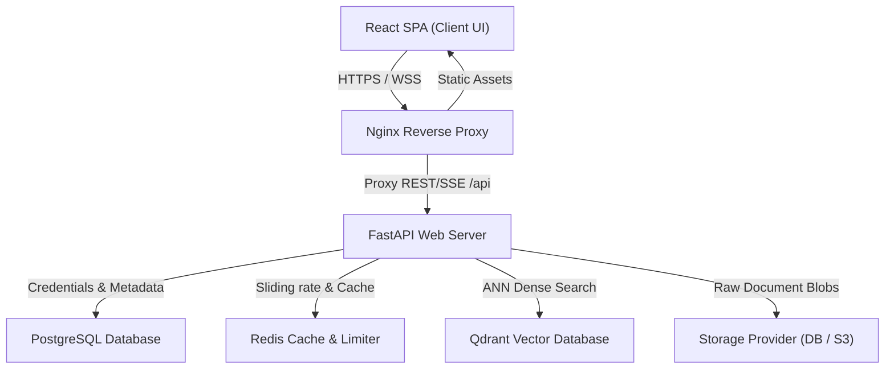
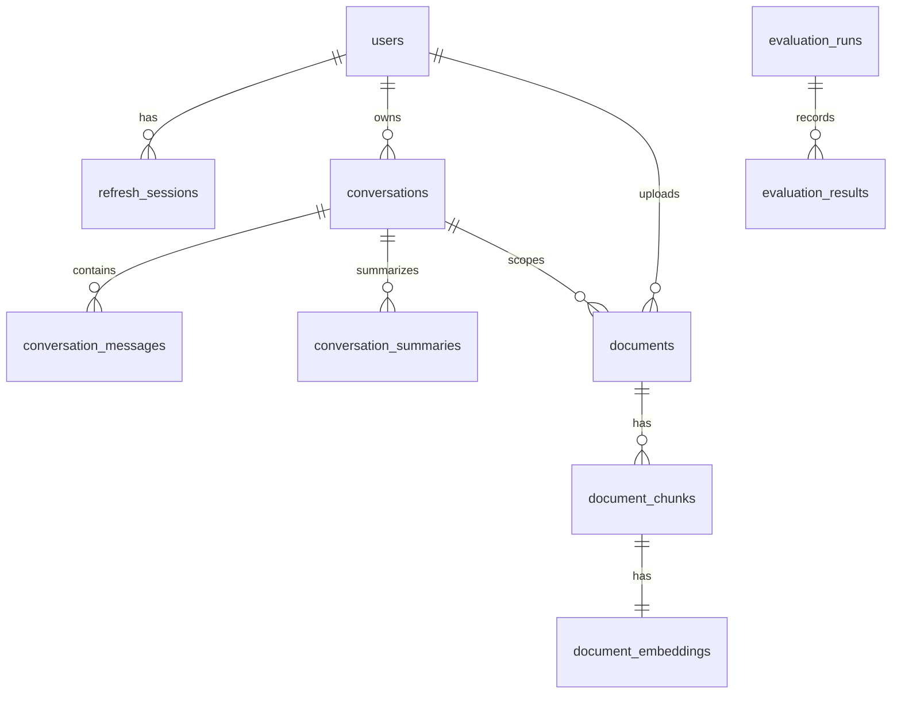
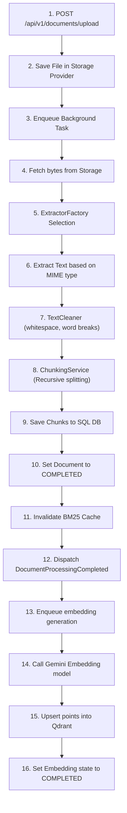
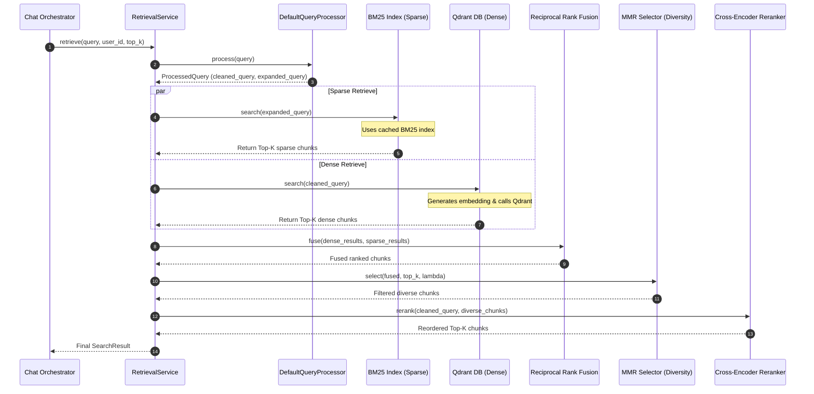
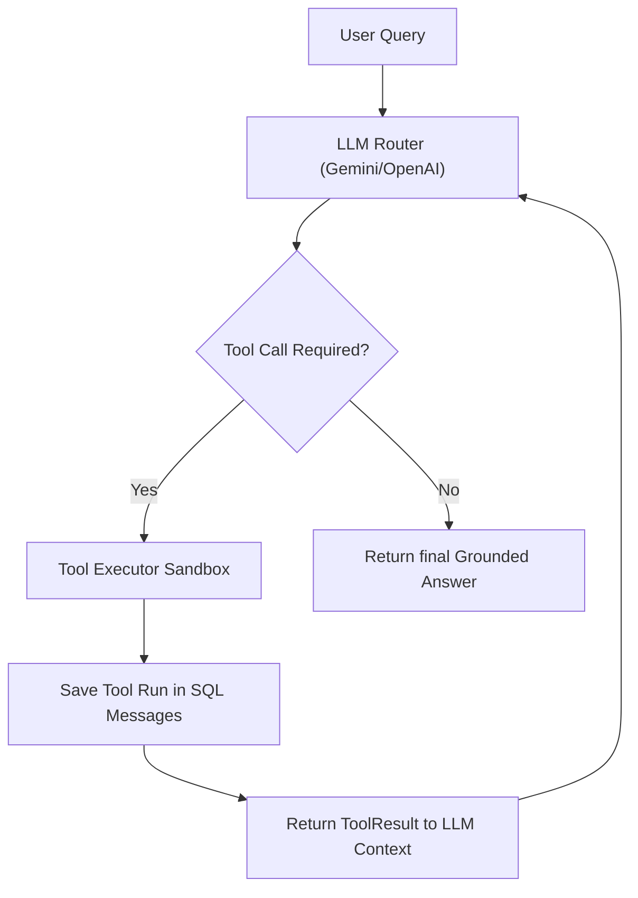
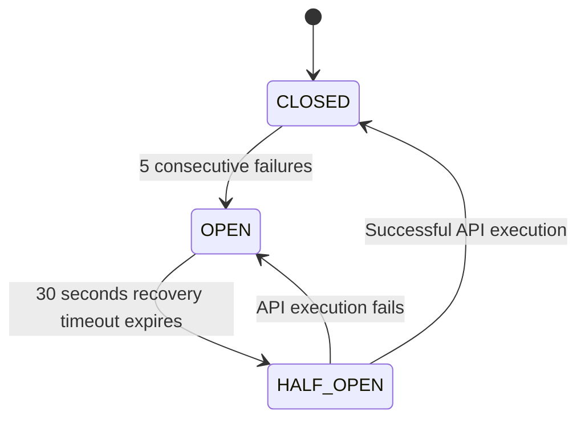

# Reverse Engineering Manual: Production-Grade Hybrid RAG Chatbot

This document provides a comprehensive technical breakdown of the **Hybrid RAG Chatbot** system. It details the architecture, design choices, data models, pipelines, algorithms, and steps required to build this system from scratch without AI assistance.

---

## 1. System Architecture & Tech Stack

The system is designed with a decoupled, asynchronous, and modular architecture. It divides responsibilities into three main tiers: a React Client SPA, a FastAPI Gateway Web Server, and backing Database engines (PostgreSQL, Qdrant, and Redis).

### Relational Stack Topology



### Component Selection Rationale

1. **FastAPI (Python 3.12+)**: Chosen for its high performance (comparable to Node.js and Go via ASGI), native asynchronous support (`async/await`), out-of-the-box data validation via Pydantic v2, and automatic OpenAPI schema generation.
2. **React + Vite + TypeScript**: React provides component-based modularity. Vite is selected over Create React App (CRA) due to its lightning-fast Hot Module Replacement (HMR) powered by ESbuild. TypeScript guarantees compile-time type safety across the frontend.
3. **PostgreSQL**: Serves as the primary transactional database. To support high concurrent loads without thread-pool starvation deadlocks (common when using FastAPI's synchronous DB sessions inside limited anyio thread pools), the SQLAlchemy connection pool is scaled with `pool_size=50` and `max_overflow=50` to exceed the default size of the worker thread pool.
4. **Qdrant**: A high-performance vector database written in Rust. It supports HNSW approximate nearest neighbors (ANN) search and allows exact filtering based on payload values (e.g., restricting vector searches by user ID or document ID).
5. **Redis**: Used as a fast, in-memory cache and state manager. It handles sliding window rate limiting and caches the compiled user BM25 indexes. All Redis operations are handled asynchronously using `redis.asyncio` connection pooling to keep the event loop free of blocking I/O.
6. **SQL-Fallback Storage / S3**: Files are saved in a binary table (`document_files`) inside PostgreSQL by default to keep the local setup simple. In production, this can be switched to S3 or MinIO via environment configurations.

---

## 2. Database Schema & Data Models

### 2.1. PostgreSQL Relational Schema

The SQL relational layout is defined via SQLAlchemy models. The schema consists of 10 primary tables grouped by domain boundaries.



#### 1. `users`
Tracks user credentials, account status, roles, and OAuth providers.
* `id` (`UUID`, Primary Key, default `uuid.uuid4`)
* `email` (`VARCHAR(255)`, unique, index, not null)
* `hashed_password` (`VARCHAR(255)`, nullable for OAuth users)
* `role` (`VARCHAR(50)`, default `"user"`, not null)
* `is_active` (`BOOLEAN`, default `True`, not null)
* `created_at` (`TIMESTAMPTZ`, default `now()`, not null)
* `updated_at` (`TIMESTAMPTZ`, default `now()`, not null)
* `oauth_provider` (`VARCHAR(50)`, nullable)
* `oauth_sub` (`VARCHAR(255)`, nullable, index)
* **Constraints**: `UniqueConstraint("oauth_provider", "oauth_sub")`

#### 2. `refresh_sessions`
Manages stateful refresh tokens for JWT session rotation.
* `id` (`UUID`, Primary Key, default `uuid.uuid4`)
* `token_hash` (`VARCHAR(255)`, unique, index, not null)
* `user_id` (`UUID`, Foreign Key to `users.id` with `ondelete="CASCADE"`, not null)
* `expires_at` (`TIMESTAMPTZ`, not null)
* `is_revoked` (`BOOLEAN`, default `False`, not null)
* `created_at` (`TIMESTAMPTZ`, default `now()`, not null)
* `last_used_at` (`TIMESTAMPTZ`, default `now()`, not null)
* `revoked_at` (`TIMESTAMPTZ`, nullable)
* `user_agent` (`VARCHAR(512)`, nullable)
* `ip_address` (`VARCHAR(100)`, nullable)

#### 3. `conversations`
Maintains chat sessions and metadata.
* `id` (`UUID`, Primary Key, default `uuid.uuid4`)
* `user_id` (`UUID`, Foreign Key to `users.id` with `ondelete="CASCADE"`, not null, index)
* `title` (`VARCHAR(255)`, not null)
* `state` (`VARCHAR(50)`, default `"active"`, not null)
* `settings` (`JSON`, default `{}`, not null)
* `version` (`INTEGER`, default `1`, not null) - *Used for optimistic locking*
* `metadata` (`JSON`, default `{}`, not null)
* `created_at` (`TIMESTAMPTZ`, default `now()`, not null)
* `updated_at` (`TIMESTAMPTZ`, default `now()`, not null)
* `last_message_at` (`TIMESTAMPTZ`, default `now()`, not null)

#### 4. `conversation_messages`
Stores individual chat bubbles (user prompts, system notes, assistant answers, tool runs).
* `id` (`UUID`, Primary Key, default `uuid.uuid4`)
* `conversation_id` (`UUID`, Foreign Key to `conversations.id` with `ondelete="CASCADE"`, not null, index)
* `role` (`VARCHAR(50)`, not null) - *Values: user, assistant, system, tool*
* `content` (`TEXT`, not null)
* `status` (`VARCHAR(50)`, default `"completed"`, not null)
* `citations` (`JSON`, nullable)
* `prompt_tokens` (`INTEGER`, default `0`, not null)
* `completion_tokens` (`INTEGER`, default `0`, not null)
* `tool_calls` (`JSON`, nullable)
* `metadata` (`JSON`, nullable)
* `attachments` (`JSON`, nullable)
* `structured_content` (`JSON`, nullable)
* `created_at` (`TIMESTAMPTZ`, default `now()`, not null)

#### 5. `conversation_summaries`
Stores summaries of old chat messages to fit context limits.
* `id` (`UUID`, Primary Key, default `uuid.uuid4`)
* `conversation_id` (`UUID`, Foreign Key to `conversations.id` with `ondelete="CASCADE"`, not null, index)
* `summary` (`TEXT`, not null)
* `summary_version` (`INTEGER`, default `1`, not null)
* `covered_from_message_id` (`UUID`, not null)
* `covered_until_message_id` (`UUID`, not null)
* `message_count` (`INTEGER`, not null)
* `created_at` (`TIMESTAMPTZ`, default `now()`, not null)

#### 6. `documents`
Tracks metadata, validation status, and ingestion pipelines for uploaded files.
* `id` (`UUID`, Primary Key, default `uuid.uuid4`)
* `user_id` (`UUID`, Foreign Key to `users.id` with `ondelete="CASCADE"`, not null)
* `conversation_id` (`UUID`, Foreign Key to `conversations.id` with `ondelete="SET NULL"`, nullable, index)
* `scope` (`VARCHAR(50)`, default `"LIBRARY"`, not null) - *Values: LIBRARY, CONVERSATION*
* `filename` (`VARCHAR(255)`, not null) - *Hashed/stored name*
* `original_filename` (`VARCHAR(255)`, not null)
* `content_type` (`VARCHAR(100)`, not null)
* `file_size` (`INTEGER`, not null)
* `checksum` (`VARCHAR(64)`, index, not null) - *SHA-256 to prevent duplicate uploads*
* `status` (`VARCHAR(50)`, default `"queued"`, not null) - *Values: queued, processing, completed, failed*
* `extractor_version` (`VARCHAR(20)`, default `"v1"`, not null)
* `failure_reason` (`TEXT`, nullable)
* `page_count` (`INTEGER`, nullable)
* `word_count` (`INTEGER`, nullable)
* `language` (`VARCHAR(50)`, nullable)
* `created_at` (`TIMESTAMPTZ`, default `now()`, not null)
* `updated_at` (`TIMESTAMPTZ`, default `now()`, not null)
* `processing_started_at` (`TIMESTAMPTZ`, nullable)
* `processing_completed_at` (`TIMESTAMPTZ`, nullable)

#### 7. `document_chunks`
Stores text segments split from documents.
* `id` (`UUID`, Primary Key, default `uuid.uuid4`)
* `document_id` (`UUID`, Foreign Key to `documents.id` with `ondelete="CASCADE"`, not null)
* `chunk_index` (`INTEGER`, not null)
* `text` (`TEXT`, not null)
* `character_start` (`INTEGER`, not null)
* `character_end` (`INTEGER`, not null)
* `token_estimate` (`INTEGER`, not null)
* `metadata` (`JSON`, default `{}`, not null)
* `created_at` (`TIMESTAMPTZ`, default `now()`, not null)
* **Constraints**: `UniqueConstraint("document_id", "chunk_index")`

#### 8. `document_embeddings`
Monitors the generation state of vector embeddings.
* `id` (`UUID`, Primary Key, default `uuid.uuid4`)
* `chunk_id` (`UUID`, Foreign Key to `document_chunks.id` with `ondelete="CASCADE"`, unique, not null)
* `embedding_provider` (`VARCHAR(50)`, not null)
* `embedding_model` (`VARCHAR(100)`, not null)
* `embedding_dimension` (`INTEGER`, not null)
* `embedding_version` (`VARCHAR(50)`, not null)
* `status` (`VARCHAR(50)`, not null) - *Values: pending, generating, completed, failed*
* `created_at` (`TIMESTAMPTZ`, default `now()`, not null)
* `updated_at` (`TIMESTAMPTZ`, default `now()`, not null)

#### 9. `document_files`
Binary blob storage fallback table (when not using S3/MinIO).
* `key` (`VARCHAR(255)`, Primary Key)
* `content` (`BYTEA`, not null)

#### 10. `durable_cleanup_jobs`
Durable queue to clean up orphan vector records and files when a document is deleted.
* `id` (`UUID`, Primary Key, default `uuid.uuid4`)
* `resource_type` (`VARCHAR(50)`, not null) - *Values: vector, file*
* `resource_id` (`UUID`, not null)
* `payload` (`JSON`, default `{}`, not null)
* `status` (`VARCHAR(20)`, default `"PENDING"`, not null) - *Values: PENDING, COMPLETED, FAILED*
* `attempts` (`INTEGER`, default `0`, not null)
* `last_error` (`TEXT`, nullable)
* `created_at` (`TIMESTAMPTZ`, default `now()`, not null)
* `updated_at` (`TIMESTAMPTZ`, default `now()`, not null)
* **Constraints**: `UniqueConstraint("resource_type", "resource_id")`

---

### 2.2. Qdrant Payload & Indexing Configuration

Qdrant stores dense embeddings. The vectors are configured with **Cosine Distance** matching.
To run fast metadata filtering, payload indexes are created on specific fields. Without these payload indexes, Qdrant will fail filtered searches with `Index required but not found` errors.

#### Vector Configurations
* **Dimension**: `768` (Gemini `text-embedding-004` used in all environments)
* **Distance Metric**: `Distance.COSINE`

#### Payload Schema
Every point inserted into Qdrant contains the following JSON payload:
```json
{
  "chunk_id": "string (UUID)",
  "document_id": "string (UUID)",
  "user_id": "string (UUID)",
  "document_scope": "string (LIBRARY or CONVERSATION)",
  "conversation_id": "string (UUID, nullable)",
  "chunk_index": "integer",
  "language": "string",
  "metadata": "object"
}
```

#### Required Qdrant Payload Indexes
Payload keyword indexes (`PayloadSchemaType.KEYWORD`) are created on the following fields:
1. `user_id` (Isolates users' documents)
2. `document_id` (Allows deleting points by document ID)
3. `document_scope` (Enables searching global library vs. conversation files)
4. `conversation_id` (Restricts search to a specific chat conversation)
5. `tags` (Allows tag-based filtering)
6. `metadata` (Enables arbitrary metadata filters)

---

## 3. Document Ingestion & Processing Pipeline

The ingestion pipeline handles file uploads, parses content based on type, cleans text, chunks the output, extracts metadata, generates embeddings, and indexes the vectors.



### 3.1. Parsing Strategies
The [`ExtractorFactory`](file:///d:/fun/hybrid_rag/backend/app/documents/infrastructure/extractors.py) selects the correct parser based on the file's MIME type:
* **PDF**: Text is extracted page-by-page. Special rules are applied to preserve the correct reading order, ignore headers/footers, and clean layout columns.
* **DOCX**: Iterates through document paragraphs and tables, converting them to plain text while preserving lists.
* **HTML**: Uses a parser (like `BeautifulSoup`) to strip `<script>`, `<style>`, and `<head>` tags. It retains semantic headings (`<h1>` to `<h6>`), `<p>`, `<li>`, and table structures.
* **TXT & Markdown**: Reads text directly.
* **CSV**: Parses rows, converting them into structured text representations (e.g., `Column1: Value, Column2: Value`).
* **Images (OCR)**: Extracts text from images using PyTesseract or a multimodal Vision LLM (e.g., Gemini).

### 3.2. Text Cleaning
The [`TextCleaner`](file:///d:/fun/hybrid_rag/backend/app/documents/services/text_cleaner.py) sanitizes raw text by:
1. Normalizing consecutive whitespaces, tabs, and page breaks into single spaces.
2. Removing boilerplate footers, headers, and page numbers.
3. Repairing words that were split across lines with hyphens (e.g., `semi-\nconductor` -> `semiconductor`).

### 3.3. Recursive Character Chunking
The [`ChunkingService`](file:///d:/fun/hybrid_rag/backend/app/documents/services/chunking.py) splits long text documents into smaller chunks using a recursive character splitting algorithm.

#### Algorithm Steps
1. The service uses a list of separators: `["\n\n", "\n", " ", ""]`.
2. It attempts to split text using the first separator (`\n\n`).
3. If a segment fits within the `chunk_size` (default `500` characters), it is kept. If it exceeds the size, the service recursively splits that segment using the next separator (`\n`), then spaces (` `), and finally individual characters.
4. When a chunk is full, the service creates the next chunk by backtracking to include a `chunk_overlap` (default `50` characters) from the end of the previous chunk.
5. Character offsets (`character_start`, `character_end`) are tracked for each chunk to support citation highlighting in the source documents.
6. A token estimate is calculated using a character-to-token ratio heuristic: `tokens = len(text) // 4`.

---

## 4. Advanced Hybrid Retrieval Pipeline

The retrieval engine combines dense semantic search and sparse term-frequency keyword matching to achieve high precision and recall.



### 4.1. Query Preprocessing
The [`DefaultQueryProcessor`](file:///d:/fun/hybrid_rag/backend/app/documents/services/query_processor.py) processes raw queries:
1. **Lowercase normalization**: Converts all characters to lowercase.
2. **Typo correction**: Corrects spelling mistakes using a preconfigured dictionary mapping.
3. **Punctuation cleanup**: Normalizes special characters into spaces.
4. **Acronym expansion**: Replaces abbreviations with their full definitions (e.g., `RAG` -> `Retrieval-Augmented Generation`). Acronym expansions are appended to the `expanded_query` used for sparse retrieval, while the `cleaned_query` is kept clean for dense embeddings.

---

### 4.2. Okapi BM25 Sparse Retrieval
Sparse retrieval uses keyword term matching based on the Okapi BM25 formula:

$$Score(D, Q) = \sum_{i=1}^{n} IDF(q_i) \cdot \frac{f(q_i, D) \cdot (k_1 + 1)}{f(q_i, D) + k_1 \cdot \left(1 - b + b \cdot \frac{|D|}{avgdl}\right)}$$

Where:
* $f(q_i, D)$ is the term frequency of query token $q_i$ in document chunk $D$.
* $|D|$ is the length of chunk $D$ in tokens.
* $avgdl$ is the average chunk length across the entire user corpus.
* $k_1$ is the term frequency scaling parameter (default $= 1.5$).
* $b$ is the length normalization parameter (default $= 0.75$).
* $IDF(q_i)$ is the Inverse Document Frequency of token $q_i$, calculated as:

$$IDF(q_i) = \ln \left( \frac{N - n(q_i) + 0.5}{n(q_i) + 0.5} + 1 \right)$$

Where $N$ is the total number of chunks in the user's corpus, and $n(q_i)$ is the number of chunks containing the token $q_i$.

#### Index Caching & Thread-Safe Rebuilds
To avoid rebuilding the BM25 index on every request, the system caches the index in the [`InMemoryIndexCache`](file:///d:/fun/hybrid_rag/backend/app/documents/services/index_cache.py).
The `InMemoryIndexCache` implements an LRU eviction policy using a bounded `collections.OrderedDict` with a capacity cap of `INDEX_CACHE_MAX_USERS` to enforce memory safety.
When a search is requested:
1. The indexer checks the database for updates by comparing chunk counts and the latest creation timestamp (`max_created_at`).
2. If the database stats match the cached stats, the search uses the cached index.
3. If there is a stats mismatch (or cache miss), the indexer acquires an async lock (`asyncio.Lock`), pulls all chunks for the user from the database, and rebuilds the BM25 index.
4. To optimize CPU-bound tokenization, the `InMemoryBM25Index` class maintains a shared, class-level cache (`_tokenized_chunks_cache`) of tokenized chunk strings. When index rebuilds occur, already tokenized chunks are reused from this cache. Obsolete chunk tokenizations are automatically pruned based on active users currently present in the `InMemoryIndexCache` to prevent memory leaks.

---

### 4.3. Dense Semantic Retrieval
Dense retrieval matches conceptual and semantic meaning.
1. The system generates a vector representation of the query using the configured embedding model (Gemini `text-embedding-004`).
2. It queries Qdrant using the query vector.
3. Qdrant applies payload pre-filters (`user_id`, `document_ids`, and `document_scope`).
4. Cosine similarity scores are normalized to a `[0.0, 1.0]` range:

$$Score_{norm} = \max\left(0.0, \min\left(1.0, \frac{Score_{cosine} + 1.0}{2.0}\right)\right)$$

5. Chunks with scores below the `similarity_threshold` (default `0.25`) are discarded.
6. The system performs a batch SQL lookup (`_chunk_repo.batch_lookup`) to retrieve the text and metadata for the remaining chunk IDs.

---

### 4.4. Reciprocal Rank Fusion (RRF)
To combine results from the sparse (BM25) and dense (Qdrant) retrievers, the system fuses their ranked lists using the RRF algorithm:

$$RRF\_Score(d) = \sum_{m \in M} \frac{1}{k + r_m(d)}$$

Where:
* $M$ is the set of retrievers (sparse and dense).
* $r_m(d)$ is the rank position of document chunk $d$ in the output of retriever $m$ (1-indexed).
* $k$ is a smoothing constant (default $= 60$) that prevents high-ranking items from dominating the score.

---

### 4.5. Maximal Marginal Relevance (MMR)
To prevent the LLM context from being polluted with redundant information, the system applies MMR to diversify the retrieved chunks:

$$MMR = \arg\max_{D_i \in R \setminus S} \left[ \lambda \cdot Sim_1(D_i, Q) - (1 - \lambda) \cdot \max_{D_j \in S} Sim_2(D_i, D_j) \right]$$

Where:
* $R$ is the set of candidate chunks returned by RRF.
* $S$ is the set of already selected chunks.
* $Sim_1(D_i, Q)$ is the similarity score between candidate chunk $D_i$ and query $Q$.
* $Sim_2(D_i, D_j)$ is the similarity score between chunk $D_i$ and already selected chunk $D_j$ (calculated via token overlap or vector similarity).
* $\lambda$ is the diversity balance parameter (default $= 0.5$). A value of $1.0$ selects items purely based on relevance, while $0.0$ selects a highly diverse set of chunks.

---

### 4.6. Cross-Encoder Reranking
Finally, the system rescores the candidate chunks using a Cross-Encoder reranker (such as `bge-reranker-large` or the Cohere Rerank API).
Unlike Dual-Encoder models (which embed the query and document separately), a Cross-Encoder processes the query and document chunk together through self-attention layers:
$$\text{Score} = \text{Model}(\text{Query} \oplus \text{Chunk})$$
Reranked chunks are sorted by score in descending order, and the top-$K$ chunks (default $= 5$) are selected for context compression.

---

## 5. Authentication, JWT Lifecycle & Session Rotation

The authentication system uses a stateful, dual-token security architecture with automatic session rotation.

```mermaid
sequenceDiagram
    actor Browser as Client Browser
    participant API as FastAPI /auth
    participant DB as PostgreSQL (Sessions)

    Browser->>API: POST /login (Credentials)
    API->>API: Verify password (Argon2id)
    API->>DB: Create Refresh Session
    API-->>Browser: Set HTTP-Only Cookie (Refresh Token) & JSON body (Access Token)
    Note over Browser, API: Subsquent requests include Bearer Access Token in Header
    
    Browser->>API: POST /refresh-token (No Access Token / Cookies sent)
    alt Token Valid & Unused
        API->>DB: Rotate Refresh Token (Create new session, revoke old)
        API-->>Browser: Set New Cookie (Refresh Token) & JSON body (New Access Token)
    else Token Reused (Theft Detection)
        API->>DB: Revoke all user sessions immediately (Breach)
        API-->>Browser: Clear Cookies & return 401 Unauthorized
    </td>
```

### 5.1. Password Hashing
User passwords are encrypted before storage using **Argon2id** (the profile winner of the Password Hashing Competition), implemented via the `argon2-cffi` library. It provides high resistance against GPU-based brute-force attacks by requiring configurable parameters for memory footprint, time iterations, and parallel lanes.

### 5.2. Stateful Session Rotation
* **Access Token**: Short-lived JWT (expires in 15 minutes) containing user claims (`sub`, `role`, `exp`). It is returned in the HTTP response body and stored in React memory. It is sent as a `Bearer` token in the HTTP `Authorization` header of API requests.
* **Refresh Token**: Long-lived cryptographically secure random string (expires in 7 days). It is stored in an `HTTP-Only`, `Secure`, `SameSite=Lax` cookie (`refresh_token`). This cookie cannot be accessed by client-side JavaScript, protecting it against Cross-Site Scripting (XSS) attacks.

#### Silent Refresh Flow
The client React app runs a background timer. 60 seconds before the access token expires, it sends a POST request to `/api/v1/auth/refresh-token`.
On the server:
1. The server reads the refresh token cookie.
2. It hashes the token and checks it against the `refresh_sessions` table in the database.
3. If the token is valid, unexpired, and unrevoked, the server:
   - Marks the old session as revoked.
   - Generates a new refresh token and saves its hash in a new `refresh_sessions` row.
   - Generates a new access token.
   - Sets the new refresh token in the response cookie and returns the new access token in the response body.

#### Token Reuse & Theft Detection
If a refresh token is presented that is already marked as revoked or used:
1. The server assumes a token theft has occurred (e.g., an attacker intercepted the token).
2. It immediately revokes **all** active sessions belonging to that user in the `refresh_sessions` table.
3. The server clears the client's cookie and returns a `401 Unauthorized` response, forcing the user to log in again.

---

## 6. Agentic Tool Calling Loop

When a user query requires dynamic calculations or database searches, the system runs an agentic feedback loop using the [`AgentExecutor`](file:///d:/fun/hybrid_rag/backend/app/chat/services/agent_executor.py).



### 6.1. State Machine execution
1. **Initiation**: The system compiles the prompt messages, system instructions, and available tool definitions.
2. **THINKING state**: The LLM analyzes the query and decides if it needs to call one or more tools.
   - If the model returns text without tool calls, the loop terminates and the response is returned to the user.
   - If the model requests tool calls, the system transitions to the **CALLING_TOOL** state.
3. **Execution**:
   - The system validates that the tool call count does not exceed the limit (`max_tools_per_request = 10`).
   - It saves the model's tool call request to the `conversation_messages` table as a pending message.
   - The [`ToolExecutor`](file:///d:/fun/hybrid_rag/backend/app/chat/services/tool_executor.py) executes the requested tool.
4. **Feedback**: The tool output is wrapped in a `ToolResult` object and appended to the message history as a `tool` role message. The loop returns to the **THINKING** state.
5. **Termination Guard**: The loop runs up to a maximum of `max_iterations = 5` to prevent infinite tool-calling loops.

### 6.2. Built-in Tools
* **`search_knowledge`**: Performs semantic search against documents.
* **`calculator`**: Solves math expressions.
* **`datetime`**: Returns the current date and time.
* **`chunk_retrieval`**: Retrieves text for specific chunks using chunk IDs.
* **`citation_lookup`**: Finds matching citations in documents.
* **`document_retrieval`**: Searches files by name or properties.

---

## 7. Observability, Evaluations & LLM Failover

### 7.1. Observability Traces
Every chat turn captures execution logs and metadata, storing them in `conversation_messages` and exposing them through the `/api/v1/observability` endpoints.
Captured metrics include:
* **Token count**: Tracking prompt input, completion output, and total token usage.
* **Granular latency**: Measuring execution time for query rewriting, vector database searches, BM25 indexing, reranking, and generation.
* **Cost estimation**: Calculating dollar costs based on input/output token usage and provider pricing models.

---

### 7.2. Evaluation Framework
The evaluation framework validates retrieval and generation quality against a ground-truth dataset.
* **Hit Rate**: Verifies if the correct ground-truth chunk is present in the retrieved chunks list.
* **Precision @ K**: Measures the ratio of retrieved chunks that are relevant.
* **Recall @ K**: Measures the ratio of expected relevant chunks that were successfully retrieved.
* **NDCG (Normalized Discounted Cumulative Gain)**: Measures ranking quality, penalizing relevant chunks that are retrieved at lower positions in the results list.
* **MRR (Mean Reciprocal Rank)**: Measures the reciprocal rank of the first relevant chunk.
* **LLM-as-a-Judge (DeepEval/Ragas)**: Evaluates **Faithfulness** (verifying if the answer is grounded *only* in the retrieved context) and **Answer Relevancy** (verifying if the response directly addresses the user query).

---

### 7.3. LLM Router & Circuit-Breaker Failover
To prevent service interruptions, the [`LLMProviderRouter`](file:///d:/fun/hybrid_rag/backend/app/chat/infrastructure/router.py) manages API calls to the LLM providers (Gemini and OpenAI) using a circuit breaker pattern.



#### Circuit States
* **CLOSED**: Normal operation. All requests are routed to the primary provider.
* **OPEN**: The primary provider has failed 5 consecutive times. All requests are immediately routed to the backup provider without calling the primary API. The circuit remains open for 30 seconds (`recovery_timeout`).
* **HALF_OPEN**: The recovery timeout has expired. The system allows a single test request to check the health of the primary provider. If the request succeeds, the circuit transitions back to **CLOSED**. If it fails, the circuit returns to **OPEN** and the recovery timeout is reset.

---

## 8. Frontend Architecture & React Patterns

The React application uses a modular page structure and global state providers to manage authentication, themes, and background uploads.

### 8.1. Global Context Providers
* **`ThemeContext`**: Manages the application theme (light/dark mode) and updates the root CSS variables.
* **`AuthContext`**: Manages user authentication state, handles login/register requests, and runs the silent token refresh timer.
* **`UploadQueueContext`**: Tracks in-progress file uploads. It is placed above the application routes in the component tree, allowing uploads to continue in the background when the user navigates between pages.

### 8.2. Server-Sent Events (SSE) Streaming
To provide a fast user experience, chat responses are streamed in real-time from the `/api/v1/chat/stream` endpoint.
1. The backend uses FastAPI's `StreamingResponse` to stream JSON events token-by-token.
2. The client uses the browser's `EventSource` API (or a fetch-based reader for custom headers) to consume the stream.
3. The stream yields three event types:
   - `metadata`: Contains citations and query diagnostics.
   - `text`: Yields raw text tokens as they are generated.
   - `done`: Signals the end of the stream and contains final token usage metrics.
4. The client uses a Markdown parser (with custom syntax highlighting for code blocks) to render the incoming stream progressively.

### 8.3. Citation Rendering Drawer
1. When the backend generates an answer, it maps factual claims to the retrieved document chunks and includes citations (e.g., `[1]`, `[2]`).
2. The client renders these citations as interactive badges.
3. Clicking a citation badge opens a side drawer.
4. The drawer fetches the source document's text and uses the chunk's character offsets (`character_start`, `character_end`) to highlight the exact text matching the citation.

---

## 9. Rebuilding Roadmap (Step-by-Step Guide)

Follow these steps to build the Hybrid RAG Chatbot from scratch:

### Step 1: Environment Setup
1. Install Python 3.12+ and Node.js v18+.
2. Install Docker Desktop.
3. Create the project folders:
   ```
   hybrid_rag/
   ├── backend/
   ├── frontend/
   └── docker-compose.yml
   ```

### Step 2: Database Setup & Migration
1. Define the SQLAlchemy models in `backend/app/db/models.py`.
2. Configure Alembic to manage database migrations:
   ```bash
   cd backend
   pip install alembic sqlalchemy psycopg2-binary
   alembic init alembic
   ```
3. Update `alembic/env.py` to import the models and bind the database engine. Run `alembic revision --autogenerate -m "initial"` to generate migrations, and `alembic upgrade head` to apply them.

### Step 3: Core Reliability Utils
Implement the reliability patterns (circuit breaker, retry with backoff, timeout, and bulkhead) in `backend/app/core/reliability/`. Write unit tests to verify the state transitions of the circuit breaker.

### Step 4: Ingestion Pipeline
1. Implement the document extractors (PDF, DOCX, HTML, TXT, CSV, Image OCR) in `backend/app/documents/infrastructure/extractors.py`.
2. Implement the recursive character splitting algorithm in `backend/app/documents/services/chunking.py`.
3. Create the background worker service (`DocumentProcessingService`) to coordinate extraction, cleaning, and chunking.

### Step 5: Vector Store & Embeddings
1. Implement the Qdrant connector (`QdrantVectorStore`) in `backend/app/documents/infrastructure/persistence/vector_store.py`. Ensure collection creation and payload indexing logic is implemented.
2. Implement the `EmbeddingService` to handle batch embedding generation and upserting vectors to Qdrant.

### Step 6: Hybrid Retrieval Pipeline
1. Implement the custom Okapi BM25 Scorer class in `backend/app/documents/services/sparse_index.py`.
2. Implement the Reciprocal Rank Fusion (RRF) and Maximal Marginal Relevance (MMR) algorithms.
3. Integrate the Cross-Encoder reranker.
4. Create the `RetrievalService` to run sparse and dense search tasks in parallel, fuse the results, and apply MMR and reranking.

### Step 7: Authentication & Session Management
1. Set up Argon2id password hashing.
2. Implement the JWT generation and verification utility.
3. Implement the login, registration, and token refresh endpoints. Ensure refresh token cookie management and token reuse revocation logic are in place.

### Step 8: Chat Orchestrator & Tool Calling
1. Create the `ChatOrchestrator` to handle query rewriting, retrieval, prompt building, and response generation.
2. Implement the `AgentExecutor` state machine loop to handle tool calls.
3. Write the tool definitions and execution handlers in `backend/app/chat/services/tools/`.
4. Create the SSE streaming endpoint in `backend/app/api/v1/chat.py`.

### Step 9: Frontend Development
1. Initialize the React app using Vite and TypeScript:
   ```bash
   cd frontend
   npm create vite@latest . -- --template react-ts
   ```
2. Build the global contexts: `ThemeContext`, `AuthContext`, and `UploadQueueContext`.
3. Implement the login and registration forms.
4. Implement the chat window page. Add support for SSE streaming, Markdown rendering, and the citation highlight drawer.
5. Create the documents page with upload queue tracking.
6. Build the admin dashboard to display token usage charts, latency traces, and evaluation reports.

### Step 10: Dockerization
1. Create a `Dockerfile` for the backend:
   ```dockerfile
   FROM python:3.12-slim
   WORKDIR /app
   COPY requirements.txt .
   RUN pip install -r requirements.txt
   COPY . .
   CMD ["uvicorn", "app.main:app", "--host", "0.0.0.0", "--port", "8000"]
   ```
2. Create a `Dockerfile` for the frontend:
   ```dockerfile
   FROM node:18-alpine AS build
   WORKDIR /app
   COPY package*.json ./
   RUN npm install
   COPY . .
   RUN npm run build
   FROM nginx:alpine
   COPY --from=build /app/dist /usr/share/nginx/html
   COPY nginx.conf /etc/nginx/conf.d/default.conf
   ```
3. Set up `docker-compose.yml` to orchestrate PostgreSQL, Redis, Qdrant, the FastAPI backend, and the React frontend. Start the application by running:
   ```bash
   docker compose up --build
   ```
