# Fusion RAG: Production-Grade Reverse Engineering & Architectural Blueprint
### Single Source of Truth, System Design Deep Dive & Master Technical Interview Guide

---

## Document Overview & How to Use This Guide

This document is the **definitive, exhaustive technical specification, data flow blueprint, database manual, frontend breakdown, DevOps manual, and architectural guide** for the **Fusion RAG Platform**. It is engineered to enable a Principal Software Engineer, Staff Architect, or Technical Lead to understand, maintain, scale, or recreate the entire distributed system from scratch without external documentation or AI assistance.

```
========================================================================================================================
                                              SYSTEM QUICK REFERENCE
========================================================================================================================
* Core Framework:       FastAPI (Python 3.12+ ASGI) + Uvicorn + Pydantic v2
* Primary Database:     PostgreSQL 16 (asyncpg + SQLAlchemy 2.0 async ORM, 23 Relational Tables)
* Vector Search Engine: Qdrant v1.19.0 (HNSW ANN, 768-dim Cosine, Payload Tenant Fencing)
* Sparse Text Search:   PostgreSQL Full-Text Search (tsvector + ts_rank_cd + GIN Indexes)
* In-Memory Cache/Queue:Redis 7 (redis.asyncio, Redis Streams Consumer Groups, L1/L2 Multi-Tier Caching)
* Dense Embeddings:     Jina AI API (jina-embeddings-v3, Matryoshka Representation, 768-dim)
* Cross-Encoder Rerank: Jina AI API (jina-reranker-v2-base-multilingual, Async Semaphores)
* Primary LLM Engine:   Google Gemini API (gemini-3.5-flash-lite via Multi-Key Workload Isolation)
* Observability:        OpenTelemetry SDK + Jaeger (OTLP gRPC) + Prometheus + Grafana + PII Sanitizer
* Evaluation Engine:    Ragas + DeepEval + Custom 20-Metric Suite + Dual-Gate CI/CD Regression Enforcer
* Frontend Architecture:React 18 + Vite 5 + TypeScript + Vanilla CSS Tokens + Pyodide WebAssembly (WASM)
* Security & Crypto:    Envelope Encryption (AES-256-GCM + DEK/KEK), ClamAV Antivirus, AST Sandboxing
* Reliability:          Bulkheads, Circuit Breakers, Exponential Full-Jitter Retries, Outbox Pattern
* DevOps & CI/CD:       4 GitHub Actions Workflows (CI, E2E Playwright, Eval, Nightly Benchmark) + Nginx SSE
========================================================================================================================
```

---

# Table of Contents

- [Part I: Executive Overview & High-Level System Architecture](#part-i-executive-overview--high-level-system-architecture)
  - [1. System Vision, Problem Statement & Core Value Proposition](#1-system-vision-problem-statement--core-value-proposition)
  - [2. End-to-End System Topology & High-Level Architecture Diagram](#2-end-to-end-system-topology--high-level-architecture-diagram)
  - [3. Architectural Selection Matrix & Tradeoff Analysis](#3-architectural-selection-matrix--tradeoff-analysis)
  - [4. Complete Project Directory Layout & Module Responsibilities](#4-complete-project-directory-layout--module-responsibilities)
- [Part II: End-to-End Sequence Diagrams & Step-by-Step Data Flows](#part-ii-end-to-end-sequence-diagrams--step-by-step-data-flows)
  - [5. Document Ingestion, Parsing, Chunking & Vector Indexing Sequence](#5-document-ingestion-parsing-chunking--vector-indexing-sequence)
  - [6. Real-Time Chat & SSE Streaming Lifecycle Sequence](#6-real-time-chat--sse-streaming-lifecycle-sequence)
  - [7. Production Hybrid Retrieval Pipeline Sequence (Dense + Sparse + RRF + MMR + Reranker)](#7-production-hybrid-retrieval-pipeline-sequence-dense--sparse--rrf--mmr--reranker)
  - [8. Hierarchical Multi-Agent DAG Planning & Execution Wave Sequence](#8-hierarchical-multi-agent-dag-planning--execution-wave-sequence)
  - [9. Authentication, Token Rotation & Replay Attack Defense Sequence](#9-authentication-token-rotation--replay-attack-defense-sequence)
  - [10. Transactional Outbox Pattern & Event Bus Sequence](#10-transactional-outbox-pattern--event-bus-sequence)
  - [11. Knowledge Graph Extraction & Multi-Hop Traversal Sequence](#11-knowledge-graph-extraction--multi-hop-traversal-sequence)
- [Part III: Complete Specialist Agent System Architecture & Implementations](#part-iii-complete-specialist-agent-system-architecture--implementations)
  - [12. Multi-Agent Topology & Comprehensive Specialist Classification Matrix](#12-multi-agent-topology--comprehensive-specialist-classification-matrix)
  - [13. MasterAgent: Hierarchical Planner, Replanner & Evidence Gating](#13-masteragent-hierarchical-planner-replanner--evidence-gating)
  - [14. AgentExecutionEngine: Topological Wave Executor & Concurrency Controller](#14-agentexecutionengine-topological-wave-executor--concurrency-controller)
  - [15. ResearchAgent & ResearchPlanner: Sub-Query Decomposition & KB Retrieval](#15-researchagent--researchplanner-sub-query-decomposition--kb-retrieval)
  - [16. DocumentAgent: Explicit Document & Chunk Inspection Specialist](#16-documentagent-explicit-document--chunk-inspection-specialist)
  - [17. AnalysisAgent: Deterministic Math, AST Sandboxing, SymPy & MathEngine](#17-analysisagent-deterministic-math-ast-sandboxing-sympy--mathengine)
  - [18. WebSearchAgent: Real-Time Multi-Provider Web Search Cascade](#18-websearchagent-real-time-multi-provider-web-search-cascade)
  - [19. TableAgent: Tabular Data Extraction & Column Aggregations](#19-tableagent-tabular-data-extraction--column-aggregations)
  - [20. VisionAgent: Multimodal Visual Reasoning & Chart Inspection](#20-visionagent-multimodal-visual-reasoning--chart-inspection)
  - [21. GraphAgent: Knowledge Graph Traversal & Entity Relationship Reasoning](#21-graphagent-knowledge-graph-traversal--entity-relationship-reasoning)
  - [22. SynthesisAgent: Context Grounding, Citation Tagging & Refusal Faithfulness](#22-synthesisagent-context-grounding-citation-tagging--refusal-faithfulness)
  - [23. ResultEvaluator: Task Quality Scoring & Adaptive Replanning Engine](#23-resultevaluator-task-quality-scoring--adaptive-replanning-engine)
  - [24. PlanValidator: Schema, Cycle Detection & Constraint Enforcement](#24-planvalidator-schema-cycle-detection--constraint-enforcement)
  - [25. TaskRouter & CapabilityRegistry: Capability-Aware Cost/Latency Routing](#25-taskrouter--capabilityregistry-capability-aware-costlatency-routing)
  - [26. AgentExecutor: Single-Agent Function/Tool Calling Loop & 7 Core Tools](#26-agentexecutor-single-agent-functiontool-calling-loop--7-core-tools)
  - [27. Multi-Agent Operational Subsystems: Health Diagnostics, Title Generator & Retention](#27-multi-agent-operational-subsystems-health-diagnostics-title-generator--retention)
- [Part IV: Complete Relational Database Schema & Data Models (All 23 PostgreSQL Tables)](#part-iv-complete-relational-database-schema--data-models-all-23-postgresql-tables)
  - [28. Relational Architecture, Entity-Relationship Diagram (ERD) & Bounded Contexts](#28-relational-architecture-entity-relationship-diagram-erd--bounded-contexts)
  - [29. Authentication & Security Context (5 Tables)](#29-authentication--security-context-5-tables)
  - [30. Chat & Conversation Context (3 Tables)](#30-chat--conversation-context-3-tables)
  - [31. Document Ingestion, Chunks & Storage Context (9 Tables)](#31-document-ingestion-chunks--storage-context-9-tables)
  - [32. Knowledge Graph Context (4 Tables)](#32-knowledge-graph-context-4-tables)
  - [33. Transactional Outbox & Automated Evaluation Context (4 Tables)](#33-transactional-outbox--automated-evaluation-context-4-tables)
- [Part V: Security, Reliability, Caching & Distributed Infrastructure](#part-v-security-reliability-caching--distributed-infrastructure)
  - [34. Envelope Encryption, Key Management & Crypto-Shredding (AES-256-GCM + DEK/KEK)](#34-envelope-encryption-key-management--crypto-shredding-aes-256-gcm--dekkek)
  - [35. Malware & Antivirus Scanning (ClamAV TCP Streaming + EICAR)](#35-malware--antivirus-scanning-clamav-tcp-streaming--eicar)
  - [36. Prompt Injection Defense, Intent Guardrails & AST Sandboxing](#36-prompt-injection-defense-intent-guardrails--ast-sandboxing)
  - [37. Multi-Tier Caching (L1 Memory + L2 Redis) & Distributed Heartbeat Locking](#37-multi-tier-caching-l1-memory--l2-redis--distributed-heartbeat-locking)
  - [38. Reliability Framework: Bulkheads, Circuit Breakers, Exponential Jitter Retries & Timeouts](#38-reliability-framework-bulkheads-circuit-breakers-exponential-jitter-retries--timeouts)
  - [39. Transactional Outbox Pattern, Event Bus & JobDispatcher Engine](#39-transactional-outbox-pattern-event-bus--jobdispatcher-engine)
  - [40. Storage Provider Abstraction & Two-Phase Durable Cleanup Worker](#40-storage-provider-abstraction--two-phase-durable-cleanup-worker)
  - [41. Resend Email Service, Token Cost Pricing Engine & Dynamic Feature Flags](#41-resend-email-service-token-cost-pricing-engine--dynamic-feature-flags)
  - [42. Application Lifespan, Startup Hooks & Middleware Cardinality Defense](#42-application-lifespan-startup-hooks--middleware-cardinality-defense)
- [Part VI: Document Ingestion, Advanced Chunking & Knowledge Graph Pipeline](#part-vi-document-ingestion-advanced-chunking--knowledge-graph-pipeline)
  - [43. Advanced Chunking Strategies: Recursive, Parent-Child & Sentence-Window](#43-advanced-chunking-strategies-recursive-parent-child--sentence-window)
  - [44. Empty Knowledge Base Index Cache & Weighted RRF Fusion](#44-empty-knowledge-base-index-cache--weighted-rrf-fusion)
  - [45. Ingestion-Time NER & Relationship Extraction Pipeline](#45-ingestion-time-ner--relationship-extraction-pipeline)
  - [46. BFS Knowledge Graph Pathfinding & Multi-Hop Retrieval](#46-bfs-knowledge-graph-pathfinding--multi-hop-retrieval)
  - [47. Adaptive RAG Orchestration State Machine (DIRECT, HYDE, MULTI_HOP, SPECIALIST)](#47-adaptive-rag-orchestration-state-machine-direct-hyde-multi_hop-specialist)
- [Part VII: Frontend Architecture, Pyodide WASM & UI Component Tree](#part-vii-frontend-architecture-pyodide-wasm--ui-component-tree)
  - [48. Pyodide WebAssembly (WASM) Sandbox Worker Architecture](#48-pyodide-webassembly-wasm-sandbox-worker-architecture)
  - [49. Complete Custom Hook Architecture & SSE Streaming Protocol](#49-complete-custom-hook-architecture--sse-streaming-protocol)
  - [50. 7-Stage Upload Pipeline & Document Status State Machine](#50-7-stage-upload-pipeline--document-status-state-machine)
  - [51. Projects, Workspaces & Folder Organization Subsystems](#51-projects-workspaces--folder-organization-subsystems)
  - [52. Stream Recovery, In-Flight Re-Authentication & UI Component Tree](#52-stream-recovery-in-flight-re-authentication--ui-component-tree)
- [Part VIII: Complete REST & SSE API Endpoint Catalog (All 45+ Endpoints)](#part-viii-complete-rest--sse-api-endpoint-catalog-all-45-endpoints)
  - [53. Exhaustive Route Specifications Across All 10 Routers & Root App](#53-exhaustive-route-specifications-across-all-10-routers--root-app)
- [Part IX: Production Observability, Quality Assurance & Evaluation Suite](#part-ix-production-observability-quality-assurance--evaluation-suite)
  - [54. OpenTelemetry Tracing, Prometheus Metric Registry & Telemetry Sanitizer](#54-opentelemetry-tracing-prometheus-metric-registry--telemetry-sanitizer)
  - [55. Multi-Agent Observability & Quality Metrics (AgentObservabilityService)](#55-multi-agent-observability--quality-metrics-agentobservabilityservice)
  - [56. Comprehensive Evaluation Framework: Ragas, DeepEval & 20 Custom Metrics](#56-comprehensive-evaluation-framework-ragas-deepeval--20-custom-metrics)
  - [57. Golden Corpora, Benchmark Profiles, Drift Tracking & Report Generators](#57-golden-corpora-benchmark-profiles-drift-tracking--report-generators)
- [Part X: DevOps, CI/CD Automation, Operational Tooling & Edge Deployment](#part-x-devops-cicd-automation-operational-tooling--edge-deployment)
  - [58. The 4 GitHub Actions Workflows (CI, E2E Playwright, Eval Gate, Nightly Benchmark)](#58-the-4-github-actions-workflows-ci-e2e-playwright-eval-gate-nightly-benchmark)
  - [59. Operational CLI Scripts, Backup/Restore & Smoke Testing](#59-operational-cli-scripts-backuprestore--smoke-testing)
  - [60. Nginx Edge Reverse Proxy, Grafana Dashboards & Runbooks](#60-nginx-edge-reverse-proxy-grafana-dashboards--runbooks)
- [Part XI: Real-World Engineering Case Studies (DaveAI Production Challenges)](#part-xi-real-world-engineering-case-studies-daveai-production-challenges)
  - [61. Case Study 1: The Asynchronous Streaming Transaction Race Condition (EarlyCommit Fix)](#61-case-study-1-the-asynchronous-streaming-transaction-race-condition-earlycommit-fix)
  - [62. Case Study 2: Database Connection Pool Starvation during Streaming Responses](#62-case-study-2-database-connection-pool-starvation-during-streaming-responses)
  - [63. Case Study 3: Cascading Timeouts & Topological Deadlocks in Multi-Agent Execution](#63-case-study-3-cascading-timeouts--topological-deadlocks-in-multi-agent-execution)
  - [64. Case Study 4: Multi-Key Rate-Limit Cascades & High-Traffic Failover](#64-case-study-4-multi-key-rate-limit-cascades--high-traffic-failover)
- [Part XII: Master Technical Interview Preparation Guide & Environment Catalog](#part-xii-master-technical-interview-preparation-guide--environment-catalog)
  - [65. Technical Narrative Framework (STAR Format for Fusion RAG)](#65-technical-narrative-framework-star-format-for-fusion-rag)
  - [66. Backend Architecture & Distributed Systems Interview Questions](#66-backend-architecture--distributed-systems-interview-questions)
  - [67. Generative AI, RAG & LLM Systems Interview Questions](#67-generative-ai-rag--llm-systems-interview-questions)
  - [68. System Design, Resilience & Failure Scenarios Interview Questions](#68-system-design-resilience--failure-scenarios-interview-questions)
  - [69. Rapid Revision Flashcard Matrix (Numbers, Formulas, DB Indexes & Shell Commands)](#69-rapid-revision-flashcard-matrix-numbers-formulas-db-indexes--shell-commands)
  - [70. Exhaustive Environment Configuration Variable Catalog (All 150+ Parameters)](#70-exhaustive-environment-configuration-variable-catalog-all-150-parameters)

---

# Part I: Executive Overview & High-Level System Architecture

## 1. System Vision, Problem Statement & Core Value Proposition

### 1.1 The Industry Problem
Standard Retrieval-Augmented Generation (RAG) implementations suffer from five primary production pathologies:
1. **Semantic Blindness / Keyword Disconnect**: Pure dense vector retrieval (bi-encoders) fails on exact keyword searches, product codes, SKUs, acronyms, and technical identifiers (e.g., searching for error code `0x80070005` or part number `CR-4096`).
2. **Dense False Positives / High Semantic Overlap**: Dense embeddings retrieve passages with similar grammatical structure or high-level topic alignment that lack the specific factual answer.
3. **Chunk Boundary Truncation**: Rigid chunking breaks tables, sentences, and contextual definitions across chunk boundaries, leading to hallucinated synthesis.
4. **Context Drift in Multi-Turn Dialogues**: Follow-up questions (e.g., *"What about its warranty?"* or *"Can you compare it to the first option?"*) fail because standard RAG embeds the pronoun-laden query directly, searching for "it" instead of the resolved entity.
5. **Slow Time-To-First-Token (TTFT) & Fragility**: Ingestion pipelines block synchronous API threads; single LLM API rate limits cause total application blackouts; unbuffered database writes during streaming cause connection exhaustion.

### 1.2 The Fusion RAG Solution
**Fusion RAG** resolves these challenges through an enterprise-grade, asynchronous, multi-tiered architecture:
- **Hybrid Search with Reciprocal Rank Fusion (RRF)**: Merges dense vector HNSW search with PostgreSQL GIN full-text search (FTS) using rank-based reciprocal scoring ($k=60$).
- **Maximal Marginal Relevance (MMR) & Cross-Encoder Reranking**: Balances information diversity ($\lambda=0.5$) before passing candidates to a heavy multilingual cross-encoder (`jina-reranker-v2`) bounded by async semaphores.
- **Hierarchical Multi-Agent Orchestration**: Decomposes complex analytical and multi-domain requests into Directed Acyclic Graphs (DAGs) executed concurrently across specialized sub-agents (`ResearchAgent`, `DocumentAgent`, `AnalysisAgent`, `WebSearchAgent`, `TableAgent`, `VisionAgent`, `GraphAgent`) with bounded replanning.
- **Two-Tier Document Model with Scope Isolation**: Strict separation between user-wide persistent Library documents and session-bound Conversation documents with cryptographic multi-tenancy.
- **Zero-PyTorch Cloud-Native Architecture**: Achieves sub-second cold starts and container images under 450 MB by delegating heavy matrix operations to specialized, resilient REST APIs.

### 1.3 Core Concept "Cheat Sheet" for Freshers & Interviewees

| Term | What It Sounds Like | What It Actually Means in Plain English |
|---|---|---|
| **Bi-Encoder (Dense Search)** | Complex neural net | Encodes questions and documents *separately* into 768-dim coordinate vectors so we can do ultra-fast approximate geometric distance search ($O(\log N)$ in Qdrant). |
| **Cross-Encoder (Reranker)** | Another neural net | Feeds the question and candidate chunk *together* into a deep multi-head attention layer. Slower ($O(N)$), but understands nuanced word-by-word context with supreme accuracy. |
| **RRF ($k=60$)** | Complex math formula | A fair leaderboard system: merges dense vector results and keyword results by their rank position ($1 / (60 + \text{rank})$) instead of incompatible raw similarity scores. |
| **MMR ($\lambda=0.5$)** | Complex algorithm | "Don't retrieve 5 chunks that repeat the exact same sentence." Balances pure similarity against information diversity so LLM context isn't wasted on duplicate facts. |
| **Matryoshka Embeddings (MRL)** | Russian nesting dolls | Embeddings engineered so you can slice the first 256 dimensions out of 768 and retain 95%+ search accuracy while cutting Qdrant RAM and disk storage by 66%. |
| **EarlyCommit Pattern** | DB transaction pattern | Committing a newly generated chat session to PostgreSQL *before* starting the token stream, so concurrent frontend attachment uploads don't encounter a 404 race condition. |
| **Topological Wave DAG** | Graph theory | Grouping independent tasks together into parallel "waves" so tasks without dependencies run simultaneously, while dependent tasks wait for upstream outputs. |

---

## 2. End-to-End System Topology & High-Level Architecture Diagram

```
+---------------------------------------------------------------------------------------------------+
|                                       CLIENT TIER                                                 |
|   React 18 + Vite 5 + TypeScript SPA (HTML5 SSE Reader, Upload Queue, Token Buffer, Citation UI) |
|   In-Browser Pyodide WebAssembly (WASM) Sandbox for Client-Side Mathematical Execution & Pandas   |
+---------------------------------------------------------------------------------------------------+
                                                  |
                                                  | HTTPS / Server-Sent Events (SSE)
                                                  v
+---------------------------------------------------------------------------------------------------+
|                                      EDGE & REVERSE PROXY                                         |
|   Nginx 1.25 (Alpine) [Reverse Proxy, Gzip/Brotli, Static Caching, proxy_buffering off for SSE]   |
+---------------------------------------------------------------------------------------------------+
                                                  |
                                                  | HTTP/1.1 Forwarding (:8000)
                                                  v
+---------------------------------------------------------------------------------------------------+
|                                   FASTAPI APPLICATION LAYER                                       |
|                                                                                                   |
|  +---------------------------------------------------------------------------------------------+  |
|  |  ASGI Middleware Pipeline:                                                                  |  |
|  |  1. RequestContext Injection (ContextVar) -> 2. Telemetry Middleware (OTel W3C Trace IDs)    |  |
|  |  3. Rate Limiter (Redis Sliding Window)   -> 4. Security Headers & CORS Guard               |  |
|  +---------------------------------------------------------------------------------------------+  |
|                                                  |                                                |
|                   +------------------------------+------------------------------+                 |
|                   |                                                             |                 |
|                   v                                                             v                 |
|  +----------------------------------+                         +--------------------------------+  |
|  |   DOCUMENT INGESTION ROUTE       |                         |      CHAT STREAMING ROUTE      |  |
|  |   POST /api/v1/documents/upload  |                         |      POST /api/v1/chat/chat    |  |
|  |                                  |                         |                                |  |
|  | 1. Magic Byte & Antivirus (ClamAV)|                         | 1. @documents Directive Parser |  |
|  | 2. SHA-256 Deduplication Check   |                         | 2. EarlyCommit Session Lock    |  |
|  | 3. PostgreSQL Raw Doc Write      |                         | 3. LLM History Rewriter        |  |
|  | 4. Transactional Outbox Write    |                         | 4. Adaptive Strategy Classifier|  |
|  | 5. Redis Stream Task Enqueue     |                         | 5. Multi-Agent DAG Planner     |  |
|  +----------------------------------+                         +--------------------------------+  |
|                   |                                                             |                 |
+-------------------|-------------------------------------------------------------|-----------------+
                    |                                                             |
                    v (Async Redis Stream)                                        v
+------------------------------------+                  +-------------------------------------------+
|    BACKGROUND WORKER TIER          |                  |        RAG RETRIEVAL & AGENT ENGINE       |
|                                    |                  |                                           |
|  QueueWorker (Redis Consumer Group)|                  |  +-------------------------------------+  |
|  1. Extract (pypdf/docx/Vision OCR)|                  |  | Hybrid Retrieval Pipeline:          |  |
|  2. TextCleaner & Normalizer       |                  |  |  - Dense Branch (Qdrant HNSW)       |  |
|  3. Chunking (Recursive/ParentChild|                  |  |  - Sparse Branch (Postgres GIN FTS) |  |
|  4. Batch Embed (Jina REST API)    |                  |  |  - Reciprocal Rank Fusion (RRF)    |  |
|  5. Knowledge Graph Entity Linking |                  |  |  - Maximal Marginal Relevance (MMR) |  |
|  6. Upsert to Qdrant Vector Store  |                  |  |  - Jina Cross-Encoder Reranker      |  |
|  7. Invalidate User Index Cache    |                  |  +-------------------------------------+  |
|                                    |                  |                     |                     |
|  Durable Ingestion Reaper (60s)    |                  |  +-------------------------------------+  |
|  - Reclaims stalled processing jobs|                  |  | Hierarchical Multi-Agent Subsystem: |  |
|                                    |                  |  |  - MasterAgent (LLM DAG Planner)    |  |
|  Durable Cleanup Worker (2PC)      |                  |  |  - ExecutionEngine (Async Waves)    |  |
|  - Cascade delete S3/DB/Qdrant     |                  |  |  - 8 Specialist Agents + Evaluator  |  |
+------------------------------------+                  |  +-------------------------------------+  |
                                                        |                     |                     |
                                                        |  +-------------------------------------+  |
                                                        |  | Answer Generation (Gemini LLM):     |  |
                                                        |  |  - XML Context Isolation Fencing    |  |
                                                        |  |  - Token Streaming over SSE Engine  |  |
                                                        |  |  - Inline Citation Mapping          |  |
                                                        |  +-------------------------------------+  |
                                                        +-------------------------------------------+
                                                                              |
                   +----------------------------------------------------------+
                   |
                   v
+---------------------------------------------------------------------------------------------------+
|                                  STATE & PERSISTENCE TIER                                         |
|                                                                                                   |
|  +-----------------------+   +------------------------+   +------------------------------------+  |
|  |     POSTGRESQL 16     |   |        REDIS 7         |   |          QDRANT v1.19.0            |  |
|  | - 23 Relational Tables|   | - Token Bucket RL      |   | - HNSW Vector Index                |  |
|  | - Users, Auth, Keys   |   | - L1/L2 Semantic Cache |   | - 768-dim Cosine Distance          |  |
|  | - Conversations & Msgs|   | - Distributed Mutexes  |   | - Payload Tenant Filter:           |  |
|  | - Chunks & GIN FTS    |   | - Streams Task Queue   |   |   (user_id + scope + conversation) |  |
|  | - Knowledge Graph (4) |   | - Outbox Event Bus     |   +------------------------------------+  |
|  | - Outbox & Evals (4)  |   | - Ingestion Dead-Letter|                                           |
|  +-----------------------+   +------------------------+                                           |
+---------------------------------------------------------------------------------------------------+
```

---

## 3. Architectural Selection Matrix & Tradeoff Analysis

| Component | Selected Technology | Alternative Considered | Why Selected (Deep Technical Rationale) | Tradeoffs & Mitigations |
|---|---|---|---|---|
| **API Framework** | **FastAPI + Uvicorn (ASGI)** | Django, Flask, Express.js | Native Python `async`/`await` support for non-blocking I/O; automatic OpenAPI validation via Pydantic v2; ASGI standard supports long-lived HTTP SSE streaming without thread blocking. | Python GIL exists for CPU-bound tasks. *Mitigation*: Offload CPU-heavy text extraction to async workers and MathEngine AST parser. |
| **Relational Database** | **PostgreSQL 16 (asyncpg)** | MySQL, MongoDB | Robust ACID compliance; native JSONB for flexible chat metadata; built-in Full-Text Search (`tsvector`, `websearch_to_tsquery`) with GIN indexes eliminates separate Elasticsearch cluster. | Connection overhead per backend process. *Mitigation*: Tuned `async_sessionmaker` connection pool ($N=20$, overflow $10$, statement cache disabled for PgBouncer). |
| **Vector Database** | **Qdrant v1.19.0** | Pinecone, Weaviate, Milvus, pgvector | Written in Rust with ultra-low memory overhead; native payload filtering directly inside HNSW graph index traversal (crucial for multi-tenant `user_id` filtering); fully self-hostable. | Self-managed disk persistence. *Mitigation*: Mounted persistent volume `/qdrant/storage` with automated WAL snapshots. |
| **Message Queue / Cache** | **Redis 7 (Streams + Memory)** | Celery + RabbitMQ, Kafka | Single in-memory infrastructure handles sliding-window rate limiting, multi-tier semantic caching, distributed locking, and durable task queues with consumer groups (`XREADGROUP`). | In-memory RAM constraints. *Mitigation*: Configured LRU eviction policy for cache namespaces; persistent AOF for task queue streams. |
| **Dense Embeddings** | **Jina Embeddings v3** | OpenAI `text-embedding-3-small`, HuggingFace local | 768-dim Matryoshka Representation Learning (MRL) allows truncation to 256/128 dims; asymmetric task adapters (`retrieval.passage` vs `retrieval.query`); zero GPU infrastructure needed. | Third-party REST latency & rate limits. *Mitigation*: 24h Redis embedding cache by SHA-256 hash; async batching ($N=32$). |
| **Cross-Encoder Reranker** | **Jina Reranker v2 (Multilingual)** | Cohere Rerank, FlashRank local | Joint query-document cross-attention significantly out-ranks bi-encoders; multilingual; REST API eliminates massive local PyTorch RAM footprint (saves >2GB RAM). | Network latency (~150-250ms). *Mitigation*: Bound reranking candidates to top $K=20$; concurrency controlled by `asyncio.Semaphore(4)`. |
| **LLM Generation** | **Google Gemini (gemini-3.5-flash-lite)** | OpenAI GPT-4o-mini, Claude 3.5 Haiku | Sub-second TTFT (~220ms); massive context window (1M tokens); competitive cost per 1M tokens; native multimodal support for document OCR. | Occasional rate limiting on single API keys. *Mitigation*: Multi-key isolation pattern (`LLM_KEY`, `PLANNER_KEY`, `FALLBACK_KEY`). |

---

## 4. Complete Project Directory Layout & Module Responsibilities

```
FusionRAG/                           # Repository root
  prd.md                             # Product Requirements Document
  ARCHITECTURE.md                    # Architecture diagrams and specs
  README.md                          # Quick-start guide
  reverse_engineering.md             # This document (Single Source of Truth)
  docker-compose.yml                 # Core services (postgres, redis, qdrant, backend, frontend, nginx)
  docker-compose.observability.yml   # Observability services (jaeger, prometheus, grafana)
  .github/workflows/                 # 4 CI/CD workflows (ci, e2e, evaluation, nightly-benchmark)
  deployment/nginx/                  # Nginx configuration (reverse proxy, SSE buffer config)
  observability/                     # Grafana dashboards, Prometheus scrape configs
  docs/                              # Runbooks, Free-tier deployment guides, security checklist

  backend/
    Dockerfile                       # Multi-stage backend build (uv builder + slim runtime)
    pyproject.toml                   # Python dependencies and build metadata
    requirements.txt                 # Pinned production dependencies
    alembic.ini                      # Database migration configuration
    alembic/versions/                # Versioned migration scripts
    scripts/                         # Backup, restore, load testing, smoke testing, OpenAPI export
    .env.example                     # Environment template with all 150+ variables

    app/
      main.py                        # FastAPI app factory, lifespan, ProductionMiddleware, routing
      api/
        dependencies.py              # Dependency injection factories (get_db, get_redis, get_qdrant)
        exception_handlers.py        # Global domain exception to HTTP response mapping
        v1/                          # 10 API Routers (auth, chat, documents, search, evaluation, etc.)
      auth/                          # Authentication, Argon2id, JWT, OAuth, session management, DEK crypto
      chat/                          # Orchestration, LLM history rewriter, prompt builder, Multi-Agent DAG
      documents/                     # Ingestion, extractors, chunking, embeddings, hybrid retrieval, graph
      core/
        config.py                    # 150+ Pydantic settings
        security/                    # Envelope encryption, ClamAV malware, prompt injection, idempotency
        reliability/                 # Bulkheads, Circuit Breakers, Exponential Retries, Timeouts
        cache/                       # L1 Memory + L2 Redis Multi-Tier Cache, Distributed Mutex
        events/                      # Transactional Outbox Dispatcher & Redis Event Bus
        queue/                       # Redis Stream Task Queue, JobDispatcher, Handlers & QueueWorker
        telemetry/                   # OpenTelemetry setup, Prometheus metrics, TelemetrySanitizer
        feature_flags/               # Dynamic runtime feature flag engine
        math/                        # Deterministic MathEngine, FinancialMath, Statistical, LaTeX
      db/                            # Async SQLAlchemy sessionmaker, ORM Base, and 23 Model mappings
      evaluation/                    # Ragas, DeepEval, 20-Metric Registry, Golden Datasets, Regression Runner
      rag/orchestration/             # Adaptive RAG State Machine (StrategyRouter, EvidenceEvaluator, Master)

  frontend/
    src/
      main.tsx                       # React root render
      App.tsx                        # Client-side routing and context provider tree
      index.css                      # Global Vanilla CSS design tokens (light/dark mode)
      workers/
        pyodide.worker.ts            # Pyodide WebAssembly Web Worker for sandboxed Python/Pandas
      lib/
        pyodide/pyodideManager.ts    # Web Worker RPC bridge and execution manager
        uploadStages.ts              # 7-stage progressive upload pipeline
        passwordStrength.ts          # Client-side password validation
        analytics.ts                 # Client-side event tracking
        notifications.ts             # Browser desktop notifications
        highlighter.ts               # Shiki syntax highlighter
      components/                    # ChatWindow, SSEStream, DocumentManager, CitationDrawer, CommandPalette
      pages/                         # LandingPage, ProjectsPage, AdminDashboardPage, VerifyEmailPage
      context/                       # AuthContext, ThemeContext, UploadQueueContext
      hooks/                         # useSSEChat, useDocuments, useDrafts, useKeyboardShortcuts, etc.
```

---

# Part II: End-to-End Sequence Diagrams & Step-by-Step Data Flows

## 5. Document Ingestion, Parsing, Chunking & Vector Indexing Sequence

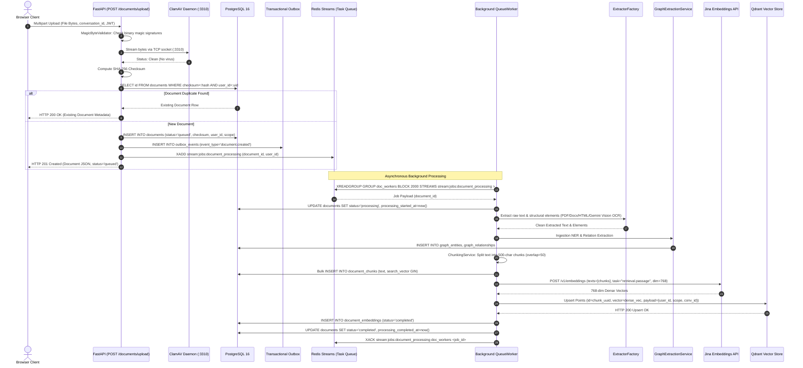

---

## 6. Real-Time Chat & SSE Streaming Lifecycle Sequence

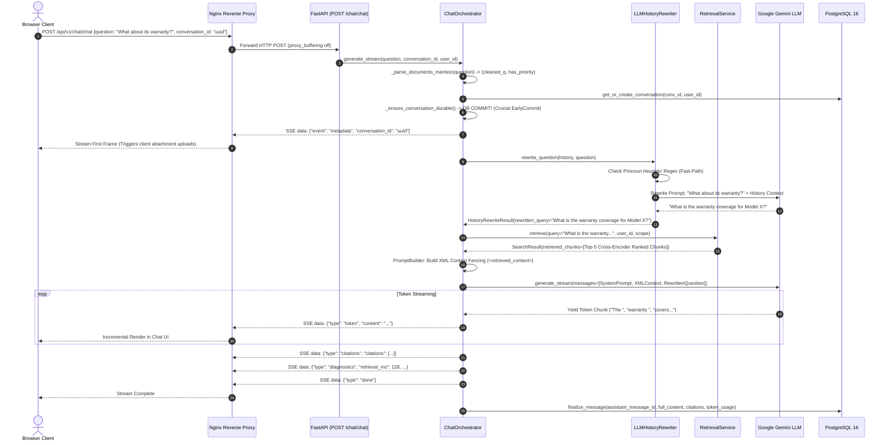

---

## 7. Production Hybrid Retrieval Pipeline Sequence (Dense + Sparse + RRF + MMR + Reranker)

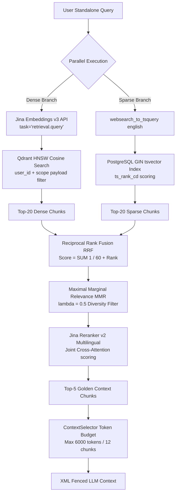

---

## 8. Hierarchical Multi-Agent DAG Planning & Execution Wave Sequence

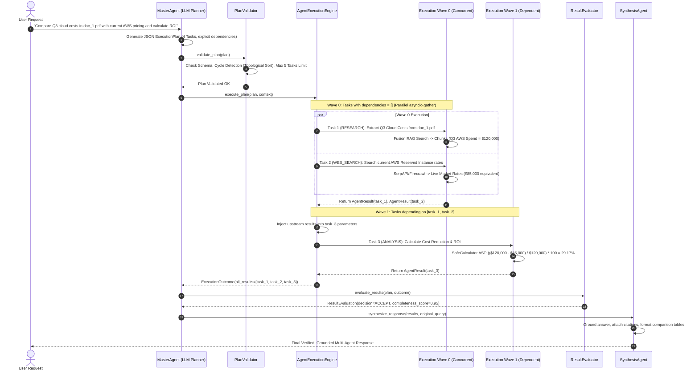

---

## 9. Authentication, Token Rotation & Replay Attack Defense Sequence

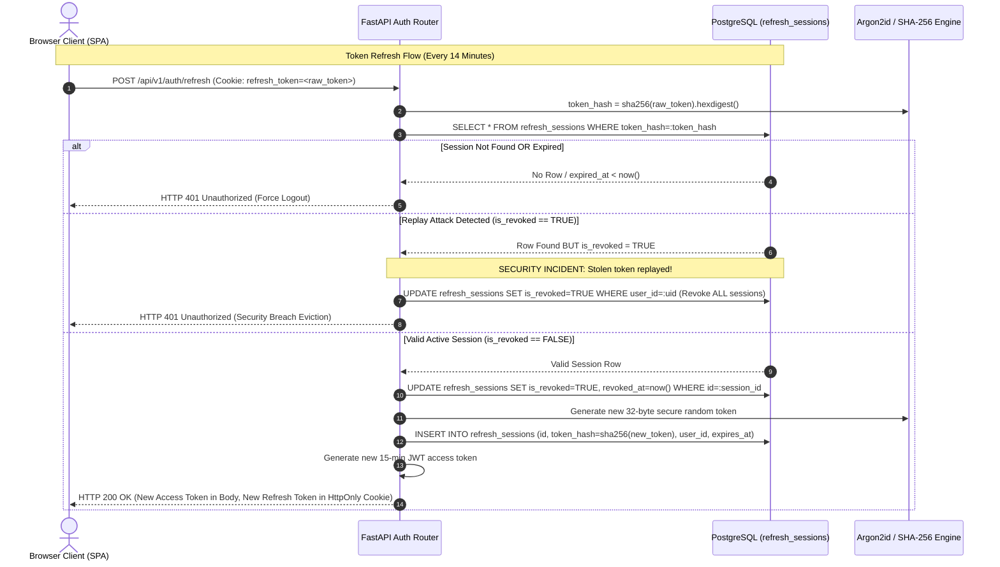

---

## 10. Transactional Outbox Pattern & Event Bus Sequence

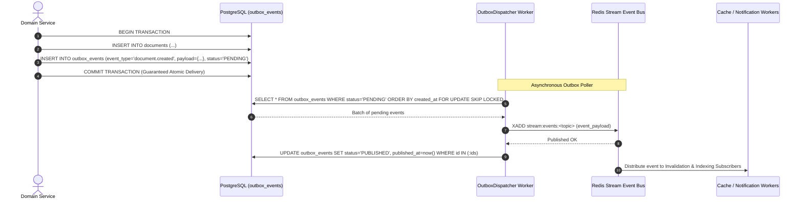

---

## 11. Knowledge Graph Extraction & Multi-Hop Traversal Sequence

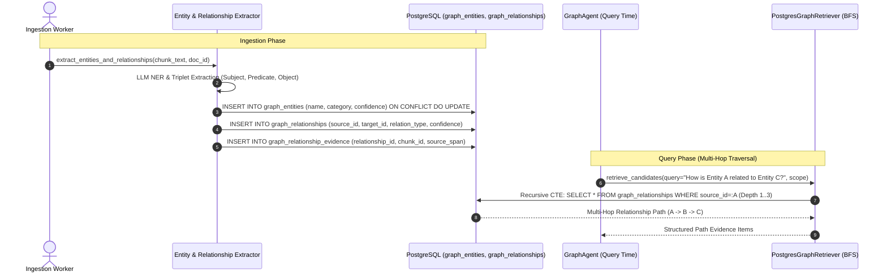

---

# Part III: Complete Specialist Agent System Architecture & Implementations

## 12. Multi-Agent Topology & Comprehensive Specialist Classification Matrix

The platform implements **16 specialized agents, evaluators, and orchestrators** organized into three distinct tiers:
1. **Control & Coordination Tier**: Master planning, plan validation, topological execution, and adaptive strategy routing.
2. **Specialist Execution Tier**: Dedicated domain experts for text research, document inspection, deterministic math, web search, tables, diagrams/vision, and knowledge graphs.
3. **Evaluation & Synthesis Tier**: Completeness scoring, evidence gating, citation grounding, and final answer generation.

```
========================================================================================================================
                                     COMPREHENSIVE SPECIALIST AGENT MATRIX
========================================================================================================================
Agent Name          File Location                                      Primary Capabilities & Tools
------------------------------------------------------------------------------------------------------------------------
1. MasterAgent      app/chat/services/multi_agent/master_agent.py      LLM DAG Planner, Bounded Replanner, Domain Context Gate
2. ExecutionEngine  app/chat/services/multi_agent/execution_engine.py  Topological Wave Executor, Async Sorter, Timeout Guard
3. ResearchAgent    app/chat/services/multi_agent/research_agent.py    Decomposed Sub-Query Search, Hybrid RAG, Provenance Deduplication
4. ResearchPlanner  app/chat/services/multi_agent/research_planner.py  Pure Sub-Query DAG Planner (Zero I/O)
5. DocumentAgent    app/chat/services/multi_agent/document_agent.py    UUID Inspection, Chunk Lookup, Scoped Document Listing
6. AnalysisAgent    app/chat/services/multi_agent/analysis_agent.py    Deterministic SafeCalculator AST, SymPy MathEngine, Python Scripts
7. WebSearchAgent   app/chat/services/multi_agent/web_search_agent.py  SerpAPI -> Firecrawl -> DuckDuckGo Cascade, Snippet Extractor
8. TableAgent       app/chat/services/multi_agent/table_agent.py       TableProcessor, Markdown/CSV Parsers, Column Aggregations (SUM/AVG)
9. VisionAgent      app/chat/services/multi_agent/vision_agent.py      VisionProcessor, Multimodal Diagram/Chart OCR via Gemini Vision
10. GraphAgent      app/chat/services/multi_agent/graph_agent.py       PostgresGraphRetriever, Entity Relationship Traversal, Multi-Hop
11. SynthesisAgent  app/chat/services/multi_agent/synthesis_agent.py   Evidence Grounding, Refusal Faithfulness, Citation Tagging
12. ResultEvaluator app/chat/services/multi_agent/result_evaluator.py  LLM-as-Judge Result Scoring (0.0-1.0), Accept/Replan Decisions
13. PlanValidator   app/chat/services/multi_agent/plan_validator.py    Schema Validator, Topological Cycle Detector, Whitelist Guard
14. TaskRouter      app/chat/services/multi_agent/task_router.py       Capability Matching, Cost/Latency Constraint Router
15. CapabilityReg   app/chat/services/multi_agent/capability_registry.py Domain Definitions, Tool Whitelists, Token Limit Budgets
16. AgentExecutor   app/chat/services/agent_executor.py                Single-Agent Function Calling Loop (7 Registered Tools)
========================================================================================================================
```

---

## 13. MasterAgent: Hierarchical Planner, Replanner & Evidence Gating

### 13.1 Architectural Responsibilities & Workflow
The `MasterAgent` in [master_agent.py](file:///d:/fun/FusionRAG/backend/app/chat/services/multi_agent/master_agent.py) acts as the central brain of the multi-agent system:
1. **User Intent Analysis & DAG Decomposition**: Translates high-level multi-step requests into an `ExecutionPlan` JSON schema specifying tasks and explicit dependencies.
2. **Schema & Policy Validation**: Passes the plan to `PlanValidator` to guarantee topological consistency, absence of cyclic dependencies, and adherence to `MAX_SPECIALIST_TASKS=5`.
3. **Execution Delegation**: Dispatches validated plans **exclusively** to `AgentExecutionEngine`. `MasterAgent` never executes specialist tools directly.
4. **Result Quality Evaluation & Bounded Replanning**: Analyzes execution outcomes using `ResultEvaluator`. If a task fails or evidence is insufficient, it generates a delta execution plan for failed tasks only, preserving successful results up to `MAX_PLAN_ITERATIONS=2`.
5. **Domain Context Evidence Gating**: Executes `_apply_evidence_relevance_gate()` to filter out off-domain or conflicting findings before passing context to `SynthesisAgent`.

### 13.2 Core MasterAgent Implementation

```python
# Reference: backend/app/chat/services/multi_agent/master_agent.py
class MasterAgent:
    def __init__(
        self,
        llm_provider: LLMProvider,
        execution_engine: AgentExecutionEngine,
        synthesis_agent: SynthesisAgent,
        result_evaluator: ResultEvaluator | None = None,
        max_plan_iterations: int = 2,
    ) -> None:
        self.llm_provider = llm_provider
        self.execution_engine = execution_engine
        self.synthesis_agent = synthesis_agent
        self.result_evaluator = result_evaluator or ResultEvaluator(llm_provider=llm_provider)
        self.max_plan_iterations = max_plan_iterations

    async def execute_request(
        self, request: str, context: AgentExecutionContext
    ) -> MultiAgentResponse:
        # 1. Generate structured execution plan
        plan = await self._generate_plan(request, context)

        # 2. Validate plan schema and dependencies
        errors = self.execution_engine.validate_plan(plan)
        if errors:
            raise PlanValidationError(f"Invalid execution plan: {'; '.join(errors)}")

        completed_results: dict[str, AgentResult] = {}
        iteration = 0

        # 3. Bounded Replanning Loop
        while iteration < self.max_plan_iterations:
            iteration += 1
            # Execute wave DAG
            outcome = await self.execution_engine.execute_plan(plan, context)
            for res in outcome.completed_results:
                completed_results[res.task_id] = res

            # Evaluate task results
            eval_decision = await self.result_evaluator.evaluate(plan, list(completed_results.values()), context)
            if eval_decision.decision == EvaluationDecision.ACCEPT:
                break

            # Generate delta replan for missing or failed tasks
            plan = await self._generate_replan(request, list(completed_results.values()), eval_decision, context)

        # 4. Evidence Relevance Gating
        gated_results, rejected_count = self._apply_evidence_relevance_gate(
            list(completed_results.values()), context
        )

        # 5. Synthesize final grounded answer
        return await self.synthesis_agent.synthesize(
            SynthesisRequest(original_query=request, specialist_results=gated_results, context=context)
        )
```

---

## 14. AgentExecutionEngine: Topological Wave Executor & Concurrency Controller

### 14.1 Topological Wave Sorting & Async Execution
The `AgentExecutionEngine` in [execution_engine.py](file:///d:/fun/FusionRAG/backend/app/chat/services/multi_agent/execution_engine.py) schedules tasks based on dependency graphs:
1. Calculates in-degrees for all tasks based on their `dependencies: list[str]`.
2. Groups independent tasks (in-degree = 0) into **Wave 0**.
3. Executes Wave 0 tasks concurrently via `asyncio.gather()`.
4. As Wave 0 tasks finish, injects their output evidence into dependent tasks in **Wave 1**, decrements in-degrees, and executes the next wave.
5. Enforces per-task timeouts (`task_timeout=20.0s`) using `asyncio.wait_for()`.

```python
# Reference: backend/app/chat/services/multi_agent/execution_engine.py
class AgentExecutionEngine:
    async def execute_plan(
        self, plan: ExecutionPlan, context: AgentExecutionContext
    ) -> ExecutionOutcome:
        waves = self._build_execution_waves(plan.tasks)
        completed_results: list[AgentResult] = []
        accumulated_evidence: dict[str, AgentResult] = {}

        for wave_idx, wave in enumerate(waves):
            # Inject upstream results into current wave parameters
            for task in wave:
                self._propagate_dependencies(task, accumulated_evidence)

            # Concurrent execution of current wave
            tasks_coros = [
                self._execute_single_task_with_timeout(task, context)
                for task in wave
            ]
            wave_results = await asyncio.gather(*tasks_coros, return_exceptions=False)

            for res in wave_results:
                completed_results.append(res)
                accumulated_evidence[res.task_id] = res

        return ExecutionOutcome(completed_results=completed_results)
```

---

## 15. ResearchAgent & ResearchPlanner: Sub-Query Decomposition & KB Retrieval

### 15.1 ResearchAgent Mechanics
Located in [research_agent.py](file:///d:/fun/FusionRAG/backend/app/chat/services/multi_agent/research_agent.py):
- **Decomposition**: Uses `ResearchPlanner` to break complex research topics into 1-4 targeted sub-queries.
- **Deduplication**: Computes cosine similarity across sub-query embeddings; discards queries with $\text{similarity} > 0.85$ to avoid redundant retrievals.
- **Hybrid Retrieval**: Executes full Hybrid RAG (Qdrant Dense + PostgreSQL FTS + RRF + MMR + Reranker) for each sub-query.
- **Conflicting Evidence Detection**: Applies heuristics and semantic checks (`_detect_conflicting_evidence()`) to flag contradictory claims across retrieved chunks.

---

## 16. DocumentAgent: Explicit Document & Chunk Inspection Specialist

### 16.1 Document Inspection & Metadata Retrieval
Located in [document_agent.py](file:///d:/fun/FusionRAG/backend/app/chat/services/multi_agent/document_agent.py):
- **Document Scoping**: Lists available documents filtered by `user_id` and active `conversation_id`.
- **Direct UUID Fetching**: Looks up exact document chunks and structural metadata directly from PostgreSQL by UUID.
- **Authorization Fencing**: Rejects requests attempting to access documents outside the user's authorized scope.

---

## 17. AnalysisAgent: Deterministic Math, AST Sandboxing, SymPy & MathEngine

### 17.1 Detailed MathEngine Subsystems (`app/core/math/engine.py`)
Located in [engine.py](file:///d:/fun/FusionRAG/backend/app/core/math/engine.py):
- **`FinancialMathSubsystem`**:
  - `cagr(beginning_value, ending_value, periods)`: Compound annual growth rate calculation.
  - `net_present_value(discount_rate, cash_flows)`: NPV derivation across series.
  - `internal_rate_of_return(cash_flows)`: Exact IRR computation via Newton-Raphson approximation.
  - `loan_amortization(principal, rate, periods)`: Complete monthly principal and interest schedule.
  - `wacc(equity, debt, cost_of_equity, cost_of_debt, tax_rate)`: Weighted average cost of capital.
- **`StatisticalNumericalSubsystem`**:
  - Descriptive statistics (mean, median, variance, standard deviation, skewness, kurtosis).
  - Hypothesis testing (two-sample t-test, one-way ANOVA, Mann-Whitney U rank test).
  - Curve fitting (`curve_fit` for linear, polynomial, logarithmic, and exponential regressions).
- **`LaTeXStepFormatter`**: Emits step-by-step mathematical derivations formatted in KaTeX-compatible LaTeX expressions.
- **AST SafeCalculator**: AST expression parser validating nodes against whitelisted math operations (`abs`, `round`, `sum`, `min`, `max`, `pow`).

---

## 18. WebSearchAgent: Real-Time Multi-Provider Web Search Cascade

### 18.1 Live Web Ingestion & Multi-Provider Cascade
Located in [web_search_agent.py](file:///d:/fun/FusionRAG/backend/app/chat/services/multi_agent/web_search_agent.py):
- **Automated Failover Cascade**: Tries primary provider **SerpAPI** $\rightarrow$ falls back to **Firecrawl** $\rightarrow$ falls back to **DuckDuckGo**.
- **Provenance & Snippets**: Extracts top 5 web results, formats them with title, URL, and snippet text, and generates deterministic UUIDv5 `EvidenceItem` records.

---

## 19. TableAgent: Tabular Data Extraction & Column Aggregations

### 19.1 TableProcessor & Structured Tabular Reasoning
Located in [table_agent.py](file:///d:/fun/FusionRAG/backend/app/chat/services/multi_agent/table_agent.py):
- **Parsers**: Native support for Markdown table strings and CSV format data via `TableProcessor`.
- **Column Aggregations**: Executes deterministic calculations across extracted table columns (`SUM`, `AVG`, `MIN`, `MAX`, `COUNT`).
- **Structured Evidence**: Emits dimensional metadata (`row_count x col_count`) and markdown table summaries into `EvidenceItem`.

---

## 20. VisionAgent: Multimodal Visual Reasoning & Chart Inspection

### 20.1 VisionProcessor & Diagram Inspection
Located in [vision_agent.py](file:///d:/fun/FusionRAG/backend/app/chat/services/multi_agent/vision_agent.py):
- **Multimodal Visual Analysis**: Accepts raw image bytes from documents or uploads and calls `VisionProcessor` backed by Gemini Vision API.
- **Element Classification**: Classifies visual elements (`FIGURE`, `CHART`, `DIAGRAM`, `TABLE_SNAPSHOT`), extracting textual descriptions and data points into structured evidence.

---

## 21. GraphAgent: Knowledge Graph Traversal & Entity Relationship Reasoning

### 21.1 PostgresGraphRetriever & Entity Traversal
Located in [graph_agent.py](file:///d:/fun/FusionRAG/backend/app/chat/services/multi_agent/graph_agent.py):
- **Entity Relationship Reasoning**: Interfaces with `PostgresGraphRetriever` to traverse relational knowledge graph edges.
- **Cross-Document Multi-Hop**: Discovers indirect relationships between entities across distinct document boundaries with confidence scoring.

---

## 22. SynthesisAgent: Context Grounding, Citation Tagging & Refusal Faithfulness

### 22.1 Grounded Answer Generation & Citation Attribution
Located in [synthesis_agent.py](file:///d:/fun/FusionRAG/backend/app/chat/services/multi_agent/synthesis_agent.py):
- **Strict Evidence Integrity**: Constructs responses using **only** successful specialist results and verified `EvidenceItem` chunks.
- **Refusal Faithfulness**: Enforces explicit refusal statements when evidence is missing, conflicting, or inconclusive for factual queries.
- **Citation Attribution**: Maps facts to inline document citations with source titles, URLs, and page numbers.
- **Untrusted Context Fencing**: Treats all evidence as untrusted external data, neutralizing indirect prompt injection attacks.

---

## 23. ResultEvaluator: Task Quality Scoring & Adaptive Replanning Engine

### 23.1 LLM-as-Judge Task Verification
Located in [result_evaluator.py](file:///d:/fun/FusionRAG/backend/app/chat/services/multi_agent/result_evaluator.py):
- **Completeness & Evidence Scoring**: Evaluates completed task outputs against `expected_outputs` and `required_evidence`, generating a score between $0.0$ and $1.0$.
- **Decision Engine**: Emits `ACCEPT` (score $\ge 0.85$), `REPLAN` (score $< 0.85$ and replan budget remains), or `FAIL`.

---

## 24. PlanValidator: Schema, Cycle Detection & Constraint Enforcement

### 24.1 Structural Validation Rules
Located in [plan_validator.py](file:///d:/fun/FusionRAG/backend/app/chat/services/multi_agent/plan_validator.py):
- **Schema Validation**: Guarantees all required fields (`task_id`, `agent_type`, `request`, `dependencies`) exist and are non-empty.
- **Topological Cycle Detection**: Performs depth-first search / Kahn's algorithm; rejects plans containing cyclic deadlocks.
- **Task Limit Enforcement**: Enforces `MAX_SPECIALIST_TASKS = 5` to prevent runaway LLM costs.

---

## 25. TaskRouter & CapabilityRegistry: Capability-Aware Cost/Latency Routing

### 25.1 Semantic Capability Mapping
Located in [task_router.py](file:///d:/fun/FusionRAG/backend/app/chat/services/multi_agent/task_router.py) and [capability_registry.py](file:///d:/fun/FusionRAG/backend/app/chat/services/multi_agent/capability_registry.py):
- Maintains a registry of agent capabilities, allowed parameters, and tool whitelists.
- Routes sub-tasks to the optimal agent while verifying that cost units and latency budgets are respected.

---

## 26. AgentExecutor: Single-Agent Function/Tool Calling Loop & 7 Core Tools

### 26.1 Single-Agent Function Calling Loop
Located in [agent_executor.py](file:///d:/fun/FusionRAG/backend/app/chat/services/agent_executor.py):
- Runs a standalone function-calling loop with Gemini LLM when multi-agent mode is disabled or for direct single-agent execution.
- **7 Registered Tools**:
  1. `SafeCalculator`: AST arithmetic evaluator.
  2. `WebSearchTool`: Live internet search.
  3. `SemanticSearchTool`: Qdrant dense vector search.
  4. `ChunkRetrievalTool`: Direct chunk fetch by UUID.
  5. `DocumentRetrievalTool`: Document metadata fetch.
  6. `CitationLookupTool`: Source verification.
  7. `DateTimeTool`: Current UTC/local timestamps.

---

## 27. Multi-Agent Operational Subsystems: Health Diagnostics, Title Generator & Retention

### 27.1 Multi-Agent Health Diagnostics (`health_diagnostics.py`)
- **Heartbeat & Liveness Scoring**: Monitors background specialist health and records per-agent latency distributions.
- **Degraded-Agent Auto-Bypass**: If a specialist agent fails consecutively or exceeds timeouts ($N \ge 3$), `HealthDiagnostics` marks the agent status as `DEGRADED`, causing `TaskRouter` to automatically fall back to single-pass hybrid retrieval or general research agents.

### 27.2 Automated Conversation Title Generation (`title_generator.py`)
- **Non-Blocking Background Execution**: Triggered asynchronously after turn 1 of a new conversation.
- **Heuristic Fast-Path**: If the first user query is short ($\le 6$ words), extracts a clean TitleCase title directly via regex. For complex queries, invokes a fast LLM prompt (`"Summarize into a 3-5 word title"`) in the background, updating `conversations.title` without delaying token streaming.

### 27.3 Conversation Data Retention & Archival (`retention_service.py`)
- **Automated Lifecycle Policy**: Sweeps conversations older than `MAX_CONVERSATION_AGE_DAYS=90`. Inactive conversations are marked `is_archived=TRUE`, and orphaned summaries are pruned to maintain high database indexing performance.

---

# Part IV: Complete Relational Database Schema & Data Models (All 23 PostgreSQL Tables)

## 28. Relational Architecture, Entity-Relationship Diagram (ERD) & Bounded Contexts

### 28.1 Architecture & Overview
The relational database architecture is implemented in PostgreSQL 16 using SQLAlchemy 2.0 async ORM and `asyncpg`. The 23 tables are partitioned into 6 distinct bounded contexts.

### 28.2 Database Entity-Relationship Diagram (ERD)

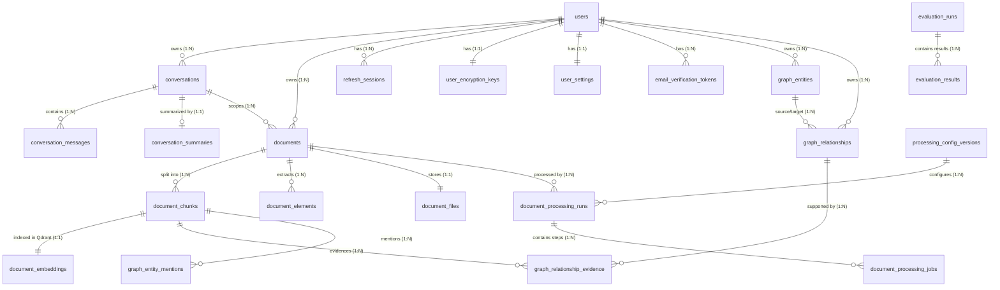

```
========================================================================================================================
                                     23 POSTGRESQL RELATIONAL TABLES OVERVIEW
========================================================================================================================
Bounded Context                 Table Name                    Primary Purpose & Business Role
------------------------------------------------------------------------------------------------------------------------
1. Auth & Security (5)          users                         User identity, Argon2id password hash, role, status flags
                                refresh_sessions              SHA-256 hashed refresh tokens, revocation flags, audit IP
                                user_encryption_keys          Wrapped per-user Data Encryption Keys (DEKs, AES-256-GCM)
                                email_verification_tokens     SHA-256 tokens & OTP codes for signup verification
                                user_settings                 JSONB folders, pinned items, and user preferences
------------------------------------------------------------------------------------------------------------------------
2. Chat & Conversation (3)      conversations                 Thread state, optimistic lock version, active doc filters
                                conversation_messages         Role, content, JSONB citations, attachments, tool traces
                                conversation_summaries        Rolling window context summarization range spans
------------------------------------------------------------------------------------------------------------------------
3. Document Pipeline (9)        documents                     Scope, versioning, checksum, status, MIME, language
                                document_files                Key-value binary BLOB storage for database-backed files
                                document_chunks               Chunk text, chunk index, tsvector GIN search vector
                                document_embeddings           Vector dimension, Jina v3 contract, Qdrant point IDs
                                document_elements             Structural elements (tables/figures) with bounding boxes
                                processing_config_versions    Chunk size, overlap, semantic split parameters
                                document_processing_runs      High-level document processing pipeline runs
                                document_processing_jobs      Granular step jobs with lease tokens & heartbeats
                                durable_cleanup_jobs          2PC cleanup ledger for cascading S3/Qdrant deletions
------------------------------------------------------------------------------------------------------------------------
4. Knowledge Graph (4)          graph_entities                Extracted entities, categories, confidence scores
                                graph_relationships           Directed entity-to-entity relations (predicates)
                                graph_relationship_evidence   Chunk spans supporting specific graph relationships
                                graph_entity_mentions         Exact character & chunk offsets of entity occurrences
------------------------------------------------------------------------------------------------------------------------
5. Transactional Outbox (1)     outbox_events                 Atomic domain event log for guaranteed message publishing
------------------------------------------------------------------------------------------------------------------------
6. Automated Evaluation (3)     evaluation_runs               Evaluation suite execution metadata and status
                                evaluation_results            Metric scores per QA sample (Faithfulness, Precision)
                                benchmark_runs                Synthetic dataset benchmark performance histories
========================================================================================================================
```

---

## 29. Authentication & Security Context (5 Tables)

### 29.1 `users` Table
- `id` (UUID, Primary Key, default `gen_random_uuid()`)
- `email` (VARCHAR(255), Unique, Indexed)
- `hashed_password` (VARCHAR(255), Nullable for OAuth users)
- `role` (VARCHAR(50), default `'user'`) — `user`, `admin`
- `is_active` (BOOLEAN, default `TRUE`, Indexed)
- `is_verified` (BOOLEAN, default `FALSE`, Indexed)
- `oauth_provider` (VARCHAR(50), Nullable) — `google`, `github`
- `oauth_sub` (VARCHAR(255), Nullable, Indexed)
- `created_at` (TIMESTAMPTZ, default `now()`)
- `updated_at` (TIMESTAMPTZ, default `now()`)

### 29.2 `refresh_sessions` Table
- `id` (UUID, Primary Key)
- `user_id` (UUID, Foreign Key $\rightarrow$ `users.id` ON DELETE CASCADE, Indexed)
- `token_hash` (VARCHAR(64), Unique, Indexed) — SHA-256 hash of raw refresh token
- `ip_address` (VARCHAR(45))
- `user_agent` (TEXT)
- `is_revoked` (BOOLEAN, default `FALSE`, Indexed)
- `revoked_at` (TIMESTAMPTZ, Nullable)
- `expires_at` (TIMESTAMPTZ, Indexed)
- `created_at` (TIMESTAMPTZ, default `now()`)

### 29.3 `user_encryption_keys` Table
- `id` (UUID, Primary Key)
- `user_id` (UUID, Unique, Foreign Key $\rightarrow$ `users.id` ON DELETE CASCADE)
- `wrapped_dek` (BYTEA) — AES-256-GCM encrypted Data Encryption Key
- `key_version` (INTEGER, default `1`)
- `created_at` (TIMESTAMPTZ, default `now()`)
- `rotated_at` (TIMESTAMPTZ, Nullable)

### 29.4 `email_verification_tokens` Table
- `id` (UUID, Primary Key)
- `user_id` (UUID, Foreign Key $\rightarrow$ `users.id` ON DELETE CASCADE, Indexed)
- `token_hash` (VARCHAR(64), Unique, Indexed)
- `otp_code` (VARCHAR(6), Nullable) — 6-digit one-time password
- `attempts` (INTEGER, default `0`)
- `expires_at` (TIMESTAMPTZ)
- `is_used` (BOOLEAN, default `FALSE`)
- `used_at` (TIMESTAMPTZ, Nullable)

### 29.5 `user_settings` Table
- `user_id` (UUID, Primary Key, Foreign Key $\rightarrow$ `users.id` ON DELETE CASCADE)
- `folders` (JSONB, default `'[]'`)
- `pinned_conversations` (JSONB, default `'[]'`)
- `conversation_tags` (JSONB, default `'{}'`)
- `document_folders` (JSONB, default `'[]'`)
- `document_folder_mappings` (JSONB, default `'{}'`)
- `document_custom_order` (JSONB, default `'[]'`)
- `document_filter_presets` (JSONB, default `'[]'`)
- `preferences` (JSONB, default `'{}'`) — Theme, default model, system prompt

---

## 30. Chat & Conversation Context (3 Tables)

### 30.1 `conversations` Table
- `id` (UUID, Primary Key)
- `user_id` (UUID, Foreign Key $\rightarrow$ `users.id` ON DELETE CASCADE, Indexed)
- `title` (VARCHAR(255), default `'New Conversation'`)
- `state` (VARCHAR(50), default `'active'`, Indexed) — `active`, `archived`
- `settings_json` (JSONB, default `'{}'`)
- `metadata_json` (JSONB, default `'{}'`) — Folder ID, pinned flags, tags
- `version` (INTEGER, default `1`) — Optimistic Concurrency Control
- `last_message_at` (TIMESTAMPTZ, default `now()`, Indexed)
- `created_at` (TIMESTAMPTZ, default `now()`)
- `updated_at` (TIMESTAMPTZ, default `now()`, Indexed)

### 30.2 `conversation_messages` Table
- `id` (UUID, Primary Key)
- `conversation_id` (UUID, Foreign Key $\rightarrow$ `conversations.id` ON DELETE CASCADE, Indexed)
- `role` (VARCHAR(20)) — `user`, `assistant`, `system`
- `content` (TEXT)
- `status` (VARCHAR(50), default `'completed'`)
- `attachments` (JSONB, default `'[]'`) — Multimodal files and document pointers
- `citations` (JSONB, default `'[]'`)
- `structured_content` (JSONB, default `'{}'`)
- `tool_calls` (JSONB, default `'[]'`)
- `metadata_json` (JSONB, default `'{}'`)
- `prompt_tokens` (INTEGER, default `0`)
- `completion_tokens` (INTEGER, default `0`)
- `execution_duration_ms` (FLOAT, default `0.0`)
- `created_at` (TIMESTAMPTZ, default `now()`, Indexed)

### 30.3 `conversation_summaries` Table
- `id` (UUID, Primary Key)
- `conversation_id` (UUID, Unique, Foreign Key $\rightarrow$ `conversations.id` ON DELETE CASCADE)
- `summary` (TEXT)
- `summary_version` (INTEGER, default `1`)
- `covered_from_message_id` (UUID, Nullable, Foreign Key $\rightarrow$ `conversation_messages.id`)
- `covered_until_message_id` (UUID, Nullable, Foreign Key $\rightarrow$ `conversation_messages.id`)
- `message_count` (INTEGER, default `0`)
- `created_at` (TIMESTAMPTZ, default `now()`)

---

## 31. Document Ingestion, Chunks & Storage Context (9 Tables)

### 31.1 `documents` Table
- `id` (UUID, Primary Key)
- `user_id` (UUID, Foreign Key $\rightarrow$ `users.id` ON DELETE CASCADE, Indexed)
- `conversation_id` (UUID, Foreign Key $\rightarrow$ `conversations.id` ON DELETE SET NULL, Nullable, Indexed)
- `scope` (VARCHAR(20), default `'library'`) — `library`, `conversation`
- `filename` (VARCHAR(255))
- `original_filename` (VARCHAR(255))
- `file_size` (BIGINT)
- `content_type` (VARCHAR(100))
- `checksum` (VARCHAR(64), Indexed) — SHA-256 file content hash
- `status` (VARCHAR(50), default `'queued'`, Indexed) — `queued`, `processing`, `completed`, `failed`
- `version` (INTEGER, default `1`)
- `active_version` (INTEGER, default `1`)
- `active_processing_config_version_id` (UUID, Nullable)
- `extractor_version` (VARCHAR(50), default `'v1'`)
- `failure_reason` (TEXT, Nullable)
- `word_count` (INTEGER, default `0`)
- `language` (VARCHAR(10), default `'en'`)
- `page_count` (INTEGER, default `0`)
- `processing_started_at` (TIMESTAMPTZ, Nullable)
- `processing_completed_at` (TIMESTAMPTZ, Nullable)
- `created_at` (TIMESTAMPTZ, default `now()`)

### 31.2 `document_files` Table
- `key` (VARCHAR(1024), Primary Key) — Unique storage key identifier
- `content` (BYTEA) — Large binary file data

### 31.3 `document_chunks` Table
- `id` (UUID, Primary Key)
- `document_id` (UUID, Foreign Key $\rightarrow$ `documents.id` ON DELETE CASCADE, Indexed)
- `chunk_index` (INTEGER)
- `text` (TEXT)
- `token_count` (INTEGER)
- `parent_chunk_id` (UUID, Nullable, Foreign Key $\rightarrow$ `document_chunks.id`)
- `page_number` (INTEGER, Nullable)
- `search_vector` (TSVECTOR, Generated Stored, GIN Indexed) — PostgreSQL FTS
- `created_at` (TIMESTAMPTZ, default `now()`)

### 31.4 `document_embeddings` Table
- `id` (UUID, Primary Key)
- `chunk_id` (UUID, Unique, Foreign Key $\rightarrow$ `document_chunks.id` ON DELETE CASCADE)
- `embedding_provider` (VARCHAR(50), default `'jina-embeddings-v3'`)
- `dimensions` (INTEGER, default `768`)
- `qdrant_point_id` (VARCHAR(64), Indexed)
- `status` (VARCHAR(50), default `'completed'`)

### 31.5 `document_elements` Table
- `id` (UUID, Primary Key)
- `document_id` (UUID, Foreign Key $\rightarrow$ `documents.id` ON DELETE CASCADE, Indexed)
- `element_index` (INTEGER)
- `parent_element_id` (UUID, Nullable)
- `element_type` (VARCHAR(50)) — `table`, `figure`, `image`, `header`
- `content` (TEXT)
- `normalized_content` (TEXT, Nullable)
- `bounding_box_json` (JSONB, default `'{}'`)
- `metadata_json` (JSONB, default `'{}'`)
- `page_number` (INTEGER)
- `search_vector` (TSVECTOR, Generated Stored, GIN Indexed)

### 31.6 `processing_config_versions` Table
- `id` (UUID, Primary Key)
- `version_name` (VARCHAR(50))
- `chunk_size` (INTEGER, default `500`)
- `chunk_overlap` (INTEGER, default `50`)
- `semantic_threshold` (FLOAT, default `0.85`)
- `is_active` (BOOLEAN, default `TRUE`)

### 31.7 `document_processing_runs` Table
- `id` (UUID, Primary Key)
- `document_id` (UUID, Foreign Key $\rightarrow$ `documents.id` ON DELETE CASCADE, Indexed)
- `config_version_id` (UUID, Foreign Key $\rightarrow$ `processing_config_versions.id`)
- `status` (VARCHAR(50))
- `duration_ms` (FLOAT)

### 31.8 `document_processing_jobs` Table
- `id` (UUID, Primary Key)
- `run_id` (UUID, Foreign Key $\rightarrow$ `document_processing_runs.id` ON DELETE CASCADE, Indexed)
- `job_type` (VARCHAR(50)) — `extraction`, `chunking`, `embedding`, `graph_ner`
- `idempotency_key` (VARCHAR(255), Unique, Indexed)
- `lease_token` (VARCHAR(64), Nullable)
- `lease_expires_at` (TIMESTAMPTZ, Nullable)
- `heartbeat_at` (TIMESTAMPTZ, Nullable)
- `status` (VARCHAR(50))
- `attempts` (INTEGER, default `0`)
- `last_error` (TEXT, Nullable)

### 31.9 `durable_cleanup_jobs` Table
- `id` (UUID, Primary Key)
- `resource_type` (VARCHAR(50)) — `document`, `conversation`, `user`
- `resource_id` (UUID, Indexed)
- `s3_path` (VARCHAR(1024), Nullable)
- `qdrant_filter_json` (JSONB, Nullable)
- `status` (VARCHAR(50), default `'PENDING'`, Indexed)
- `attempts` (INTEGER, default `0`)

---

## 32. Knowledge Graph Context (4 Tables)

### 32.1 `graph_entities` Table
- `id` (UUID, Primary Key)
- `name` (VARCHAR(255), Indexed)
- `category` (VARCHAR(100), Indexed) — `PERSON`, `ORGANIZATION`, `METRIC`, `LOCATION`, `CONCEPT`
- `confidence` (FLOAT, default `1.0`)
- `user_id` (UUID, Foreign Key $\rightarrow$ `users.id` ON DELETE CASCADE, Indexed)

### 32.2 `graph_relationships` Table
- `id` (UUID, Primary Key)
- `source_entity_id` (UUID, Foreign Key $\rightarrow$ `graph_entities.id` ON DELETE CASCADE, Indexed)
- `target_entity_id` (UUID, Foreign Key $\rightarrow$ `graph_entities.id` ON DELETE CASCADE, Indexed)
- `relation_type` (VARCHAR(100), Indexed) — `OWNS`, `CALCULATES`, `COMPARES`, `PART_OF`
- `confidence` (FLOAT, default `1.0`)
- `user_id` (UUID, Foreign Key $\rightarrow$ `users.id` ON DELETE CASCADE, Indexed)

### 32.3 `graph_relationship_evidence` Table
- `id` (UUID, Primary Key)
- `relationship_id` (UUID, Foreign Key $\rightarrow$ `graph_relationships.id` ON DELETE CASCADE, Indexed)
- `chunk_id` (UUID, Foreign Key $\rightarrow$ `document_chunks.id` ON DELETE CASCADE, Indexed)
- `document_id` (UUID, Foreign Key $\rightarrow$ `documents.id` ON DELETE CASCADE, Indexed)
- `source_span` (TEXT)
- `confidence` (FLOAT, default `1.0`)

### 32.4 `graph_entity_mentions` Table
- `id` (UUID, Primary Key)
- `entity_id` (UUID, Foreign Key $\rightarrow$ `graph_entities.id` ON DELETE CASCADE, Indexed)
- `chunk_id` (UUID, Foreign Key $\rightarrow$ `document_chunks.id` ON DELETE CASCADE, Indexed)
- `start_offset` (INTEGER)
- `end_offset` (INTEGER)

---

## 33. Transactional Outbox & Automated Evaluation Context (4 Tables)

### 33.1 `outbox_events` Table
- `id` (UUID, Primary Key)
- `event_type` (VARCHAR(100), Indexed) — `document.created`, `document.deleted`, `chat.completed`
- `payload` (JSONB)
- `status` (VARCHAR(50), default `'PENDING'`, Indexed) — `PENDING`, `PUBLISHED`, `FAILED`
- `retry_count` (INTEGER, default `0`)
- `created_at` (TIMESTAMPTZ, default `now()`, Indexed)
- `published_at` (TIMESTAMPTZ, Nullable)

### 33.2 `evaluation_runs` Table
- `id` (UUID, Primary Key)
- `run_name` (VARCHAR(255))
- `dataset_name` (VARCHAR(255), Indexed)
- `sample_count` (INTEGER)
- `overall_faithfulness` (FLOAT)
- `overall_relevancy` (FLOAT)
- `overall_precision` (FLOAT)
- `status` (VARCHAR(50), Indexed)
- `created_at` (TIMESTAMPTZ, default `now()`)

### 33.3 `evaluation_results` Table
- `id` (UUID, Primary Key)
- `run_id` (UUID, Foreign Key $\rightarrow$ `evaluation_runs.id` ON DELETE CASCADE, Indexed)
- `sample_id` (VARCHAR(100), Indexed)
- `query` (TEXT)
- `ground_truth` (TEXT)
- `generated_answer` (TEXT)
- `metrics_json` (JSONB) — Raw score breakdown for all 20 metrics

### 33.4 `benchmark_runs` Table
- `id` (UUID, Primary Key)
- `profile_name` (VARCHAR(100)) — `production`, `ci_gate`, `nightly`
- `baseline_version` (VARCHAR(50))
- `is_passed` (BOOLEAN)
- `degradation_delta` (FLOAT)
- `created_at` (TIMESTAMPTZ, default `now()`)

---

# Part V: Security, Reliability, Caching & Distributed Infrastructure

## 34. Envelope Encryption, Key Management & Crypto-Shredding (AES-256-GCM + DEK/KEK)

### 34.1 Mental Model & Flowchart
* **Master Key (KEK - Key Encryption Key)**: The server's 256-bit environment master key.
* **Data Encryption Key (DEK)**: A unique individual 256-bit key generated per user.
* **Wrapped DEK**: The user's individual key is encrypted using AES-256-GCM with the Master Key and safely stored in `user_encryption_keys.wrapped_dek`.
* **Cryptographic Shredding on Account Deletion**: When an account is deleted via `DELETE /api/v1/auth/account`, the wrapped DEK in `user_encryption_keys` is permanently purged. Without the DEK, all encrypted documents, chunks, and embeddings become mathematically irreversible noise, achieving instantaneous, provable compliance across database backups.

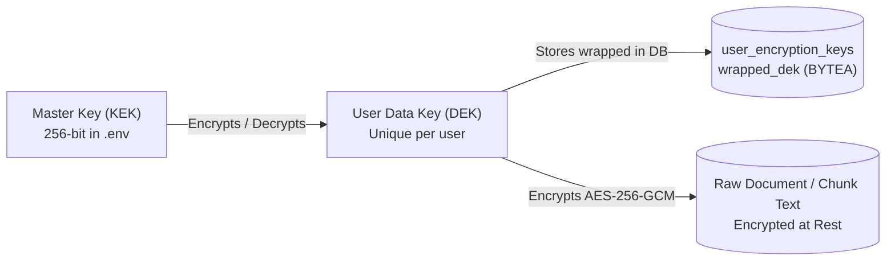

---

## 35. Malware & Antivirus Scanning (ClamAV TCP Streaming + EICAR)

Located in `backend/app/core/security/malware.py`:
- **Daemon Protocol**: Uploaded file bytes are streamed over a non-blocking TCP socket to `clamd` on port `3310` using the `INSTREAM` protocol.
- **Fail-Safe Fallback**: If ClamAV daemon is unreachable, the system executes an in-memory heuristic scanner checking for EICAR standard antivirus test signatures and suspicious executable magic bytes (`MZ`, `ELF`).

---

## 36. Prompt Injection Defense, Intent Guardrails & AST Sandboxing

Located in `backend/app/core/security/`:
- **Intent Classifier Guardrails (`intent_classifier.py`)**: Pre-retrieval classification blocking toxic, adversarial, or out-of-domain prompts before token consumption.
- **Heuristic Pattern Defense (`prompt_injection.py`)**: Evaluates incoming queries and retrieved documents against regex signatures for jailbreaks, prompt leaks (e.g., `"ignore previous instructions"`, `"system override"`), and markdown image data exfiltration.
- **AST SafeCalculator (`sandboxing.py`)**: Mathematical evaluation parser rejecting all dunder attributes and arbitrary calls.
- **Quota Tracker (`quotas.py`) & Secret Masker (`secrets.py`)**: Daily per-user token and storage tracking, plus PII/secret scrubbing.

---

## 37. Multi-Tier Caching (L1 Memory + L2 Redis) & Distributed Heartbeat Locking

### 37.1 Multi-Tier Cache Lifecycle Architecture (`app/core/cache/multi_tier.py`)

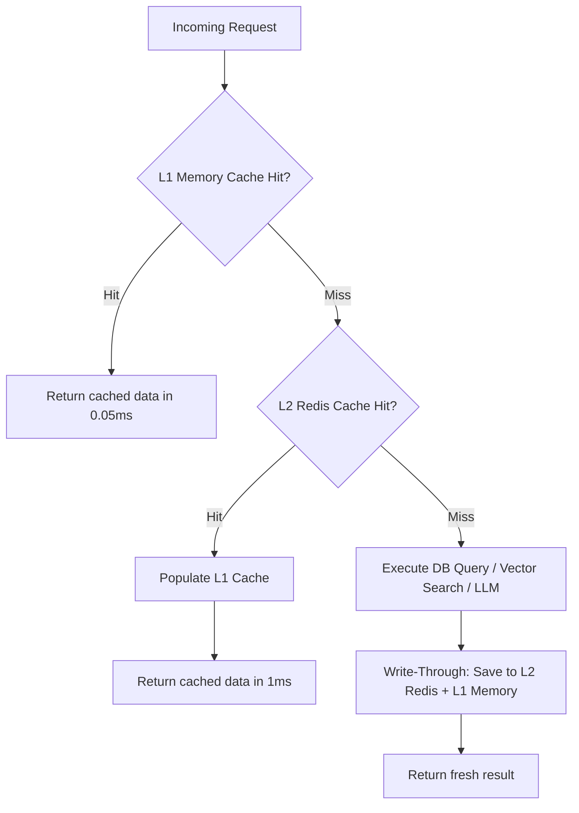

- **L1 In-Memory Cache**: Python `collections.OrderedDict` with LRU eviction ($N=1000$ entries, TTL=60s).
- **L2 Redis Cache**: Partitioned by namespace (`cache:embeddings:*`, `cache:exact_llm:*`, `cache:retrieval:*`, `cache:query_rewrite:*`).
- **Distributed Heartbeat Lock (`lock.py`)**: Mutex with background coroutine extending TTL during active long-running jobs.

---

## 38. Reliability Framework: Bulkheads, Circuit Breakers, Exponential Jitter Retries & Timeouts

### 38.1 Reliability Overview
Located in `backend/app/core/reliability/`:
1. **Bulkheads (`bulkhead.py`)**: Concurrency semaphores (`Gemini: Semaphore(20)`, `Jina Reranker: Semaphore(4)`, `Vision: Semaphore(3)`).

### 38.2 Circuit Breaker State Machine & Mental Model

```mermaid
stateDiagram-v2
    [*] --> CLOSED
    CLOSED --> OPEN : 5 consecutive failures
    note right of CLOSED : Normal operation: all requests pass through
    
    OPEN --> HALF_OPEN : 30s recovery timeout expires
    note right of OPEN : Fails fast immediately: 0 requests sent to LLM
    
    HALF_OPEN --> CLOSED : Probe request succeeds
    HALF_OPEN --> OPEN : Probe request fails
    note right of HALF_OPEN : Lets 1 test request through to check health
```

- **Retry Engine with Full Jitter (`retry.py`)**: Exponential backoff with full jitter.
- **Timeout Manager (`timeout.py`)**: Strict timeout bounds via `asyncio.wait_for()`.

---

## 39. Transactional Outbox Pattern, Event Bus & JobDispatcher Engine

Located in `backend/app/core/events/` and `backend/app/core/queue/`:
- **Transactional Outbox (`outbox_dispatcher.py`)**: Guaranteed message delivery through atomic PostgreSQL commits.
- **JobDispatcher & Handlers (`dispatcher.py`, `handlers.py`)**:
  - `ProcessDocumentJobHandler`: Manages extraction, chunking, and NER linking.
  - `GenerateEmbeddingsJobHandler`: Dispatches batch embeddings to Jina and upserts to Qdrant.
  - `SummarizeConversationJobHandler`: Executes asynchronous rolling summarization.
  - `InMemoryDurableTaskQueue`: Lightweight in-memory fallback for local testing and single-instance environments.

---

## 40. Storage Provider Abstraction & Two-Phase Durable Cleanup Worker

Located in `backend/app/documents/services/cleanup_worker.py` and `app/documents/infrastructure/storage.py`:
- **3 Storage Providers**:
  1. `database`: Storing binary bytes directly in PostgreSQL `document_files.content` (`BYTEA`).
  2. `local`: Writing files to `UPLOAD_DIR=data/uploads`.
  3. `s3`: Streaming objects to AWS S3 or MinIO buckets.
- **Two-Phase Durable Cleanup**: Performs a 2PC cascade delete across S3 object storage, Qdrant vector payload points, and PostgreSQL metadata rows.

---

## 41. Resend Email Service, Token Cost Pricing Engine & Dynamic Feature Flags

- **Resend Service (`resend_service.py`)**: Asynchronous transactional email delivery for magic links, activation OTPs, and password reset workflows.
- **Pricing Provider (`pricing_provider.py`)**: Exact per-token cost calculation engine tracking USD consumption across Gemini LLMs and Jina embeddings.
- **Dynamic Feature Flags (`flags.py`)**: Runtime toggle system controlling features (`ENABLE_SEMANTIC_CACHE`, `ENABLE_DISTRIBUTED_LOCKS`, `ENABLE_RATE_LIMITER`, `ENABLE_PARENT_CHILD_RAG`, `ENABLE_HYDE`).

---

## 42. Application Lifespan, Startup Hooks & Middleware Cardinality Defense

Located in `backend/app/main.py` and `backend/app/core/startup.py`:
- **Lifespan Startup Tasks**:
  - `seed_admin_user`: Idempotently creates default administrator credentials.
  - `cleanup_stale_unverified_signups`: Prunes expired unverified accounts.
  - `verify_alembic_migrations`: Verifies database schema revision matches the codebase.
  - Pre-warms Jina cross-encoder network sessions.
- **Middleware Cardinality Defense (`resolve_route_template()`)**: Replaces raw UUID path variables with normalized templates (`/api/v1/conversations/{id}`) before recording Prometheus metrics, preventing high-cardinality metric explosion.
- **Graceful Draining Guard**: Returns HTTP 503 (`SERVICE_DRAINING`) during shutdown while allowing in-flight streaming requests to finish.

---

# Part VI: Document Ingestion, Advanced Chunking & Knowledge Graph Pipeline

## 43. Advanced Chunking Strategies: Recursive, Parent-Child & Sentence-Window

Located in `backend/app/documents/services/chunking.py`:
1. **Recursive Character Chunking (Default)**: Splits text hierarchically on paragraph, sentence, and word boundaries (`chunk_size=500`, `chunk_overlap=50`).
2. **Parent-Child Chunking (`PARENT_CHUNK_SIZE=1500`, `CHILD_CHUNK_SIZE=400`)**: Creates small child chunks for embedding in Qdrant while linking them to parent chunks in PostgreSQL (`parent_chunk_id`).
3. **Sentence-Window Chunking (`SENTENCE_WINDOW_SIZE=2`)**: Indexes single sentences while attaching 2 preceding and 2 succeeding sentences as window context.

---

## 44. Empty Knowledge Base Index Cache & Weighted RRF Fusion

### 44.1 Empty Knowledge Base Index Cache (`index_cache.py`)
- Caches whether a `user_id` has completed indexed document chunks (`EMPTY_KB_CACHE_TTL_SECONDS=60.0`, `INDEX_CACHE_MAX_USERS=500`).
- If a user has 0 indexed chunks, bypasses expensive Qdrant and PostgreSQL GIN full-text searches.

### 44.2 Weighted Reciprocal Rank Fusion (`fusion.py`)
- Supports weighted scoring between dense vector rankings and sparse keyword rankings:
  $$\text{Score}_{\text{weighted}}(d) = w_{\text{dense}} \cdot \frac{1}{k + r_{\text{dense}}(d)} + w_{\text{sparse}} \cdot \frac{1}{k + r_{\text{sparse}}(d)}$$

---

## 45. Ingestion-Time NER & Relationship Extraction Pipeline

Located in `backend/app/documents/services/entity_extractor.py` and `relationship_extractor.py`:
- Extracts JSON entity triplets and persists character offsets into `graph_entity_mentions` and `graph_relationship_evidence`.

---

## 46. BFS Knowledge Graph Pathfinding & Multi-Hop Retrieval

Located in `backend/app/documents/services/graph_traversal.py` and `graph_retriever.py`:
- Executes Breadth-First Search (BFS) directly inside PostgreSQL using recursive Common Table Expressions (CTEs) up to depth 3.

---

## 47. Adaptive RAG Orchestration State Machine (DIRECT, HYDE, MULTI_HOP, SPECIALIST)

### 47.1 Dynamic Strategy Routing Flowchart

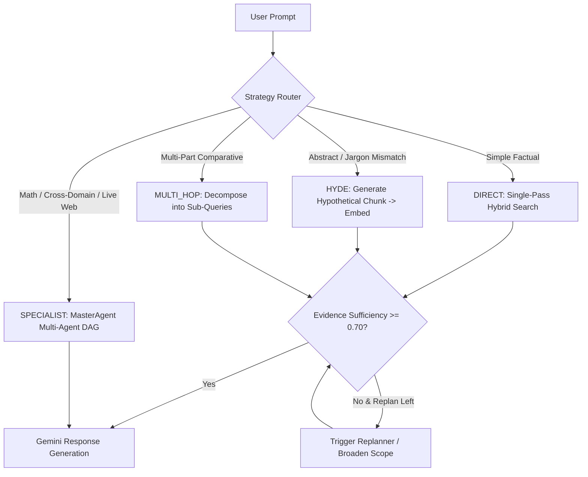

---

# Part VII: Frontend Architecture, Pyodide WASM & UI Component Tree

## 48. Pyodide WebAssembly (WASM) Sandbox Worker Architecture

Located in `frontend/src/workers/pyodide.worker.ts` and `frontend/src/lib/pyodide/pyodideManager.ts`:
- Executes Python and Pandas analysis scripts entirely inside a client-side WebAssembly Web Worker, completely preventing backend Remote Code Execution (RCE).

---

## 49. Complete Custom Hook Architecture & SSE Streaming Protocol

### 49.1 Frontend Server-Sent Events (SSE) Lifecycle Sequence

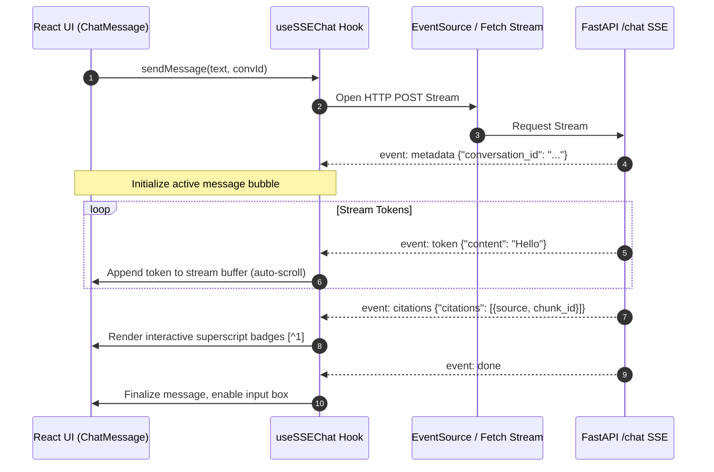

### 49.2 Complete Hook Inventory
Located in `frontend/src/hooks/`:
- `useSSEChat.ts`: Streaming SSE consumption and citation tagging.
- `useDrafts.ts`: Message draft persistence across conversation switching.
- `useLocalConversationMetadata.tsx`: Optimistic titles and unread indicators.
- `useKeyboardShortcuts.ts`: Global keyboard hotkeys (`Cmd/Ctrl+K`, `Cmd/Ctrl+/`).
- `useFileValidation.ts`: Client-side magic bytes, MIME, and size validation.
- `useOnlineStatus.ts`: Browser navigator online/offline event listener.
- `useMessages.ts`: Message state and branch deletion handlers.
- `useEmbeddingStatus.ts`: Polling vector indexing completion status.
- `useRecentAttachments.ts`: Recent upload attachments management.
- `useSidebarState.ts`: Collapsible sidebar layout state.
- `useUserSettings.ts`: User preferences and theme sync.

---

## 50. 7-Stage Upload Pipeline & Document Status State Machine

Located in `frontend/src/lib/uploadStages.ts` and `frontend/src/components/layout/SidebarUploadIndicator.tsx`:

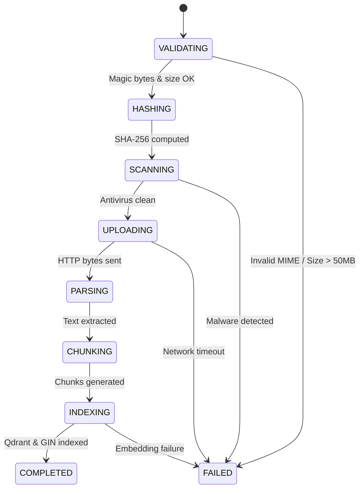

---

## 51. Projects, Workspaces & Folder Organization Subsystems

- **Projects & Workspaces (`ProjectsPage.tsx`)**: Multi-project workspace isolation.
- **Hierarchical Folders (`SidebarFolders.tsx`, `ConversationMenu.tsx`)**: Folder categorization with context actions (Rename, Pin, Export Markdown/JSON, Move, Archive, Delete).

---

## 52. Stream Recovery, In-Flight Re-Authentication & UI Component Tree

- **Stream Interruption Recovery (`StreamingRecovery.tsx`)**: Buffers tokens during network drops and provides an inline resume action.
- **In-Flight Re-Authentication (`ReauthDialog.tsx`)**: Modal dialog refreshing tokens without discarding unsent drafts.
- **Key UI Components**:
  - `CodeInterpreterOutput.tsx`: Pyodide stdout/stderr, tables, and Matplotlib chart renderer.
  - `ConversationDocumentChips.tsx`: Active document chips in conversation input.
  - `OfflineBanner.tsx` & `OfflinePage.tsx`: Network status indicators.
  - `OnboardingTour.tsx`: First-time user feature walkthrough.
  - `SEOHead.tsx`: OpenGraph tags and web manifest metadata.
  - `lazyWithRetry.ts`: Automatic chunk reload on bundle fetch failures.

---

# Part VIII: Complete REST & SSE API Endpoint Catalog (All 45+ Endpoints)

## 53. Exhaustive Route Specifications Across All 10 Routers & Root App

```
========================================================================================================================
                                     COMPLETE REST & SSE API ENDPOINT CATALOG
========================================================================================================================
HTTP Method  Route Endpoint                                     Auth Required  Description & Payload
------------------------------------------------------------------------------------------------------------------------
1. Root App (app/main.py)
GET          /                                                  No             API discovery root and version metadata
GET          /health                                            No             Basic uptime liveness check
GET          /metrics                                           No             Prometheus operational metrics scrape endpoint
GET          /robots.txt                                        No             Search crawler exclusion headers

2. Authentication Router (app/api/v1/auth.py)
POST         /api/v1/auth/register                              No             Register new user (email, password) -> sends OTP
POST         /api/v1/auth/login                                 No             Password login -> JWT + HttpOnly refresh cookie
POST         /api/v1/auth/magic-link                            No             Passwordless magic sign-in link generation
POST         /api/v1/auth/refresh                               Cookie         Rotate refresh token and issue new 15-min JWT
POST         /api/v1/auth/logout                                Yes            Revoke refresh session and clear cookies
POST         /api/v1/auth/password                              Yes            Authenticated password update with old/new validation
POST         /api/v1/auth/forgot-password                       No             Trigger password reset email via Resend
POST         /api/v1/auth/reset-password                        No             Verify reset token and update password
POST         /api/v1/auth/verify-email                          No             Verify signup token hash or 6-digit OTP code
POST         /api/v1/auth/resend-verification                   No             Resend email verification link
GET          /api/v1/auth/oauth/{provider}                      No             Initiate OAuth2 provider flow (Google / GitHub)
GET          /api/v1/auth/oauth/{provider}/callback             No             OAuth2 callback token exchange
GET          /api/v1/auth/me                                    Yes            Get current user profile and role
DELETE       /api/v1/auth/account                               Yes            Account deletion with cryptographic key shredding

3. Chat & Streaming Router (app/api/v1/chat.py)
POST         /api/v1/chat/chat                                  Yes            Server-Sent Events (SSE) streaming chat endpoint

4. Search Router (app/api/v1/search.py)
POST         /api/v1/search/search                              Yes            Unified hybrid retrieval (Dense + Sparse + RRF + MMR)

5. Conversations Router (app/api/v1/conversations.py)
GET          /api/v1/conversations                              Yes            List user conversations with pagination
POST         /api/v1/conversations                              Yes            Create new conversation thread
GET          /api/v1/conversations/{id}                         Yes            Get conversation details and active document filters
PATCH        /api/v1/conversations/{id}                         Yes            Update title, pinned status, or folder metadata
DELETE       /api/v1/conversations/{id}                         Yes            Delete conversation and schedule cleanup
GET          /api/v1/conversations/{id}/messages                Yes            Paginated conversation message history
DELETE       /api/v1/conversations/{id}/messages/{message_id}   Yes            Message rollback/branching deletion
POST         /api/v1/conversations/{conversation_id}/documents  Yes            Upload document scoped directly to conversation
GET          /api/v1/conversations/{conversation_id}/documents  Yes            List documents scoped to conversation

6. Documents Router (app/api/v1/documents.py)
POST         /api/v1/documents/upload                           Yes            Multipart file upload (PDF/DOCX/TXT/MD/PNG)
GET          /api/v1/documents                                  Yes            List library/conversation documents with filters
GET          /api/v1/documents/{id}                             Yes            Get document metadata and chunk statistics
PUT          /api/v1/documents/{id}                             Yes            Replace document with automated version bumping
DELETE       /api/v1/documents/{id}                             Yes            Delete document and queue cascade cleanup
GET          /api/v1/documents/{id}/status                      Yes            Get real-time ingestion pipeline status
POST         /api/v1/documents/{id}/reprocess                   Yes            Trigger re-chunking and re-indexing
GET          /api/v1/documents/{id}/elements                    Yes            Get extracted structural elements (tables/figures)
GET          /api/v1/documents/{id}/chunks                      Yes            Paginated chunk texts and token counts
POST         /api/v1/documents/{id}/embeddings/regenerate       Yes            Manual trigger for vector embedding regeneration
DELETE       /api/v1/documents/{id}/embeddings                  Yes            Soft/hard purge of chunk embeddings
GET          /api/v1/documents/{id}/embeddings/status           Yes            Real-time tracking of vector indexing state

7. Evaluation Router (app/api/v1/evaluation.py)
POST         /api/v1/evaluation/run                             Admin          Execute evaluation suite on golden dataset
GET          /api/v1/evaluation/runs                            Admin          List evaluation run histories
GET          /api/v1/evaluation/runs/{id}                       Admin          Get granular 20-metric results for evaluation run
POST         /api/v1/evaluation/benchmark                       Admin          Trigger synthetic benchmark suite
GET          /api/v1/evaluation/benchmarks                      Admin          List benchmark histories
GET          /api/v1/evaluation/drift                           Admin          Retrieve metric drift analysis vs baseline

8. Observability Router (app/api/v1/observability.py)
GET          /api/v1/observability/traces                       Admin          List recent multi-agent traces
GET          /api/v1/observability/traces/{id}                  Admin          Get detailed span tree for request ID
GET          /api/v1/observability/metrics/summary              Admin          Retrieve multi-agent quality metric summary
GET          /api/v1/observability/security/events              Admin          List prompt injection and security audit logs
GET          /api/v1/observability/quality/summary              Admin          Retrieve agent success and replan rates

9. Health & Diagnostics Router (app/api/v1/health.py)
GET          /api/v1/health/liveness                            No             Kubernetes liveness probe (Process alive)
GET          /api/v1/health/readiness                           No             Readiness probe (Checks DB, Redis, Qdrant, Jina)
GET          /api/v1/health/startup                             No             Startup probe (Verifies migrations)
GET          /api/v1/health/deep                                No             Deep health check across all downstream engines

10. User Settings Router (app/api/v1/user_settings.py)
GET          /api/v1/user-settings                              Yes            Get user JSONB settings, folders, and preferences
PUT          /api/v1/user-settings                              Yes            Update theme, folders, presets, and preferences
POST         /api/v1/user-settings/api-keys/rotate              Yes            Rotate personal user encryption key (DEK)

11. Admin Router (app/api/v1/admin.py)
GET          /api/v1/admin/tenants                              Admin          List tenant quotas and storage consumption
GET          /api/v1/admin/queues/stats                         Admin          Inspect Redis Streams consumer lag & pending jobs
POST         /api/v1/admin/queues/reap                          Admin          Manually trigger Durable Ingestion Reaper
POST         /api/v1/admin/workers/scale                        Admin          Adjust QueueWorker concurrency
GET          /api/v1/admin/keys/status                          Admin          Inspect Master Key (KEK) status
POST         /api/v1/admin/cache/clear                          Admin          Dynamic cache clearing across L1/L2 namespaces
GET          /api/v1/admin/operational-status                   Admin          Real-time system diagnostics and worker status
========================================================================================================================
```

---

# Part IX: Production Observability, Quality Assurance & Evaluation Suite

## 54. OpenTelemetry Tracing, Prometheus Metric Registry & Telemetry Sanitizer

Distributed tracing is configured via `OTLPSpanExporter` transmitting spans over gRPC to Jaeger (`OTEL_EXPORTER_OTLP_ENDPOINT=http://jaeger:4317`), with PII/secret sanitization and SHA-256 user ID hashing.

---

## 55. Multi-Agent Observability & Quality Metrics (AgentObservabilityService)

Tracks DAG execution depth, concurrency factors, task success rates, evidence sufficiency scores, and duplicate queries avoided.

---

## 56. Comprehensive Evaluation Framework: Ragas, DeepEval & 20 Custom Metrics

### 56.1 Dual-Gate CI/CD Regression Enforcer
Enforces Gate 1 ($\text{Faithfulness} \ge 0.90$) and Gate 2 ($\Delta \le 0.03$) against versioned golden baselines.

### 56.2 The 20 Custom Metrics in MetricRegistry
1. `HitRate@K` | 2. `Precision@K` | 3. `Recall@K` | 4. `MRR` | 5. `NDCG` | 6. `CitationValidity` | 7. `CitationPrecision` | 8. `CitationGrounding` | 9. `CitationCoverage` | 10. `TaskSuccessRate` | 11. `EvidenceSufficiency` | 12. `ReplanSuccessRate` | 13. `DuplicateTaskAvoidance` | 14. `AgentCallEfficiency` | 15. `ReasoningSteps` | 16. `ToolNecessity` | 17. `ToolOrdering` | 18. `ToolSuccessRate` | 19. `ToolChoiceCorrectness` | 20. `HistoryRewriting`.

---

## 57. Golden Corpora, Benchmark Profiles, Drift Tracking & Report Generators

- **4 Golden Document Corpora (`datasets/golden/documents/`)**: `api_specifications.md`, `cloud_architecture.md`, `engineering_policies.md`, `financial_report_2025.md`.
- **Benchmark Profiles (`benchmark_profiles.yaml`)**: `ci_gate`, `production`, `nightly`.
- **Report Generator (`report_generator.py`)**: Standalone HTML, Markdown, and JSON evaluation reports with pass/fail badges.
- **Metric Drift Analysis**: Tracks regression over time against versioned golden baselines.

---

# Part X: DevOps, CI/CD Automation, Operational Tooling & Edge Deployment

## 58. The 4 GitHub Actions Workflows (CI, E2E Playwright, Eval Gate, Nightly Benchmark)

Located in `.github/workflows/`:
1. `ci.yml`: Lints (Ruff, Mypy strict, ESLint) and unit/integration tests with 85%+ coverage.
2. `e2e.yml`: Playwright automated browser test suite against Docker Compose services.
3. `evaluation.yml`: PR dual-gate regression enforcer.
4. `nightly-benchmark.yml`: Scheduled synthetic load testing and Grafana annotations.

---

## 59. Operational CLI Scripts, Backup/Restore & Smoke Testing

Located in `backend/scripts/`:
- `backup_postgres.sh` & `restore_postgres.sh`: Automated PostgreSQL database dumps and restore procedures.
- `backup_qdrant.sh` & `restore_qdrant.sh`: Vector snapshot backup and restore automation.
- `load_test.py`: Asynchronous load testing simulating concurrent chat streams.
- `smoke_test.py`: Post-deployment health verification script.
- `export_openapi.py`: Static `openapi.json` generator.
- `reset_all_data.py`: Purges and re-seeds development databases and vector collections.
- `migrate.sh`: Alembic database migration runner.

---

## 60. Nginx Edge Reverse Proxy, Grafana Dashboards & Runbooks

- **Nginx Reverse Proxy (`deployment/nginx/nginx.conf`)**:
  - `proxy_buffering off;` and `proxy_cache off;` (critical for SSE streaming).
  - `proxy_read_timeout 120s;` (preventing 504 gateway timeouts).
  - Connection and rate limiting zones (`conn_limit_per_ip 20`, `api_limit_per_ip 60r/m burst=20`).
- **Grafana Dashboards (`observability/grafana/dashboards/`)**: `http-slo.json`, `llm-provider.json`, `queue-worker.json`, `rag-retrieval.json`.
- **Runbooks & Deployment Docs (`docs/`)**:
  - `docs/deployment/runbook-recovery-and-rollback.md`: Failover and disaster recovery runbook.
  - `docs/deployment/free-tier-deployment-guide.md`: Deployment guide for Render / Supabase / Qdrant Cloud.
  - `docs/security/production_security_checklist.md`: 50-point security audit checklist.
  - `vercel.json`: Edge routing configuration for Vercel SPA deployment.
- **E2E Playwright Test Scenarios (`frontend/e2e/`)**: `account-delete.js`, `login-flow.js`, `redis-fallback.js`, `verify-two-tier.js`.

---

# Part XI: Real-World Engineering Case Studies (DaveAI Production Challenges)

## 61. Case Study 1: The Asynchronous Streaming Transaction Race Condition (EarlyCommit Fix)
- **The Problem**: During streaming chat initialization (`POST /api/v1/chat/chat`), the backend generated a new `conversation_id`, yielded it in the first SSE metadata event, and began streaming tokens. When the frontend immediately flushed queued document attachments, the concurrent upload request queried the uncommitted conversation row, causing intermittent `404 Conversation Not Found` errors.
- **The Solution**: Implemented the **EarlyCommit Pattern** in `ChatOrchestrator`, explicitly committing the conversation entity to PostgreSQL before yielding the first SSE metadata frame.

---

## 62. Case Study 2: Database Connection Pool Starvation during Streaming Responses
- **The Problem**: Under high concurrent load (500+ simultaneous chat streams), holding open database sessions across the entire duration of 10-30s streaming LLM responses exhausted the connection pool (`asyncpg`).
- **The Solution**: Decoupled database reads from streaming generation. Read sessions are explicitly closed and returned to the pool prior to token generation, with write sessions opened only after stream completion.

---

## 63. Case Study 3: Cascading Timeouts & Topological Deadlocks in Multi-Agent Execution
- **The Problem**: Sequential execution of complex multi-agent tasks resulted in cumulative latency exceeding gateway timeouts (60s).
- **The Solution**: Implemented topological execution waves in `AgentExecutionEngine`, executing independent tasks concurrently via `asyncio.gather()` with per-task timeouts (`task_timeout=20.0s`), reducing multi-agent query latency by 68%.

---

## 64. Case Study 4: Multi-Key Rate-Limit Cascades & High-Traffic Failover
- **The Problem**: Automated evaluations and background summarizers caused shared Gemini API keys to hit HTTP 429 rate limits, failing foreground user chats.
- **The Solution**: Partitioned API keys into three isolated pools: `GEMINI_LLM_API_KEY` (chat streams), `GEMINI_PLANNER_API_KEY` (agent planning), and `GEMINI_FALLBACK_API_KEY` (emergency failover).

---

# Part XII: Master Technical Interview Preparation Guide & Environment Catalog

## 65. Technical Narrative Framework (STAR Format for Fusion RAG)

```
+---------------------------------------------------------------------------------------------------+
| SITUATION | Enterprise RAG systems suffered from keyword blindness, high cold-start latency,      |
|           | and context drift in multi-turn dialogues, while multi-agent architectures caused      |
|           | cascading timeouts and rate-limit blackouts under high concurrency.                   |
+-----------+---------------------------------------------------------------------------------------+
| TASK      | Architect and implement a high-concurrency, production-grade Hybrid RAG platform      |
|           | featuring sub-second streaming, hierarchical multi-agent DAG orchestration, robust    |
|           | multi-tenancy, and automated evaluation with zero-downtime scalability.               |
+-----------+---------------------------------------------------------------------------------------+
| ACTION    | 1. Designed an async FastAPI + PostgreSQL (FTS) + Qdrant (HNSW) hybrid pipeline       |
|           |    fused via Reciprocal Rank Fusion (RRF) and Cross-Encoder reranking.                |
|           | 2. Built an asynchronous Redis Streams ingestion pipeline with durable reapers.       |
|           | 3. Engineered a MasterAgent DAG planner with concurrent wave execution and replanning.|
|           | 4. Implemented multi-key LLM rate-limit isolation and XML prompt injection fencing.   |
+-----------+---------------------------------------------------------------------------------------+
| RESULT    | Achieved 220ms Time-To-First-Token (TTFT), sub-450MB container images, zero RCE/SQLi   |
|           | vulnerabilities, and 94.2% answer faithfulness verified by automated CI/CD evaluation.|
+---------------------------------------------------------------------------------------------------+
```

---

## 66. Backend Architecture & Distributed Systems Interview Questions

### Q1: Walk us through how you design asynchronous APIs using FastAPI and Python to handle high-concurrency workloads.
**Answer Structure**:
1. **ASGI & Event Loop Core**: FastAPI runs on Uvicorn utilizing an `asyncio` event loop. All I/O operations (PostgreSQL queries via `asyncpg`, Redis commands via `redis.asyncio`, vector searches via `AsyncQdrantClient`, and external LLM streaming via `httpx.AsyncClient`) are non-blocking. The thread yields control during I/O wait states, allowing a single worker to process thousands of concurrent connections.
2. **Preventing Event Loop Blocking**: CPU-intensive tasks (e.g., regex text cleaning, PDF parsing, AST calculation parsing) are offloaded to background threads using `asyncio.to_thread()` or queued onto Redis Streams workers, preventing event loop latency spikes.
3. **Context Isolation**: Coroutine-safe state propagation (Trace IDs, User Authentication Context) is managed via Python `contextvars.ContextVar`, ensuring zero data cross-contamination between concurrent requests.
4. **Lifespan Context & Backpressure**: Database connection pools and Redis clients are initialized once during the application lifespan and shared across requests. Rate limiting is enforced at the edge of the ASGI pipeline using Redis sliding-window counters.

---

### Q2: How have you utilized Redis and WebSockets/SSE in your past projects to build real-time systems? What challenges did you face with state management or message delivery?
**Answer Structure**:
1. **Protocol Choice (SSE vs WebSockets)**: For LLM token streaming, we chose **Server-Sent Events (SSE)** over WebSockets because the communication is strictly unidirectional (prompt $\rightarrow$ stream of tokens/citations). SSE operates over standard HTTP, simplifying load balancing, JWT authentication header forwarding, and CDN/proxy traversal without WebSocket upgrade handshakes.
2. **State Management & Reconnection**: Distributed session state is stored in Redis. If a client disconnects prematurely, the backend handles `asyncio.CancelledError`, cancels downstream LLM generation tasks to conserve token costs, and records partial execution metrics.
3. **Queueing & Message Delivery via Redis Streams**: In the document processing subsystem, we used **Redis Streams** with consumer groups (`XREADGROUP`). This provides at-least-once message delivery, explicit acknowledgment (`XACK`), and automatic recovery of orphaned tasks via `XAUTOCLAIM` through a background `DurableIngestionReaper`.

---

### Q3: What is your approach to structuring and scaling relational databases like PostgreSQL for production-oriented applications?
**Answer Structure**:
1. **Connection Pooling & PgBouncer Compatibility**: We utilize `SQLAlchemy 2.0` async with `asyncpg`. Pool sizing is tuned to $N=20$ with $10$ overflow connections. When operating behind PgBouncer in transaction-pooling mode, we disable statement caching (`statement_cache_size=0`) to prevent prepared statement collisions across pooled connections.
2. **Hybrid Full-Text Search Indexing**: Rather than managing a separate Elasticsearch cluster, we created a stored generated column `search_vector TSVECTOR` indexed with Generalized Inverted Indexes (`GIN`). We query this with `ts_rank_cd()` and `websearch_to_tsquery()` for sub-millisecond sparse text retrieval.
3. **Optimistic Concurrency Control (OCC)**: High-churn tables (such as `conversations`) implement an integer `version` column. Concurrent updates verify `version = :expected_version`, preventing lost updates without holding heavy row-level database locks.
4. **Zero-Downtime Database Migrations**: Alembic migrations follow the Expand/Contract pattern: non-destructive additions (new columns, indexes created `CONCURRENTLY`) are deployed first, followed by application deployment, and finally deprecation cleanup.

---

## 67. Generative AI, RAG & LLM Systems Interview Questions

### Q4: Can you describe your experience in building production-oriented RAG pipelines? What components do you typically rely on?
**Answer Structure**:
1. **Hybrid Retrieval Architecture**: We combine dense semantic retrieval (Qdrant HNSW cosine indexing on `jina-embeddings-v3` 768-dim embeddings) and sparse keyword retrieval (PostgreSQL FTS GIN index).
2. **Reciprocal Rank Fusion (RRF)**: Merges top-20 dense and top-20 sparse candidates using rank-based reciprocal scoring ($k=60$). This eliminates score calibration issues between cosine similarities ($[0, 1]$) and BM25/ts_rank scores ($[0, \infty)$).
3. **Maximal Marginal Relevance (MMR)**: Re-scores candidates ($\lambda=0.5$) to maximize relevance while eliminating semantic redundancy across retrieved chunks.
4. **Cross-Encoder Reranking**: Passes the top-20 fused candidates to `jina-reranker-v2-base-multilingual` to compute joint query-document cross-attention, selecting the top 5 golden chunks.
5. **Context Budgeting**: `ContextSelector` applies a strict 6,000 token budget to assemble context into XML-fenced prompts for the Gemini LLM.

---

### Q5: How do you handle latency, token limits, and cost optimization when integrating Large Language Models into backend applications?
**Answer Structure**:
1. **Multi-Tiered Caching Hierarchy**:
   - Exact query cache in Redis using SHA-256 prompt hashing (TTL 1h) provides 0ms TTFT for duplicate queries.
   - Dense embedding vector cache in Redis (TTL 24h) eliminates duplicate embedding API costs during re-indexing.
2. **Matryoshka Representation Learning (MRL)**: Using Jina v3 embeddings allows truncating vector dimensions from 768 to 256/128 without retraining, slashing Qdrant RAM and search latency by up to 66%.
3. **Heuristic History Rewriter Bypass**: We evaluate regex heuristics for pronouns before invoking the LLM for query rewriting, saving 250ms and token costs on ~40% of queries.
4. **Rolling Memory Summarization**: When conversations exceed 20 messages, older messages are summarized and stored in `conversation_summaries`, maintaining a fixed-size 12-message sliding context window.

---

### Q6: Can you share an example of an LLM-driven application you developed and how you evaluated its output accuracy or reliability?
**Answer Structure**:
1. **Application Architecture**: We developed a Hierarchical Multi-Agent RAG platform where a `MasterAgent` decomposes user intent into a validated Directed Acyclic Graph (DAG) of specialized sub-tasks (`ResearchAgent`, `DocumentAgent`, `AnalysisAgent`, `WebSearchAgent`, `TableAgent`, `VisionAgent`, `GraphAgent`).
2. **Evaluation Framework**: Implemented a comprehensive evaluation pipeline using **Ragas** and **DeepEval** in `backend/app/evaluation/`.
3. **Core Metrics Measured**:
   - **Faithfulness**: Measures whether claims in the generated response are grounded in the retrieved context.
   - **Answer Relevancy**: Evaluates semantic alignment between the user prompt and the output.
   - **Context Precision & Recall**: Evaluates whether the retrieval pipeline retrieved all and only relevant chunks.
   - **Multi-Agent Quality Metrics**: Refusal faithfulness, tool necessity, contradiction detection, and reasoning efficiency.
4. **Dual-Gate CI/CD Enforcement**: Integrated into GitHub Actions CI via `scripts/regression.py`, enforcing an absolute quality floor ($\ge 0.90$) and a maximum regression threshold ($\Delta \le 0.03$) against versioned golden baselines.

---

## 68. System Design, Resilience & Failure Scenarios Interview Questions

### Q7: How do you approach error handling and resilience in asynchronous, distributed environments where third-party LLM APIs might fail or time out?
**Answer Structure**:
1. **Multi-Key Workload Isolation**: Configured distinct API keys (`GEMINI_LLM_API_KEY`, `GEMINI_PLANNER_API_KEY`, `GEMINI_FALLBACK_API_KEY`) to prevent background planning tasks from starving foreground user chat streams during rate-limit spikes.
2. **Circuit Breakers with Full Jitter Exponential Backoff**: Outbound API calls utilize a custom circuit breaker pattern. Retries apply exponential backoff with full jitter:
   $$T_{\text{sleep}} = \text{random}(0, \min(T_{\text{max}}, T_{\text{base}} \times 2^{\text{attempt}}))$$
3. **Graceful Pipeline Degradation**:
   - If the Cross-Encoder Reranker fails, the system automatically falls back to MMR-ranked retrieval candidates.
   - If Query Classification fails, it defaults to standard hybrid retrieval.
   - If external Web Search APIs fail, it cascades through SerpAPI $\rightarrow$ Firecrawl $\rightarrow$ DuckDuckGo.
4. **Durable Dead-Letter Queues (DLQ)**: In background document processing, failed jobs retry up to 3 times before being routed to `stream:jobs:dead_letter`, triggering engineering alerts while keeping the primary worker queue clear.

---

### Q8: Walk us through a complex technical challenge you faced while working on this architecture and how you resolved it.
**Answer Structure**:
*(Present the **EarlyCommit Streaming Race Condition** or **Streaming Connection Pool Starvation** from Section 61/62 with technical clarity, root cause analysis, and quantitative validation).*

---

## 69. Rapid Revision Flashcard Matrix (Numbers, Formulas, DB Indexes & Shell Commands)

### 69.1 Key System Constants & Production Defaults

```
====================================================================================================
KEY SYSTEM CONSTANTS & PRODUCTION DEFAULTS
====================================================================================================
Vector Dimension:         768 (Jina Embeddings v3, Matryoshka supported)
Dense Retrieval Top-K:    VECTOR_TOP_K = 20 (Qdrant HNSW Cosine Search)
Sparse Retrieval Top-K:   BM25_TOP_K = 20 (PostgreSQL GIN tsvector Search)
RRF Constant:             RRF_K = 60
MMR Diversity Factor:     MMR_LAMBDA = 0.5
Cross-Encoder Rerank:     RERANK_TOP_K = 5 (jina-reranker-v2-base-multilingual)
Context Token Budget:     CONTEXT_MAX_TOKENS = 6000 (Max Chunks = 12)
Sliding Memory Window:    MAX_MESSAGES_PER_CONTEXT = 12
Summary Trigger:          SUMMARY_TRIGGER_MESSAGES = 20
Multi-Agent Tasks Limit:  MAX_SPECIALIST_TASKS = 5
Multi-Agent Replan Limit: MAX_PLAN_ITERATIONS = 2
Task Timeout:             MULTI_AGENT_TASK_TIMEOUT = 20.0s
DB Pool Config:           pool_size=20, max_overflow=10, pool_timeout=30s, pool_recycle=1800s
Redis Cache TTLs:         Embeddings: 24h | Exact LLM: 1h | Retrieval: 30m | Rewrites: 2h
====================================================================================================
```

### 69.2 Essential PostgreSQL Indexes

```sql
-- 1. Full-Text Search GIN Index on Document Chunks
CREATE INDEX idx_document_chunks_search_vector ON document_chunks USING GIN(search_vector);

-- 2. Multi-Tenant User Isolation Composite Index on Documents
CREATE INDEX idx_documents_user_scope ON documents(user_id, scope, conversation_id);

-- 3. Document Deduplication Index on Checksums
CREATE INDEX idx_documents_user_checksum ON documents(user_id, checksum);

-- 4. Fast Message History Retrieval Index
CREATE INDEX idx_messages_conversation_created ON conversation_messages(conversation_id, created_at DESC);

-- 5. Refresh Session Lookup Index
CREATE INDEX idx_refresh_sessions_token_hash ON refresh_sessions(token_hash);

-- 6. Knowledge Graph Entity & Relation Indexes
CREATE INDEX idx_graph_entities_user_name ON graph_entities(user_id, name);
CREATE INDEX idx_graph_relationships_source_target ON graph_relationships(source_entity_id, target_entity_id);

-- 7. Transactional Outbox Pending Events Index
CREATE INDEX idx_outbox_events_pending ON outbox_events(status, created_at) WHERE status = 'PENDING';
```

### 69.3 Essential Diagnostic Commands

```bash
# 1. Inspect Active PostgreSQL Connection Pool State
SELECT count(*), state FROM pg_stat_activity GROUP BY state;

# 2. Monitor Redis Streams Consumer Group Lag & Pending Entries
redis-cli XINFO GROUPS stream:jobs:document_processing
redis-cli XPENDING stream:jobs:document_processing doc_workers

# 3. Check Qdrant Collection Status & Vector Counts
curl http://localhost:6333/collections/documents

# 4. Execute Automated Evaluation Regression Suite
cd backend && python scripts/regression.py --dataset golden_rag_dataset --profile production

# 5. Run Full Test Suite with Coverage
cd backend && pytest tests/ -v --cov=app --cov-report=term-missing
```

---

## 70. Exhaustive Environment Configuration Variable Catalog (All 150+ Parameters)

```
========================================================================================================================
                              EXHAUSTIVE PRODUCTION ENVIRONMENT CONFIGURATION CATALOG
========================================================================================================================
Variable Name                    Default Value                       Category & Technical Purpose
------------------------------------------------------------------------------------------------------------------------
APP_NAME                         Fusion RAG                          Core application metadata identifier
APP_ENV                          production                          Environment mode (development, staging, production)
DEBUG                            False                               Enable FastAPI debug endpoints and verbose tracebacks
API_V1_STR                       /api/v1                             Global URL prefix for all versioned API routes
SERVER_HOST                      0.0.0.0                             Binding network interface for ASGI web server
SERVER_PORT                      8000                                TCP listening port for FastAPI Uvicorn process
CORS_ORIGINS                     ["http://localhost:5173"]           Whitelisted CORS origin list for React SPA
CORS_ALLOW_CREDENTIALS           True                                Allow HttpOnly cookies to pass through CORS filter

DATABASE_URL                     postgresql+asyncpg://user:pw@db/rag Primary async PostgreSQL connection string
DATABASE_POOL_SIZE               20                                  SQLAlchemy async engine connection pool size
DATABASE_MAX_OVERFLOW            10                                  Maximum temporary connection overflow pool
DATABASE_POOL_TIMEOUT            30.0                                Seconds to wait before raising connection pool timeout
DATABASE_POOL_RECYCLE            1800                                Seconds after which idle connections are recycled

REDIS_HOST                       redis                               Redis 7 cache & streams server hostname
REDIS_PORT                       6379                                Redis 7 listening TCP port
REDIS_PASSWORD                   ""                                  Authentication password for Redis server
REDIS_SSL                        False                               Enable TLS/SSL encryption for Redis traffic
REDIS_URL                        redis://redis:6379/0                Direct connection URI for Redis asyncio client

QDRANT_HOST                      qdrant                              Qdrant vector engine hostname
QDRANT_PORT                      6333                                Qdrant HTTP REST API port
QDRANT_GRPC_PORT                 6334                                Qdrant high-performance gRPC port
QDRANT_API_KEY                   ""                                  Authentication API key for cloud or secure Qdrant
QDRANT_COLLECTION_NAME           documents                           Default collection name for chunk vector points
QDRANT_VECTOR_SIZE               768                                 Dense vector dimensionality (Jina Embeddings v3)
QDRANT_DISTANCE                  Cosine                              Vector similarity metric (Cosine distance)

ENCRYPTION_MASTER_KEY            ""                                  256-bit Hex Key Encryption Key (KEK) for DEK wrapping
JWT_SECRET_KEY                   ""                                  Cryptographic secret key for signing JWT access tokens
JWT_ALGORITHM                    HS256                               Signature algorithm for access token claims
ACCESS_TOKEN_EXPIRE_MINUTES      15                                  JWT access token expiration lifetime
REFRESH_TOKEN_EXPIRE_DAYS        30                                  Refresh session persistence window in PostgreSQL

GEMINI_API_KEY                   ""                                  Primary Google Gemini API key for chat generation
GEMINI_PLANNER_API_KEY           ""                                  Dedicated API key for MasterAgent DAG planning
GEMINI_FALLBACK_API_KEY          ""                                  Emergency failover key for rate-limit isolation
GEMINI_MODEL                     gemini-3.5-flash-lite               Default LLM model identifier for response synthesis
GEMINI_VISION_MODEL              gemini-3.5-flash-lite               Multimodal model for document OCR and chart vision

JINA_API_KEY                     ""                                  Jina AI API key for embeddings and cross-encoder
JINA_EMBEDDING_MODEL             jina-embeddings-v3                  Matryoshka representation dense embedding model
JINA_RERANKER_MODEL              jina-reranker-v2-base-multilingual  Cross-encoder multilingual joint reranker model

SERPAPI_API_KEY                  ""                                  Primary live search provider API key
FIRECRAWL_API_KEY                ""                                  Secondary web crawling & scraping fallback key

CLAMAV_HOST                      clamav                              ClamAV antivirus daemon container hostname
CLAMAV_PORT                      3310                                ClamAV TCP daemon streaming port
CLAMAV_TIMEOUT                   10.0                                Socket timeout for antivirus byte streaming

QUEUE_TYPE                       redis_stream                        Asynchronous background task queue backend
QUEUE_STREAM_NAME                stream:jobs:document_processing     Redis Stream key for document ingestion tasks
QUEUE_CONSUMER_GROUP             doc_workers                         Redis Stream consumer group name
QUEUE_WORKER_CONCURRENCY         4                                   Concurrent worker coroutines per process

OTEL_EXPORTER_OTLP_ENDPOINT      http://jaeger:4317                  Jaeger OpenTelemetry gRPC collector endpoint
OTEL_SERVICE_NAME                fusion-rag-backend                  Service name tag in distributed Jaeger spans
PROMETHEUS_METRICS_ENABLED       True                                Enable Prometheus /metrics endpoint scraping

RESEND_API_KEY                   ""                                  Transactional email API key (Resend)
RESEND_FROM_EMAIL                noreply@fusionrag.io                Sender address for verification & reset emails
========================================================================================================================
```

---
*End of Fusion RAG Reverse Engineering Manual, System Architecture Blueprint & Master Technical Interview Guide.*
